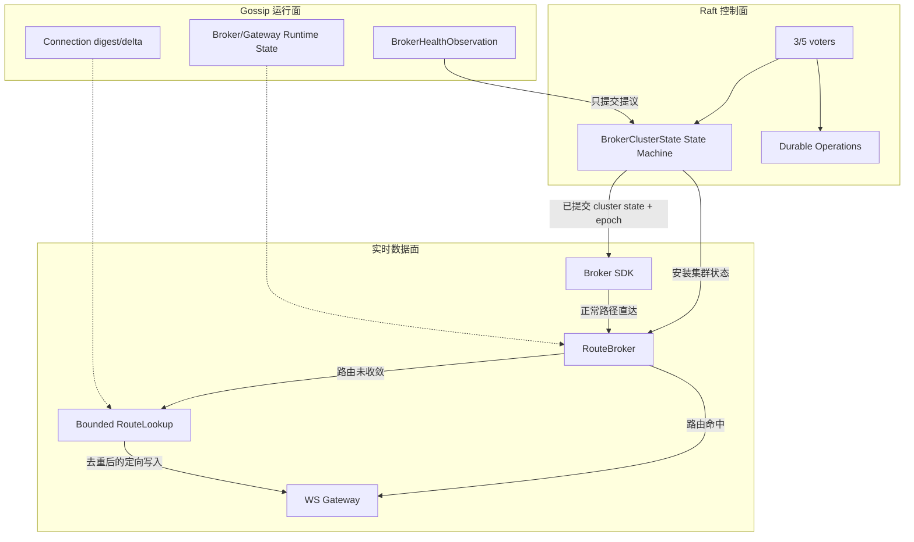
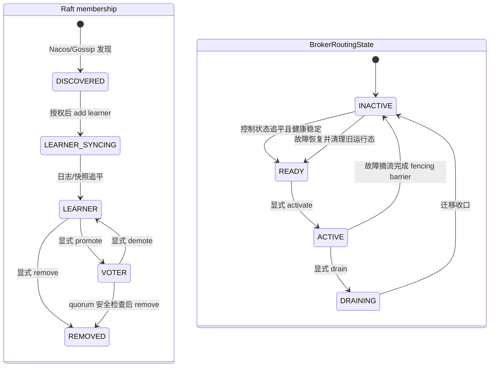
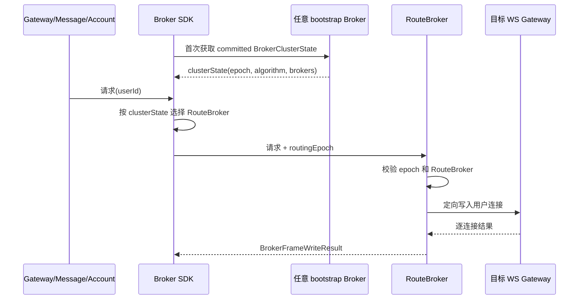
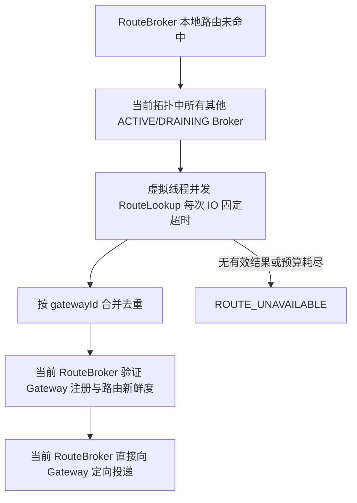
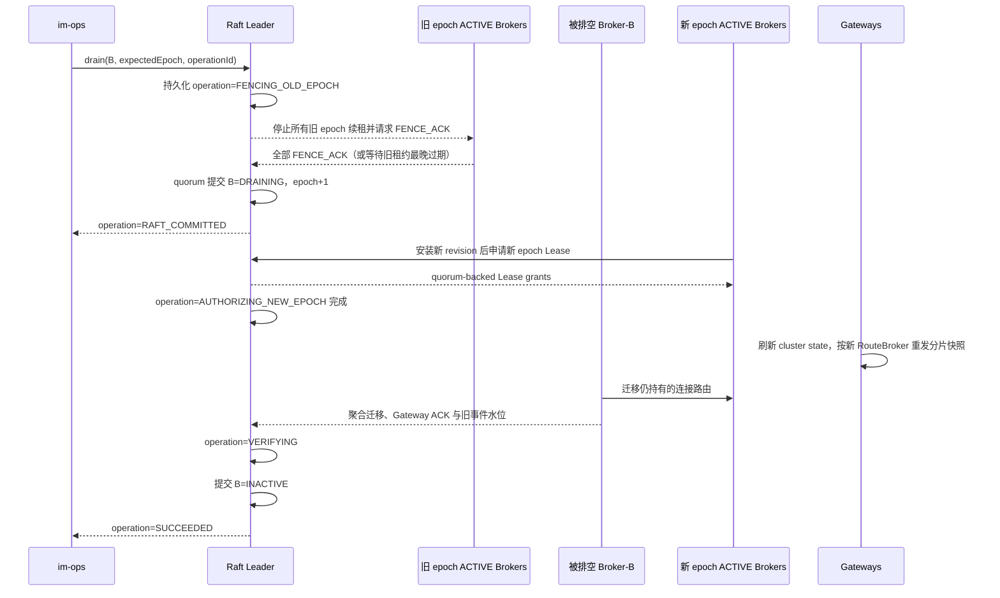

# Broker 权威集群状态与高可用路由切换设计

> 状态：原设计已批准，四轮独立 Review 结论为 `Approved`。2026-10-08 用户确认 D17/D18 增量调整为查询当前所有可路由 Broker、专用虚拟线程并发、每个 peer IO 独立超时；代码/集成范围已独立复评 `Accept`，不替代生产容量验收。实施状态见 [`2026-09-20-broker-routing-consensus`](../exec-plans/completed/2026-09-20-broker-routing-consensus.md)，容量见[独立计划](../exec-plans/active/2026-10-10-broker-routing-capacity.md)。

## 摘要

本设计把 Broker 的低频权威决策与高频运行观察分开：成熟 Raft 库提交唯一的 `BrokerClusterState`，Gossip
继续传播健康和连接观察；SDK 使用 committed state 直接选择 `RouteBroker`。Gateway 路由按 RouteBroker
分片，迁移窗口由只查询路由、不广播 Frame 的 RouteLookup 兜底。

系统在 epoch 切换前通过 `RoutingAuthorityLease` 和全旧 epoch fencing barrier 撤销旧执行权，宁可让实时
下行短暂暂停，也不允许旧、新 RouteBroker 同时准入新的权威副作用。切换前已准入且结果未知的 RPC 可能
跨 epoch 完成，由稳定幂等标识和接收端去重处理；消息事实仍由 Message 持久化，通知失败由 Receipt 重投和
历史拉取恢复。

第一版采用等权 Rendezvous Hash，保留建群时可选的 `MODULO_HASH`；算法建群后不可在线变更。Broker
membership 与 `BrokerRoutingState` 正交但受硬不变量约束。运维入口一次性由 `im-monitor` 改名为 `im-ops`。

系统尚未上线，因此不实现旧协议兼容、双栈、滚动 cutover 或生产数据迁移。首次可发布版本必须是同一
revision 的 Broker、Gateway、调用方和 im-ops 完整集成，并通过 3 Broker + 2 Gateway 的 `routing-ha`、E2E
和容量验收。

## 阅读指南

- 评审整体方案：依次阅读“背景与约束”“方案概览”“权威控制面”“实时数据面”和“高可用切换”。
- 开发接口与协议：重点阅读各主线中的模型、不变量、错误语义和 deep module interface。
- 运维与验收：阅读“管理与安全”“运维与交付”“验证策略”。
- 追溯取舍：阅读文末附录中的行业依据、备选方案、库选型和决策记录。

## 背景与问题

设计启动时，Broker 通过 Gossip 最终同步 Broker、Gateway 和 Connection 运行态。用户的 `RouteBroker` 由各 Broker
读取本机 `BrokerRegistry`，按照排序后的 Broker 列表做取模计算：

```text
routeBroker = sortedBrokerIds[floorMod(hash(userId), brokerCount)]
```

Gateway、Message 等调用方只缓存 Broker 地址，先按本地负载均衡策略选择一个入口 Broker。入口 Broker
再根据本机成员视图选择 `RouteBroker`；如果自己不是 `RouteBroker`，则转发一次。这个模型在成员稳定时可以工作，
但成员加入、失联、恢复或网络分区期间，各节点的 Gossip 视图可能暂时不同，同一个用户因而可能被
选择到不同 `RouteBroker`。

实施前的 `syncConnections` 还有一项已知偏差：Gateway 把完整用户快照发送给所有已知 Broker，每个接收
Broker 都会恢复本地可投递路由。这会在多实例环境制造重复路由副本，掩盖 `RouteBroker` 分片错误，却不能
提供可靠的广播投递保证。

需要解决的不是单一“消息没找到路由”问题，而是三个相互关联的问题：

1. **权威性**：成员视图冲突时，哪份 Broker 集群状态是已经获得授权的正式版本。
2. **效率**：正常请求应由 SDK 直接到达 `RouteBroker`，避免固定多一次 Broker 转发。
3. **恢复性**：Broker/Gateway 切换窗口中，权威 `RouteBroker` 已变化但连接路由尚未迁移完成时，如何有界地
   找到实际连接，并避免业务 Frame 广播、循环转发和重复投递。

仅增加一个 Broker 集合摘要可以发现“双方看到的不一样”，却不能判断哪份集群状态更新，也不能阻止
网络分区两侧各自改变 `RouteBroker`。仅增加 RouteLookup 可以提高路由命中率，却不能裁决多个节点都声称
自己是 `RouteBroker` 的冲突。因此本设计把低频、必须唯一的 Broker 控制面与高频、允许短暂不一致的连接
运行面分开处理。

## 术语

| 术语 | 本文定义 | 不表示什么 |
|---|---|---|
| `BrokerClusterState` | 由 Raft 状态机提交的 Broker 权威集群状态，包含集群身份、路由算法、epoch 和 `BrokerRoutingState` | 不是 Gossip 当前观察到的节点视图，也不是 Raft membership |
| `revision` | `BrokerClusterState` 每次内容变化时递增的状态修订号 | 不是 `routingEpoch`，也不是直接暴露的 Raft log index |
| `epoch` | `BrokerClusterState` 内部的路由代次；只有 `RouteBroker` 选择输入变化时递增 | 不是 Raft term、日志 index 或时间戳 |
| `routingEpoch` | 当 epoch 平铺到 Frame、连接或重定向协议时使用的字段名 | 不使用含义不明的裸 `version` |
| voter | 参与 Raft 选举与多数派提交的 Broker | 不等于一定承载业务流量 |
| learner | 复制 Raft 日志但不参与投票的 Broker | 不等于不能成为 `RouteBroker` |
| `BrokerRoutingState` | Broker 是否参与 `RouteBroker` 选择及其路由迁移阶段的权威状态 | 不等于 Raft 角色、进程健康状态或全部网络流量状态 |
| `BrokerHealthObservation` | 某个 Broker 通过 Gossip、心跳或主动探针对另一个 Broker 形成的健康观察 | 不是权威故障结论，不能直接改变 `BrokerClusterState` |
| `RouteBroker` | 根据已提交 `BrokerClusterState` 与 `userId` 选择出的 Broker，负责维护和使用该用户的连接路由 | 不拥有用户、消息数据或 Gateway 本机连接 |
| `GatewayRouteSnapshot` | Gateway 按 `RouteBroker` 分片后，对“当前有哪些用户连接在本 Gateway”的完整声明 | 不是 Raft snapshot、消息备份或业务 Frame |
| `deliveryId` | 一次逻辑下行投递跨 RouteLookup、Receipt 和网络重试保持稳定的幂等标识 | 不是每次 RPC 都变化的 attempt ID，也不承诺端到端 exactly-once |
| `ROUTE_MOVED` | 请求使用的 `routingEpoch` 早于 Broker 当前 epoch，Broker 返回最新 epoch 和 `RouteBroker` 提示 | Broker 明确未执行路由副作用；不是 RPC timeout |
| `ROUTE_MISMATCH` | 请求 epoch 与 Broker 相同，但请求到达的节点不是该用户的 `RouteBroker` | 不是普通成员变更；持续发生表示选择算法、输入编码或端点映射不一致 |
| `BROKER_STATE_STALE` | 请求 epoch 晚于 Broker 本机 epoch，说明接收请求的 Broker 尚未安装调用方已经看到的集群状态 | Broker 不能使用自己的旧状态反向纠正调用方 |
| RouteLookup | 查询哪些 Broker 暂时持有目标用户 Gateway 路由的兜底协议 | 不是业务 Frame 广播 |
| `RoutingAuthorityLease` | Raft Leader 为指定 `brokerId + routingEpoch` 签发的短期路由执行许可证；有效期内才允许权威路由写入和下行 | 不是 WebSocket/Gateway 租约，不表示用户永久归属，也不是通用分布式锁 |
| `RouteBrokerFence` | Broker 无法证明仍处于可服务的权威集群状态时，阻止其继续执行 `RouteBroker` 路由写入和下行 | 不关闭 WebSocket，也不停止上行业务转发；对外失败结果仍为 `ROUTING_FENCED` |

## 目标与非目标

### 目标

- 使用成熟 Raft 库维护唯一、持久化、可比较的 `BrokerClusterState` 和 `epoch`。
- 保留 Gossip 处理高频运行观察与最终一致传播，但禁止 Gossip 直接改变 `RouteBroker` 选择集合。
- 让 Broker SDK 缓存 `BrokerClusterState` 并根据 `userId` 直接请求 `RouteBroker`，正常路径只经过一个 Broker。
- 新集群默认使用等权 Rendezvous Hash，保留 `MODULO_HASH` 作为建群时的可选算法。
- 路由算法在集群首次创建时确定，集群生命周期内不支持在线切换。
- 修正 Gateway 快照广播偏差，按 `RouteBroker` 发送带 epoch 的完整分片快照。
- 提供有界、不可递归、只查询路由的 RouteLookup，覆盖 Broker/Gateway 切换窗口。
- 提供 Broker 激活、排空、停止分流、learner/voter 管理以及可恢复的异步 operation。
- 把 `im-monitor` 一次性重命名为 `im-ops`，成为运行观测与受控运维入口。
- 用独立 `routing-ha` 门禁验证 3 Broker、2 Gateway、Leader 切换、网络分区和兜底投递。
- 保持消息事实不丢：网络分区期间上行与消息持久化继续可用，实时通知允许短暂延迟并由 Receipt 重投恢复。

### 非目标

- 不自行实现 Raft、简化 Raft 或 Redis Cluster 投票协议。
- 不把用户连接、Gateway 心跳、消息、Receipt、Gossip delta 写入 Raft。
- 不承诺网络分区时实时通知零延迟；该目标与同一用户只能有一个 `RouteBroker` 的约束冲突。
- 不允许 Gossip/Nacos 自动把发现节点直接加入 voter 或流量集合。
- 第一版不实现动态权重、自动容量调度或在线算法切换。
- 不广播业务 Frame 到全部 Broker。
- 不让 Broker 根据连接注册时间擅自决定多 Gateway 中哪个连接有效；连接有效性仍由 Gateway 与 Account Session 语义决定。
- 不在设计阶段修改生产代码或创建执行计划。

## 已知事实与约束

### 实施前代码事实

以下内容记录设计获批时的基线，用于解释方案动机，不表示执行计划推进后的当前代码状态：

- `BrokerClient` 从 Nacos 获取 bootstrap 地址，随后通过 `LIST_BROKERS` 刷新地址列表。
- SDK 的 `HASH`、`ROUND_ROBIN`、`RANDOM` 只决定第一个入口 Broker，不是 `RouteBroker` 选择算法。
- `BrokerConnectionService` 直接读取 Gossip 投影的 `BrokerRegistry` 并硬编码取模选择 `RouteBroker`。
- 普通注册、注销、关闭和下行会在入口 Broker 重新计算 `RouteBroker` 并转发。
- Gateway `syncConnections` 当时遍历所有已知 Broker，向每个 Broker 发送完整快照。
- Gossip entry 使用逐 key 的 `GossipVersion(timestamp, counter, nodeId)`；它能比较同一 key 的 delta，
  不能充当整个 Broker 成员集合的单调版本。
- 当前 Compose、realtime E2E 和 load test 都只有一个 Broker，尚无真实多 Broker 切换证据。
- Broker 已有独立管理 HTTP 端口和只读 `/management/**` 接口；`im-monitor` 已有独立页面，
  通过 Nacos metadata 发现并聚合 Broker 管理接口。
- Message 的持久事实与 Receipt 重投不属于 Broker；Gateway 拥有本机 WebSocket Channel。

### 系统约束

- 生产至少使用 3 个 voter，通常使用 3 或 5 个；本地允许合法的单 voter Raft group。
- Broker 必须使用跨重启稳定的 `brokerId` 和独立持久卷。
- Raft 多数派不可用时不能提交新集群状态或成员变更。
- Dubbo/Bolt timeout 不能被解释为“请求肯定没有执行”；只有明确无副作用的重定向结果允许 SDK 立即重试。
- SDK 和 Broker 必须使用同一 `RouteBroker` 选择实现和同一组 golden vectors。
- 管理写接口不能依靠可伪造的浏览器 Header 或单纯网络隔离完成认证。

## 处理时机

当前文档已经揭示多实例边界，但继续只补充说明会留下结构性风险：

- Broker 扩缩容时取模算法会重映射大量用户，放大连接迁移窗口。
- Gossip 局部视图直接参与 `RouteBroker` 选择，网络分区期间没有权威裁决。
- SDK 不知道权威集群状态，正常请求可能固定多一次 Broker RPC。
- Gateway 快照写入全部 Broker，与“单一 `RouteBroker`”目标相冲突。
- 当前没有 3 Broker/2 Gateway 运行测试，无法证明 Broker 与 Gateway 切换行为。
- 计划加入 RouteLookup 后，如果不先定义权威集群状态、epoch 和 `RouteBrokerFence`，兜底查询可能掩盖甚至放大同一用户存在多个 `RouteBroker` 的冲突。

这次应先建立控制面和运行面的清晰所有权，再增加兜底；否则后续每个局部修复都会依赖含糊的成员语义。

## 方案概览

### 总体架构



唯一允许改变 `RouteBroker` 选择输入的路径是：

```text
明确操作或多数 BrokerHealthObservation
-> Raft Leader 提议
-> 多数派提交
-> BrokerClusterState 状态机应用
-> epoch 递增
-> SDK/Broker 安装新集群状态
```

禁止路径：

```text
Gossip TTL 删除 Broker
-> 直接改变 BrokerSelector 输入
```

### 状态所有权

| 状态 | 权威所有者 | 一致性 | 是否进入 Raft |
|---|---|---|---|
| `clusterId`、路由算法 | BrokerClusterState 状态机 | 强一致、建群后算法不可变 | 是 |
| `routingEpoch`、`BrokerRoutingState` | BrokerClusterState 状态机 | 强一致 | 是 |
| voter/learner membership | Raft 配置 | Raft 成员一致性 | 由 Raft 库管理 |
| 管理 operation 关键状态 | Routing operation 状态机 | Leader 切换后可恢复 | 是，有界保留 |
| `BrokerHealthObservation` | Gossip/主动探针 | 最终一致的观察事实 | 否 |
| Gateway 存活状态 | Gossip/心跳 | 最终一致 | 否 |
| `userId -> gatewayId` | 当前 `RouteBroker` 的 Connection Registry | `RouteBroker` 内即时、跨节点最终一致 | 否 |
| Gateway 本机 Channel | Gateway | 进程本地 | 否 |
| Message/Inbox | Message MySQL | 业务事务 | 否 |
| Receipt Task | Message Redis | 有界重投 | 否 |
| Audit 事实 | Audit | 持久、幂等追加 | 否 |

### 深模块接口

业务 Handler 不应直接操作 SOFAJRaft、Gossip entry、本地持久目录或 Lease 生命周期。稳定边界由以下领域接口与应用层 port 表达：

```java
public interface BrokerClusterConsensus {
    BrokerClusterState current();
    BrokerClusterOperationResult submit(BrokerClusterCommand command);
}

public interface RouteBrokerSelector {
    BrokerEndpoint select(Long userId, BrokerClusterState clusterState);
}

public interface ConnectionRouteRegistry {
    List<ConnectionRoute> findByUserId(Long userId);
    void register(ConnectionRoute route);
    void unregister(ConnectionRoute route);
    SnapshotApplyResult applySnapshot(GatewayRouteSnapshot snapshot);
}

public interface RoutingGrantFence {
    FenceAck closeGrant(EpochFence fence);
}
```

- `BrokerClusterConsensus` 隐藏 Raft Leader、ReadIndex、日志与快照。
- `RouteBrokerSelector` 是 SDK 和 Broker 共用的纯函数模块。
- `LocalRoutingLeaseService.executeOrElse` 包裹一次数据面副作用：在同一个本地执行许可内校验指定 epoch、
  执行并释放许可；未获得许可时直接返回调用方提供的 fenced 结果，避免“检查通过后恰好被 fence”的
  TOCTOU 窗口。它不暴露 Lease 对象，也不能触发申请或续签。
- `BrokerClusterAppService` 编排 Raft Leader 控制面的 epoch 关闭：通过 `RoutingGrantFence` 关闭本地
  grant，通过 `FencePeerClient` 收集 `FENCE_ACK`，必要时通过 `QuarantineWaiter` 等待不可达 Lease 过期，
  再决定是否允许提交新 epoch。这段流程只有一个调用入口，因此不再额外暴露 `RoutingEpochFence` 包装接口。
- Lease 的申请、续签、单调 deadline 和 Leader 切换恢复由内部 `RoutingLeaseManager` 实现。它可以同时实现
  上述两个窄接口，但数据面和控制面调用者只能依赖各自需要的接口。
- `ConnectionRouteRegistry` 只管理当前 Broker 本地可投递的 `userId -> gatewayId` 连接路由；
  `findByUserId` 永远不触发跨 Broker 查询。
- `FrameDeliveryAppService` 在本地未命中后编排有界跨 Broker 查询，隐藏候选来源、并发查询、预算和去重；
  这段逻辑没有第二调用方，不再额外抽取 Lookup service 或 candidate directory。
- `DrainRouteCleanupAppService` 直接执行 committed drain operation 的幂等单调删除；命令必须携带 operationId、
  old/new epoch、gatewayId 和 `routeRevision` 水位。它不能创建或复活路由、应用普通 unregister 或投递 Frame，
  普通 Handler 不得依赖其内部清理步骤。
- SOFAJRaft 是 `BrokerClusterConsensus` 与 `BrokerConsensusMembershipClient` 的 Adapter，不进入 Domain
  模型或公共 SDK 协议。

## 权威控制面

### BrokerClusterState 模型

概念模型：

```text
BrokerClusterState
  clusterId
  revision
  epoch
  algorithm: RouteBrokerAlgorithm
  brokers[]
    brokerId
    routeEndpoint
    routingState: BrokerRoutingState
```

约束：

- `clusterId` 在建群时产生，此后不能改变；持久目录和配置中的 clusterId 不一致时拒绝启动。
- `revision` 为 64 位非负整数，任何 `BrokerClusterState` 内容变化都递增；SDK 使用它判断是否原子安装新状态。
- `epoch` 为 64 位非负整数，只由状态机在 `RouteBroker` 选择输入变化时递增。
- `algorithm` 的类型为 `RouteBrokerAlgorithm`，只能是 `RENDEZVOUS_HASH` 或 `MODULO_HASH`，
  在集群创建时确定，建群后不可修改。
- 第一版所有 Broker 等权。数据结构演进必须保留未来增加权重的可能，但第一版不提供无调用者的权重字段或修改接口。
- 只有 `ACTIVE` Broker 参与正常 `RouteBroker` 选择。
- `DRAINING` Broker 不再成为新的 `RouteBroker`，但在迁移完成前保留旧路由和 RouteLookup 能力。
- `READY` Broker 已追平控制状态，可以被激活，但不参与分流。
- `INACTIVE` Broker 不参与分流，只保留管理与必要恢复能力。
- `routeEndpoint` 对同一 `brokerId` 不可变，并使用稳定 DNS/StatefulSet 地址而不是临时 Pod IP；需要更换端点时，
  按“新 brokerId 加入、旧 brokerId 排空移除”处理，不能在相同 epoch 下静默替换。

#### epoch 递增规则

递增：

- `READY -> ACTIVE`。
- `ACTIVE -> DRAINING`，Broker 从 `RouteBroker` 候选集合移除。
- 故障自动停止分流。
- 已恢复 Broker 被显式重新激活。
- 任何会改变 `RouteBrokerSelector` 输入的正式变更。

不递增：

- Raft Leader 切换、term 或 log index 变化。
- learner 日志追平。
- voter 晋升/降级但 `BrokerRoutingState` 不变。
- 心跳、Gossip delta、诊断状态和 operation 展示进度变化。
- DRAINING 内部迁移计数变化。

上述不递增项如果改变 `BrokerClusterState` 内容，仍必须递增 `revision`。因此同一 `revision` 永远对应
唯一状态内容，而 `epoch` 只承担 `RouteBroker` 选择和请求 fencing 语义。

对外协议中使用 `routingEpoch`，状态修订号平铺时使用 `clusterStateRevision`，避免裸字段离开
`BrokerClusterState` 上下文后含义不清。算法字段在
`BrokerClusterState` 和 `im.broker.routing` 配置作用域内均叫 `algorithm`；只有脱离这些作用域独立平铺时，
才使用 `routeBrokerAlgorithm`。

### 路由算法

#### 建群时选择

```yaml
im:
  broker:
    routing:
      algorithm: RENDEZVOUS_HASH
```

- 默认 `RENDEZVOUS_HASH`。
- 明确配置可选择 `MODULO_HASH`。
- 首次建群把算法写入权威集群状态。
- 已有集群启动时，本机配置与权威算法不一致则拒绝启动。
- 不提供运行时算法修改 API，也不支持原地在线切换。

#### Rendezvous Hash

对一个 `userId` 和每个 ACTIVE Broker 的稳定 `brokerId` 计算分数：

```text
score(userId, brokerId) = stableHash(canonicalBytes(userId, brokerId))
routeBroker = broker with highest unsigned score
```

协议必须冻结：

- 稳定哈希函数及其 seed。
- `userId` 的固定宽度编码和字节序。
- `brokerId` 的 UTF-8 编码、长度前缀或无歧义组合方式。
- 分数的无符号比较规则。
- 分数相同时按稳定 `brokerId` 排序裁决。
- 空集群状态、重复 brokerId 和非法状态明确失败。

算法不在名称中增加 `_V1`，但以上语义必须由共享实现和 golden vectors 固定。未来若必须改变算法，
需要新的显式算法名和离线/分阶段迁移设计，不能静默替换 `RENDEZVOUS_HASH` 的含义。

#### Modulo Hash

```text
index = floorMod(stableHash(userId), sortedActiveBrokers.size)
routeBroker = sortedActiveBrokers[index]
```

它使用与 Rendezvous 一样明确定义的稳定哈希输入，不继续依赖 Java `String.hashCode()` 作为跨实现协议。
它保留为建群选项，但新增/删除 Broker 会重映射大量用户，运维页面应明确展示该代价。

#### 分布与热点

等权 Rendezvous Hash 让大量用户数量在统计上接近均匀，但不承诺每个 Broker 的消息流量、连接数、
带宽或 CPU 完全均匀。第一版不根据瞬时负载动态改变权重，因为权重变化会改变 `RouteBroker` 并触发迁移。
容量偏差先通过监控、扩容和后续容量报告处理；如果未来引入权重，权重必须成为 `BrokerClusterState` 的一部分，
并使用有界、显式的变更流程。

### 集群引导与身份

#### 稳定身份

生产 Broker 必须配置稳定身份和独立数据目录：

```yaml
im:
  broker:
    instance:
      id: broker-0
    raft:
      cluster-id: im-broker-prod
      data-dir: /var/lib/im-broker/raft
```

- `brokerId` 跨重启稳定，不能继续依赖临时 IP 生成生产身份。
- term、vote、log、snapshot 和 committed cluster state 位于持久卷。
- 同一 `brokerId` 不允许两个进程同时运行。
- 数据目录中的 clusterId/nodeId 与配置不一致时拒绝启动。
- Kubernetes 使用 StatefulSet identity 与独立 PVC。
- Compose 三节点使用三个独立 named volume。
- 本地单节点使用被忽略的开发目录，并由脚本提供明确的清理/重新建群操作。

#### 首次建群

- 本地 profile 可以自动 bootstrap 当前 Broker 为单 voter 集群。
- 三节点集成测试由编排显式提供 A/B/C 初始 voter，一次性 bootstrap。
- 生产显式配置 clusterId、bootstrap 凭证和 3/5 个初始 voter。
- 普通 Broker 不能采用“谁先启动谁建群”；未被授权的节点只能发现现有 Leader并申请 learner。
- 集群形成后，初始列表只用于身份核验，不能覆盖 Raft 已提交成员关系。

#### 自动发现与受控加入

Raft membership 与 `BrokerRoutingState` 是两套正交状态机，不能用 `VOTER_READY` 之类的组合状态耦合：



- `LEARNER/VOTER` 只回答是否参与 Raft 投票；`READY/ACTIVE/DRAINING/INACTIVE` 只回答是否承载路由。
- learner 可以 ACTIVE，voter 可以 INACTIVE；任一状态变化都不能隐式改变另一套状态机。
- 优雅 drain 使用 `ACTIVE -> DRAINING -> INACTIVE`；突然故障不假装执行迁移，而是在 fencing barrier
  完成后直接 `ACTIVE -> INACTIVE`，再依靠 Gateway 完整快照和 Receipt 恢复实时下行。

自动化边界：

- 自动：注册 Nacos、加入 Gossip、发现 Leader、经身份授权申请 learner、同步日志、达到 READY。
- 显式：参与流量、晋升 voter、降级 learner、永久移除成员、强制摘流。
- 测试/部署脚本可以在检查通过后自动调用显式接口；这仍是可审计的正式操作，而不是 Gossip 直接改配置。

#### 跨状态机硬不变量

“正交”表示投票角色和流量角色不互相隐式改变，不表示任意组合都合法。Leader 必须把跨状态机操作串行化为
可恢复 operation，并在每个提交点校验：

- 只有已认证且处于 `LEARNER` 或 `VOTER`、日志/快照追平至 operation 要求的 committed index、安装当前
  `BrokerClusterState.revision`、routeEndpoint 核验通过的 Broker 才能进入 READY。
- 只有 READY 可以显式申请进入 ACTIVE。operation 先关闭旧 epoch，再提交包含该节点为 ACTIVE 的新 epoch；
  节点安装新 revision 后才申请新 epoch `RoutingAuthorityLease`。Lease 到达前状态虽为 ACTIVE，但保持
  `ROUTING_FENCED`、不得执行副作用；DISCOVERED、LEARNER_SYNCING 和 REMOVED 不能进入 READY/ACTIVE/DRAINING。
- 首次 bootstrap 使用相同顺序：先提交初始 `BrokerClusterState`，再给已经安装该 revision 的 ACTIVE Broker
  签发 Lease，不预签尚未提交的未来 epoch。
- ACTIVE 只能通过完成 fencing barrier 进入 DRAINING 或因故障直接进入 INACTIVE；DRAINING 在路由清理
  收口前必须保留为 Raft learner/voter 成员，不能 demote 后立即 remove。
- `remove member` 只接受 INACTIVE、无未完成 drain/fence operation、无权威路由残留且不破坏 quorum 的节点。
  Raft remove 提交后，同一 operation 从 `BrokerClusterState.brokers` 删除该节点；诊断历史进入有界 operation/
  Audit 记录，REMOVED 节点不能继续出现在选择器输入或可查询候选中。
- voter -> learner 的 demote 允许节点保持 ACTIVE，但必须先证明 demote 后仍有 quorum；learner -> voter 的
  promote 必须先追平并通过成员变更串行锁。投票角色变化本身不改变 epoch。
- add、promote、demote、remove 与 activate、drain 同一时间只能有一个会影响目标节点或 quorum 的 operation
  进入提交阶段；冲突请求返回明确 `OPERATION_CONFLICT`，不能靠最后写入获胜。
- Leader 切换后从 Raft 恢复 operation 阶段和前置条件。尚未提交的步骤可以重试或失败；已经提交的 membership、
  epoch 或 routing state 不做隐式回滚，只能通过新的补偿 operation 前进到安全状态。

推荐顺序是这些不变量的可读表达，Broker 后端必须拒绝违反它们的 API 请求，不能只靠 im-ops 页面约束。

## 实时数据面

### 连接路由领域模型

Broker 视角中的领域不只包含面向最终用户的聊天业务。只要一个概念拥有稳定语言、生命周期和必须在所有
adapter 中一致执行的不变量，它就是 Broker 路由领域的一部分。连接路由的 revision、完整快照、tombstone、
drain 水位与回收规则不能继续由 `InMemoryConnectionRegistry` 私有 Map 逻辑决定。

`GatewayRouteTable` 是一个 Gateway 在当前 RouteBroker 上的连接路由聚合，也是完整快照和 drain purge 的
一致性范围。它拥有 `gatewayId` 及该 Gateway 的 `ConnectionRoute` 集合，并负责：

- 注册、注销和完整快照只能按 `routeRevision` 单调推进；旧事件不得覆盖新状态。
- 注销和快照删除产生 tombstone，旧注册不能复活 tombstone。
- 完整快照原子计算新增、删除和不受旧 snapshot 影响的新 revision 路由。
- drain purge 只删除不高于 committed Gateway 水位的连接路由。
- tombstone 只有被更新快照覆盖、事件 deadline 已过且 grace period 已满足时才能回收。

`ConnectionRoute` 是聚合内有身份和生命周期的实体，身份为 `ConnectionRouteId(userId, gatewayId)`；它不是
只读 Lookup DTO，也不是因为使用 record 就成为值对象。`ConnectionRouteChangeSet` 是聚合行为结果，向 adapter
提供新增和删除的 route id，不暴露聚合内部 Map；`accepted` 表示命令被聚合接受并处理，即使外部连接
投影没有增删也可为 true，`changed()` 只表示投影增删。

聚合身份 `GatewayId`、实体键中的 `UserId` 和单调 `RouteRevision` 是连接路由领域值对象；
`Map<UserId, ConnectionRoute>` 只是聚合内部实体索引，不再包装成额外实体。完整快照尚未接受时没有绑定，
接受后以 `GatewayRouteSnapshotCheckpoint(revision, contentDigest)` 同时保存快照水位与内容 SHA-256
摘要，避免用 `-1` 和 nullable digest 分别表示同一个状态。Registry adapter 在现有协议基本类型与
领域值对象之间转换，SDK 协议不受影响。

`ConnectionRegistry` 仍是 application 访问运行态目录的 port；`InMemoryConnectionRegistry` 作为 adapter
负责同步、存储 `GatewayRouteTable`、维护 `userId -> gatewayId` 反向查询索引，以及把领域 change set 转换为
现有应用结果。adapter 不再自行判断 revision、tombstone、snapshot、purge 或 GC 规则。

不是所有 Broker 类型都进入 domain：`RouteLookupCommand` 是 application 输入；Bolt Params/Result 是 SDK
协议 DTO；`RouteLookupTarget` 是 Lookup 用例内部目标；诊断 DTO 是查询投影。是否属于 domain 由 Broker
不变量和生命周期决定，而不是由“技术/业务”二分或 Java 类型形式决定。

#### 领域下沉审查

本轮按“不变量是否稳定、是否能脱离 adapter 独立测试、是否拥有明确生命周期”复核其余组件，结论如下：

| 组件 | 归属结论 | 原因 |
| --- | --- | --- |
| `GatewayRouteTable` / `ConnectionRoute` | 下沉 `domain/connection` | revision、快照、tombstone、drain 与 GC 是跨入口必须一致的路由不变量 |
| `BrokerClusterStatePolicy`、operation、drain progress | 保持 domain | 已表达权威状态演进和可恢复生命周期，application 只负责编排 fence、Raft 提交和授权 |
| `LocalRoutingLeaseManager`、fence/lease 值 | 保持 domain | 决定能否执行路由副作用，且不依赖 Bolt、Spring 或 Raft 实现 |
| `FrameDispatchAppService` 的 Lookup 编排 | 保持 application | 当前拓扑的全部其他可路由节点、统一预算、并发查询、超时和负缓存服务于可用性编排，不改变权威拓扑；当前只有投递用例消费，不再拆成薄 service/directory |
| `GatewayRouteSnapshotAppService` 的 pending batch | 暂留 application | 分块暂存受 SDK chunk 协议、内存上限和超时约束；完整快照落表后的 revision 规则已经由领域聚合负责。若未来出现第二种传输协议，再提取协议无关的 snapshot batch 状态机 |
| `LocalLeaseActivationAppService` 的 pending nonce | 保持 application | 它是 prepare/install 用例的一次性关联状态；Lease 有效性、fence 水位和执行许可已经在 domain |
| Registry、Gossip store、诊断 tracker、Bolt client | 保持 infrastructure | 它们负责存储、observation、资源上界或远端 I/O，不拥有权威业务决策 |

因此本次升级的边界是“强化 DDD 核心”，不是把 Broker Server 改造成全量纯 DDD。后续只有当暂留组件出现
新的稳定不变量、多个 adapter 复用或独立生命周期时，才通过新的设计决策和 RED 测试继续下沉。

### Broker Server 完整 DDD 核心

进一步 Review 发现，上一阶段只完成了领域规则提取，尚未形成完整聚合：权威集群状态仍由 SDK 的
`BrokerClusterState` 表达，operation/fence 的组合状态与主要状态机行为仍位于 Raft infrastructure。因此
采用“渐进替换、最终删除旧模型”的完整 DDD 方案，不保留双模型兼容层。

#### 领域所有权与目录

```text
domain/
  cluster/
    BrokerCluster                 # 聚合根
    BrokerNode                    # 聚合内实体
    BrokerClusterOperation        # 可恢复 operation 实体
    BrokerFailureObservationService # 跨对象领域决策服务
    BrokerClusterDecision         # 聚合决策结果值对象
    ...                           # 聚合内其他值对象与枚举
  authority/model/                # epoch Lease、ack、quorum evidence 等领域对象
  authority/service/              # 本机 Lease admission 与 fence 线性化领域服务
  authority/repository/           # 本机 fence 水位资源库接口
  connection/                     # GatewayRouteTable 聚合、ConnectionRoute 实体和值对象
```

`authority` 决定某个 epoch 下哪些 Broker 有权执行路由副作用，`connection` 描述用户连接位于哪个 Gateway。
二者与 `cluster` 都是 Broker `domain` 下的一级能力；`authority` 包内再按 `model/service/repository`
区分领域对象、领域服务和资源库接口。这里的路由不表示 IP 路由，也不拥有消息存储或客户端 ACK。

#### BrokerCluster 聚合

`BrokerCluster` 是控制面一致性边界，拥有 cluster identity、revision、epoch、选择算法、Broker 节点、
有界 operation 历史和当前 fencing operation。下列规则只能由聚合行为改变：

- Broker membership 与 traffic state 合法迁移、稳定 endpoint、ACTIVE 集合变化引起的 epoch/revision 演进；
- `operationId + requestDigest` 幂等绑定、operation phase 单调推进和有界终态淘汰；
- drain Gateway ACK、路由摘要、旧事件 deadline、完成/降级/强制条件；
- fence 与 committed cluster/epoch/holder 集合的一致性及新 Leader term 恢复。

`RoutingEpochFence` 是 BrokerCluster 为关闭旧 epoch 而提交的聚合内值对象，直接归属 `domain.cluster`。
`routing.authority` 只负责依据该事实执行本机 admission 关闭、收集 ACK 和 Lease 授权，不反向拥有或定义
BrokerCluster 的持久状态，避免 cluster 与 routing authority 双向依赖。

改变 ACTIVE 集合的 operation 必须按三个可恢复的领域步骤推进：先提交 operation 并进入
`FENCING_OLD_EPOCH`，再提交与 operation、旧 epoch、旧 holder 集合一致的 fence 事实，最后才允许应用新拓扑
并进入 `RAFT_COMMITTED`。聚合拒绝没有有效 fence 的 epoch 变化，不能只依赖 AppService 的调用顺序保证该
约束。Leader 换届恢复 fence 时只允许 term 和 quorum read evidence 单调增加。

拓扑提交仍使用完整目标拓扑，便于 Raft snapshot 确定性重放，但聚合必须从当前状态计算 diff，并校验
`operationType + targetBrokerId + diff` 一致：一次 operation 只能改变目标 Broker，新增、membership、traffic、
删除各动作必须匹配其明确迁移；operation 类型不能只是供展示使用的未校验标签。成员数量等部署策略仍由
application 校验，节点身份、状态迁移、目标一致性和 fence 前置条件由聚合保护。

Raft 状态机只反序列化 application consensus command，将其翻译为 `BrokerCluster` 具名行为，保存聚合结果并
生成/恢复 snapshot；不得自行判断 traffic state、operation phase、drain 完成或 fence 规则。SDK 的 `BrokerClusterState` 是跨进程只读
投影，由 transformer 从领域聚合生成，Server domain 不依赖 SDK。

Raft 日志输入不是 DDD 战术构件，不放入 domain 的 `change` 技术目录。封闭 `*Command` 契约按 type-first
规则位于 `model/cqrs/command`，application consensus port 接收命令，infrastructure 负责版本化编码和重放，state machine 将命令翻译为
`BrokerCluster.beginOperation`、`commitTopology`、`commitRoutingFence`、`advanceOperation` 等具名聚合行为。
聚合不依赖 application command。聚合返回的 `BrokerClusterDecision` 是领域值对象，与聚合放在同一包；它按
状态收紧 operation/reason 组合，不形成独立 `result` 层，也不携带 Leader hint、`CompletionStage` 或异常。

`domain.cluster`、`domain.authority` 与 `domain.connection` 本身就是领域能力边界，不再按
`model/change/result/repository/service` Java 类型机械分包。只有
出现可以独立理解和演进的子领域概念时才新增业务语义子包，不能为单个 Repository、Service 或结果类型创建
目录。

SDK 只读投影与领域聚合之间使用 MapStruct Transformer：普通字段、集合和同名枚举由生成代码映射，领域
值对象的拆装使用明确 helper；聚合重建仍由聚合入口执行最终不变量校验。不得保留全部由手写 default 方法
组成的 `@Mapper` 接口，也不为了 MapStruct 把业务判断搬进 Transformer。

#### Application 与共识边界

Raft Leader 判断、异步提交、`NOT_LEADER`/leader hint、共识 membership 调用属于 application port，不进入
domain Repository 或领域结果。Raft 状态机直接持有当前 `BrokerCluster`，日志与 snapshot 已经构成真实持久化
边界，不再叠加单实现的内存 Repository；`BrokerClusterConsensus` 负责提交 command；
`BrokerConsensusMembershipClient` 负责 voter/learner 技术变更。
所有 port 必须显式实现，不提供 `isLeader() = true`、空 operation 查询等 fail-open 默认值。

#### Connection revision

`GatewayRouteTable` 保存 Gateway 级 snapshot watermark 与内容摘要。同 revision 同内容为幂等；同 revision
不同内容为冲突；低 revision 忽略；只有更高 revision 才能原子应用。相同 revision 的 snapshot 不得复活
tombstone，也不得重置 tombstone 创建时间或改变 GC 结果。

#### 迁移与门禁

迁移按 domain model/聚合测试、Raft 委托、application port、SDK transformer、authority 重组、
connection revision 修复、旧类型删除的顺序执行。每一步保持编译和聚焦测试可验证，但中间状态不可发布。
Architecture Test 最终禁止 Broker domain 依赖 SDK/application/interfaces/infrastructure/Spring/plugin，要求
领域服务使用 `Service` 后缀；各领域能力内的 Repository 以类型名明确角色并与聚合共置，不为单个接口
机械建立 `repository` 子目录；同时禁止重新引入万能 nullable change。

### 可插拔请求责任链

后续收敛：完整链 `infrastructure/chain/BrokerRequestInterceptorChain` 直接实现公共
`BoltRequestHandler`；删除 support 中的同形空接口及 Ordered 前缀。

2026-10-09 用户确认的装配调整：配置为每个 operation 按声明顺序组装前置节点和最后的业务 Handler。
Handler 不再持有责任链，不使用 `Terminal` 回调；Bolt Processor 只注册装配后的链入口。
节点仍可环绕后续调用，RouteBroker 的 Lease 执行保护必须覆盖真实业务副作用。
后续 Review 确认：节点不声明 stage，配置列表直接决定顺序；operation 覆盖和请求 capability
匹配由测试验证，不再使用生产启动校验 Bean。链尾业务节点用于取得 operation 和请求类型。
以下原始设计中的 Handler 持链及
principal-aware 基类描述由本增量替代；认证、拒绝结果和公共 Bolt 协议保持不变。

Broker Bolt 请求在 JSON 反序列化完成后，进入按 operation 装配的
`BrokerRequestInterceptorChain`。每个前置节点可以拒绝请求、跳过自身，或通过 `next.proceed()`
继续；链尾节点调用该 operation 的业务 Handler。`RouteBrokerExecutionInterceptor` 等节点仍可环绕
后续 Handler 的真实副作用。它不是 Spring AOP，也不是只能在业务调用前运行的普通校验链；
调用顺序由配置列表显式表达，不由节点数字排序，也不在 Handler 内重新进入链。

责任链内部使用 `BrokerRequestInvocation` 封装 `operation()`、已经反序列化的 `request()` 和 Bolt
`context()`；这里直接使用 `context`，不再重复命名为 `transportContext`。原始 `context()` 只供
基础设施 Interceptor 解析远端地址和传输身份，不暴露给具体 Handler 或应用服务。

每个 `BrokerBoltOperation` 必须声明一个非空 `admissionType`，它是准入规则的主索引；请求 capability
契约用于向对应 Interceptor 提供 gatewayId、requesterBrokerId、routingEpoch 等强类型字段，两者必须
一致。装配测试校验“已注册 Handler、operation、admissionType、所需 capability”全量闭环；
生产不保留重复阶段声明或启动校验 Bean。运行时不把“没有 Interceptor
匹配”解释为允许，而是 fail closed。禁止使用 Handler 类名、包名或字符串分支匹配规则。

第一版 access profile 对现有 operation 的完整分类如下：

| Access profile | Operations | 调用身份 |
|---|---|---|
| `CLUSTER_READ` | `LIST_BROKERS`、`GET_CLUSTER_STATE` | 配置允许的 Gateway、Message、Account、Broker peer、im-ops 等内部工作负载 |
| `BROKER_PEER` | `REGISTER_BROKER`、`UNREGISTER_BROKER`、`HEARTBEAT_BROKER`、`GOSSIP_DIGEST`、`GOSSIP_DELTA` | Broker mTLS 身份，并按请求 brokerId/nodeId 绑定 committed/受控加入状态 |
| `BROKER_CONTROL` | `FENCE_ROUTING_EPOCH`、`PREPARE_ROUTE_LEASE`、`INSTALL_ROUTE_LEASE` | Broker mTLS 身份，并进一步校验 committed member、Leader/voter、operation 与 nonce/term 约束 |
| `GATEWAY_BOOTSTRAP` | `REGISTER_GATEWAY` | Gateway mTLS 身份；只建立自身 gatewayId 的注册租约 |
| `GATEWAY_ROUTE` | `UNREGISTER_GATEWAY`、`HEARTBEAT_GATEWAY`、`REGISTER_CONNECTION`、`UNREGISTER_CONNECTION`、`APPLY_GATEWAY_ROUTE_SNAPSHOT`、`ACK_GATEWAY_ROUTE_SNAPSHOT` | 已注册且租约有效的 Gateway mTLS 身份 |
| `BROKER_DATA_PLANE` | `LOOKUP_CONNECTION_ROUTES`、`CLEANUP_DRAIN_ROUTES` | Broker mTLS 身份，并校验 committed member 及 operation-specific drain/Leader 条件 |
| `SERVICE_DATA_PLANE` | `CLOSE_CONNECTIONS`、`WRITE_FRAME` | 该 operation 明确允许的 Gateway、Message 或 Account 工作负载身份 |

Interceptor 同时根据 access profile 和 SDK 请求 capability 执行，不使用 opt-in capability 作为默认放行
开关：

| Interceptor | 适用请求契约 | 职责 |
|---|---|---|
| `BrokerCallerIdentityInterceptor` | 所有 access profile | 从受信 Bolt 上下文取得 mTLS peer identity，按 operation allowlist 校验工作负载类型；缺少身份或规则时拒绝 |
| `GatewayRegistrationInterceptor` | `GATEWAY_BOOTSTRAP` 的 Gateway 注册请求 | 校验 mTLS 身份与 gatewayId 绑定，并向后续节点传递已认证的 `BrokerCallerPrincipal` |
| `GatewayRouteAuthorizationInterceptor` | `GatewayRouteRequest` | 校验 gatewayId、已提交注册租约与 mTLS 工作负载身份绑定 |
| `BrokerPeerAdmissionInterceptor` | Broker SDK 的 `BrokerPeerRequest`，以及 Gossip Plugin 的 `GossipPeerRequest` | 校验请求 brokerId/nodeId 与 mTLS 身份绑定、committed/受控加入状态及 operation-specific Peer 权限 |
| `BrokerRouteCallerInterceptor` | `BrokerDataPlaneRequest` | 校验请求 Broker 身份与 TLS/网络身份绑定，并确认它仍是 committed member |
| `ServiceCallerRoleInterceptor` | `ServiceDataPlaneRequest` | 在 operation allowlist 之上校验请求语义要求的调用方角色：上行 Frame 仅 Gateway，下行 Frame 仅 Message/明确下行生产者，关闭连接仅 Account |
| `RouteBrokerExecutionInterceptor` | `RoutableBrokerRequest` | 校验 deadline、epoch 与本机 `RouteBroker` 身份，并用 `LocalRoutingLeaseService` 环绕后续真实副作用 |
| `BrokerHandlerInterceptor` | 对应 operation 的 Handler | 在链尾调用已经解码且已通过前置准入的业务 Handler |

Gossip 参数由通用 `im-plugin/im-gossip` 所有，不能反向依赖 Broker SDK。Plugin 在自身模块定义只暴露
`nodeId()` 的通用 `GossipPeerRequest`，`GossipDigestParams` 与 `GossipDeltaParams` 实现它；Broker 的 Peer
Interceptor 显式支持该通用契约和 Broker SDK 的 `BrokerPeerRequest`。启动闭环把两种 capability 都注册到
`BROKER_PEER`，不按 Gossip DTO 类名或包名判断。

`WRITE_FRAME` 虽然共用一个 operation，但不能让 operation allowlist 掩盖方向差异。
`BrokerFrameWriteParams` 实现 `ServiceDataPlaneRequest`，由 `direction` 得出要求的调用方角色：`INBOUND`
要求 Gateway，`OUTBOUND` 要求 Message 或明确配置的下行生产者；`ConnectionCloseParams` 要求 Account。
`ServiceCallerRoleInterceptor` 在 Route Guard 与 Handler 之前比较已认证工作负载角色和请求要求，方向
为空或角色不匹配直接拒绝。请求只能声明自己要执行的语义，不能自行扩大已认证身份的角色。

`BROKER_CONTROL` 必须区分调用者和目标：例如 `INSTALL_ROUTE_LEASE` 的 mTLS 调用者应验证为当前合法
Leader/committed voter，而 payload 中的 `brokerId` 表示 Lease holder，必须验证为目标本机；不能把目标
holder brokerId 与调用者身份错误地直接绑定。其他 Peer operation 同样按各自协议解释 caller、reporter、
target 和 holder 字段。

当前 Bolt 传输层只能提供经过 mTLS 验证的 peer identity，不包含经过密码学验证的 OAuth audience/scope。
因此第一版不再把本机临时填入的 audience/scope 当作调用方授权事实，而是使用服务端
“peer identity -> operation allowlist”策略授权；生产关闭 trusted-network 回退，本地环境可显式开启。
已认证调用方统一使用 `BrokerCallerPrincipal`，只保存调用方身份和角色，不携带 resolver 本地生成的
audience/scopes。
未来若 Bolt 上下文真正携带经过验证的 token claims，才能增加 token audience/scope Interceptor，不能由
Principal resolver 自行填入常量再自证通过。

执行顺序固定为“身份与访问授权在前，路由执行许可在后”：Gateway/Broker 身份拒绝不会占用路由执行
许可；`RouteBrokerExecutionInterceptor` 只有在无副作用比较通过后才调用
`LocalRoutingLeaseService.executeOrElse(routingEpoch, next::proceed, fencedResult)`，
因此本地 Lease 服务覆盖的仍是 Handler 的真实副作用，
不会把 epoch 比较与副作用拆成存在竞态的两个阶段。缺少适用请求所要求的 `BoltRequestContext`、身份或
协议字段时必须 fail closed，不能降级为跳过校验。

Gateway 注册是建立 Gateway 注册身份和租约的 bootstrap 入口，不实现 `GatewayRouteRequest`，由注册阶段
Interceptor 校验工作负载身份。链内部的 `BrokerRequestInvocation` 可以携带验证后的 typed principal，
但链尾只向业务 Handler 传递请求及已认证 principal，不传原始 `context()`。
`AbstractBrokerRpcHandler<I, O>` 不实现 Bolt 入口 SPI；普通 Handler 调用 `process(I request)`，
确实需要持久化可信身份的 Gateway 注册调用 `invoke(I request, BrokerCallerPrincipal principal)`。
principal 缺失或角色不符时拒绝，不能把未认证身份用于持久化。
Bolt `handle(context, payload)` 只由完整链入口实现，原始 Handler 不在 Processor 注册。

心跳、注销、连接注册/注销和路由快照等后续入口才进入 `GatewayRouteAuthorizationInterceptor`。除 Gateway 注册
外，现有 Handler 没有消费传输身份的业务需求，只接收 `process(request)`。应用服务属于 Broker 进程内
调用边界，不再重复解析和校验传输层身份；
未来若新增非 Bolt 入口调用这些服务，必须先接入同一责任链或提供等价的入口适配器，不能直接绕过准入。

现有 `RouteRequestValidator`、`GatewayRouteAuthorizer` 和 `BrokerDataPlaneAuthorizer` 的规则分别迁入上述
Interceptor，Handler 不再显式调用 `validate`/`authorize`。当前零生产调用的 `BrokerPeerAuthorizer` 删除；
其 learner join/observation 方法不能误当成现有 Lease/Fence 的保护。新的 `BrokerPeerAdmissionInterceptor`
直接覆盖 Broker membership、Gossip、Lease 和 Fence 的实际入口，并按 operation 执行不同约束。责任链允许
通过依赖注入有序扩展，但不提供默认放行、测试专用生产实现或按类名配置的隐式旁路。

Gateway 路由快照只把传输身份解析和 Gateway 租约授权迁入责任链。分块完整性、checksum、deadline、epoch、
目标 `RouteBroker` 判断以及最终 `LocalRoutingLeaseService` 包裹 `applySnapshot` 的逻辑继续保留在
`GatewayRouteSnapshotAppService`，因为只有服务完成分片聚合后才具备执行 Guard 的条件；Snapshot ACK 的
deadline 和 active operation 校验也由同一个 AppService 负责，不能误套单用户 `RoutableBrokerRequest` 规则。

责任链至少验证以下行为：全量 operation 分类、匹配与跳过规则、固定顺序、缺少上下文时拒绝、身份失败
时不进入 Handler、Gossip nodeId 与 Broker 身份绑定、Frame direction 与工作负载角色绑定、路由拒绝时
零副作用，以及 epoch 在比较后切换时 Guard 仍能阻止真实副作用。具体 Handler 测试只证明
业务委托和结果映射，不再逐个复制同一套授权调用断言。

### 正常数据流

#### SDK 获取集群状态并直达 RouteBroker



集群状态刷新来源：

- 周期拉取，避免长期依赖单次缓存。
- `ROUTE_MOVED`、`ROUTE_MISMATCH`、`BROKER_STATE_STALE` 或 `ROUTING_FENCED` 触发即时刷新。
- Nacos 只提供 bootstrap 与端点发现，不覆盖已提交 `BrokerClusterState`。
- SDK 原子替换完整 `BrokerClusterState`，不能分别更新 epoch 和 Broker 列表。

#### 上行与下行

- 上行 Frame 已经从某条 Gateway 连接进入系统，不依赖接收用户连接位置。SDK仍可以按发送者 userId
  均匀分散到 `RouteBroker`，但 Broker 不执行 RouteLookup，直接委托 Message。
- 下行 Frame、关闭连接、连接注册/注销需要权威 `RouteBroker`，SDK 直接访问它，Broker 复核 epoch。
- 上行 RPC timeout 不得自动换 Broker 重放，因为业务命令可能已经执行。

### 请求到达错误 RouteBroker 时的纠正流程

请求携带 `routingEpoch`。Broker 先完成无副作用的认证、结构/deadline 校验，读取一份本机 committed state
快照并比较 epoch；只有 request epoch 相等且本机确为 `RouteBroker` 时，才把实际副作用交给
`LocalRoutingLeaseService.executeOrElse(routingEpoch, sideEffect, fencedValue)`：

```text
requestEpoch < localEpoch
-> 不执行连接写入/下行
-> 返回 ROUTE_MOVED(localEpoch, routeBrokerEndpoint)

requestEpoch > localEpoch
-> 不执行连接写入/下行
-> 返回 BROKER_STATE_STALE(localEpoch, leaderEndpoint)

requestEpoch == localEpoch，但本机不是 RouteBroker
-> 不执行连接写入/下行
-> 返回 ROUTE_MISMATCH(localEpoch, routeBrokerEndpoint)

requestEpoch == localEpoch，且本机是 RouteBroker
-> LocalRoutingLeaseService.executeOrElse(requestEpoch, sideEffect, fencedValue)
-> Lease/本地 fence 有效：在执行许可内完成副作用
-> Lease 无效或 epoch 正在切换：不执行副作用，返回 ROUTING_FENCED(localEpoch, leaderEndpoint)
```

四种拒绝结果都必须保证请求尚未产生路由副作用。SDK 收到后刷新完整 `BrokerClusterState`，重新选择
`RouteBroker`，并在 deadline 允许时使用相同业务标识定向重试至多一次：

```text
收到明确拒绝结果
-> 刷新 committed cluster state
-> 重新选择 RouteBroker
-> 使用相同业务标识定向重试一次
```

`ROUTE_MISMATCH` 有额外约束：如果 SDK 刷新同一 epoch 后计算出的 `RouteBroker` 仍与 Broker 返回的
`routeBrokerEndpoint` 不同，必须停止重试，返回选择不一致错误并告警。这通常表示哈希算法、输入编码、
ACTIVE Broker 集合或端点映射发生漂移，不能用连续重定向掩盖。

epoch 比较与 Guard 执行之间允许状态发生变化，但不能产生副作用竞态：任何新 epoch 提交前已经关闭旧
epoch 执行许可；若比较后发生切换，Guard 必须拒绝旧 epoch 并返回 `ROUTING_FENCED`。Guard 在本地将“许可
校验 + sideEffect + 许可释放”线性化；fence 先阻止新的 execute，再等待已经进入的有界 sideEffect 完成，
最后才能持久化 fence marker 并发送 `FENCE_ACK`。

RPC timeout、连接中断或无法判断对端是否执行时，不在 SDK 内盲目换节点重放。Message 下行由 Receipt
继续有界重投；连接注册/注销等明确幂等操作可按各自协议重试。

### GatewayRouteSnapshot：Gateway 路由快照

#### 它解决什么问题

Broker 下行投递依赖本机 `ConnectionRouteRegistry` 中的映射：

```text
userId -> gatewayId
```

Gateway 会在用户连接和断开时发送 `register`、`unregister` 增量，但网络中断、Broker 重启或进程故障
可能使某个增量丢失。例如用户 102 已断开，但 `unregister` 未送达，Broker 就会长期保留一条失效路由。
`GatewayRouteSnapshot` 是周期性的完整校准：Gateway 声明自己此刻实际连接的全部用户，Broker 据此删除
快照中已经不存在的旧路由。

```text
register / unregister = 实时增量
GatewayRouteSnapshot  = 周期性完整校准
```

它不是 Raft snapshot，不保存 WebSocket Channel 或消息内容，也不能替代实时的注册/注销事件。

#### 为什么必须按 RouteBroker 分片

假设 Gateway-A 当前连接用户 101、102、103，当前 `BrokerClusterState` 的选择结果为：

```text
user-101 -> Broker-A
user-102 -> Broker-B
user-103 -> Broker-A
```

Gateway-A 不能再把 `[101, 102, 103]` 完整发送给所有 Broker，否则每个 Broker 都会保存全部连接路由，
破坏单一 `RouteBroker` 边界。正确流程是：

```text
读取同一份 BrokerClusterState
-> 按 userId 选择 RouteBroker
-> 按 RouteBroker 分组
-> Broker-A 分片：[101, 103]
-> Broker-B 分片：[102]
-> Broker-C 分片：[]
```

Gateway 向“当前分片非空的 ACTIVE Broker”以及“上一轮分片非空、这次需要清空的 Broker”发送完整分片。
它不能每轮向全部 ACTIVE Broker 发送空分片。接收 Broker 校验自己确实是这些用户在该 epoch 下的
`RouteBroker`，待一个分块批次完整后，再原子校准该 Gateway 在本机的路由集合。

#### 协议字段

```text
GatewayRouteSnapshot
  gatewayId
  routingEpoch
  routeRevision
  routeBrokerId
  batchId
  chunkIndex / chunkCount
  contentChecksum
  eventDeadline
  userIds[]
```

- `gatewayId`：每次 Gateway 进程启动生成的全局唯一实例身份，至少使用 128 位安全随机值，进程重启后
  必须更换且永不复用；它通过内部 mTLS 身份和有租约的 Gateway 注册记录绑定到当前进程。
- `routingEpoch`：Gateway 用哪一版 `BrokerClusterState` 完成分组。
- `routeRevision`：同一 `gatewayId` 作用域内的连接路由修订号；`register`、`unregister` 和完整快照
  共用这条单调递增序列，而不是仅给快照单独编号。脱离 `GatewayRouteSnapshot` 上下文展示时必须同时携带
  `gatewayId`，不能与 `clusterStateRevision` 混用。
- `routeBrokerId`：该分片的目标 Broker；接收方必须校验它等于本机身份。
- `batchId/chunkIndex/chunkCount/contentChecksum`：标识一次完整快照的分块及整体内容；缺块、重复块、校验失败
  或超时的批次整体丢弃，不能把半份快照应用为完整事实。
- `eventDeadline`：限制离线队列或网络重试中的旧事件存活时间；过期事件即使版本更高也不得应用。
- `userIds`：该 Gateway 在此 `RouteBroker` 下的完整用户集合，不是相对上一份快照的增量。

#### 与增量事件如何排序

如果只给快照编号，仍可能发生：

```text
Gateway 生成旧快照
-> 新用户连接，register 先到 Broker
-> 旧快照后到 Broker
-> 旧快照错误删除刚注册的连接
```

因此 Gateway 的每次连接路由变化都会推进 `routeRevision`，增量事件携带自己的修订号，快照携带
它覆盖到的修订号水位。Broker 为 `gatewayId + userId` 保存最后应用修订号：

- 应用快照时，只删除最后修订号小于或等于快照修订号、且已不在快照中的旧路由。
- 已经收到更高修订号 `register/unregister` 的用户不被旧快照覆盖。
- 增量事件修订号不大于该用户最后应用修订号时按重复或倒序事件忽略。
- `unregister` 不直接删除修订号水位，而是写入带最后修订号和过期时间的删除 tombstone，防止迟到的低修订号
  `register` 使路由复活。
- tombstone 只有在更新的完整快照已经覆盖该用户、所有旧事件的 `eventDeadline` 已过，并满足配置的
  grace period 后才能回收。
- Gateway 注册租约过期并经过 grace period 后，Broker 可以按 `gatewayId` 批量回收路由、修订号水位和
  tombstone；相同 `gatewayId` 不能由新进程重新注册。

这样增量提供低延迟，完整快照负责最终校准，两者不会因网络重排互相覆盖新状态。

#### 空分片与发送范围

假设 Broker-B 上一次收到：

```text
Gateway-A -> Broker-B: [user-102]
```

用户 102 断开后，新的集合为空。如果 Gateway-A 什么都不发送，Broker-B 无法区分“当前已经没有用户”
和“本轮快照还未到达”。因此 Gateway-A 必须发送：

```text
Gateway-A -> Broker-B: []
```

Broker-B 才能删除旧的 user-102 路由。但空分片只发送给 Gateway 记录的“上一轮非空、本轮已为空”的
Broker，不发送给所有从未持有该 Gateway 路由的 ACTIVE Broker。Gateway 保留待清空目标，直到收到
快照 ACK、目标 Broker 完成受控排空，或该目标的路由保留窗口结束；这样既保留删除语义，也避免 Broker
数量增加时产生 `Gateway x Broker` 的周期性空请求。

#### 分块、背压与拓扑切换

- 单个快照按配置的最大用户数和最大字节数分块；Broker 只有在全部 chunk 到齐且 checksum 一致后才原子应用。
- Gateway 限制同时发送的 Broker 数和在途字节；Broker 返回 `RETRY_AFTER` 时按带抖动的指数退避重试。
- epoch 变化时立即开始重新分组，但批次使用确定性 jitter 错峰，不能让全部 Gateway 同时冲击新 Broker。
- 新 epoch 批次优先于旧 epoch 周期批次；已经过期或明确收到 `ROUTE_MOVED` 的旧批次停止重试。
- Broker 对每个 Gateway、全局在途批次和待应用字节设置上限；超过上限明确拒绝，不能耗尽堆内存。

#### 接收与覆盖规则

Broker 按以下顺序处理快照：

```text
校验 gatewayId 已注册、租约有效且与 mTLS 身份一致
-> 校验 eventDeadline 尚未过期
-> 校验 routingEpoch 与本机 epoch
-> 校验 routeBrokerId 等于本机 brokerId
-> 校验每个 userId 的 RouteBroker 选择结果确实为本机
-> 收齐并校验完整分块批次
-> 按 routeRevision 和 tombstone 合并增量与快照
-> 原子校准该 gatewayId 在本机的完整用户集合
```

- 旧 `routingEpoch` 按“请求到达错误 RouteBroker 时的纠正流程”返回明确拒绝，Gateway 刷新状态后重新分组。
- Gateway 必须先完成带租约的实例注册再发布路由；旧实例在租约失效后发送的事件始终拒绝。
- 相同或更小的 `routeRevision` 不得覆盖更高修订号的连接路由或删除结果。
- 应用同一快照重试必须幂等；多个 RouteBroker 之间不要求分布式事务，部分成功由重试和 RouteLookup
  覆盖短暂窗口。
- epoch 变化时 Gateway 立即启动受控并发的重新分组快照，不等待下一次普通周期。
- Gateway 切换期间，新旧 Gateway 的连接仍有效时可以同时投递；Account `sessionVersion` 与 Gateway
  本机 Channel 状态决定旧连接何时失效。

### RouteLookup 兜底

#### 触发条件

只有当前已提交的 `RouteBroker` 正确接收请求、但本地找不到目标用户连接路由时，才进入 RouteLookup。
正常命中、旧 epoch 重定向和上行 Frame 都不执行 RouteLookup。

调用边界固定为：

```text
FrameDeliveryAppService -> ConnectionRouteRegistry.findByUserId(userId)
-> 本地命中：直接投递
-> 本地未命中：在总预算内查询候选 Broker
-> 按 gatewayId 合并去重后定向投递
```

`ConnectionRouteRegistry` 不依赖跨 Broker Lookup。收到远端 Lookup 的 Broker 也只能查询自己的
`ConnectionRouteRegistry`；跨 Broker 查询只由 `FrameDeliveryAppService` 在首次本地未命中时发起，因此不会
形成递归 Lookup 或隐式广播。

#### 候选目录与单轮查询

RouteLookup 从当前已提交拓扑取得除本机外的全部 ACTIVE/DRAINING Broker，一轮并发查询，不按历史 owner
或 DRAINING 身份排序，也不按固定 fanout 截断。DRAINING Broker 只能返回本地只读路由，不能借 Lookup
执行下行。已退出当前拓扑的旧节点不在本轮查询范围；旧路由的搬迁仍由排空与 Gateway 重建流程负责。



约束：

- 查询携带请求 Broker 身份、`routingEpoch`、`targetUserId`、peer IO deadline 和 `hopCount`；
  不另造只用于透传的 `lookupId`；跨虚拟线程和 Bolt 的 trace 传播需另行验证。
- 本地未命中后只执行一轮并行查询；候选来自当前已提交拓扑中的所有其他 ACTIVE/DRAINING Broker，
  不排序、不截断。阻塞式 peer RPC 使用专用虚拟线程执行器。
- 收到 RouteLookup 的 Broker 只调用本机 `ConnectionRouteRegistry.findByUserId`，禁止再次发起 RouteLookup。
- 每次 peer IO 默认超时 300ms，由 Adapter 配置并为 peer 请求生成独立 deadline；
  应用服务不接收或计算外部请求的剩余期限。
- 整体请求期限由 SDK 与入口边界处理；各 peer 并发查询，不按节点数顺序累加等待时间。
- 对相同用户连续未命中使用很短的负缓存并限流，防止离线用户放大集群查询。
- 部分 Broker 超时不丢弃已经找到的路由。
- RouteLookup 只返回 `gatewayId`、Gateway endpoint、`routeRevision` 和观察 epoch 等路由描述，
  不携带并执行业务 Frame。
- 查询已退出当前拓扑的旧 Broker 不再由 RouteLookup 兜底；排空和 Gateway 重建必须保证旧连接及时迁出。

#### 多份结果与投递

- 合并所有仍有效的 Gateway 路由，而不是只选第一个 Broker。
- 同一 `gatewayId` 出现在多个 Broker 时只生成一次目标 Gateway 写入。
- 当前 epoch 的权威 `RouteBroker` 使用本机已认证的 Gateway 注册/心跳记录复核 `gatewayId`、endpoint、
  注册租约和路由 deadline，再直接调用目标 Gateway。Lookup responder 只提供候选描述；包括 DRAINING 和
  历史候选在内的 responder 均不得代理或执行 Frame，也不得再次 RouteLookup。
- 一次逻辑投递使用稳定 `deliveryId`，由持久消息/收件人任务派生或由上游显式提供；RouteLookup、Receipt
  重试和结果不确定后的网络重试都沿用它。每次 RPC 另生成 `deliveryAttemptId`，只用于诊断单次尝试。
- Message 通知的 `deliveryId` 由持久 messageId、recipientId 和事件类型确定性派生；Account 关闭控制由
  account operationId、userId 和 sessionVersion 派生；其他下行生产者必须用“调用方身份 + 业务 operationId”
  形成全局唯一值，不能在每次重试时重新生成。
- Gateway 以 `deliveryId + connectionId` 做有界幂等；最低保留时间必须覆盖 Receipt 最大重试 TTL、Broker
  网络重试窗口和路由迁移窗口三者最大值再加安全余量。容量达到上限时不能提前淘汰仍在最低窗口内的 key；
  应触发背压/拒绝、低基数告警并明确回到 at-least-once 可能重复语义。
- 客户端继续以现有 messageId/事件 ID 去重。Broker
  只重试明确失败的 Gateway；RPC timeout 导致结果未知时可使用相同 `deliveryId` 重试，但不得声称 exactly-once。
- Broker 汇总逐 Gateway/逐连接结果，但 Gateway 接受写入仍不等于客户端 ACK。

这提供的是可恢复的 at-least-once 投递：允许同一用户合法地连接多个 Gateway，同时把迁移、副本和不确定
响应造成的重复限制在可去重范围内。

## 高可用切换

### Broker 排空闭环



进入 DRAINING 后：

- B 立即退出 `RouteBroker` 候选集合，新的注册和下行由 SDK 发往新 `RouteBroker`。
- 新 epoch 提交后，所有 ACTIVE Broker 在取得各自新 Lease 前均保持 `ROUTING_FENCED`；只有全部目标 holder
  安装新 revision 并取得 Lease，operation 才离开 `AUTHORIZING_NEW_EPOCH` 进入路由重建。
- B 暂时保留旧路由，可以响应只读 RouteLookup 和向新 Broker 导出迁移数据，但不能再执行权威连接写入
  或面向 Gateway 的下行投递。
- 新 RouteBroker 取得新 epoch Lease 后，可以把迁移导出或 Gateway 完整快照作为新 epoch 权威写入；旧
  DRAINING Broker 不导入新数据。
- DRAINING 的旧路由清理不走普通 `unregister`，而由 `DrainRouteCleanupAppService` 直接执行。命令必须引用
  committed drain operation、old/new epoch 和已确认的 Gateway `routeRevision` 水位；清理只会删除旧记录并
  写入 tombstone，不能新增路由或发送 Frame，因此不需要旧 epoch Lease，也不能绕过新 epoch Guard。
- 清理进度和 tombstone 水位以 operationId 幂等；Leader 切换后从 committed operation 恢复。缺少目标 epoch
  快照/迁移确认时不得删除，重复 purge 返回相同结果。
- 持有旧 epoch 缓存的 SDK 到达 B 时得到 `ROUTE_MOVED`，而不是由 B 继续充当权威 `RouteBroker`。
- Gateway 收到/发现新 epoch 后主动重发分片快照，加快新 `RouteBroker` 恢复。
- 只有同时满足以下条件才进入 `SUCCEEDED`：旧 epoch fencing barrier 已完成；新 epoch 已提交且全部新
  epoch ACTIVE holder 已取得 Lease；切换时仍
  存活的 Gateway 已 ACK 目标 epoch 完整快照、其注册租约已过期，或被记录为有原因的显式排除；旧 Broker
  不再持有权威路由；迁移/重建数量与校验摘要一致；切换前路由事件的最大 deadline 已过。
- 目标 Gateway 的判断使用切换时冻结的 Gateway 注册水位，避免持续新加入的 Gateway 让 operation 永不完成。
- 达到完成条件后提交 INACTIVE；超时进入 `FAILED` 并保留可恢复上下文。管理员 force 后进入 `FORCED`
  而不是 `SUCCEEDED`，并记录未确认 Gateway、残留路由和可能的实时投递风险。

### Broker 故障与网络分区闭环

#### 自动停止分流

针对 Broker 的 Gossip 和主动探针产生 `BrokerHealthObservation`。自动摘流要求：

- 当前 Raft 多数派中的多数 voter 独立报告目标 Broker 不可达。
- `BrokerHealthObservation` 持续超过稳定窗口，生产默认 30 秒；测试可缩短。
- 一次集群状态变更后，对同一节点应用冷却窗口，避免抖动反复迁移。
- Leader 先执行旧 epoch fencing barrier；要求所有旧 epoch 租约持有者返回 `FENCE_ACK`，无法联系的节点
  则等待其旧租约最晚过期，之后才提交 `ACTIVE -> INACTIVE` 和新 epoch。故障节点不进入需要主动迁移的
  DRAINING。
- 自动摘流不自动删除 voter；恢复节点进入 READY，不自动 ACTIVE。
- 故障摘流不能等待故障 Broker 主动迁移。新 epoch 提交后，由切换时仍存活的 Gateway 重发完整快照；
  operation 在这些 Gateway 已 ACK、注册租约过期或显式记录超时后进入 `DEGRADED` 或 `SUCCEEDED`。
  存在未确认 Gateway 时必须是 `DEGRADED`，不能用故障 Broker 不可达掩盖证据缺口。

#### RoutingAuthorityLease 与 fencing barrier

`RoutingAuthorityLease` 是 Broker 准入权威路由副作用的短期许可证。Raft 能确定新的
`BrokerClusterState`，但无法瞬间让网络分区中的旧 Broker 停止；如果旧 Broker 仍按旧 epoch 下行，而新
Broker 已按新 epoch 准入新请求，就会出现两个并发准入节点。Lease 用有界有效期补上这段“撤销旧准入权”的空隙。

概念字段为：

```text
RoutingAuthorityLease
  clusterId
  brokerId
  routingEpoch
  leaderTerm
  leaseSequence
  requestNonce
  validFor
  authorityReadIndex
```

线路协议不发送可跨主机比较的单调绝对时间。Broker 在发起申请/续签时记录本机单调时钟
`requestStartedAt`；只接受匹配当前请求 nonce、身份、term、递增 sequence 和 epoch 的响应，并以
`requestStartedAt + conservative(validFor)` 计算本地 deadline。网络往返只会缩短可用期，不能把迟到响应
变成一张从收到时才开始计时的新 Lease；`conservative` 按允许的最大时钟速率漂移和 safety margin 缩短时长。

每次签发或续签前，Leader 必须完成当前 term 的 quorum-backed ReadIndex/等价多数派确认，并把对应
`authorityReadIndex` 放入 grant；缓存的 Leader 身份或单节点心跳不足以签发。候选 Raft 库必须验证该能力，
若无法提供就不能进入正式实现。这样失去多数派的旧 Leader 无法继续产生新 Lease，最后一张旧 Lease 的
存活时间也被 `maxLeaseDuration` 限定。

Broker 在每次连接注册、注销、Gateway 路由快照应用和面向 Gateway 的下行投递前，都必须通过
`LocalRoutingLeaseService.execute` 包裹副作用，并验证：Lease 属于本集群/本 Broker、绑定当前 `routingEpoch`、
term/sequence 未回退、本地 deadline 未到且本地 `fencedThroughEpoch < routingEpoch`。sideEffect 必须携带
RPC deadline 且执行有界；fence 会阻止新 execute，并等待已进入的 sideEffect 释放许可。Lease 不控制
WebSocket Channel 生命周期，不表示用户永久属于某个 Broker，也不能被业务代码当作通用分布式锁。

对外接口按调用权限拆分，内部实现可以复用同一个 `RoutingLeaseManager`：

```text
数据面 Handler -> LocalRoutingLeaseService.executeOrElse(epoch, sideEffect, fencedValue)
                      |
                      v
             本地 Lease 许可内执行并释放

Raft Leader operation -> BrokerClusterAppService.fenceEpoch(command)
                              |
                              v
                 停止续签 -> ACK/到期 -> FenceResult

RoutingLeaseManager（内部）= 申请、续签、deadline、恢复以及两个接口的实现
```

拆分接口不是要求部署两个组件，而是限制能力暴露：高频数据面只能在许可内执行，不能主动申请 Lease 或关闭 epoch；
控制面才能发起旧 epoch fencing。这样既可以由一个实现共享状态，也不会把高权限操作暴露给普通 Handler。

三 voter 集群发生分区：

```text
多数派：A、C
少数派：B
```

A/C 不能在 B 的旧租约仍可能有效时直接启用新 `RouteBroker`，否则持有旧 epoch 缓存的 SDK 仍可能让 B
执行旧 epoch 请求。
而且新增或删除一个 Broker 会让其他 Broker 的部分用户也重新映射，所以不能只 fence 目标 B。许可证绑定
`(brokerId, routingEpoch)`；任何改变 `RouteBrokerSelector` 输入的变更都必须经过全旧 epoch barrier：

```text
Raft 持久化 FENCING_OLD_EPOCH operation
-> BrokerClusterAppService 编排 oldEpoch fencing
-> 内部 RoutingLeaseManager 线性化关闭旧 epoch grant/execute admission
-> 等待关闭点之前已受理的 grant 与有界 sideEffect 收口
-> 旧 epoch holder 持久化 fencedThroughEpoch >= oldEpoch 后返回 FENCE_ACK
-> 全部 holder ACK，或当前 Leader 完成保守 quarantine 等待
-> Raft 提交新的 BrokerClusterState / routingEpoch
-> 新 epoch ACTIVE Brokers 安装新 revision、获得 RoutingAuthorityLease 后开始服务
```

约束：

- 第一版采用全 epoch barrier，不实现分片租约。代价是拓扑变更期间存在一个短暂的全局路由副作用暂停，
  但边界清晰且可验证；将来只有在证明按分片租约能保持同等安全性后才能优化。
- holder 集合冻结为旧 `BrokerClusterState` 中全部 ACTIVE Broker，并随 fencing operation 持久化；不是根据
  当前 Gossip 在线列表临时推断。
- `FENCE_ACK` 绑定 clusterId、brokerId、oldEpoch、leaderTerm、最后接受的 leaseSequence 和 operationId。
  Broker 必须先阻止新 execute、等待本机在途 sideEffect 结束并释放许可、停止本地重试队列、持久化
  `fencedThroughEpoch`，再 ACK；RPC timeout 的远端结果仍可未知。此后即使收到迟到或重放的旧 Lease 也
  拒绝，重启后仍有效。
- `BrokerClusterAppService` 通过 `RoutingGrantFence` 建立的本地线性化点同时关闭旧 epoch 新 grant
  和 execute admission。关闭点前
  已完成 ReadIndex 并受理的 grant 全部算作可能在途；关闭点后的申请明确拒绝。继续任职的原 Leader 从该
  本机单调关闭点重新等待完整
  `maxLeaseDuration + maxClockDriftAllowance + maxSchedulingPause + networkSafetyMargin`，因此迟到 grant
  即使在网络中继续传输，也不能活过 quarantine 上界。
- Leader 不得同时签发任何旧、新 epoch Lease。Leader/进程切换后从 Raft 恢复 fencing operation，本机旧
  单调计时不可恢复；若缺少任一 holder ACK，新 Leader 从确认当前 term 领导权并重新安装 grant-closed 状态的
  本机单调时刻开始等待完整
  `maxLeaseDuration + maxClockDriftAllowance + maxSchedulingPause + networkSafetyMargin`，完成 quarantine 后
  才能提交新 epoch。该等待保守覆盖旧 Leader 在失去多数派前最后一次成功 ReadIndex 后签发的 Lease。
- 若所有冻结 holder 都提交了有效 `FENCE_ACK`，可以提前结束 quarantine；任何 holder 不确定时只能等待，
  不能用 Gossip 失联或新 Leader 当选作为旧 Lease 已失效的证据。
- Lease grant 通过已认证的 Broker peer 通道传输，并使用 requestNonce、term、sequence、epoch 和本地持久化
  fence 防止迟到响应与重放；不能依赖墙上时间戳判断授权新旧。
- Broker 使用单调时钟记录本地租约 deadline，并在每次连接写入和下行副作用前检查；JVM STW 后恢复时
  必须先重新检查，过期即进入 `ROUTING_FENCED`。
- `maxLeaseDuration`、续租间隔、允许的时钟速率漂移、最大调度暂停和网络安全余量必须配置、交叉校验并
  通过故障注入测量；不依赖未经约束的墙上时间同步。
- `RouteBrokerFence` 停止权威连接写入和面向 Gateway 的下行投递；只读 RouteLookup、迁移数据导出、
  上行业务转发和管理诊断仍可执行。
- 无法取得 quorum 时不能提交新 epoch；旧租约到期后可能出现短暂不可用，但不能出现旧、新
  `RouteBroker` 同时准入新的权威副作用。这是本设计明确选择的一致性优先窗口。
- 恢复联系的 Broker 必须安装最新 committed state、清理或隔离旧运行态并重新取得当前 epoch lease，
  才能从 `ROUTING_FENCED` 进入 READY。

安全不变量：对于任意时刻和用户，系统最多允许一个 `routingEpoch` 的 Broker 准入新的权威路由副作用。
新 epoch Lease 的最早签发点必须晚于全部旧 holder 已持久化 fence，或保守 quarantine 完成；Raft term
变化、Leader 当选和 Gossip 失联本身都不能缩短这条屏障。

该不变量约束 admission，不虚假承诺网络调用的完成时间。旧 Broker 在 Lease 有效期最后时刻已经进入的
sideEffect，可能因 RPC timeout、网络缓冲或响应丢失，在新 epoch 开始后才被远端观察到。fence 会停止本地
重试队列并等待本地执行许可释放，但不能把未知结果解释为“远端一定未执行”。跨 epoch 完成按操作类型收口：

| 操作 | 跨 epoch 完成语义 |
|---|---|
| register/unregister/快照 | 只改变旧 Broker 的非权威 Registry；新 RouteBroker 以新 epoch 快照和 routeRevision 建立权威状态，旧记录不重新迁入 |
| 下行 Frame | 所有重试沿用 deliveryId；Gateway 按 `deliveryId + connectionId` 在覆盖最大重试/迁移周期的窗口内去重，整体语义仍为 at-least-once |
| 关闭连接 | Account operationId、userId、sessionVersion 固定；Gateway 对同一旧 session 的关闭保持幂等 |
| 迁移/清理 | responder 只导出描述；新 Broker 重新验证，旧 Broker purge 只删除且按 operationId/水位幂等 |

因此 Harness 必须分别断言“新旧 epoch admission 不重叠”和“接收端幂等结果正确”，不能把 RPC 完成时间
当作 Lease 安全证明，也不能宣称端到端 exactly-once。

#### IM 可用性取舍

本设计不是全局“一致性优先”，而是按链路拆分：

| 链路 | 分区策略 | 用户影响 |
|---|---|---|
| 上行发送、已读、撤回、ACK 到 Message | 尽量保持可用，不依赖 `RouteBroker` 或 RouteLookup | 业务请求仍可持久化或处理 |
| 权威连接注册和 `RouteBroker` 变更 | 必须服从 Raft 多数派 | 少数派不能创建第二份权威路由 |
| 实时下行通知 | 少数派 `RouteBrokerFence` 生效，允许短暂失败 | 接收方通知可能延迟 |
| 最终消息获取 | Message 持久事实 + Receipt 重投 + 历史拉取 | 不因路由分区永久丢消息 |

因此可接受结果是“发送成功，接收方实时通知晚几秒”，不可接受结果是“消息事实丢失”或“新旧 `RouteBroker`
同时无限制投递”。

### Gateway 切换闭环

用户从 Gateway-A 切到 Gateway-B 时：

1. Gateway-B 完成认证并注册新连接。
2. Gateway-B 按 committed cluster state 向 `RouteBroker` 注册并发送分片快照。
3. Gateway-A 正常断开则主动注销；异常退出则由心跳、TTL 和后续空/完整快照清理。
4. 两条连接仍有效时，Broker 向两个 Gateway 投递，保持多设备/多连接语义。
5. 单设备替换由 Account 发布携带旧 `sessionVersion` 的关闭控制，Gateway 只关闭匹配旧版本的本机连接。
6. `RouteBroker` 尚未获得新路由时，RouteLookup 可以找到 Gateway-B；同一 Gateway 的多 Broker 副本被去重。

Broker 不使用“注册时间最新”替代 Account Session 规则，也不因切换临时存在双 Gateway 就判定错误。

## 管理与安全

### 管理 operation

#### 异步模型

集群状态和 Raft 成员操作可能等待 quorum、日志追平、迁移与 Gateway 快照，管理 HTTP 不长时间阻塞。

请求示例：

```http
POST /management/cluster-state/brokers/broker-d/activate
Idempotency-Key: operation-123
If-Match-Epoch: 22
```

立即返回：

```json
{
  "operationId": "operation-123",
  "status": "PENDING",
  "acceptedEpoch": 22
}
```

状态机：

```text
PENDING
-> FENCING_OLD_EPOCH
-> RAFT_COMMITTED
-> AUTHORIZING_NEW_EPOCH
-> REBUILDING_ROUTES
-> VERIFYING
-> SUCCEEDED

任一阶段 -> FAILED
VERIFYING -> DEGRADED（故障摘流仍有未确认 Gateway）
FAILED -> FORCED（管理员接受并记录剩余风险）
```

关键 operation 状态进入 Raft：operationId、请求摘要、操作类型、目标、提交前/目标 epoch、阶段、
错误摘要、切换时 Gateway 注册水位、未确认目标摘要、创建和完成时间。逐连接迁移进度不进入 Raft，只记录
有界聚合进度和最终结果。`DEGRADED/FORCED` 是终态且必须保留风险摘要，不能在展示层折叠为成功。operation
按容量或 TTL 有界保留；长期审计事实进入 Audit。

`RAFT_COMMITTED` 后不能因为 Lease 申请失败而回滚 epoch。operation 停留在 `AUTHORIZING_NEW_EPOCH` 并重试；
超过 deadline 后进入 FAILED，但所有未获 Lease 的 ACTIVE Broker 继续 `ROUTING_FENCED`。管理员修复 quorum/
节点后恢复同一 operation，或发起新的安全补偿 operation，不能预签未来 epoch Lease 或把节点静默改回旧状态。

#### Leader 重定向

- 写操作只由当前 Leader 接受。
- 非 Leader 返回明确 `NOT_LEADER` 和当前已知 Leader 管理端点，不内部形成代理链。
- `im-ops` 使用相同 `operationId` 向新 Leader 重试一次。
- 幂等状态机保证“请求已提交但响应丢失”时不会重复创建操作。
- 普通诊断读可访问 follower；要求线性一致的 cluster-state/operation 读通过 ReadIndex 或重定向 Leader。

### 管理成员与路由承载状态

Raft 角色和 `BrokerRoutingState` 正交：

```text
promote/demote：是否参与 Raft 投票
activate/drain/deactivate：是否参与用户 `RouteBroker` 分流
```

推荐部署：

- 本地 1 Broker：1 voter，同时 ACTIVE。
- 三节点测试：3 voter，全部可 ACTIVE。
- 生产 3 至 5 Broker：可全部为 voter 和 ACTIVE。
- 生产超过 5 Broker：固定 3 或 5 voter；其他 Broker 为 learner，但仍可 ACTIVE 承载业务流量。

推荐操作顺序：

新增：

```text
自动发现 -> learner -> 追平 -> READY
-> 按需要 activate
-> 按需要 promote voter
```

`activate` 的准确顺序为：READY 校验通过 -> fence 旧 epoch -> 提交新 epoch 中的 ACTIVE -> 节点安装新 revision
-> 取得新 epoch Lease -> operation 成功。状态提交和执行授权是两个连续阶段，ACTIVE 不代表 Lease 已经生效；
控制台必须同时展示 `BrokerRoutingState` 与 `ROUTING_FENCED`。

优雅下线：

```text
ACTIVE -> drain -> DRAINING -> INACTIVE
-> 如为 voter，先安全 demote/remove
-> 停止进程
```

突然故障：

```text
多数 BrokerHealthObservation + 稳定窗口
-> Raft 自动停止分流
-> 保留 voter membership
-> 管理员决定恢复、替换或显式移除
```

### im-ops

#### 重命名

`im-monitor` 一次性完整重命名为 `im-ops`：

```text
Maven module/path: im-monitor -> im-ops
Application: ImMonitorApplication -> ImOpsApplication
configuration: im.monitor.* -> im.ops.*
permissions: monitor:* -> ops:*
Nacos service: im-monitor -> im-ops
UI title: IM 运行控制台
```

不保留旧模块名、配置别名或双服务注册。系统尚未上线，不需要设计生产 IAM/Audit 数据兼容层；仓库种子
数据、开发配置、部署清单和代码引用在同一个任务中一次性改成新名称。

#### 一次性重命名流程

这是一次源码与开发环境重命名，不是在线生产迁移：

1. 同一任务内重命名 Maven module/path、Application、Java package、配置前缀、Nacos service、IAM seed、
   权限码、Audit source、UI 标题、Compose/脚本和文档引用。
2. 测试和本地环境清理旧 `im-monitor` 容器、Nacos 实例和可丢弃的开发 IAM/Audit 数据，再用新 seed 重建；
   不编写双读、双写、旧配置别名或长期数据转换代码。
3. 全仓检查不再出现运行时 `im-monitor`、`im.monitor.*`、`monitor:*` 引用；历史设计文档中的名称保留原文。
4. 只部署整套同 revision 的 `im-ops`，验证登录、权限目录、Broker 聚合、管理服务身份、审计和 operation dry-run。

成功判据是源码/构建/配置只有 `im-ops` 当前名称，Nacos 只有 `im-ops` 实例，新 seed 与权限测试通过，管理
聚合和 dry-run 通过。任务未合并前用 Git 回滚整个重命名；合并后若发现问题优先 roll-forward 修复，不为尚未
上线的数据制造兼容负担。

#### 职责

Broker 继续拥有 Raft、集群状态和成员变更事实；`im-ops` 只负责：

- 聚合 Broker、Gateway、Raft 和路由健康状态。
- 发起受控 operation并展示进度。
- 处理 Leader 重定向。
- 通过 IAM 校验管理员权限。
- 把操作身份和结果提交 Audit。

`im-ops` 不直接修改 Broker 本地文件，不持久化另一份集群状态，不把聚合结果当作强一致事实。

#### 页面信息与操作

节点列表至少展示：

- Broker ID 和管理/路由端点。
- `BrokerHealthObservation` 的 `HEALTHY / UNHEALTHY` 观察结果。
- `LEADER / VOTER / LEARNER` Raft 角色。
- `READY / ACTIVE / DRAINING / INACTIVE` BrokerRoutingState，以及 `RouteBrokerFence` 产生的独立 `ROUTING_FENCED` 保护状态。
- 日志/快照追平状态、当前 routing epoch、算法。
- 最近 operation、失败摘要和迁移聚合进度。

操作包括：

- `activate`、`drain`、`deactivate`。
- `promote voter`、`demote learner`、`remove member`。
- `force deactivate`。

页面只提供操作意图和确认；安全规则必须由 Broker 后端再次校验。

### 安全与审计

#### 内部服务身份与协议认证

Raft、Broker 对等通信、Gateway 路由注册/快照和 RouteLookup 都是能影响路由或读取连接位置的内部协议，
不能只依赖内网可信。生产默认使用双向 TLS，并按服务身份授权：

- Raft peer 证书的 SAN/工作负载身份必须绑定已授权 `brokerId`、clusterId 和 Raft endpoint；普通 Broker
  业务证书不能调用成员变更接口。
- 自动申请 learner 需要短期、一次性 join token 或受信工作负载身份，且请求中的 clusterId、brokerId、
  endpoint 必须与凭证约束一致。Leader 限流、审计并拒绝身份复用、端点冒用和跨集群加入。
- Gateway 注册时把随机 `gatewayId` 绑定到当前 mTLS 身份和注册租约。后续 register、unregister、快照
  必须使用同一身份，并由 `routeRevision`、`eventDeadline` 和 tombstone 防重放。
- RouteLookup、迁移导出和限定 Gateway 下行只接受已提交集群状态中的 Broker 身份；
  RouteLookup 请求携带 routingEpoch 和 peer IO deadline，接收方校验来源、权限和新鲜度。
- `BrokerHealthObservation` 只接受当前 voter 身份的独立报告；报告绑定 reporter、target、观察窗口、
  cluster-state revision 和 deadline。重复 reporter 只能计一票，过期或未认证报告不能触发自动摘流。
- 证书与 join token 支持轮换；私钥、token 和 trust bundle 只通过 Secret/受控配置注入，不进入 Raft、
  Nacos metadata、日志或仓库默认配置。

SOFAJRaft 1.4.1 的默认 Bolt RPC adapter 不向状态机或业务 Handler 暴露已认证的客户端证书身份，也没有
可直接注入双向 TLS 上下文的应用配置入口。因此本项目不在 Raft payload 中增加可伪造的 `brokerId` Header
冒充 mTLS：生产 Raft 独立端口由 sidecar/service mesh 的双向 TLS、工作负载身份和端口级授权保护，代理只把
通过 SAN/工作负载身份策略的 Broker 流量转发到本机 loopback Raft 端口。Broker 应用层仍负责 learner join、
observation 和其他 peer 业务协议的身份、operation allowlist、clusterId、brokerId、endpoint 与一次性 token 校验。
T3 聚焦测试验证应用授权器；T9 多实例门禁必须使用真实代理证书验证伪造 peer 无法到达 Raft 端口。若部署环境
不能提供该边界，则必须实现并重新 Spike 自定义 JRaft `RpcFactory`，不能以明文跨主机 Raft 端口上线。

普通数据面同样按 operation 授权，不能因“来自内网 SDK”就共享全权限身份：

| 调用方 | 允许的 Broker operation | 应用授权来源 | 身份与业务字段约束 | 防重放/时限 |
|---|---|---|---|---|
| WS Gateway | 上行 Frame；连接 register/unregister；分片快照 | mTLS peer identity 对应的 operation allowlist | 工作负载身份绑定 gatewayId；userId/sessionVersion 来自 Gateway 已认证连接上下文，不接受客户端伪造内部字段 | 上行 commandId；路由事件使用 routeRevision、eventDeadline、tombstone |
| Message | 下行 Frame、Receipt 重试 | mTLS peer identity 对应的 operation allowlist | 服务身份绑定生产者域；recipientId 与稳定 deliveryId 一起校验 | deliveryId、deliveryAttemptId、deadline |
| Account | 指定 sessionVersion 的关闭控制 | mTLS peer identity 对应的 operation allowlist | 服务身份只能关闭请求 userId/sessionVersion 对应连接，不能调用路由管理接口 | account operationId、deadline |
| Broker peer | RouteLookup、迁移导出、限定 Gateway 路由描述交换、Lease/FENCE | Broker mTLS identity 与 operation-specific allowlist | brokerId 必须在已提交成员或有界受控加入状态中，并与证书身份一致 | routingEpoch、operationId、nonce、deadline |
| Gateway/Message/Account SDK | 获取 committed cluster state | mTLS peer identity 对应的 `CLUSTER_READ` allowlist | 只返回客户端路由所需字段，不暴露 Secret、证书或本地路径 | revision 条件读取、响应完整性校验 |
| im-ops | 管理读写 | 经过验证的 OAuth 服务凭证，或 im-ops mTLS identity 对应的管理 allowlist | 只接受受信 im-ops 服务身份；用户授权与审计仍归 im-ops | operationId、expectedEpoch、幂等键 |
| 受控恢复脚本 | 灾难恢复专用接口 | 独立短期恢复凭证与专用 allowlist | 独立凭证、受控网络和人工 Runbook；不能复用 im-ops 常规凭证 | 一次性恢复 token、reason、操作审计 |

Broker 对身份正确但 operation 不在 allowlist 返回稳定 `FORBIDDEN_OPERATION`，对过期/重放请求返回明确且无副作用的
拒绝。认证失败日志只记录服务身份、operation 和低敏错误摘要，不记录 token、业务 Frame、用户路由全集。

本地 profile 可使用脚本生成的开发 CA 和短期证书，但不能通过关闭身份校验形成另一套协议语义。

#### 认证授权

管理链路采用清晰的服务信任边界：`im-ops` 负责管理员登录、权限校验和审计，Broker 只认证调用方是否为
受信任的 `im-ops` 服务，不重复解析或授权具体管理员身份。

```text
管理员登录 im-ops
-> IAM 校验用户权限
-> im-ops 记录管理员、请求摘要、reason 和 operationId 的审计日志
-> im-ops 使用 Client Credentials 或 mTLS 调用 Broker
-> Broker 校验调用服务身份；OAuth 路径校验已验证的 audience/scope，mTLS 路径校验服务端 operation allowlist
-> Broker 校验 expectedEpoch、幂等、状态转换与 quorum 安全规则
-> Raft 提交 operation
-> im-ops 更新审计结果
```

`operationId` 和可选 `auditId` 可以传给 Broker 用于日志关联，但不参与 Broker 授权。Broker 不信任浏览器
直接传入的管理员、角色或权限 Header，也不要求 token exchange 或签名委托。该模型把 `im-ops` 明确定义为
可信管理控制面，同时保留 Broker 对集群不变量的最终校验；页面权限通过不等于可以绕过 quorum 或非法状态转换。

权限最少拆分：

```text
ops:broker:read
ops:broker:cluster-state:write
ops:broker:raft:write
ops:broker:force
```

Broker 管理端口继续默认只监听受控地址，生产网络策略只允许 `im-ops` 和受控脚本访问。网络隔离是
第二层保护，不能替代 token 校验。

#### 高风险操作

普通操作：`activate`、`drain`，要求预期 epoch 与幂等键。

危险操作：`force-deactivate`、`remove-voter`、重新 bootstrap，要求：

- 独立高权限。
- 非空 reason。
- 页面二次确认并展示操作后的 voter/quorum、健康 voter 和预计迁移影响。
- Broker 后端拒绝会直接破坏 quorum 的操作。
- Audit 记录管理员、目标、原因、旧/新 epoch、operationId 和最终结果。

重新 bootstrap 不是普通在线 operation；它需要集群恢复 Runbook 和更严格的离线确认。

## 运维与交付

### 配置与端口

最终属性名称在实施计划中按现有 `@ConfigurationProperties` 结构精确落位，语义至少包括：

```yaml
im:
  broker:
    instance:
      id: broker-0
    routing:
      algorithm: RENDEZVOUS_HASH
      lookup-timeout: 300ms
      directed-lookup-timeout: 100ms
      recent-topology-retention: 10m
      route-event-max-age: 2m
      route-tombstone-grace: 5m
      lease-duration: 3s
      lease-renew-interval: 1s
      max-clock-drift-allowance: 250ms
      max-scheduling-pause: 2s
      network-safety-margin: 1s
      delivery-dedup-retention: 30m
      snapshot-max-users: 5000
      snapshot-max-bytes: 2MB
      snapshot-max-concurrency: 4
      snapshot-jitter: 5s
      failure-stabilization-window: 30s
      change-cooldown: 60s
    raft:
      cluster-id: im-broker-local
      endpoint: 127.0.0.1:12300
      data-dir: .local/im-broker/raft/broker-0
      bootstrap: true
      initial-voters:
        - broker-0@127.0.0.1:12300
      tls:
        enabled: true
        certificate-ref: broker-0-tls
        trust-bundle-ref: im-broker-ca
```

约束：

- Raft RPC 使用独立端口，不与业务 Bolt 或管理 HTTP 复用。
- timeout、Lease/quarantine、旧事件与投递去重保留、快照分块/并发、稳定窗口、冷却窗口和 operation 保留量使用类型化配置并做
  交叉范围校验；例如续租间隔必须显著小于租约时长，tombstone grace 不能短于最大事件年龄。
- 测试 profile 可以缩短窗口，但生产默认值不能被测试便利性反向修改。
- 敏感 bootstrap 凭证、私钥和 join token 不写入仓库默认配置；配置只引用 Secret。

以上数值是设计初值，不是生产容量结论。实施时必须用故障注入和容量测试校准；不满足安全余量时调整
配置与实现，而不是把示例值当作既定 SLA。

### 容量基线与机器规格交付

本功能会新增 Raft 日志/快照、路由快照分块、RouteLookup fanout 和 Gateway 重分片开销，不能在没有数据时
直接给出“推荐 4C8G”一类结论。最终验收必须基于生产候选拓扑完成容量测试，并产出可追溯的机器规格表。

容量负载模型继承已批准的
[IM 核心链路容量压测设计](2026-09-14-im-load-test-design.md)作为权威输入：连接档
`50/100/200/400/800/1600/3200`、消息档 `50/100/200/400/800/1600/3200 msg/s`、70% 私聊/30% 十人群聊、
256B 正文，以及每档 1 分钟预热、5 分钟正式测量、1 分钟排空。后续产品 SLO 若改变这些输入，必须先修改
该容量设计或新增获批规格，不能在 execution plan 临时选择更容易通过的负载。

本设计在该基线之上增加固定故障阶段，每个目标档至少独立运行三次：

1. 5 分钟稳态，确认与单 Broker 历史基线的差异。
2. Gateway 重启/切换并保持目标连接和消息负载，测量重注册与分片快照恢复。
3. 非 Leader ACTIVE Broker drain，测量 fencing、epoch cutover、快照重建和 RouteLookup。
4. Raft Leader 故障并重新选举，随后故障一个 RouteBroker，测量 quarantine、自动摘流与 Receipt 恢复。
5. 制造单 Broker 少数派和 JVM 长暂停，证明旧 epoch admission 关闭后不再准入新副作用，并核对跨 epoch
   完成请求的接收端幂等结果。

沿用容量设计的连接/消息正确性门槛：在线与连接成功率 >=99.5%、消息业务成功率和投递 ACK >=99.9%、
接收 P95 <=500ms、P99 <=2s、未知/错投为 0、重复投递率 <=0.1%，且实际速率与发压有效性条件全部满足。
路由 HA 额外要求：

- 任意故障场景中，新 epoch Lease 签发后旧 epoch 新 admission 数为 0；该项失败直接 Block。切换前已准入、
  切换后才完成的请求单独计数，并验证 deliveryId/routeRevision/sessionVersion 幂等结果，不伪装成 exactly-once。
- drain/fault operation 必须在配置的 operation deadline 内进入明确终态；`SUCCEEDED` 满足全部水位，
  `DEGRADED/FORCED` 不算正常通过。
- fencing 引起的实时下行暂停不得超过“实测 quarantine 上界 + Gateway 快照恢复预算”；正式验收前由
  Lease Spike 固定这一数值，未固定或超限均不得给出生产规格。
- RouteLookup 总 P95 <=300ms、P99 不超过调用链总 deadline；全查询比例在稳态和切换后一个 Gateway
  完整快照周期内均须 <=0.1%，并单独记录离线用户查询，不能用离线流量掩盖迁移未收敛。
- epoch 切换后的存活 Gateway 目标快照 ACK 率为 100%，或在注册租约过期后有明确排除记录；残留权威旧路由为 0。
- 服务容器 CPU 持续值不超过配额 70%、RSS 不超过内存限制 70%、磁盘使用不超过规划容量 70%，Raft fsync
  P99 和网络吞吐必须记录；任一采样缺失或发压端饱和则该轮为不确定。
- 三次结果都通过且关键 P95/P99、资源峰值变异可解释才形成稳定基线；一通过一失败时继续按容量设计复测，
  不能选择最好的一轮发布。

至少分别测量：

- Gateway：连接数、注册/注销速率、epoch 切换重分片峰值、堆外内存和出口带宽。
- ACTIVE voter Broker：路由数量、下行 QPS、RouteLookup、Raft fsync 与快照并存时的 CPU、堆/直接内存、
  磁盘 IOPS/fsync P95 和网络。
- ACTIVE learner Broker：与 voter 相同业务负载下的日志复制增量及追平峰值。
- INACTIVE voter Broker：纯控制面基线，用于判断固定 voter 的最低规格。
- Message/Receipt：实时投递失败、Broker 切换和 Receipt 重投叠加时的队列、Redis、数据库与消费延迟。
- im-ops：节点聚合、operation 轮询和审计写入基线；它不能与 Broker 使用同一容量假设。

规格表必须按“本地 1 Broker、测试 3 Broker、生产 3/5 voter、生产超过 5 Broker”区分角色和拓扑，并包含：

| 模块/角色 | 拓扑与目标负载 | CPU | 内存/JVM | 磁盘容量与 IOPS | 网络 | 已验证容量与余量 | 证据 |
|---|---|---|---|---|---|---|---|
| 待容量测试填写 | 连接数、消息速率、故障场景 | 核数与峰值 | heap/direct/RSS | fsync P95、增长率 | ingress/egress | P95/P99 与至少 30% 余量 | batch、日期、commit、配置 |

“推荐规格”只能引用通过上述验收的批次，并同时写出单机承载上限、目标利用率和扩容触发阈值；生产建议
负载不得高于三次稳定通过档的 70%，即至少保留 30% 容量余量。缺少任一项时
标记为“待测”，不得用开发机观察值推断生产。结果同步到受影响模块 README、运维文档和 execution plan
证据区，确保开发者能从模块入口找到最新基线。

### 可观测性

#### 指标

至少提供低基数指标：

- 当前 routing epoch、`BrokerRoutingState`、Raft role。
- committed/applied log index 差距、snapshot 状态、Leader 变化次数。
- cluster-state operation 按类型/结果计数和 duration。
- `ROUTE_MOVED`、`ROUTE_MISMATCH`、`BROKER_STATE_STALE`、`ROUTING_FENCED`、`ROUTE_UNAVAILABLE` 次数。
- RouteLookup 单轮并发命中、未命中、超时、限流、超过旧 fanout 上限仍查询全部当前 Broker。
- Gateway 分片快照接受、过期实例/事件拒绝、分块失败、背压、tombstone GC 和
  `routeRevision` 倒序保护。
- route migration 成功、失败、待迁移数量。
- Receipt 因路由失败触发的重投结果。

指标不使用 userId、messageId、connectionId、operationId 或 gatewayId 作为标签。

#### 日志与诊断

- 日志可包含受控的 operationId、epoch、Broker ID 和错误摘要。
- RouteLookup 记录 fanout 和命中数，不打印全量用户路由。
- 管理接口明确区分权威 `BrokerClusterState` 与本机 Gossip runtime view。
- `im-ops` 页面不得把单节点 Registry 快照展示成集群强一致真值。

#### 告警

- 无 Leader、quorum 风险、follower 长期落后。
- Broker `ROUTING_FENCED`。
- 自动摘流触发或反复触发。
- RouteLookup 全量广播比例持续升高。
- Gateway 快照持续旧 epoch 或迁移长期不收敛。
- operation 长期处于中间态，或以 `FAILED/DEGRADED/FORCED` 结束。

### 实施顺序与首次部署

系统尚未上线，不存在旧生产实例、历史协议数据或滚动升级兼容要求。本功能不实现旧/新路由双栈、feature
flag、协议版本协商、LEGACY mode、旧快照 Handler 或在线 cutover。execution plan 可以按依赖顺序分任务开发，
但任何共享测试/部署环境只运行同一 revision 的完整组件集，功能全部完成前不把中间版本作为可发布版本。

#### 阶段 0：Raft Spike

- 验证 SOFAJRaft；失败时选择 Ratis。
- 不改变现有运行行为。

#### 阶段 1：权威控制面与选择契约

- 引入 Raft `BrokerClusterState`、operation、共享 `RouteBrokerSelector`、revision/epoch 和管理读接口。
- 单节点本地与三节点测试建立 committed cluster state。
- 该任务只通过聚焦测试和测试拓扑验收，不单独部署到共享运行环境。

#### 阶段 2：执行权保护与成员生命周期

- 实现 `RoutingAuthorityLease`、`LocalRoutingLeaseService`、由 `BrokerClusterAppService` 编排的 epoch fence、quorum-backed Lease grant、
  跨状态机不变量和 operation 恢复。
- 三节点故障注入证明旧 Leader 残留权限上界、FENCE_ACK、quarantine 和重启 fence marker。
- direct routing 和 Gateway 分片行为在本阶段尚未接入共享环境。

#### 阶段 3：完整路由数据面

- SDK 直达 RouteBroker，并实现 epoch 拒绝结果、timeout 规则和 cluster-state 原子缓存。
- Gateway/Broker 一次性替换旧完整广播：实现 `routeRevision`、分块分片快照、定向空分片、tombstone、
  背压、DRAINING 清理、RouteLookup 和稳定 deliveryId。
- 删除旧 Gossip 成员直接决定 RouteBroker、Broker 二次转发和全 Broker 快照广播路径，不保留运行时兼容分支。

#### 阶段 4：im-ops 与受控管理

- 一次性把 `im-monitor` 源码、seed、配置、部署和文档重命名为 `im-ops`。
- 实现管理写 API、页面、服务身份、权限和 Audit；默认关闭高风险自动化，只开放经过验证的操作。
- 清理可丢弃的本地/测试旧数据，不提供生产迁移脚本或双名称兼容。

#### 阶段 5：同 revision 首次集成部署

- 重建本地与 CI 的 Raft 数据目录、IAM/Audit 测试 seed 和 Compose 环境；不尝试读取开发期旧格式。
- 只部署同一 revision 的 Broker、Gateway、Message、Account 和 im-ops，运行 `routing-ha`、E2E 与行为验证。
- 任何组件失败都回到代码修复后整体重建，不通过启用旧 Handler 绕过。

#### 阶段 6：生产前多实例认证

- 完成 `routing-ha`、E2E、行为验证和容量基线。
- 使用生产候选拓扑重新测量 RouteLookup 异常开销、Raft 磁盘与选举恢复时间。

每个实施任务必须保持仓库可编译、聚焦测试通过并可用 Git 回滚，但“任务可验证”不等于“中间产物可独立
发布”。首次可发布点是阶段 5 全组件同 revision 集成通过之后。详细文件与命令由设计批准后的 execution plan 定义。

### 回滚

- Spike 可直接移除候选依赖，无运行状态迁移。
- 首次发布前的每项实现通过 Git 回滚完整逻辑变更；本地/CI 的 Raft、IAM 和 Audit 数据属于可丢弃开发状态，
  使用受限脚本重建，不为它们增加生产兼容代码。
- `im-ops` 重命名在同一逻辑变更中整体回滚，不能只恢复模块名而保留新 permission/config 引用。
- 第一次正式部署只接受完整的新拓扑，不存在回退到旧线上 Gossip 路由的兼容路径。正式 cluster-state 数据
  一旦产生，后续缺陷优先 roll-forward；更换 Raft 库或数据格式需要另行设计导出/导入，不能读取旧格式碰运气。
- 强制重新 bootstrap 只用于多数派永久丢失的灾难恢复，不是常规回滚手段。

### 风险与注意事项

#### 共识并不保证端到端投递

Raft 只保证集群状态控制面的顺序和唯一性。它不保证 Gateway Channel 存活、Broker 到 Gateway RPC 成功、
客户端收到 Frame 或 ACK。端到端仍依赖 RouteLookup、Receipt、Gateway 重注册和客户端幂等。

#### 两节点不是高可用

两个 voter 的多数派为 2，失去任一节点就不能提交变更。生产使用 3 或 5 voter；2 Broker 只能用于
明确接受该限制的开发场景，不能作为 HA 证据。

#### 成员变更和流量激活不能混为一谈

learner 可以 ACTIVE，voter 可以 INACTIVE。把“发现节点”“追平日志”“参与投票”“参与分流”合并成
一个自动动作，会同时放大 quorum 和路由迁移风险。

#### epoch 相同不代表连接路由已收敛

epoch 只版本化 `RouteBroker` 选择输入。连接路由是高频运行态，仍可能滞后。因此 `RouteBroker` 在 epoch 正确
时仍可能需要 RouteLookup。

#### timeout 不是明确失败

SDK 不能因 timeout 就换 Broker 重放 Frame。只有 Broker 在执行前返回的重定向可以立即安全重试。

#### hash 均匀不等于负载均匀

用户数量接近均匀不代表消息速率、连接数或带宽均匀。权重和热点迁移延后，必须用实际容量数据决定。

#### 自动故障摘流可能造成大规模迁移

30 秒窗口是起始默认值，不是未经测量的永久真理。需要使用故障注入数据校准，并监控抖动和迁移量。

#### RouteLookup 是异常路径

全量查询长期高频意味着路由注册、快照或迁移存在故障，不能把扩大 timeout/fanout 当作修复。

## 验证策略

### 算法与契约测试

- SDK 与 Broker 对同一 cluster state/userId 选择完全相同的 `RouteBroker`。
- Broker 列表输入顺序不影响结果。
- `RENDEZVOUS_HASH`、`MODULO_HASH` golden vectors 固定编码与结果。
- 大样本等权分布在明确统计容差内；测试固定输入，不能随机偶现。
- Rendezvous 新增节点的迁移比例接近理论值，删除节点主要迁移原 `RouteBroker` 对应的用户。
- 空集群状态、重复 ID、未知算法和非法状态明确失败。
- 已建群算法与本机配置不一致时启动失败；不存在在线修改入口。

### Raft 状态机测试

- 单 voter bootstrap、写入、读取、快照和重启恢复。
- 三 voter Leader 选举、Leader 宕机和重新选举。
- 少数派不能提交 cluster state；恢复后安装最新 epoch。
- learner 加入、追平、晋升、降级和移除。
- 并发成员变更被串行化或拒绝。
- epoch 只在 `RouteBroker` 选择输入变化时递增。
- 任意状态内容变化都递增 revision；SDK 不安装更低 revision，且同 revision 不允许不同内容。
- 同 brokerId 静默修改 routeEndpoint 被拒绝；更换端点走新 brokerId 加入与旧节点排空。
- operation 在 Leader 切换后按 operationId 继续查询且不重复执行。
- quorum 安全检查拒绝危险 remove-voter。
- Lease grant 必须由当前 term 成功 ReadIndex/多数派确认支撑；失去多数派的旧 Leader 不能续签。
- Broker 从申请开始时刻而非响应到达时刻计算保守 deadline；延迟 grant、重复 nonce、回退 term/sequence 和
  已持久化 fencedThroughEpoch 的 grant 均被拒绝。
- fencing operation 在 Leader 切换后恢复冻结 holder 集合；缺 ACK 时完成完整 quarantine，不会越过旧 Lease
  最晚到期上界签发新 epoch Lease；全部 ACK 时只在 fence marker 已持久化后提前结束。
- 原 Leader 继续任职但 holder 缺 ACK 时，以 grant/execute admission 的本地线性化关闭点开始完整 quarantine；
  与关闭并发的 grant 要么计入关闭点前可能在途集合，要么被明确拒绝。
- fencing 过程中 Leader 进程重启或换届时不恢复旧单调计时，而是在重新确认领导权和安装 grant-closed 状态后
  重等完整 quarantine；停止续签请求和延迟 grant 响应与关闭并发时，仍保证新旧 epoch 的 admission 不重叠。
- 时钟速率漂移边界、网络延迟、JVM STW、FENCE_ACK 丢失、旧 Leader 分区和旧 Broker 重启恢复时，旧新
  epoch admission 不重叠；旧 epoch 最后一刻准入且远端结果未知的请求由接收端幂等契约收口。
- 旧 Broker 在 Lease 截止前最后一刻准入 Gateway RPC，随后发生超时、响应丢失或延迟执行时，新 epoch 只在
  admission barrier 完成后获得 Lease；接收端用 `deliveryId` 等稳定标识证明跨 epoch 重试不产生重复结果。
- DISCOVERED/LEARNER_SYNCING/REMOVED 激活、ACTIVE/DRAINING 直接 remove、未追平 promote、破坏 quorum 的
  demote/remove 及冲突 operation 均被拒绝；Leader 切换后只前进恢复，不回滚已提交状态。

### SDK 与 Broker 聚焦测试

- SDK 有缓存时直接访问 `RouteBroker`，不先调用任意 Broker。
- 无缓存时只用 Nacos 地址 bootstrap committed cluster state。
- `ROUTE_MOVED` 刷新并重试一次。
- `BROKER_STATE_STALE` 不使用接收 Broker 的旧状态重定向，改从 Leader/bootstrap 刷新。
- `ROUTE_MISMATCH` 刷新同一 epoch 后仍不一致时停止重试并告警。
- timeout 不盲重放。
- Broker 先无副作用比较 epoch 和 `RouteBroker`，保证旧/新请求分别得到 `ROUTE_MOVED`/
  `BROKER_STATE_STALE`、同 epoch 错节点得到 `ROUTE_MISMATCH`；只有相等且 owner 正确时才进入 Guard。
- `LocalRoutingLeaseService.execute` 在线性化许可内完成有界 sideEffect；比较后发生 epoch 切换时返回
  `ROUTING_FENCED`，fence 等待在途执行释放后才 ACK，不存在 check/execute TOCTOU。
- 数据面 Handler 不能依赖 `RoutingGrantFence`、`FencePeerClient` 或内部 `RoutingLeaseManager`；控制面以外的代码不能申请、
  续签 Lease 或关闭 epoch。
- `DrainRouteCleanupAppService` 只接受 committed drain operation 和确认水位，重复 purge 幂等；缺确认时不删，
  且永远不能创建路由、普通注销或投递 Frame。
- follower/非 Leader 管理写请求返回 Leader hint。
- READY -> ACTIVE 与首次 bootstrap 均先提交新 epoch/revision，再申请 Lease；Lease 未到时 ACTIVE 保持
  `ROUTING_FENCED`，operation 停留 `AUTHORIZING_NEW_EPOCH`，不得预签未来 epoch。

### Gateway 快照测试

- Gateway 按 `RouteBroker` 正确分组。
- 只有本轮非空或需要清理旧路由的 Broker 收到快照；从未持有路由的 Broker 不收到周期空分片。
- epoch 变化按受控并发和 jitter 立即启动重发，背压不会导致无界队列或内存增长。
- 缺块、重复块、checksum 错误和批次超时不应用半份快照；完整批次重试幂等。
- 旧 epoch、过期/伪造 gatewayId、过期事件被拒绝，低修订号增量/快照不能覆盖高修订号路由。
- unregister tombstone 阻止迟到 register 复活；达到快照、deadline 与 grace 条件后才 GC。
- Gateway 进程重启使用新 gatewayId，旧实例租约过期后路由和修订号水位可批量回收。
- Gateway 优雅切换、异常退出和多 Gateway 并存。

### RouteLookup 测试

- 正常路由命中不执行 Lookup。
- 本地命中不查询 peer；本地未命中并发查询当前拓扑中的全部其他 ACTIVE/DRAINING Broker。
- 节点数超过旧 fanout 上限时仍全部发起查询，统一期限内已返回的结果不因其他节点超时丢弃。
- DRAINING Broker 可返回本地只读路由，但不能执行权威写入或面向 Gateway 的下行。
- 已退出当前拓扑的节点不进入本轮查询。
- hopCount、防递归、负缓存和限流生效。
- 总耗时不超过统一 deadline，不随节点数线性累加。
- 部分超时仍使用已找到结果。
- 多 Broker 返回相同 gatewayId 时只投递一次。
- 多个不同 Gateway 都获得一次投递。
- Lookup responder 返回路由描述但不接收业务 Frame；当前权威 RouteBroker 复核 Gateway 注册租约后直接投递。
- Receipt、Lookup 和 timeout 重试沿用同一 deliveryId、使用不同 deliveryAttemptId；重复到达 Gateway 时
  同一连接只执行一次，超出幂等保留窗口后遵循明确的 at-least-once 语义。
- Message、Account 和其他生产者按各自唯一性域稳定生成 deliveryId；Gateway 去重保留窗口不短于最大上游
  重试/迁移窗口，容量耗尽触发背压和告警而不是静默提前淘汰。

### 安全测试

- 未认证 peer、错误 clusterId、证书身份与 brokerId 不一致时不能加入 Raft 或调用 Broker 对等协议。
- learner join token 过期、复用、跨节点或跨集群使用均被拒绝并审计。
- Gateway 不能用另一实例的 mTLS 身份注册 gatewayId、发布路由或重放快照。
- 未授权/过期 `BrokerHealthObservation`、同一 reporter 重复报告不能计入自动摘流多数。
- RouteLookup、迁移导出和限定 Gateway 下行拒绝伪造来源、过期 deadline 与越权目标。
- Gateway、Message、Account、Broker peer 和 cluster-state read 分别验证 mTLS identity 与 operation allowlist；身份正确但 operation
  越权仍返回 `FORBIDDEN_OPERATION`，业务字段不能扩大服务身份权限。
- 未认证的服务、OAuth 路径错误 audience/scope 或 mTLS 路径缺少管理 allowlist 的写请求被拒绝；`operationId/auditId` 不得被当作
  授权凭证。

### 首次部署与改名测试

- 全仓不存在 LEGACY mode、旧路由 Handler、协议协商或旧/新快照双写分支；共享环境只接受同 revision 组件。
- 本地/CI 重建脚本只能清理明确 allowlist 的开发 Raft/IAM/Audit 状态，生产目标 fail closed。
- im-ops 重命名覆盖 Maven、Java、配置、Nacos、IAM seed、权限、Audit source、UI、Compose、脚本和当前文档；
  运行时旧名称为零，历史设计文档不做失真改写。
- 同 revision 首次部署验证 cluster bootstrap、im-ops 登录/聚合/审计/operation dry-run 和完整 routing-ha。

### `routing-ha` 真实拓扑

新增独立命令：

```bash
./scripts/verify.sh routing-ha
```

拓扑至少为 3 Broker + 2 Gateway，并覆盖：

1. 单节点/三节点 bootstrap、稳定 epoch 和 SDK 直达 `RouteBroker`。
2. Gateway-A 到 Gateway-B 优雅切换。
3. Gateway-A 异常退出，RouteLookup 找到 B。
4. Broker drain、连接迁移、INACTIVE 收口。
5. Broker 突然故障，经稳定窗口自动摘流。
6. Raft Leader 宕机、重新选举和 operation 恢复。
7. 单 Broker 少数派 `RouteBrokerFence` 生效，上行仍可用、下行明确失败。
8. SDK 使用旧 epoch，收到 `ROUTE_MOVED` 后定向重试。
9. Broker 本机 epoch 落后请求时返回 `BROKER_STATE_STALE`，不使用旧状态重定向。
10. 同 epoch 请求到达错误 Broker 时返回 `ROUTE_MISMATCH`；持续不一致停止重试并告警。
11. 定向 Lookup 失败后执行一次全可查询 Broker 查询，包括 DRAINING 旧 RouteBroker。
12. 多 Gateway 去重、不漏投、不广播业务 Frame。
13. Broker 恢复后为 READY，不自动恢复分流。
14. learner 追平/晋升、voter 安全移除、持久卷重启。
15. Message 已持久化但实时通知失败时，Receipt 最终重投成功。
16. drain 在 Gateway ACK/过期、旧事件水位和路由摘要全部满足后才成功；超时与 force 分别显示
    `FAILED/DEGRADED/FORCED`，不伪装成 `SUCCEEDED`。
17. Leader 在 fencing barrier 中切换、旧 Broker 经长暂停恢复时，新 epoch Lease 生效后旧 epoch admission
    为零；切换前已准入的延迟下行即使跨 epoch 到达，也按相同 deliveryId 在 Gateway 去重。
18. 大量 Gateway 同时观察到 epoch 变化时，快照分块、jitter、并发限制和 Broker 背压保持有效。
19. 伪造 learner、Gateway、健康报告和 RouteLookup 调用均被内部身份校验拒绝。
20. DRAINING responder 只返回路由描述，由当前权威 RouteBroker 验证并直连 Gateway；旧 Broker 不执行 Frame。
21. membership/routing 非法组合及并发跨状态 operation 被后端拒绝，Leader 切换后按已提交阶段恢复。
22. 从空开发状态部署同 revision 全组件，确认不存在旧完整快照/新分片快照双写和旧运行时名称。
23. 原 Leader 不切换且 holder 缺 ACK、关闭时存在在途 grant、以及 fencing 中进程重启三种路径都等待正确
    quarantine；全部 holder 持久 ACK 才能提前结束。
24. 旧/新 epoch 请求在 Lease 状态不同组合下仍返回确定的 MOVED/STALE；epoch 比较后并发 fence 时只返回
    FENCED 且副作用计数为零。
25. 旧 Broker 在 Lease 有效期最后时刻发出 Gateway RPC 后立即失联，覆盖远端延迟执行、调用方 timeout 和
    响应丢失；断言 admission 屏障成立、同 deliveryId 不产生重复连接写入，并保留 at-least-once 证据。

`routing-ha` 不加入每次 `quick`：

- `quick` 运行纯算法、协议和状态机聚焦测试。
- `behavior` 运行进程内单/三节点 Raft 与路由行为测试。
- `routing-ha` 仅在路由、Raft、Gossip、Gateway/Broker 切换变更、相关 CI/定时任务和本计划最终验收时强制执行。
- 它独立于耗时的 `load-test-smoke`，不让无关任务重复承担真实多实例成本。

`routing-ha` 是确定性的功能与故障门禁，不在每次运行中执行完整容量阶梯。生产机器规格另用显式容量任务，
按“容量基线与机器规格交付”的档位、三次重复和资源阈值运行；只有最终验收、路由性能实现变化或生产规格
更新时要求刷新，避免把耗时容量测试加入每个普通任务的收口路径。

### 完整门禁

实施收口仍需按仓库规则从窄到宽运行：

```bash
./scripts/verify.sh readiness
./scripts/verify.sh quick
./scripts/verify.sh behavior
./scripts/verify.sh routing-ha
./scripts/verify.sh e2e
./scripts/verify.sh clean
./scripts/verify.sh full
```

具体任务只运行风险适用的门禁，但最终变更集必须取得 fresh evidence。依赖 Spike 还需记录 dependency tree、
Java/OS 架构和原生库加载结果。

## 后续文档与执行

实施时重新组织三份 Broker 文档：

### `im-broker/README.md`

面向第一次进入模块的开发者，负责：模块作用、子模块地图、端到端主流程、术语入口、常用开发命令和
指向 Architecture/Server README 的导航。不复制全部一致性细节。

### `im-broker/ARCHITECTURE.md`

作为 Broker 当前架构事实源，负责：Raft/Gossip 所有权、`BrokerClusterState`、epoch、`RouteBroker` 选择算法、迁移、
`RouteBrokerFence`、RouteLookup、失败语义和不可破坏的架构约束。

### `im-broker/im-broker-server/README.md`

面向实现与运维开发者，负责：代码包入口、Raft Adapter、端口、持久卷、配置、bootstrap、管理接口、
指标、故障排查和聚焦测试。

同时更新根 `ARCHITECTURE.md`、`docs/RELIABILITY.md`、`docs/SECURITY.md`、Gateway 与 im-ops 文档、
实时产品场景规格、Harness 指南和验证脚本。文档必须区分当前已实现事实与设计目标，不能在实现完成前
把未来行为写成当前行为。

### 执行计划

独立设计 Review 通过后，创建
`docs/exec-plans/completed/2026-09-20-broker-routing-consensus.md`，并在本文和设计索引中建立双向链接。
在此之前不修改生产行为。

## 附录 A：业内方案与可借鉴部分

### Redis Cluster

Redis Cluster 的节点通过 Cluster Bus 和 Gossip 传播节点、故障观察、槽位位图和配置。它同时维护：

- `currentEpoch`：类似 Raft term 的集群逻辑时钟。
- `configEpoch`：Master 声明的槽位配置代次，用于比较冲突配置的新旧。

Replica 故障转移并非“只靠 Gossip”：候选 Replica 在新 epoch 请求 Master 投票，获得多数派授权后才
能晋升并得到新的 `configEpoch`，投票和 epoch 需要持久化。Redis 客户端缓存槽位拓扑；请求到达错误
节点时，`MOVED` 表示永久归属变化，客户端应更新拓扑，`ASK` 表示迁移期间只重试本次请求。

可借鉴：

- SDK 缓存拓扑并直接到 `RouteBroker`。
- 永久重定向与迁移期临时定位使用不同语义。
- Gossip 负责传播，但权威 epoch 需要额外的多数派授权与持久化。

不可直接照搬：

- Redis 的槽位、主从复制和写安全模型不同于本项目的 Gateway 连接路由。
- Redis Cluster 不是通用复制日志状态机；本项目不应自行复制其专用选举协议。

官方依据：[Redis Cluster specification](https://redis.io/docs/latest/operate/oss_and_stack/reference/cluster-spec/)、
[MOVED redirection](https://redis.io/docs/latest/operate/oss_and_stack/reference/cluster-spec/#moved-redirection)、
[ASK redirection](https://redis.io/docs/latest/operate/oss_and_stack/reference/cluster-spec/#ask-redirection)。

### Consul 与 Nomad

Consul 使用 Serf Gossip 管理 LAN/WAN 成员、Server 发现和故障传播，使用 Raft 让 Server 对服务目录、
KV 与集群状态变更达成一致。Nomad 使用 Gossip 管理 Server membership、故障发现和跨 Region 发现，
每个 Region 的少量 Server 组成 Raft group，Client 不参与投票。

这证明 Raft 与 Gossip 同时存在并不等于堆协议；关键是不能让两种协议共同拥有同一份权威状态：

```text
Gossip = runtime view：节点发现、活性观察、运行态传播
Raft   = decision：BrokerClusterState、epoch、成员与低频控制状态
```

官方依据：[Consul Gossip](https://developer.hashicorp.com/consul/docs/concept/gossip)、
[Consul Consensus](https://developer.hashicorp.com/consul/docs/concept/consensus)、
[Nomad Gossip](https://developer.hashicorp.com/nomad/docs/architecture/security/gossip)、
[Nomad Consensus](https://developer.hashicorp.com/nomad/docs/architecture/cluster/consensus)。

### etcd learner 与成员变更

etcd 明确区分 learner 和 voter。直接新增 voter 会立即扩大 quorum，即使新节点尚未启动或日志没有
追平，也可能使原本健康的集群失去多数派。推荐流程是先 `member add --learner`，待日志追平后再
`member promote`；成员变更应串行，且由现有多数派提交。

可借鉴：

- 新 Broker 自动发现后先成为 learner。
- “参与流量”和“参与投票”是两个独立动作。
- 晋升前验证追平状态；成员操作必须做 quorum 预检。

官方依据：[etcd learner design](https://etcd.io/docs/v3.6/learning/design-learner/)、
[Runtime reconfiguration](https://etcd.io/docs/v3.6/op-guide/runtime-configuration/)。

### Rendezvous Hash / HRW

Rendezvous Hash 为一个 key 与每个候选节点计算稳定伪随机分数，选择分数最高的节点。Apache Ignite
的 `RendezvousAffinityFunction` 明确基于 Highest Random Weight 算法，为分区和节点稳定 ID 计算
分数并选择 primary/backup。

在独立均匀哈希、等权节点和大量 key 的前提下：

- 每个节点成为 `RouteBroker` 的概率约为 `1/N`。
- 从 N 个节点增加到 N+1 个节点时，预期约 `1/(N+1)` 的 key 迁移到新节点。
- 删除一个节点时，主要只有原属于该节点的约 `1/N` key 重新分配。

这是统计期望，不保证小样本精确相等，也不保证流量均匀：少数高活跃用户仍可能形成热点。

官方/原始依据：[HRW 原始论文](https://doi.org/10.1109/90.663936)、
[Apache Ignite RendezvousAffinityFunction](https://github.com/apache/ignite/blob/master/modules/core/src/main/java/org/apache/ignite/cache/affinity/rendezvous/RendezvousAffinityFunction.java)。

## 附录 B：备选方案

### 方案 A：Gossip + Broker 集合摘要 + RouteLookup

每个节点继续基于本机 Gossip 成员列表选择 `RouteBroker`，请求携带 `brokerSetDigest`；摘要不一致，或
`RouteBroker` 无路由时执行 RouteLookup。

优点：

- 改动较小，不引入持久化共识组件。
- 所有节点在稳定期最终会收敛。
- RouteLookup 可以覆盖一部分迁移和快照延迟。

缺点：

- 摘要只能判断不同，不能比较新旧。
- 网络分区两侧可以各自形成合法的本地 `RouteBroker`，无法证明同一用户只有一个 `RouteBroker`。
- 多份 RouteLookup 结果发生冲突时没有权威依据。
- Gateway 快照和路由迁移容易继续依赖“多副本恰好能投递”的偶然行为。

结论：不采用为最终架构。摘要可用于诊断，但不能替代权威集群状态。

### 方案 B：仿 Redis Cluster 自建专用投票与 epoch

Broker 自行实现候选 epoch、每 epoch 单次投票、多数派授权、持久化投票、配置冲突裁决和恢复协议，
Gossip 传播已提交结果。

优点：

- 可以只针对 Broker 集群状态，协议表面比通用 Raft 小。
- 与现有 Gossip/Bolt 实现形式接近。

缺点：

- 实际仍是一套共识协议，需要正确处理网络分区、重复消息、持久化顺序、成员变更和恢复。
- 自行实现和证明安全性的成本高，失败通常是低概率且破坏性的。
- 测试覆盖难以达到成熟 Raft 库的程度。

结论：不采用。Redis 的成功不能证明本项目应复制其专用协议。

### 方案 C：外部一致性存储拥有集群状态

使用 etcd、Consul 或其他外部控制面保存 `BrokerClusterState`，Broker 监听并应用。

优点：

- 不在 Broker 进程内运行 Raft。
- 可以复用成熟运维工具。

缺点：

- 新增生产基础设施和部署依赖。
- Broker 集群状态变更、Leader 定位和 operation 状态都要跨系统建模。
- 当前仓库没有 etcd/Consul 运行基线；Nacos 服务发现也不等同于可直接复用的线性一致集群状态机接口。

结论：当前不采用。未来若组织已有统一控制面，可把 `BrokerClusterConsensus` 的实现替换为外部
Adapter，但不能改变上层语义。

### 方案 D：成熟 Raft 库 + 现有 Gossip

Raft 只拥有低频权威控制面，Gossip 保留高频运行观察；SDK 缓存 `BrokerClusterState` 并直达 `RouteBroker`，RouteLookup
处理连接迁移窗口。

优点：

- 严格区分权威决策与最终一致观察。
- 避免自研共识；可使用成熟选举、日志、快照、成员变更和恢复能力。
- 正常数据面不经过 Raft，也不增加每条消息的共识延迟。
- 接口可以隔离 Raft 实现，后续更换库不改变业务语义。

缺点：

- 引入持久卷、额外端口、Leader、quorum、快照和成员运维复杂度。
- 少数派失去路由许可后，实时通知会短暂延迟。
- SOFAJRaft 与项目现有 Bolt 版本存在真实兼容验证成本。
- 多实例和故障注入测试显著增加。

结论：采用。其复杂度对应的是当前系统已经需要、但尚未显式建模的集群状态权威问题。

## 附录 C：Raft 库选型依据

### 首选：SOFAJRaft 1.4.1

选择理由：

- 提供 Leader 选举、日志复制、learner、快照、成员变更、Leader transfer、ReadIndex/LeaseRead。
- 是生产级 Java 实现，项目当前已经使用 SOFA Bolt，团队技术栈更接近。
- 提供我们需要的低频状态机原语，无需自行实现共识。

真实风险：

- SOFAJRaft 1.4.1 固定 SOFA Bolt 1.6.12，项目当前固定 1.6.6。
- 还会引入 Protobuf、RocksDB JNI、JNA、Disruptor 和 Dropwizard Metrics。
- Java 21、Spring Boot 3.5、现有 Bolt Server、Netty 与日志体系必须实际验证，不能只凭依赖解析判断兼容。

官方依据：[SOFAJRaft README](https://github.com/sofastack/sofa-jraft/tree/v1.4.1)、
[jraft-core POM](https://repo1.maven.org/maven2/com/alipay/sofa/jraft-core/1.4.1/jraft-core-1.4.1.pom)。

### 回退：Apache Ratis 3.3.0

如果兼容 Spike 证明 SOFAJRaft 不能在不破坏现有 Bolt/Netty 运行面的前提下接入，则使用 Ratis。
Ratis 提供状态机、日志、RPC、Metrics、运行期配置、Leader transfer 和快照能力，并重定位部分第三方
依赖以降低类路径污染。代价是引入一套与现有 SOFA Bolt 独立的 RPC、线程和运维模型。

官方依据：[Apache Ratis README](https://github.com/apache/ratis/tree/ratis-3.3.0)、
[Apache Ratis BUILDING](https://github.com/apache/ratis/blob/ratis-3.3.0/BUILDING.md)。

### 依赖 Spike 的退出条件

只有以下验证全部通过，才在正式实现中采用 SOFAJRaft：

- Java 21 和 Spring Boot 3.5 下单节点创建、写入、读取、快照、停止和恢复。
- 三节点选举、提交、Leader 宕机、重新选举和 follower 恢复。
- learner 加入、追平、晋升、降级与移除。
- 与现有业务 Bolt RPC 同进程运行，端口、线程、序列化和 shutdown 无冲突。
- Maven dependency convergence 明确选择兼容 Bolt/Protobuf/Netty 版本。
- RocksDB JNI 在本地 macOS 和 CI/生产 Linux 目标架构可加载。
- Metrics、日志和异常处理能接入现有体系。

Spike 失败必须记录具体证据，再切换 Ratis；不得通过禁用验证或复制 Raft 源码绕过。

### Spike 结论（2026-09-20）

结论：采用 SOFAJRaft 1.4.1，不触发 Apache Ratis 回退。隔离 Spike 已验证：

- 单 voter bootstrap、日志提交、ReadIndex、snapshot、停止后使用同一数据目录恢复。
- 三 voter 选举、Leader 停止、重新选举、故障期间继续提交，以及旧节点重启追平。
- learner 加入与追平、promote 为 voter、demote 为 learner、最终移除。
- 现有业务 Bolt RPC 与 Raft Bolt RPC 在同一 Spring Context 中启动、请求和关闭；业务成功与异常响应
  均保持既有 `BoltResponse` 序列化语义。
- JRaft Metrics 可桥接到现有 `MeterRegistry`；JRaft 继续通过项目 SLF4J 日志体系输出生命周期和异常。
- Context 关闭后业务 Bolt 与 Raft 端口可重新绑定，本次创建的非守护基础设施线程全部退出，测试数据只写入
  JUnit 临时目录。
- RocksDB JNI 与 snapshot/restart 在本地 macOS/AArch64、Docker Linux/ARM64 和 Docker
  Linux/AMD64 下通过；Linux/AMD64 使用 Docker Desktop 模拟执行，因此 CI 仍应保留原生架构复验。

最终解析版本如下：

| 依赖 | 版本 | 结论 |
|---|---:|---|
| SOFAJRaft | 1.4.1 | 采用 |
| SOFA Bolt | 1.6.6 | 由项目统一管理；覆盖 JRaft 请求的 1.6.12，三平台 Spike 通过 |
| Netty | 4.1.132.Final | 由 Spring Boot BOM 统一管理 |
| Protobuf | 3.25.5 | 单一解析版本 |
| RocksDB JNI | 8.8.1 | macOS/AArch64、Linux/ARM64、Linux/AMD64 均可加载 |
| JNA | 5.14.0 | 单一解析版本 |
| Disruptor | 3.3.7 | 单一解析版本 |
| Dropwizard Metrics | 4.0.2 | 单一解析版本，并可桥接 Micrometer |
| Commons IO | 2.20.0 | 根 dependency management 固定，消除 Dubbo 2.11.0 与 JRaft 2.20.0 分叉 |

`dependency:tree` 已证明上述候选依赖只有一个最终版本。全模块 `dependencyConvergence` 仍报告
Checker Qual、Redisson、Error Prone Annotations 和 Fastjson2 四组引入前即存在的冲突；其中不包含
JRaft 新增依赖。本次不借 Raft 选型扩大为全仓依赖升级，后续应由独立依赖治理任务处理这四组基线债务。

## 附录 D：决策记录

| ID | 来源/问题 | 最终决策 | 理由与影响 |
|---|---|---|---|
| D1 | Gossip 是否足以产生权威 epoch | 不足；使用成熟 Raft 库提交权威 `BrokerClusterState` | Gossip 传播局部 `BrokerHealthObservation`，不能单独裁决分区两侧的 `RouteBroker` |
| D2 | Raft 与 Gossip 是否重复 | 不重复；Raft 管 decision，Gossip 管 runtime view | 采用成熟控制面/运行面拆分，禁止双重所有权 |
| D3 | Raft 实现 | 首选 SOFAJRaft 1.4.1，Spike 失败回退 Ratis 3.3.0 | 不自研共识，同时正视现有 Bolt 版本冲突 |
| D4 | 本地与生产节点数 | 本地 1 voter；测试/生产 3 或 5 voter | 保持同一语义，生产允许单节点故障仍有 quorum |
| D5 | 大规模 Broker 的 voter | 超过 5 Broker 后固定 3/5 voter，其余 learner 可承载流量 | 避免横向扩容增加每次共识成本 |
| D6 | 节点加入 | 自动发现、自动 learner、自动追平；显式 activate/promote，并由跨状态机不变量约束 | 自动化便利不直接改变流量或多数派，正交状态也不能任意组合 |
| D7 | 节点移除 | 可自动停止分流，不自动删除 voter；恢复后 READY | 防止网络抖动/分区直接重写 quorum |
| D8 | 首次建群 | 本地自动单节点；测试/生产显式 initial voters | 防止多个节点各自创建独立集群 |
| D9 | epoch 命名 | `BrokerClusterState` 内叫 `epoch`，平铺协议叫 `routingEpoch` | 外层有作用域时简洁，跨协议时避免歧义 |
| D10 | epoch 语义 | 独立可比较，只在 `RouteBroker` 选择输入变化时递增 | Raft term/index 的变化不等于路由变化 |
| D11 | RouteBroker 选择算法 | 默认 `RENDEZVOUS_HASH`，可建群选择 `MODULO_HASH` | Rendezvous 降低成员变化迁移量；保留明确选择 |
| D12 | 算法生命周期 | 建群后不可在线修改；名称不加 `_V1`，用 golden vectors 冻结 | 避免不同语言或实现版本对同一名称计算出不同 `RouteBroker` |
| D13 | 权重 | 第一版等权，预留未来演进但不开放无用配置 | 用户数均匀与流量均匀不同，动态权重会引发迁移 |
| D14 | SDK 路由 | 缓存 `BrokerClusterState` 并直接访问 `RouteBroker` | 正常路径少一次 Broker RPC；Broker 仍负责纠正旧缓存 |
| D15 | 立即重试 | 只对明确未执行的纠正结果刷新后重试一次；timeout 不盲重放 | 防止响应丢失时重复业务副作用，并暴露同 epoch 选择漂移 |
| D16 | Gateway 快照 | 每次进程使用唯一 gatewayId；增量与完整分片共享 `routeRevision`，支持分块、定向空分片、tombstone 和背压 | 避免 boot 权威仲裁、删除复活、半快照与拓扑切换风暴 |
| D17 | RouteLookup，2026-10-08 用户确认增量 | 本地未命中后查询当前拓扑中的全部其他 ACTIVE/DRAINING Broker；专用虚拟线程并发，不排序、不截断 | 避免固定 fanout 永久漏查；代价是每次未命中产生与当前 Broker 数量相同的查询，已退出拓扑的旧节点不再兜底；业务 Frame 仍不广播。该增量独立 Review 待完成 |
| D18 | Lookup IO 期限，2026-10-08 用户确认增量 | 默认每次 peer IO 超时 300ms，由 Adapter 配置并生成 peer 请求 deadline；应用服务不再传入外部期限或剩余预算 | 各 peer 并发，不按节点数累加等待；整体请求期限由 SDK 与入口边界负责，但当前在途调用不因 SDK 期限到达而自动取消。该增量独立 Review 待完成 |
| D19 | 多份路由 | 按 gatewayId 合并，逻辑重试保持 deliveryId，Gateway 对连接有界去重 | 保持多连接语义，并把 at-least-once 重复限制在可处理范围 |
| D20 | 网络分区 | 少数派启用 `RouteBrokerFence`；旧新 epoch 的副作用 admission 由 `RoutingAuthorityLease` fencing barrier 串行，上行可用、实时下行可延迟 | 防止新请求被两个 epoch 同时准入；已准入未知结果由幂等与消息持久化收口 |
| D21 | drain | `ACTIVE -> DRAINING -> INACTIVE`；只有 fencing、Gateway 水位、路由摘要和旧事件均收口才成功 | 先退出新分流，再迁移旧路由；失败、降级和强制终态不伪装成功 |
| D22 | 故障窗口 | 多数 `BrokerHealthObservation` 持续 30 秒后提交摘流，测试可缩短 | 避免单次心跳与网络抖动触发全量迁移 |
| D23 | 管理入口 | Broker 拥有写接口，`im-ops` 发起操作 | 不复制集群状态事实，复用现有管理架构 |
| D24 | 模块命名 | `im-monitor` 一次性重命名为 `im-ops` | 应用已经包含受控运维，不再只是监控 |
| D25 | 管理操作 | 异步 operation，关键状态进入 Raft | 长操作不依赖 HTTP 生命周期，Leader 切换后可恢复 |
| D26 | Leader 处理 | 非 Leader 返回 hint，im-ops 同 operationId 重试一次 | 避免内部代理链和不可判断超时 |
| D27 | 管理安全 | im-ops 负责用户权限与审计；Broker 只认证 im-ops 服务身份并执行幂等、状态转换和 quorum 校验 | 避免在 Broker 重复建设用户授权链，同时不把页面校验当作集群安全约束 |
| D28 | 验证门禁 | 新增独立 `routing-ha`，不绑定每次 quick/load-test-smoke | 真实多实例必测，但不拖慢无关开发流程 |
| D29 | 状态版本 | `revision` 版本化所有集群状态，`epoch` 只版本化 RouteBroker 选择；同 brokerId 的 routeEndpoint 不可变 | 避免非路由状态更新被 SDK 忽略，以及同 epoch 端点静默漂移 |
| D30 | epoch 切换互斥 | `LocalRoutingLeaseService.execute` 包裹数据面 admission，`BrokerClusterAppService` 通过 `RoutingGrantFence` 线性化关闭旧 epoch grant/execute；grant 每次经当前 term 多数派确认，继续任职或新任 Leader 缺 ACK 时都从各自安全关闭点完成完整 quarantine | 保证旧新 epoch admission 不重叠；已准入 RPC 可能跨边界完成，必须由稳定幂等标识处理 |
| D31 | 路由删除语义 | 增量删除保留 tombstone，直到完整快照、事件 deadline 和 grace 均满足再 GC | 防止网络重排让已经删除的连接路由复活 |
| D32 | 内部协议安全 | Raft、Broker peer、Gateway 路由和健康报告使用 mTLS 身份、授权与防重放 | 内网发现不是身份认证，伪造控制消息会改变路由或泄露连接位置 |
| D33 | 机器规格 | 以生产候选拓扑容量测试产出分角色规格、上限、余量和证据，不预填猜测值 | Raft、快照重分片与 Lookup 峰值使单一静态规格缺乏依据 |
| D34 | DRAINING 清理 | 普通路由写入全部 fenced；只允许 committed drain operation 通过 `DrainRouteCleanupAppService` 做带水位、幂等、仅删除的 purge | 让排空可收口，同时不提供绕过 Guard 的通用写路径 |
| D35 | Lookup 投递者 | responder 只返回路由描述；当前权威 RouteBroker 验证 Gateway 注册后直接投递 | DRAINING/历史 Broker 永不代理 Frame，避免绕过新 epoch Lease |
| D36 | 服务授权 | 当前 Bolt 使用经过验证的 mTLS peer identity 与服务端 operation allowlist；只有传输层将来提供已验证 token claims 时才校验 audience/scope | 内部服务身份不等于拥有全部 Broker 权限，也不能把服务端填入的常量伪装成调用方 scope |
| D37 | 首次发布 | 系统尚未上线；不实现旧协议兼容、双栈、feature flag 或滚动 cutover，只发布同 revision 的完整组件集 | 避免为不存在的线上历史引入永久状态和分支，实施任务可独立验证但中间版本不可发布 |
| D38 | im-ops 改名 | 源码、seed、配置、部署和当前文档一次性重命名；开发数据重建，不提供双名称或生产迁移层 | 尚无生产历史需要保留，完整逻辑变更比兼容层更清晰 |
| D39 | deliveryId 去重 | 生产者按业务唯一性域稳定生成，Gateway 最低保留窗口覆盖全部上游重试/迁移周期，容量耗尽时背压并暴露 at-least-once | 避免仍在重试时静默淘汰去重键或每次尝试生成新 ID |
| D40 | 容量验收输入 | 继承已批准负载档和正确性阈值，增加五类故障阶段、三次重复、零跨 epoch admission 和 70% 资源/建议负载上限 | 让机器规格由可复现的通过档推出，而不是凭开发机观察或主观解释 |
| D41 | 拒绝判定顺序 | 先做无副作用 epoch/RouteBroker 比较，再由 Guard 包裹真正副作用；比较后并发切换返回 FENCED | 保留 MOVED/STALE/MISMATCH 的确定语义，同时由本地线性化许可关闭竞态窗口 |
| D42 | ACTIVE 授权顺序 | 先提交包含 ACTIVE 的新 epoch，再由已安装该 revision 的 Broker 获取 Lease；授权前保持 ROUTING_FENCED | 不预签未提交的未来 epoch，接受一致性优先的短暂不可用窗口 |
| D43 | Handler 准入编排 | 使用显式、可插拔的环绕责任链；身份拦截器先执行，路由执行拦截器最后环绕真实副作用 | 消除 Handler 重复调用，同时保持执行顺序可见、规则可测试，并避免 Spring AOP 隐式顺序或前置链无法覆盖副作用竞态 |
| D44 | Operation 准入闭环 | 每个 `BrokerBoltOperation` 强制声明 access profile，启动时校验 Handler、capability 与 Interceptor 全量覆盖；未分类或不匹配一律失败 | capability opt-in 不能成为默认放行；Lease/Fence/Gossip 等 Peer 控制入口必须与数据面入口同样受保护 |
| D45 | 连接路由领域 | `GatewayRouteTable` 作为 Gateway 路由聚合，`ConnectionRoute` 作为聚合内实体，统一拥有 revision、快照、tombstone、drain purge 与 GC 不变量；Registry 只作运行态存储和索引 adapter | 这些规则是 Broker 的核心业务，不能留在 InMemory 实现中形成 adapter 专属语义 |
| D46 | Broker Server 完整 DDD 核心 | 建立 Server 自有 `BrokerCluster` 聚合，领域模型不依赖 SDK；Raft 复制 application consensus command，状态机只将其翻译为具名聚合行为并保存聚合与快照。`routing` 分为 `authority`、`connection`，领域服务统一以 `Service` 结尾，异步提交、Leader 判断和共识成员变更移至 application port | 现有实现只有分散领域规则，真正状态机仍在 Raft infrastructure，且 domain 直接依赖 SDK；仅改包名无法形成聚合边界 |

## 附录 E：独立 Review 重点

用户已于 2026-09-20 确认本文整体方案可以继续推进。首轮独立 Review 的 1 个 Blocker、7 个 Major、
1 个 Minor，第二轮 `Revise` 的 3 个 Major，以及第三轮关于“已准入远端调用可能跨 epoch 完成”的 Blocker
已逐项修订。第四轮完整复审未发现 Blocker 或 Major，结论为 `Approved`。实现与后续 Review 继续重点检查：

1. 是否接受少数派 `RouteBrokerFence` 带来的实时通知短暂延迟。
2. `BrokerRoutingState`（`ACTIVE/DRAINING/INACTIVE/READY`）与 voter/learner 的正交模型是否易于理解。
3. RouteLookup 最终广播查询而不广播 Frame 的边界是否足够严格。
4. `im-ops` 一次性重命名、开发 seed 重建和全仓引用更新是否完整。
5. SOFAJRaft 首选、Ratis 回退的 Spike 条件是否足够客观。
6. `routing-ha` 是否覆盖预期的 Gateway/Broker 切换与兜底场景。
7. quorum-backed Lease grant、持久 fence marker 与新 Leader quarantine 是否足以证明旧新 epoch admission
   不重叠，以及跨 epoch 完成是否被接收端幂等契约完整覆盖。
8. DRAINING 清理、Lookup responder 和当前 RouteBroker 投递是否保持只删除/只查询/唯一执行者边界。
9. 无兼容首次发布、im-ops 一次性改名和容量验收是否具有明确的成功与回滚判据。
10. 环绕责任链是否只按请求能力契约匹配、缺少上下文时 fail closed，并确保
    `LocalRoutingLeaseService` 包裹 Handler 的真实副作用而不是仅做前置校验。
11. operation access profile 是否覆盖全部 Broker Bolt Handler，Peer Lease/Fence 是否验证真实 mTLS 身份与
    operation-specific 角色，且本地常量未被当作 audience/scope 授权事实。

2026-09-21 新增的 D43 与“可插拔请求责任链”属于已批准设计的增量变更，需完成独立增量 Review 后再
进入实现；此前第四轮 `Approved` 不自动覆盖该增量。首次增量 Review 结论为 `Revise`：责任链顺序正确，
但要求补齐 Peer 控制入口、全量 fail-closed 分类、可信授权来源、typed principal 结构化传递，以及快照
服务保留自身 epoch/Guard 边界。第二次增量 Review 确认这些问题已经闭环，继续要求 Gossip capability
遵守 Plugin 依赖方向，并按 Frame direction 区分 Gateway 上行与 Message 下行权限；上述内容已修订，
最终增量 Review 未发现 Blocker 或 Major，结论为 `Approved`。唯一 Minor 是实现时严格区分 Broker
Control 的 mTLS caller identity 与 payload target/holder brokerId，正文已补充这一约束。

## 2026-09-30 增量：具名领域变更意图

用户确认采用九类专属领域 Intent，分别表达激活、停用、排空、故障摘流、learner 加入、
同步完成、晋升、voter 降级和成员移除；不再使用五至六个位置参数，也不使用含可空专属字段的
通用 Request。每种 Intent 使用手写 Builder，包含身份、摘要、预期 revision、目标 Broker、
时间和该行为必要的端点/排空证据/最低 voter 数量。操作类型由具体 Intent 固定提供。

`BrokerChangeIntent` 是重复意图判断所需的最小契约，只暴露摘要、操作类型、目标 Broker。
聚合先按 operationId 查询；存在时由 `BrokerClusterOperation.assessRepeatedIntent` 拒绝
不一致意图或 FAILED，其他一致意图返回 DUPLICATE。不存在时由聚合校验新请求的 revision、
节点状态及集群不变量，再计算完整 `BrokerClusterOperationProposal`。
Proposal 在 Raft 重放时也实现该契约；目标拓扑只能由聚合计算，不能由应用 Intent 指定。

本次只调整 Server 领域入口，不修改 SDK/HTTP 契约、共识日志格式、快照格式或阶段推进规则。
验收包含专属事实必填、错误摘要/类型/目标拒绝、FAILED 拒绝，以及九类操作状态变化后的幂等回归。
备选通用 Intent 加额外参数的方式已放弃，因为它削弱了专属事实和具名行为的一一对应关系。
本增量已由独立上下文 Reviewer 静态审查，结论为 Approved，未发现本次类型边界或幂等迁移的
具体回归。Reviewer 提出的证据缺口为排空证据与最低 voter 数量缺省测试，本轮已补齐；
测试执行和完整门禁结果仍独立记录，不把静态 Review 作为发布验证。

## 2026-09-30 增量：目标副本内修改 Broker 实体

用户确认将 BrokerNode 的成员角色与流量状态改为由具名实体行为修改，身份与端点仍不可变。
具名聚合入口先识别已有操作，再生成目标聚合快照，仅修改副本内的节点并构造完整 Proposal；
不再创建替换节点或使用 replaceBroker。公开 findNode/brokers 返回分离的节点副本，内部查询
只用于聚合自身操作，外部不能通过读接口改变权威拓扑。

Builder、快照、Proposal 和 operation 接收拓扑时深拷贝节点；对外返回拓扑时同样深拷贝。
Commit 从 operation 的独立节点副本形成当前拓扑，不共享历史目标节点。operation 的阶段行为
仍采用不可变版本，Raft/HTTP 载荷字段和幂等顺序不变。List.copyOf 只隔离集合，不能代替节点复制。

新增回归覆盖外部节点引用、目标副本、已冻结 Proposal、历史 operation、Commit 和 Raft snapshot
restore 的隔离，以及各成员/流量状态转换与非法调用。备选保持不可变节点并返回新版本已放弃，
本次取舍是以显式深拷贝成本换取实体原地行为的可读性；不能取消副本边界以避免复制。
本增量由独立上下文 Reviewer 静态审查，未发现节点别名泄漏、状态转换或映射路径回归，结论
为 Approved。审查指出原生序列化证据缺口，本轮补充 Java 序列化往返与反序列化节点独立修改测试。
Builder 保留同一目标并允许复用是既有生命周期限制，build 后不应再用该 Builder 修改已冻结对象；
本次只隔离节点输入输出，不宣称解决所有 Builder 复用问题。完整门禁仍须以执行结果为准。

### 后续收敛：只准备目标节点列表

当前确定保留 Begin/Commit 与冻结完整目标拓扑；不实施仅保存意图并在 Commit 重新推导拓扑的
另一方案。具名行为只复制节点列表并在列表内修改目标实体，不为此构造第二个 BrokerCluster，
避免重建无关 operation 历史、fence 和成员绑定。公开查询、Proposal、operation 的深复制边界
不变；应用服务的隔离聚合读取仍使用 snapshot。此项只简化目标计算，不修改共识与恢复协议。

## 当前增量：Begin 登记事实，Commit 执行实体行为

用户明确选择意图登记模式，替代以上完整目标拓扑方案。Begin 校验现有节点及集群约束、
冻结操作身份、类型、revision/epoch 与专属事实，不修改 BrokerNode；应用层执行成员配置变更或
旧 epoch fence，Commit 根据已登记 operation 在状态机内部执行实体行为，推进 revision 和阶段。

Proposal 与 operation 删除 brokers/targetBrokers。ADD_BROKER 保存新增节点路由端点，learner
加入保存成员端点，降级/移除保存最低 voter 数量，恢复类操作保存 drain 证据。Commit 不读取配置、
当前时间或远端状态；先完成所有校验和可能失败的 revision/epoch 计算，再改变节点，重复 Commit
不重复执行行为。Begin/Commit 都执行类型对应的前置状态校验；冲突操作被已登记阶段阻挡。
查询与持久化 snapshot 的隔离保留，但不再为准备变更复制拓扑；历史 operation 不引用可变节点。
本项目尚未发布，不维护旧日志混合重放兼容；日志和 snapshot 版本同步推进，完整组件集同 revision 部署。
验收重点为 Begin 无节点副作用、Commit 确定性和幂等、失败无部分修改、换届后恢复与快照重放。
本增量独立静态 Review 未发现本次回归，结论 Approved；审查提出的 pending 新增节点、
降级/移除跨快照和 Leader 配置变化的证据缺口已补测试并通过。完整架构门禁仍有既有两项
违规，静态 Approved 与模块测试通过不代表 T13 或完整发布门禁完成。
