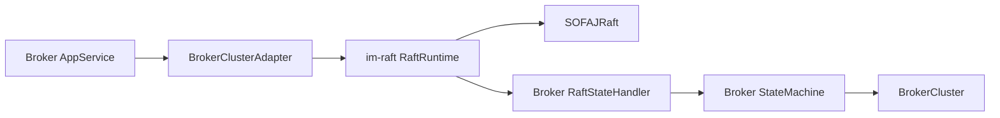

# Raft 通用运行能力抽取设计

> 状态：用户已确认抽取边界，实施已落地；独立 Review 和 Broker 全链路验证待完成。

## 摘要

将 Broker 中 SOFAJRaft 的运行机制抽取到 `im-plugin/im-raft`，由 Broker 提供业务日志和快照回调。
使用方的命令、聚合、幂等和跨节点业务流程仍归使用方管理。

## 背景

`BrokerClusterAdapter` 曾同时包含 Node 初始化、Closure、ReadIndex、成员 API、快照文件处理及领域
命令转换。插件层已有 Bolt 和 Gossip 的通用能力，Raft 运行机制同样具有独立技术所有权。

## 目标与非目标

- 目标：集中管理单个 Raft group 生命周期、字节日志提交、任期读取证据、单步成员配置及快照文件机制。
- 非目标：自研共识算法、改变成员晋升顺序、抽取 Broker 聚合、自动鉴权或生产容量评估。

## 已知事实与约束

- 使用 SOFAJRaft 1.4.1，插件仅依赖 im-common 和第三方技术库。
- 保留现有 identity.json 字段、目录布局和 Broker 快照文件名。
- 业务端仍使用 BrokerRaftProperties 绑定配置，再组装 RaftNodeSettings；不建立并行配置来源。

## 方案概览

## 详细设计

RaftRuntime 接收不可变启动设置和 RaftStateHandler 回调。所有节点都从相同日志字节解码应用，提交
返回 RaftResult，APPLIED 只证明技术提交完成。业务拒绝保留在回调结果中。

成员方法仅提供添加或移除 voter/learner。Broker 继续判断重复请求、最小 voter 数量，并编排晋升、
降级和领域 operation 提交。业务回调负责快照编码与原子恢复，插件负责文件注册与加载。

插件不自动启动空状态机：使用方显式创建运行实例并在 Spring 生命周期中关闭。

## 可靠性与安全

ReadIndex 完成时再次检查同一当前任期。应用回调异常停止日志批次并设置状态机错误。超时可能已经
提交，业务须保持幂等身份；网络安全及 mTLS 仍由部署环境管理。

## 运维与交付

配置项和 Broker 数据目录格式保持原有语义。Broker 从直接依赖 jraft-core 改为依赖 im-raft。

## 风险与回滚

- 风险：Leader 与 follower 解码路径统一后，原先仅 Leader 使用的内存命令对象不再绕过编码错误。
- 回滚：同时撤回插件依赖和 Broker 调用迁移，恢复原来的 JRaft 实现；不删除已有运行数据。
- 延后事项：旧 Broker 测试签名迁移、完整行为/故障门禁及独立 Review。

## 验证策略

- RaftRuntimeTest：真实单节点提交、ReadIndex、snapshot/restart、身份冲突、少数派拒绝、三节点换届、learner 复制与移除。
- Broker 生产 compile 和插件契约 Architecture Test。
- Broker 聚焦测试、quick、clean/full 门禁；失败必须保留原始归因。

## 后续文档与执行

属于 [T13](../exec-plans/completed/2026-09-20-broker-routing-consensus.md)，同步 Plugin README、Broker
Architecture、Harness 矩阵和 PROGRESS.md。当前测试签名阻断不得标记为已完成。

## 附录 A：备选方案

保留全部实现于 Broker 可减少模块数量，但 Node/Closure/snapshot 机制持续与业务混合。
抽出独立插件并使用业务回调可以让技术机制独立测试。未选择再建一套共识算法或框架。

## 附录 B：决策记录

| ID | 问题 | 决策 | 影响 |
|---|---|---|---|
| D1 | 通用 Raft 机制放在哪里 | im-plugin/im-raft | 插件不依赖 Broker 类型 |
| D2 | 谁解释日志 | 使用方提供确定性回调 | Domain 不感知 JRaft |
| D3 | 谁拥有 snapshot 内容 | Broker codec 与状态机 | 插件只提供文件机制 |

## 附录 C：独立 Review

待完成，不将聚焦测试通过解释为独立 Review 已批准。
