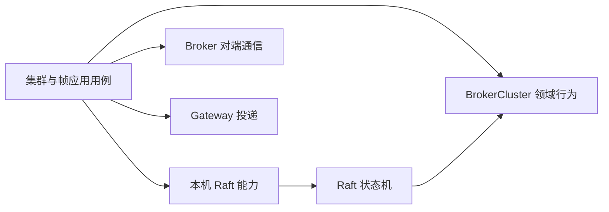

# BrokerClusterAdapter 职责重划设计

> 状态：职责拆分与后续增量已实施，独立实现 Review 已执行；A5 仍 active，最终门禁与验收缺口见[活跃计划](../exec-plans/active/README.md)。用户已确认 `BrokerCluster` 作为集群领域入口、应用层协调跨对象流程、Raft 实现位于适配层。

## 收尾修正：排空失败状态必须以提交接受为准（独立设计 Review Accept）

收口审计确认旧finding仍可达，独立设计 reviewer `4da4164b-ba32-4e4` Accept；按用户要求完成10-11计划时实施，未授权扩大新认证设计实现。

既有 finding 确认：advanceDrain 的 ACK timeout 与 cleanup timeout 两路径在 failDrain 返回未接受时仍返回 BrokerDrainResult.failed，与该结果表示 FAILED 阶段的现有契约不一致。最小修正为接受时返回FAILED；ACK超时提交未接受时返回waitingForGateways(result.message)，cleanup超时提交未接受时返回waitingForCleanup(result.message)，由后续调度重新读取权威阶段。failDrain 异常继续向外传播，不降级为等待或吞掉；已持久FAILED入口不变。不加状态枚举/结果包装/helper，不改领域/协议/超时策略。覆盖两个路径accepted/rejected/exception及并发阶段变化，未接受不得宣称FAILED或改操作状态。这是10-11计划既有正确性finding闭环，不涉及后续统一invoke设计。

## 摘要

当前 `BrokerClusterAdapter` 同时拥有本机 Raft 实例、已提交状态读取、共识命令提交、Raft 成员变更、Broker 间 RPC、Gateway 写帧和路由查询。应用服务通过一个具体类访问这些不相关能力，使领域决策、技术副作用和跨节点编排难以单独识别。建议按**状态与规则的所有者**重划：`BrokerCluster` 继续决定拓扑、operation、epoch 与 fence 的业务合法性；应用层保持跨步骤顺序；本机 Raft 能力和远端通信分别由技术 Adapter 执行。不能单凭“本机/远端”划分领域，因为本机 ReadIndex、快照与日志提交仍是技术操作。

本设计优先分开现有对象的职责，不要求为每个方法创建一层接口。`BrokerCluster` 作为有状态的集群领域能力入口，不新增只做转发的 `BrokerClusterDomainService`。拆分后的接口必须对真实调用方有清楚的用途；只有单一实现、单一调用方且无替换价值的薄包装应避免。

## 背景与重构前事实

`BrokerClusterAdapter` 构造时创建 `RaftBrokerClusterStateMachine` 和 `RaftRuntime`，还注入 `BoltInvoker`、`GatewayClient`、三个执行器、配置、指标和 `RoutingLeaseGrantService`。它的公开方法横跨四类调用方：`BrokerClusterAppService` 负责路由控制，`BrokerMembershipAppService` 负责成员变更，`BrokerQuorumAppService` 读取本机进度，`FrameDispatchAppService` 负责数据面。部分配置和 Handler 也读取它。当前 `LocalBroker` 只包装本机角色、Leader 地址、节点 ID 与应用索引，复用 Adapter 持有的 Raft 实例。

现有领域聚合 `BrokerCluster` 已决定操作登记、拓扑提交、排空完成、恢复验证、fence 和 Lease 签发资格。`RaftBrokerClusterStateMachine` 在日志应用时调用这些行为，确保提交后的判断基于当时的聚合状态。将这些判断提前到应用层只能做快速拒绝，不能取代日志应用时的重验。

## 目标与非目标

- 目标：让每个调用方只依赖所需能力；把尚在 Adapter 中的业务判断移到 `BrokerCluster`；由应用服务协调多个领域对象和外部副作用；保留本机原子签发与共识重放语义；使远端通信与 Gateway 投递不占用集群共识入口。
- 非目标：更改 Bolt/HTTP/SDK 协议、Raft 日志或快照格式、路由选择算法、故障时序、超时与线程池预算；不凭拆分类名增加无调用方的兼容接口。

## 术语与职责判定

| 术语 | 含义 | 归属 |
|---|---|---|
| 本机 Broker | 当前进程的 Raft 运行节点及本机权威状态副本 | 技术运行入口；身份是领域值 `BrokerId` |
| 目标 Broker | 由已提交拓扑指定的另一节点；目标也可能恰好是本机 | 对端通信 Adapter，不因地址相同而绕过 RPC 契约 |
| BrokerCluster | 已提交的拓扑、operation、epoch、fence 一致性边界 | 领域聚合 |
| 跨节点流程 | 登记、隔离、提交、授权、恢复等有序步骤 | 应用层编排 |

判断规则：若操作只需 `BrokerCluster` 状态就能决定是否合法，放在 `BrokerCluster`；若依赖 Raft、网络、时钟、线程池、文件或指标，放在技术 Adapter；若要协调多个领域对象、等待多个副作用并决定下一步，放在应用层。领域不得持有 `RaftRuntime`、SDK DTO 或 Spring 类型。

## 重构前 Adapter 的方法归位

| 当前方法 | 当前实质 | 建议归属与接口含义 |
|---|---|---|
| `getCluster`、`committedState`、`findOperation`、`findActiveDrainOperation`、`findActiveRouteRecoveryOperation`、`findRoutingFence` | 本机已提交状态投影；副本可能落后 | 本机共识状态读取入口；返回分离快照，不能暗示线性一致 |
| `localBrokerId`、`getLocalBroker` | 本机身份、角色、Leader 地址、应用进度 | 本机运行入口；与已提交拓扑读取区分 |
| `confirmLeadership` | quorum ReadIndex 领导权证明 | 本机 Raft 入口；不能用 `isLeader` 替代 |
| `grantLease` | 在状态机同步边界检查聚合并分配序列 | 保留本机状态机原子操作；资格规则留在 `BrokerCluster`，序列规则留在领域签发服务 |
| `submitChange`、`registerOperation`、`commitOperation`、`failDrain`、`confirmGatewayRoutes`、`saveRecoveryEvidence`、`completeDrain`、`forceDrain`、`startEpochAuthorization`、`completeEpochAuthorization`、`verifyRouteRecovery`、`completeRouteRecovery`、`persist` | 构造命令并提交 Raft 日志 | 共识提交入口只负责编码、提交和结果映射；具名命令的构建属于应用与 Transformer，状态转换仍在日志应用时由领域完成 |
| `consensusMembership`、`addLearner`、`promoteLearner`、`demoteVoter`、`removeMember` | 查询并变更 JRaft 成员配置，含部分提交重试 | 本机 Raft 成员入口；成员角色的业务资格仍由 `BrokerCluster` 判断；保留分步失败和可恢复语义 |
| `createSnapshot`、`close` | 本机 Raft 生命周期 | 本机 Raft 运行入口；关闭权只归实际资源所有者 |
| `fetchQuorumReadIndex` | 查询目标 Broker 应用索引并核对身份 | Broker 对端通信入口；响应身份与非负索引仍在通信边界校验 |
| `prepareLease`、`installLease`、`fenceBroker`、`cleanupRoutes` | 目标 Broker 单次 RPC | Broker 对端通信入口；调用者保留 ACK、quarantine、cleanup 证据和阶段决策 |
| `lookupRoutes` | 目标 Broker 路由只读 RPC、deadline 与 hop 限制 | 路由查询通信入口；维持单跳和独立执行器/期限 |
| `dispatchFrame` | 目标 Gateway 写帧、结果转换和指标 | Gateway 投递入口；与 Broker 共识无共享状态，不应继续附着在集群 Adapter |

`cleanupRoutes` 与 `fenceBroker` 当前在技术层读取 `getCluster()` 找目标地址。建议由应用层从已提交聚合确定目标 `BrokerNode` 并传入通信入口；通信入口仍校验响应身份。这样目标选择作为业务事实可审查，RPC 只负责一次调用。并发拓扑变化下仍以已登记 operation 的身份和 epoch 为准，不能在调用前随意重选目标。

`completeDrain`、`forceDrain` 当前在提交前读取 `committedState().revision()`。该值只是预期版本；日志应用时必须再次比较。设计倾向由应用层明确提供预期 revision，或由领域操作意图固定它，避免 Adapter 隐藏一次有业务含义的读取。具体选择待 Review。

## 方案概览

建议的拆分是职责图，不强制产生四个新增 Java interface。`BrokerCluster` 是本机已提交集群状态的唯一领域所有者，并提供集群领域行为；应用层负责多步骤协调，Raft Adapter 负责把已提交命令交给 `BrokerCluster`、快照恢复和共识技术结果映射。可以按真实调用方将现有具体实现拆成 `BrokerRaftAdapter`、Broker peer 通信实现、Gateway 投递实现；通用 `RaftRuntime` 留在基础设施/插件层。配置层保持唯一 Raft 实例与明确生命周期。应用层不重新注入一个同时涵盖所有能力的门面。`FrameDispatchAppService` 只需要已提交路由视图、peer lookup、Gateway dispatch 和本机身份；成员用例不需要 GatewayClient。

## 关键不变量与失败路径

1. 日志应用是权威变更点。应用层预检不能代替 `BrokerCluster` 在提交时的 revision、epoch、operation 身份与阶段校验。
2. Lease 资格校验和签发序列必须在同一个本机同步边界内完成。不能改成“读聚合副本 → 远端等待 → 签发”，否则 fence 可以在两步间提交。
3. `isLeader` 只是瞬时观察；需要领导权证明的流程继续使用 quorum ReadIndex。learner 追平比较必须保留目标身份校验。
4. `promoteLearner`/`demoteVoter` 的两个 Raft 成员步骤可能只完成第一步。重试根据当前 Raft 配置恢复，不能将部分提交报告为整步成功。
5. fence RPC 失败或执行器拒绝仍按未确认 ACK 处理，完整 quarantine 到期前不能提交新 epoch。目标 Broker 恰好为本机也遵守同一证明语义。
6. RouteLookup 保留每 peer 独立超时、单跳、请求 deadline 和独立执行器；Gateway 写帧保留专用执行器、逐目标结果与指标。拆分不得合并线程池或放松背压。
7. `cleanupRoutes` 的目标与 operation 绑定，结果只构成恢复证据；能否结束排空由领域判断。未知执行结果按现有幂等操作和恢复路径处理。

## 备选方案

| 方案 | 收益 | 代价与风险 |
|---|---|---|
| A：保留大 Adapter，只改名/抽方法 | 迁移小 | 调用方继续看到全部能力，规则位置不清；不解决依赖扩大 |
| B：按本机/远端二分 | 契合直觉，拆分少 | Gateway 投递混入远端 Broker 通信；本机技术操作易被误放领域；跨节点流程仍可能藏在 Adapter |
| C：按状态所有权和副作用拆分，推荐 | 领域规则、共识运行、Broker RPC、Gateway 投递各有明确位置；调用方接口更窄 | 配置和测试夹具需调整；必须逐步保证原子性、时序和错误语义 |

## 验证与交付建议

先用当前测试锁定聚合决策、状态机重放和 Lease/fence 原子性，再逐组迁移调用方。聚焦验证包括：成员变更部分提交后重试、peer 响应身份错误、执行器拒绝、Leader 切换、fence 未确认与 quarantine、RouteLookup 超时和 Gateway 写帧失败。运行 Broker 模块测试、架构、behavior、routing-ha、quick、clean、full；若触及实时路由或 Gateway/Broker wiring，按仓库规则运行 e2e。文档批准后创建独立 execution plan；实施完成后同步 `im-broker/ARCHITECTURE.md` 和 Server README。当前工作树已有其他未提交文档变更，实施时必须保留并区分。

## 已确认的结构取舍

1. 不新增 `BrokerClusterDomainService`。`BrokerCluster` 作为有状态的集群领域能力入口，继续拥有 revision、epoch、brokers、operations 和 routing fence，并通过具名方法执行领域状态转换。
2. 多领域对象和外部副作用的协调留在应用服务。`BrokerCluster` 不调用 peer、Raft、Gateway 或调度器。
3. Raft 协议实现留在基础设施/插件层；Broker 侧由 `BrokerRaftAdapter` 负责命令重放、快照恢复、共识结果映射和本机同步边界。
4. `completeDrain`/`forceDrain` 的预期 revision 由应用层在原提交时点读取并显式传入，不冻结 operation 登记时的旧 revision；最终 revision 校验仍由 `BrokerCluster` 执行。

## 决策记录

| ID | 来源/问题 | 草案选择 | 理由与影响 |
|---|---|---|---|
| D1 | 用户提出本机操作下沉、对外操作留 Adapter | 按规则与副作用归属拆分；本机业务规则进入 `BrokerCluster`，本机 Raft 留技术层，远端 RPC 留通信 Adapter | 保住领域纯度与 Raft 提交点 |
| D2 | 整个 Adapter 的范围 | 同时移出 Gateway 投递和 RouteLookup | 二者不属于共识状态所有权 |
| D3 | 单一大类的替代 | 让应用用例只看到所需能力，不建新的万能门面 | 降低接口表面积，避免同形转发 |
| D4 | 是否新增 `BrokerClusterDomainService` | 不新增；由 `BrokerCluster` 直接提供集群领域行为，应用服务协调跨对象流程 | 避免无状态转发层和重复的聚合入口 |
| D5 | Raft 放置 | Raft 协议实现属于基础设施/插件；Broker 通过 `BrokerRaftAdapter` 连接领域聚合 | 领域不依赖 JRaft，同时保留日志应用原子性 |
| D6 | drain 完成命令的 revision 来源 | 应用层在原提交时点读取 committed revision 并显式传入 | 保持读取时序，避免技术 Adapter 隐藏业务预期版本；日志应用仍重验 |

## consensus 接口收敛决策

2026-10-12 用户确认：删除 `BrokerClusterConsensus` 接口，生产查询及调度调用方直接依赖已有 `BrokerRaftAdapter`，不新增替代查询门面。保留 `BrokerClusterConsensusResult` 及当前包位置；按用户后续确认，将状态枚举收为 `BrokerClusterConsensusResult.Status`，删除顶层 `BrokerClusterConsensusStatus`；它们区分领域接受结果与通用 Raft 技术结果。测试夹具仅在 test scope 适配到具体 Adapter，不引入生产兼容构造器。此步不更改日志、快照、成员配置或路由行为。

## 状态机接线收敛决策

历史阶段决策：后续类型化接线及日志/快照重置 v1 由[类型化设计](2026-10-12-typed-raft-command-design.md)取代；以下保留当时决策。

2026-10-12 用户确认：`RaftBrokerClusterStateMachine` 直接实现 `RaftStateHandler`，集中字节命令应用及快照恢复接线；删除 Adapter 匿名回调。快照数据投影命名为 `snapshotState`，SPI `snapshot` 返回字节；原 SnapshotCodec 编解码移入 Snapshot，保留格式、版本与校验。CommandCodec、LocalBroker 和同步边界不变。

## Peer 调用行为保持简化决策（2026-10-13）

用户批准两项局部简化，取代旧“读取证明传输必须由 im-raft/RaftPeerClient 封装”的约束：
业务 Peer RPC 归 `BrokerPeerAdapter`，`fetchQuorumReadIndex` 直接复用通用 `BoltInvoker.invoke`
六参数调用；删除无其他生产调用方且仅转发 `BoltRpcClient` 的 Raft Peer Client 及对应测试，
删除 im-raft 唯一为该转发声明的 im-bolt 依赖。原生选举、日志复制和快照传输仍由
`RaftRuntime`/JRaft 负责，身份/非负索引校验、同步 IO、配置超时和异常失败阶段保持不变。

`lookupRoutes` 删除应用参数包装，直接接收原包装持有的 SDK `BrokerNode`、公共 `UserId`
和领域 `RoutingEpoch`。同文件控制面方法仍使用领域 `BrokerNode`，仅真实同名冲突使用 SDK
全限定名；不扩展为领域迁移。专用查询执行器、超时、deadline、hopCount 和失败策略不变。
架构负 fixture 改为真实 `BoltInvoker`，不放宽 support.raft 网络依赖规则。A5 保持 active/WIP=1，
历史决策和证据保留，当前实现仍须独立 Review 与最终门禁验收。

## BrokerRaftAdapter 方法命名收敛（2026-10-13，用户批准）

历史阶段决策：本节命名随后由“嵌套本机视图与私有提交增量决策”更新，保留为历史记录。

类名保持不变，六个公开方法及全部调用方直接迁移，不增加 API、兼容别名或转发壳：
`getCluster` → `clusterSnapshot`、`submitChange` → `submitCommand`、
`persist(RoutingEpochFence)` → `commitRoutingFence`、`consensusMembership` → `raftMembership`、
`registerOperation` → `beginOperation`、`commitOperation` → `commitTopologyChange`。
本节取代前文方法表的旧名称，历史决策不批量改写。

`clusterSnapshot` 返回分离的本机已应用聚合快照，不承诺线性一致；`raftMembership` 返回通用 Raft 技术配置快照。
`beginOperation` 提交 Begin，只登记经校验的意图及 operation 元数据，不修改 Broker 节点。
`commitTopologyChange` 提交 Commit，由领域按已登记事实改变节点集合、成员角色或流量状态；
不是直接执行 Raft membership API，也不表示整个 operation 已到成功终态。
已核对 Domain Commit 的全部 operation 分支：成功时 revision 再加一，epoch 采用冻结 resultEpoch；
Begin 登记已推进一次 revision，重复 Commit 返回 DUPLICATE、不再次推进。拒绝或冲突不改变拓扑。
Domain `BrokerCluster.commitOperation`、StateMachine `getCluster` 与其他同名方法保持不变。
现有测试仅迁移引用，保持断言，不新增镜像实现测试；A5 继续 active/WIP=1，不提交 Git。

## 嵌套本机视图与私有提交增量决策

用户确认恢复 `BrokerRaftAdapter.LocalBroker` 静态嵌套查询视图，通过 getLocalBroker().getId()/isLeader()
明确本机主体；实时读取同一 Runtime，不创建独立 Bean、第二实例或关闭权，取代先前完全删除本机视图的决定。
查询使用 getClusterSnapshot/getCommittedState/getLeaderEndpoint/getRaftMembership，find/fetch/is 保持。
操作成对命名 beginOperation/commitOperation，Commit 仍只表示拓扑阶段而非成功终态。
submitCommand 改为 private；成员失败/完成载荷构建迁入 Raft Transformer，应用服务改调用
failMembershipOperation/completeMembershipOperation，不恢复公共通用命令入口或兼容壳。

## 独立 Review

独立实现 Review 已执行；当前 A5 仍 active，最终门禁与验收缺口见活跃计划，不据此宣称已完成或归档。

## LocalBroker 查询门面收敛决策（历史，已被取代）

本节记录删除旧独立 LocalBroker 的阶段性选择，已被“嵌套本机视图与私有提交增量决策”取代；当前采用 BrokerRaftAdapter 的静态嵌套 LocalBroker 查询视图。

2026-10-12 用户确认：删除没有独立状态、业务规则或生命周期的 `LocalBroker`；本机角色、Leader 地址、quorum ReadIndex 查询直接并入 `BrokerRaftAdapter`，身份复用 `localBrokerId`。迁移查询服务、调度器、成员服务、请求装配和测试夹具，不新增替代接口或兼容入口。保留 ReadIndex 等待本机应用进度、异常传播及请求上下文生成；`isLeader` 仍只是瞬时观察，不替代 `confirmLeadership`。运行实例与关闭权仍唯一归 Adapter。此决策取代前述保留 LocalBroker 的阶段性选择。

## changedAt 最小收敛增量（用户批准，独立设计 Review Accept）

本增量只收回**调用方未参与本轮判断的提交时间**。以下九个具名方法删除 `Instant changedAt`
参数，由 `BrokerRaftAdapter` 在构造每条命令时调用一次 `Instant.now()`，继续把毫秒时间写进
原 Raft command。Transformer、Codec、状态机与领域仍消费命令中的确定时间；不得在日志应用、
领域或快照恢复时读取当前时间。已有命令字段、版本、revision 读取时点和结果处理不变。

### 逐方法分类与调用事实

| 方法 | 决定 | 当前生产调用与理由 |
|---|---|---|
| `commitOperation` | Adapter 生成 | Cluster 应用提交拓扑，以及 Membership 应用登记/恢复提交，均直接传 `Instant.now()`，不复用判断时间 |
| `failMembershipOperation` | Adapter 生成 | Membership 应用记录明确拒绝时直接传 `Instant.now()` |
| `completeMembershipOperation` | Adapter 生成 | Membership 应用登记终态时直接传 `Instant.now()` |
| `confirmGatewayRoutes` | Adapter 生成 | Cluster 应用提交 ACK 时直接传 `Instant.now()`；前面的 eventDeadline 预检另读一次时间，未与提交共享，不合并两次读取 |
| `completeDrain` | Adapter 生成 | advanceDrain 在证据提交接受后另传 `Instant.now()`；不是本轮 ACK 等待判断的 `now`，也不是 cleanup 超时判断的 `failedAt` |
| `forceDrain` | Adapter 生成 | Cluster 应用显式风险确认后直接传 `Instant.now()`；expectedRevision 仍由应用在原位置读取并传入 |
| `beginEpochAuthorization` | Adapter 生成 | Cluster 应用推进授权阶段时直接传 `Instant.now()` |
| `completeEpochAuthorization` | Adapter 生成 | Cluster 应用全部安装完成后直接传 `Instant.now()` |
| `completeRouteRecovery` | Adapter 生成 | recoverRoutes 在验证接受后另读 `Instant.now()`，不复用本轮预检/验证的 `now` |
| `failDrain` | 保留显式时间 | 两个 caller 分别共享 ACK 等待/超时判断的 `now`、cleanup 超时判断的 `failedAt`；不改失败结果处理 finding |
| `saveRecoveryEvidence` | 全部保留显式时间 | advanceDrain 的 caller 虽只传 `Instant.now()`，但 recoverRoutes 的 caller 使用与 ACK 等待及 verify 共用的 `now`；按方法保守收敛，不加重载、不拆方法 |
| `verifyRouteRecovery` | 保留显式时间 | recoverRoutes 将同一个 `now` 用于 ACK 等待、证据提交、恢复超时验证；必须维持本轮固定时间 |

`completeDrain` 的时间在领域中仍用于 `readyToComplete` 重验，`confirmGatewayRoutes` 的时间仍可
影响恢复阶段推进；这并不授权领域读取墙上时间。本次判据是**应用 caller 是否共享该时间用于
相关判断**，不是命令时间在领域中是否只有审计用途。上述两方法当前没有应用共享时间，因此
仅将最终提交采样从 caller 移到 Adapter，领域继续按日志载荷重验。

`beginOperation` 的 proposal/operation 创建时间、`commitRoutingFence` 中 fence 的证据/期限时间、
Lease request 及任何预检、quarantine、超时与证据计算时间不在收敛范围。移除参数不表示删除
命令时间，也不修改原有 operation 元数据来源。非 Leader/失败提交仍遵守已有 Runtime 契约。

### 测试与兼容取舍

- 不引入 Clock、测试构造器、生产重载、兼容壳或通用时间包装。只迁移现有 caller、Mockito 和
  test-scope bindings；保留显式方法的固定时间断言与全部非时间载荷断言。
- 真实 Adapter 的 Runtime 构造边界捕获测试负责证明九个入口生成并携带时间。对生成时间只验证
  调用前后毫秒边界内，不使用 sleep、不要求时间相互严格递增；其余字段逐个保持完整比较。
  保留的三个入口必须逐字保持传入固定时间，不能一并动态化。
- `BrokerRaftTestBindings.submit` 不再承诺九个已收敛入口使用测试 command 的指定提交时间。
  仅这些入口的生成时间允许变化；请求摘要、身份、revision、阶段、错误、证据等字段继续严格
  校验，错 digest 拒绝用例保留。显式时间入口及 Begin/fence 仍完整载荷比较。
- 固定时间重放/边界测试留在原状态机、Codec 与领域测试，不经 Adapter 增加可注入时间入口；
  真实节点快照恢复测试继续证明正常/降级终态及重复提交，生成提交时间不作为固定 fixture。

### 本轮范围与状态

独立设计 Review Accept、findings none（父会话取得）后按批准范围实施，未提交 Git。
九入口收敛、显式时间共享捕获与真实 Runtime 时间载荷反证已完成；精确文件、red/green、
reactor 失败归因和后续门禁由活跃计划 A5 的“changedAt 最小收敛”维护。
本轮不改当前 README/Architecture，也不追加历史叙事；其他 WIP 和既有 A5 验收缺口保持。

## Gossip 诊断辅助归位与 Adapter 改名（用户批准，独立设计 Review Accept）

用户选择 `support/gossip/GossipSyncTracker`，不采用 `adapter/diagnostic`：它仅记录有界、非权威、可选的同步诊断历史与累计摘要，不执行业务决策、网络调用或生命周期管理。允许这一窄类有状态辅助职责，不把“存在内存状态”直接等同于业务或运行态集成；不新增 port、wrapper、兼容类或配置。能力包精确为 `support.gossip`，不批准后代包或类名白名单；禁止 application、interfaces、infrastructure、配置、生命周期、Adapter 与具体网络 client 依赖，领域禁依赖 support 的现有规则不变。非权威/可选指记录不成为路由、成员、Lease、恢复或同步成功的权威证据，不表示本次改变诊断异常处理或调用顺序。

`adapter/gossip/BrokerStateStore` 仅改名为 `BrokerGossipAdapter`，保留原包、方法、存储所有权、digest/delta、版本/tombstone、TTL 和合并行为；它维护运行态观察并适配通用 Gossip，不能移入 support。Tracker 只搬包，容量、摘要、查询上限、同步边界、时间契约与现有可观察行为不变。运行资源/采样装配仍归 infrastructure，诊断查询编排归 application，输出模型不搬动。

独立设计 reviewer `fdaeb0fa`：Accept、findings none。已按批准范围迁移 Java、直接测试及全部调用方；当前 Architecture/README 的目标名称与源码一致。自动化保护精确包、禁止依赖与 domain 反向依赖；有界非权威/可选诊断语义由 Review 和既有测试保护，待可靠业务决策与资源所有权数据流分析后自动化。实施和验证恢复入口见[活跃计划 A5](../exec-plans/active/README.md)。保留其他 WIP、历史证据及门禁缺口，不提交 Git。

## Gossip 应用服务命名收敛（用户批准）

用户明确批准 `RegistryGossipAppService` → `BrokerGossipAppService`，行为保持不变。Broker 指模块范围，包含 Broker、Gateway、Connection 注册事件到 Gossip observation 的协调；不修改 Raft 权威拓扑，不承担 RPC 或调度。同步类型、构造器、Bean 方法名和真实调用方，配置类名、其他字段、方法、断言及处理顺序不变；无兼容入口。纯机械改名，沿用 A5，不新增访谈或计划。
