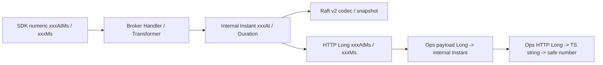

# Broker 自有时间字段契约设计

> 状态：已批准。2026-10-14 用户已批准本文的范围、命名、类型、无兼容与 v2 持久格式决定；专门 reviewer 首轮 Revise，修订后第二轮 Accept、findings none（仅设计接受，不代表实现验收）。纳入既有 [Adapter 计划 A5](../exec-plans/active/README.md)，不创建第二个 active task。

## 摘要

统一 Broker Server/SDK **全部自有时间字段**，而不是仅修正最近修改的 `changedAt`。内部绝对时刻使用 `Instant xxxAt`；现有数字协议时刻使用 Unix epoch milliseconds `xxxAtMs`；内部时长使用 `Duration`，数字毫秒时长使用 `xxxMs`。已有 Java 服务间 `Instant xxxAt` 契约不转成数字。泛指有效时长使用 `validDuration`，具体 `leaseDuration` 等业务时长名称保留；单调时间与真实 nanos 单位保持原样。

协议 producer/consumer 同步改名，无 alias、双读、旧构造器或迁移兼容。系统未上线；命令与快照 envelope 升到 v2、明确拒绝 v1，程序不删除任何目录或数据。阈值、采样点、续租、重试、幂等和权限行为不变。不新增 Clock、包装层或 common mapper。

## 背景

当前事实可定位于 `sdk/routing/RouteRequestContext` 的 `deadlineEpochMillis`、`sdk/model/params` 的 `eventDeadline`、内部 consensus command 的 `changedAtEpochMilli`、`ConnectionRegistration/GatewayRouteBatch/GatewayRouteTable` 的 `updateExpiresAt`、`DrainProgress` 的 `oldEventDeadline`。HTTP Response 仍有 `Instant createdAt/registeredAt/...`，Ops HTTP payload 按 `Instant` 读取。数值时长包含 `timeoutMillis`、`retryAfterMillis`、`durationMillis` 与 `uptimeSeconds`。

共享 [Coding Guide](../references/CODING_GUIDE.md#时间与时区) 已规定时间语义和 Long/string HTTP 边界，[Harness Guide](../references/HARNESS_GUIDE.md) 将该规则登记为 Review-only，并限定首批迁移为 Broker 与直接调用方。本次是该规则的完整、有所有权边界的落地，不是全仓正则改名。

## 目标与非目标

- 目标：Broker 自有 absolute/duration/monotonic 字段及参数、Builder、accessor、序列化键一致；caller、fixture、HTTP UI 与恢复契约闭环。
- 范围：`im-broker-sdk`、`im-broker-server`；Gateway 直接消费重命名 Broker 协议的代码；`im-management/im-ops` 直接读取并呈现 Broker 数字 HTTP 时间的代码与测试；直接相关测试。
- 非目标：Account/Message/Social 等领域服务时间迁移、通用 Plugin/common mapper 修改、时钟依赖重构、重新设计 DTO/Adapter、修复既有排空 finding、兼容历史格式、自动删除数据、容量定规格。

## 已知事实与约束

- Broker 拥有路由时效、operation 时间、运行观察和诊断；Gateway 拥有其本地 Channel 与 Session 时间，后者不在本次范围。Ops 内部 DTO 可继续使用 `Instant`，只在读取 Broker HTTP 与输出浏览器 HTTP 的边界适配。
- Raft command codec、snapshot model 现为 v1。更改 command 类型或聚合 JSON key 会改变持久 schema，不能继续声称“格式不变”。
- `RoutingLease.leaseDuration` 是具名业务时长；`RouteLeaseInstallParams.validForNanos` 是保守单调 Lease 时长，不能改成毫秒或 epoch；`MonotonicTimestamp`、pending/lease monotonic deadline 保持。
- 父会话 readiness 已通过；实现依赖 JDK/Maven、架构与 Harness、Docker realtime/routing-ha 环境；历史 full 镜像拉取网络缺口仍保留，不能用本次文档验证关闭。

## 方案概览

Transformer/协议适配负责转换；domain 不依赖协议类型。序列化数值与原绝对时刻的毫秒值相同，领域用相同阈值比较。已有 `Instant` SDK observation DTO 保留，不人为制造数字转换。

## 详细设计

### 命名与边界映射

| 当前语义/字段 | 内部 | 数字边界 |
|---|---|---|
| 请求/RouteLookup 的 `deadlineEpochMillis` | 如需内部值为 `expireAt` | `expireAtMs` |
| snapshot/ACK 的 `eventDeadline` | `updateExpireAt` | `updateExpireAtMs` |
| drain cleanup 的 `eventDeadline`、`oldEventDeadline` | `oldEventExpireAt` | `oldEventExpireAtMs` |
| `updateExpiresAt` | `updateExpireAt` | 对应 `updateExpireAtMs` |
| consensus `changedAtEpochMilli` | `Instant changedAt`，含 JSON command 字段 | 不把内部 Raft command 当数字 wire；v2 编码新类型 |
| health `unreachableSince` | `Instant unreachableAt`（首次持续不可达时刻） | 无新增数字协议 |
| 已规范的 `createdAt/completedAt/registeredAt/lastSeenAt/startedAt/executedAt/lastSuccessAt/lastFailureAt/lastExecutedAt/connectedAt/refreshedAt` | 名称/Instant 保留 | 仅现有 HTTP 转为同义 `xxxAtMs` |
| `timeoutMillis/gatewayTtlMillis/retryAfterMillis/durationMillis` 等自有毫秒数 | runtime 使用 `Duration timeout/gatewayTtl/duration`；只在配置或 wire 边界保留数值 | 配置/wire 为 `timeoutMs/retryAfterMs/durationMs`；第三方调用按其单位转换 |
| 诊断 `uptimeSeconds` | `Duration uptime`，值从启动时刻求时长，不再截为秒 | `Long uptimeMs` |
| 泛指 validity/validFor 的内部 Duration（若存在） | `validDuration` | 毫秒数为 `validMs`；不改具名 `leaseDuration` 或单调 `validForNanos` |

同一个旧 `eventDeadline` 必须按所属流程改名，不能全仓替换成同一字段。`AcceptGatewayRoutesCommand/ConfirmGatewayRoutesCommand/CleanupDrainRoutesCommand` 是内部 CQRS 输入，分别改为 `Instant updateExpireAt/oldEventExpireAt`，由接口 Transformer 从 SDK 数字字段转换；应用服务不继续传播数字 absolute time。五种数字 consensus 时间命令改为 `Instant changedAt`：`AdvanceClusterOperationCommand`、`CommitBrokerOperationCommand`、`CompleteBrokerDrainCommand`、`ForceDrainOperationCommand`、`UpdateBrokerDrainProgressCommand`；已有 `CompleteRouteRecoveryCommand/VerifyRouteRecoveryCommand.changedAt` 保留。

内部 runtime 时长必须为 `Duration`；数字时长只允许在 typed configuration、wire DTO 和第三方调用的参数转换边界，不允许以改后缀保留 runtime numeric 字段。`RouteLookupHandler.gatewayTtlMillis` 与 `GatewayRouteAuthorizationInterceptor.gatewayTtlMillis` 改 `Duration gatewayTtl`，使用原 epoch-ms 差与 `gatewayTtl.toMillis()` 保持原边界精度；BrokerClient 的数值 timeout 配置入口在构造时转 `Duration timeout`，调用 BoltInvoker 才转原整数毫秒。`BrokerGossipProperties` 作为 runtime 调度载体改 `Duration timeout`，调度器调用第三方时转换。Broker 与 Ops 的 `BrokerInstanceDTO.uptimeSeconds/GossipRecordDTO.durationMillis` 分别改 `Duration uptime/duration`；HTTP 与客户端 payload 使用 `uptimeMs/durationMs`，转换归所属 Transformer。

参数、局部变量、注释、Builder 与 accessor 一起对齐；方法动作名（如 `expired`）、`TimeUnit.MILLISECONDS`、`toEpochMilli/ofEpochMilli/toMillis` 和第三方方法名不是待改字段。必填时间仍显式校验；原数字允许 epoch 0 的 command 改 Instant 后保留 `Instant.EPOCH` 边界，不仅检查 null 而丢掉原负值拒绝。原请求 >0 约束仍保留。

### 配置分类

1. 已有 `Duration` properties（gatewayTtl、routing 各 Lease/timeout/grace/interval/cache Duration）保留具体业务名称、默认值及绑定键，不统一改成 `validDuration`。
2. Broker 自有数值配置改明确单位：`BrokerProperties` 中 GatewayPush.Bolt/PeerCall `timeoutMillis -> timeoutMs`；`ClusterProperties.gossipTimeoutMillis/gossipRemovedTtlMillis -> gossipTimeoutMs/gossipRemovedTtlMs`；`BrokerRaftProperties.electionTimeoutMillis/commandTimeoutMillis -> electionTimeoutMs/commandTimeoutMs`。`snapshotIntervalSeconds` 选用 `Duration snapshotInterval`（默认 `300s`，零关闭），只在 Raft Adapter 转回第三方秒整数，保留原整秒精度及非负校验。同步 application.yml、Broker README 与实际使用这些自有键的 deploy/Nacos/测试配置，不能留下旧键静默采用默认值。
3. BrokerClient 的 numeric constructor 输入作为配置边界改 `timeoutMs`，runtime 字段转 Duration；BrokerGossipProperties 与 RouteLookup/授权组件的 runtime 字段转 Duration；不改通用 `RaftNodeSettings.electionTimeoutMillis/snapshotIntervalSeconds/commandTimeoutMillis`、BoltInvoker/GatewayClient 的第三方或其他模块参数名，也不改 Spring `fixedDelayString`、`management.*`、`im.bolt.*`、Nacos 标准键。adapter 负责单位转换，不提供旧配置 alias。

### 精度、采样与行为不变量

- epoch milliseconds 边界显式使用 `toEpochMilli/Instant.ofEpochMilli`，已有 operation 创建/完成截毫秒不变；同毫秒完成允许，真实早于创建拒绝，不加一毫秒补偿。
- 数字 command 改 Instant 后仍截断到原毫秒精度，不能把现有采样纳秒送入状态机而改变恢复时间或相等判断。保留现有具名入口采样及共享 `changedAt` 事实，不能再次移动采样点。
- `now == expireAt` 仍过期；旧事件达到截止才可收口，TTL 恰等阈值不 fresh。零 grace/negative cache/安全余量、snapshot interval 关闭和现有正数要求原样保留。
- 不改 request retry 的原 deadline、operationId、一次明确拒绝重试、未知 timeout 不重放；不改 ACK 冻结、cleanup 水位、tombstone 寿命、Lease grant/quarantine 公式、续租间隔或 side-effect admission。
- 继续使用已有 Clock/显式时间 fixture，不新增 Clock、LongSupplier 包装、时间 utility 或 common mapper。MapStruct 声明映射继续由生成代码完成；确需 Java Time conversion 时在所属 Transformer 做最小 null-safe 转换。

### HTTP 与直接消费者

Broker 所有 HTTP absolute time 改 `Long xxxAtMs`；可空完成/诊断时间仍可空，im-web 的 Long 十进制字符串规则不变。诊断耗时为 `durationMs`，uptime 为 `uptimeMs`。

Ops `infrastructure/client/model` 对应 payload 改 Long 数字时间与毫秒时长，从 Broker 字符串 Long JSON 读取；`BrokerClientTransformer` 转回 Ops 内部 Instant DTO。Ops `model/io` 输出同义 Long `xxxAtMs` 和 `durationMs/uptimeMs`，`OpsHttpTransformer` 显式映射内部 Instant/Duration；`BrokerClientTransformer` 显式映射 payload `xxxAtMs -> xxxAt`、`durationMs -> duration`、`uptimeMs -> uptime`，两者保留 MapStruct 生成的声明式映射，包括 nested instance/diagnostic summary，不依赖旧同名自动映射，UI `api/ops.ts` 当前 time/duration 为 number，必须迁移为 string wire，显示时在既有时间 helper 边界验证安全整数再转 number，以显式 IANA 时区显示。不改 Ops 其他业务时间，也不扩展未实际读取的 operation endpoint。

## 可靠性与安全

无新增权限、并发模型、资源、RPC 或重试策略。类型/单位迁移不能吞错误或引入默认值；保持必填/null、负值、零边界与限额验证。v1 命令/快照在恢复入口显式拒绝，不允许旧字段默认 0/null 后继续应用。v2 codec 白名单、状态机失败关闭及 snapshot 隔离仍成立。

## 运维与交付

未上线，全套 Broker/SDK/Gateway/Ops 按同一契约部署，不支持混合版本。Broker 命令和 snapshot `CURRENT_FORMAT_VERSION = 2`；持久 v1 不读取、不自动迁移、不清理。联调若有旧目录，停止节点、保全原目录，显式选择新目录启动；任何数据删除另行用户确认，不属于本任务。identity/fence 技术文件没有本次 key/type 改动时保持，不机械升版。

本轮不是时间性能优化或容量设计，无新依赖、机器规格和指标标签；diagnostic uptime 数值单位变化须与 UI 同步，不把毫秒显示成秒。

## 风险与回滚

- 风险：序列化键、配置绑定和 UI fixture 漏改；内部 Instant 改动丢失毫秒截断或 epoch 0 校验；duration 与 monotonic 混淆。
- 回滚：源码/契约 producer-consumer 成组回退；v2 目录保留，旧源码只能使用其有效 v1 目录或新的目录，不让旧代码读 v2，不自动删目录。
- 延后：Clock 重构、全仓时间统一、兼容和容量评估均不纳入。

## 验证策略

- 聚焦契约测试：SDK JSON keys `expireAtMs/updateExpireAtMs/oldEventExpireAtMs/retryAfterMs`、旧键不输出；已有 SDK Instant DTO 保持。Gateway backoff 使用原绝对窗口，正好到期停止。
- 内部模型与转换：固定 ms 值验证 SDK→CQRS→domain；五个 consensus command 的 Instant JSON roundtrip、epoch 0 接受/负值拒绝；毫秒内创建/完成相等、真正倒序拒绝；RouteTable 过期/zero grace、DrainProgress 截止边界、故障观察阈值、Lease nanos 保持。
- 持久化：D worker 将固定 v2 command bytes 解码后应用于两个独立 StateMachine（相同初始状态），比较过期/收口决定、完整时间、phase/revision/epoch 与状态；再比较完整重放和从 snapshot 恢复后重放同一 tail 的结果。fixture 使用固定旧墙上时刻和带 submillisecond 的采样输入，期望统一毫秒值；把 apply 时间临时替换为当前时间或让原数字 command 保留 submillisecond 均须使测试稳定失败，恢复后 green。v2 command/snapshot roundtrip + snapshot/restart，v1 fixture 确定失败。测试先证明旧实现失败，区分 compile-red 与行为 red；每阶段计划记录精确命令、日志和恢复状态。
- HTTP/Ops：完整 registry/list HTTP envelope 与 overview nested instance/diagnostic summary 的 Long 字符串/null、numeric↔Instant/Duration 精确转换，mock Broker 真正的新响应而非按消费者期望拼旧 payload；UI 安全整数、IANA 时区、uptime/duration 单位测试。
- 配置：Spring 绑定新自有键、默认不变、旧键不再是公开契约；snapshot interval 的零、整秒/非法值约束；搜索第三方键没有改名。
- 集成：Broker/SDK、Gateway、Ops reactor，architecture、behavior、e2e、routing-ha；收尾 quick/clean/full。文档阶段只运行结构/漂移检查，不能声称上述实现测试已通过。

## 后续文档与执行

实施后同步 Broker Architecture、Broker/Server/SDK README、Gateway 与 Ops README 中实际受影响协议；已存在 Coding/Harness 时间规则无需另建全仓 scanner，若评审发现新复用约束，在原规范与 Harness 矩阵登记。A5 保持唯一 active，实施 checkbox 见原计划新增时间契约节；独立 Review 通过前全部实现步骤保持未勾选。历史 v1 决策保留并加本设计取代说明，当前 runtime 文档在实施完成后才改为 v2。

## 附录 A：备选方案与行业依据

- 只改局部 touched 字段：差异最小，但同一 Broker 时间事实在协议与领域仍有混合名称；用户选择覆盖全部 Broker 自有字段，因此不采用。
- 全部以 long epoch millis 表示：无需 Java Time 适配但抹掉绝对时间/时长/monotonic 类型边界，不满足共享规则。
- 本方案：内部 Instant/Duration、必要数字 wire 带单位，差异较大且必须同步配置/消费者；契约明确、无未上线兼容负担，是用户批准选择。

Java 21 `java.time.Instant/Duration` 与现有项目 Jackson/MapStruct 机制即可完成；不依赖新第三方库能力，也不声称外部迁移工具保证。

## 附录 B：决策记录

| ID | 来源/问题 | 最终决策 | 理由与影响 |
|---|---|---|---|
| D1 | 用户确认迁移宽度 | 全部 Broker 自有时间字段，直接 Gateway/Ops consumers 同步；不扩至一般业务或 Plugin | 完整解决拥有者内部不一致，范围有边界 |
| D2 | absolute time | 内部 Instant xxxAt，数字 wire xxxAtMs；update/oldEvent 保留具体含义 | 单位与事实可识别，不机械合并为一个 expireAt |
| D3 | duration / monotonic | runtime 必须 Duration，数字 xxxMs 仅用于配置/wire/第三方调用边界；泛指有效时长 validDuration；具体 leaseDuration 与 monotonic+nanos 保留 | 不改变 Lease 精度或授权生命周期 |
| D4 | 兼容 | 未上线，不要 alias/兼容 API/双读；不删数据 | producer-consumer 同步发布，历史目录保全 |
| D5 | Raft schema | 新 command key/type 与 snapshot key 使用 v2，拒绝 v1 | 避免沿用 v1 掩盖不兼容恢复 |
| D6 | 实施约束 | 保持阈值/续租/采样/ms/zero；不新增 Clock/wrapper/common mapper | 最小完整实现，不混入其他重构 |
| D7 | HTTP | Java Long、wire string、UI 安全整数与 IANA 显示；Ops 仅直接消费部分 | 遵循现有公开边界规范 |

## 附录 C：独立 Review

- 用户语义批准：2026-10-14，覆盖 D1–D7。
- 首轮独立设计 Review：**Revise**，2026-10-14；原结论保留，未视为 Approved。具体 findings：
  1. P3 C ownership 漏掉 Ops `model/io/{BrokerNodeResponse,GatewayNodeResponse,ConnectionRouteResponse,DiagnosticSummaryResponse}.java` 与 `model/cqrs/dto/{BrokerInstanceDTO,GossipRecordDTO}.java`（原 uptimeSeconds/durationMillis）；缺少两个 Transformer 的显式映射，以及 registry/nested diagnostic HTTP string/null 断言。
  2. 原命名表允许 numeric runtime duration，与内部 Duration 规则矛盾；RouteLookup/授权 TTL 必须 Duration，诊断内部 DTO 的 duration/uptime 必须 Duration；数值仅配置/wire/第三方调用边界。
  3. 固定 command bytes 的独立状态机重放、snapshot+tail 一致性与 current-time/sub-ms mutation 反证未明确分配给 D。
  4. UI 当前时间字段为 number，不是“保持 string”；必须写明迁移 string 与 safe parse。
  5. Coding Guide 未明确泛指有效时长优先 validDuration、具体 leaseDuration 保留。
- 修订后专门 reviewer 第二轮 **Accept**、findings none；Ops scope、runtime Duration、确定性重放反证、UI wire 与独占分工均通过设计复审，解锁 P1–P4。实现与最终门禁证据另行取得。
