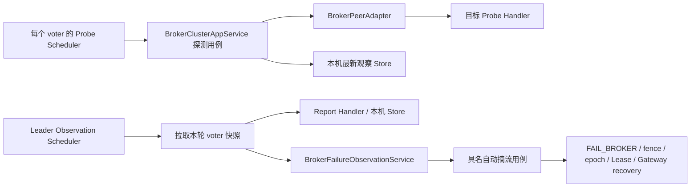

# Broker 自动故障观察与摘流接入设计

> 状态：功能方案及规范纠正设计已批准，规范实现八项复审已关闭，完整功能验收进行中。用户已批准 voter 主动探测、Leader 拉取报告、自动发起摘流及全阶段恢复方案；重启、Leader 切换和拓扑变化重新等待完整冷却窗口，不增加 Raft 持久化时间字段或修改格式。独立设计 reviewer `c5f87b0c-0030-412` 首轮 `Revise`：要求补齐入站唯一 URI SAN 来源保证及实际 membership 一致性闸门；修订后同一 reviewer 第二轮 Accept、findings none，已完整阅读全文；两项修订闭环。实施后独立规范 reviewer `9de26e93` 发现八项问题并给出 Revise；纠正设计第二轮 Accept（不关闭实现 findings），仅授权先修八项规范问题。代码纠正及聚焦验证后 reviewer `1975efff-8923-4af` 短复审 Accept、八项closed、findings none，恢复批准的功能接入；完整实现Review与HA/交付门禁仍待当前证据，不把规范closure当完整验收。本文补齐原路由共识设计 D22 的接入细节，不撤销自动摘流要求。实施后纳入现有 Adapter 计划 A5，WIP=1；不创建 Git 提交。

## 后续认证调用可读性整理（用户批准试用，独立设计 Review Accept）

独立设计 reviewer `b089e8c6-68d3-4a6` 中止恢复后 Accept/findings none；限定diff特别核对起点+五次remaining采样、顶层Timeout优先而非cause链任意Timeout、异常包装/中断不迁入classifier。

仅整理 im-bolt BoltClientInvoker.invokeAuthenticated：started→startedAtNanos、phase→failurePhase；将握手/URI SAN身份验证提为 verifyPeerIdentity(connection, startedAtNanos, timeoutMillis, expectedPeerIdentity, identityPrefix)，将catch中原有阶段/异常链归因提为 classifyFailure(failurePhase, exception)。私有helper具有真实完整职责，不新增类型/参数容器/策略或公开入口；普通invoke完全不改，不为复用重写响应解码。

预算采样次数/位置/检查顺序保持，getConnection嵌套catch继续区分迟到获取为LOCAL；验证后的同一connection用于invokeSync；TimeoutException优先LOCAL、SSL/Certificate为AUTHENTICATION、只有传输阶段明确类型为TRANSPORT_UNAVAILABLE的分类顺序保持。BoltInvocationException直传、InterruptedException标记恢复、异常消息/cause、Void/反序列化/最终预算均不改。补步骤注释说明阶段与预算接受性，不将failurePhase当作异常最终归因。不新增线程/重试/缓存/Clock，真实TLS与分类测试冻结基线和修改后复跑，限定diff独立复审，纳入既有A5，不提交。

## 后续观察请求与响应角色命名（用户批准，独立设计 Review Accept）

独立设计 reviewer `2f8cd490-5634-4ed` Accept/findings none。

SDK与应用边界成组改名：BrokerObservationRequest、BrokerProbeParams/Query、BrokerHealthReportParams/Query 的 targetBrokerId→receiverBrokerId；report请求 targetBrokerIds→brokerIds。报告Result/DTO外层 reporterBrokerId→observerBrokerId，报告Row/ObservationDTO targetBrokerId→brokerId。callerBrokerId保留，probe响应brokerId保留，clusterId/revision/epoch/nonce及年龄/持续时长字段保持。领域BrokerHealthObservation既有新名保持，所有映射/准入/Adapter/应用caller/测试/HA同步，不全局替换其他业务target字段。

此为wire与内部JSON字段契约变更，不留旧alias或兼容构造器，需Broker/SDK同版本成组部署；不改RPC operation或Raft日志格式。身份、成员、Context、目标集合完整性、不可变拷贝、时长取整/还原、调用预算及锁规则保持；SDK与内部JSON测试明确新字段存在、旧字段不输出/不绑定必填新字段，正常往返与非法身份/目标/数值校验继续有效。局部变量使用caller/receiver/brokerIds/observer语义，不扩大无关清理。精确范围与验证归既有A5，其他WIP/最终验收缺口保留，不提交。

## 后续健康观察字段语义（用户批准，独立设计 Review Accept）

独立设计 reviewer `c21875b3-8361-4b1` Accept/findings none。

仅领域值对象 BrokerHealthObservation 字段/Builder/访问器/JsonCreator参数统一为 brokerId（被观察者）、observerBrokerId（实际观察者）、status、observedAt（最近样本对应时刻，非写入/接收时刻）、unreachableBeginAt（连续失败起点，仅UNHEALTHY存在）。targetBrokerId/reporterBrokerId/unreachableAt 旧域内名称不留兼容alias；使用 @Getter 与 @Accessors(fluent=true) 替代五个手写访问器，无setter，EqualsAndHashCode/ToString/手写Builder与构造校验保持。类注释明确本机采样/远端年龄还原时间语义及不负责冷却/故障多数或权威状态。

所有实际领域caller、method reference、MapStruct映射及直接测试同步；SDK和Query/DTO的target/reporter字段不变，在边界显式映射，协议operation/期限及时间算法不改。领域JSON字段随重命名变化，序列化往返测试验证新字段，无旧名兼容；此观察对象不在Raft持久化载荷中，不升Raft格式，wire契约不变。不新增时源/包装/helper，具体范围与证据归既有A5，其他WIP保留，不提交。

## 后续报告资格与冷却职责分离（用户批准，独立设计 Review Accept）

独立设计 reviewer `a902b2d6-2902-497` Accept/findings none。

BrokerFailureObservationService.evaluate 收敛为 targetBrokerId、currentVoters、observations、evaluatedAt 四参数，只判断报告身份/最新事实/冲突/freshness/稳定窗口/多数；删除冷却时长输入、字段、构造配置与重复判断，构造器仅stableWindow/freshness。冷却唯一归BrokerObservationState.advance，由唯一生产调用reconcileFailures在拉报告前先检查，汇合后任期/角色/Context变化仍invalidate并拒绝。eligible只表示报告证据资格，不保证冷却或最终聚合/共识接受；同步领域类/决策结果Javadoc，原冷却阈值配置仍注入State，不从Properties删除。

删除无生产caller的State.cooldownElapsedAt，不保留测试专用API；其elapsed查询测试改为advance的阈值/回退可观察断言，既有应用冷却±1ns/换届/拓扑/失效恢复覆盖保留。取消evaluate之前逐目标额外单调采样（它只为被删参数服务），不改evaluatedAt或其他时源。测试与装配/precision/HA直接caller同步，不改RPC/依赖/观察模型，不新增包装或Service。此调整不再在报告汇合后重复防御单调回退，冷却回退由advance观察点处理；明确保留该职责变化，不宣称逐字等价。纳入既有A5，其他WIP/发布与完整门禁缺口保留，不提交。

## 后续观察起始本机任期读取（用户批准试用，独立设计 Review Accept）

独立设计 reviewer `900ac3d5-7bfd-4a4` Accept/findings none。

观察阶段取消首次 confirmLeadership quorum 调用，起始从 Runtime 本机领导权回调维护的 AtomicLong 读取 Leader 任期；新增 `RaftRuntime.localLeaderTerm(): OptionalLong`，非Leader、任期未初始化/已停止或FSM错误返回空。只读本机状态，不发RPC或ReadIndex，不作为多数派证明。字段由现有 onLeaderStart 设置、onLeaderStop 清零；读取需检查原子term及本机isLeader/错误状态，不能猜测默认任期。动态角色变化可发生在读取之后，不能承诺原子快照或持续领导权。

BrokerRaftAdapter.LocalBroker 新增 getLeaderTerm(): Optional<LeaderTerm>，仅将技术任期转换为领域值；观察入口已有非Leader退出保持，未完成FAIL_BROKER仍优先恢复且不要求本机term读取（由advanceEpoch自己取得证明）。新建观察前读取Optional本机term，空时invalidate并正常跳过；用它推进冷却并拉报告。原首次quorum后的revision重读守卫不删除，改为本机term采样后同位置校验，以保持现有背景变化保守拒绝。报告汇合后仅做一次confirmLeadership，并与起始term比较，异任期或角色/Context变化作废冷却；确认失败仍传播。Begin提交与advanceEpoch确认/fencing证据全部不改；Lease确认不改。

冷却期/成员不一致/阻塞轮次不发quorum请求，允许本机暂时误认Leader时多做一轮只读采样，但未通过最终quorum不得发Begin。不改Runtime.submit或JRaft依赖，不将本机term公开成可信quorum证明；新增API/接线/首末任期变化/无term/报告等待期间换届/quorum失败/恢复优先/冷却期零quorum测试。全局其他制品任务WIP及门禁缺口保留，纳入既有A5，不提交。

## 后续移除整轮耗时上限（用户批准试用，独立设计 Review Accept）

独立设计 reviewer `d78ece3a-da91-47b` Accept/findings none。

删除 reconcileFailures 最终 elapsed 计算及负值/超过 observationRpcTimeout 的整轮拒绝分支；保留单次认证 RPC 单调预算、最终 evaluatedAt freshness/稳定窗口/多数、双重领导权/Context 校验与实际完成闸门。接受较慢轮次在报告仍合格时继续，不以整轮耗时作为独立资格；不再声称具有整轮预算保护。冷却仍使用领域单调时间，原 roundStartedAt 仅用于 advance，可改为 observedAt 表达实际用途。AppService 的 observationRpcTimeout 字段及构造参数若仅用于被删检查，同步从生产配置和全部直接构造caller移除，不留无用注入/兼容重载；PeerAdapter观察配置与单次调用timeout不改。

回归应证明耗时超过原上限但报告仍新鲜且版本/领导权一致时允许evaluate/登记，过旧报告仍拒绝；原负elapsed拒绝不作为新契约，单调回退仍由冷却状态已有规则处理，不将移除全轮限制推广到其他预算。精确范围和已存在私有JRaft依赖解析缺口归既有A5；本轮不改依赖或安装制品，不提交。

## 后续观察时间用途拆分（用户批准试用，独立设计 Review Accept）

独立设计 reviewer `091d1def-a76a-446` Accept/findings none。

取消 reconcileFailures 的整轮墙钟基准 roundAt，仅保留原位置的 roundStartedAt 用于冷却推进和整轮单调预算。读取本机快照处紧邻采样 snapshotAt=MonotonicTimestamp.now 与 now=Instant.now，再传 Tracker.snapshot(context, now, snapshotAt)；允许轮次起点之后、快照采样前完成的有效样本参与本轮，不再用旧起点降UNKNOWN。报告汇合及最终领导权/Context/整轮预算检查后取一次 evaluatedAt=Instant.now，循环所有目标共用它，不在循环重复取墙钟。远端 Adapter 请求前采样/归一化不变，领域evaluate/时长阈值不变，单目标cooldownElapsed采样位置不变。

明确接受墙钟变化影响报告新鲜度：回拨可能延长有效性（未来时间点仍由原领域规则拒绝），前跳可能使样本提前过期；不再宣称轮内墙钟回拨不能影响freshness。失败持续时长仍由同一报告两时间点差值表达，不增加网络等待来凑窗口，采样累计/冷却/整轮预算仍为单调时钟。测试需覆盖新鲜度恰好阈值/超1ns、前跳/回拨已接受差异、本机轮次起点后样本纳入及断档/UNKNOWN、整轮超预算拒绝。仅App时间代码与直接Round/State/Flow测试/文档，不新增对象/Clock/helper，不改协议/依赖或其他WIP，归既有A5。

## 后续报告 Adapter 请求前采样（用户批准试用，独立设计 Review Accept）

独立设计 reviewer `dd5a86a1-79e3-481` Accept/findings none。

取代上一轮统一传入 roundAt 的试用：fetchHealthReport 删除时间参数，在 observationExecutor 任务内完成 SDK Params 构造后、invokeAuthenticated 前读取一次 Instant.now 作为 requestAt，所有响应行按 requestAt-age 还原。Transformer 参数同步为 requestAt。不引入 Clock/时间Supplier，只为真实生产请求起点采样；调用方不再传时间，逐请求elapsed推算也不恢复。

应用 roundStartedAt/roundAt 紧邻采样、本机Tracker快照、整轮单调耗时、最终 now=roundAt+elapsed、领导权/Context、freshness/稳定窗口/锁仍保留。明确接受请求前独立墙钟采样与本轮基准之间校时导致年龄高估或低估的风险，不声称轮内墙钟不敏感；不延长远端连续失败时长。队列测试需证明入队不采样、RPC前采样一次、RPC耗时不被抹去；原统一基准的用例必须改写为新职责测试，保留freshness阈值/稳定窗口/回拨场景，但不伪称跨独立采样的墙钟跳变已被消除。范围仅Adapter/App caller/Transformer及直接测试/文档，其他WIP及Follower Block保留，不提交。

## 后续报告整轮时间基准（用户批准试用，独立设计 Review Accept）

独立设计 reviewer `68216f03-79b3-4cc` Accept/findings none；本机轮次起点后完成的样本按原Tracker语义保守降UNKNOWN，纳入回归。

删除 reconcileFailures 逐 voter 的 requestElapsed 和 requestStartedAt 推算，所有远端报告以 roundAt 还原年龄；Adapter/Transformer 参数同步命名 roundAt。整轮单调起点命名 roundStartedAt，与 roundAt 紧邻采样，两个基准在原 startedAt 位置采样；用于状态 advance、Tracker.snapshot 和最终elapsed计算，不重新读取墙钟评估。仍为每条报告 observedAt=roundAt-age、unreachableAt=observedAt-duration，最终 now=roundAt+roundElapsed。这样按整轮耗时保守增加远端年龄，后发请求可能提前失效，但不增加连续失败时长或使旧报告更新。接受与原逐请求精度的差异，不宣称等价。保留RPC预算、双重quorum/Context、freshness/稳定窗口/多数/锁规则；用逐请求延迟、freshness恰好阈值与超出1ns、墙钟回拨及本机快照回归保护。其余WIP/Follower Block保留，纳入既有A5，不提交。

## 后续报告请求职责收敛（用户批准，独立设计 Review Accept）

独立 reviewer `dc8b6bb6-c757-45e` 首轮 Revise 要求明确映射/采样粒度，澄清后第二轮 Accept，findings none。

期限移除/报告更名之后，参照 probe 移除领域 BrokerHealthObservationRequest 包装；PeerAdapter.fetchHealthReport 接收 target、clusterId、revision、epoch、targets、requestStartedAt 六个现有领域/时间值，在 observationExecutor 任务中生成 nonce，caller 使用 Adapter 本机身份，target ID 从 target 取得，直接构造 SDK BrokerHealthReportParams。删除无 caller 的 Request 类/直接测试，Adapter Transformer 只删除 probeParamsFrom/reportParamsFrom，保留 observationFrom 的生成映射和年龄归一化；Interface Transformer 的入站 probeQueryFrom/reportQueryFrom 及所有出站映射保留，不留下全 default 的 Mapper。target 提供目标 ID，Adapter 本机身份提供 caller，clusterId/revision/epoch/targets/requestStartedAt 原样来自调用方；targets 继续由 SDK 构造器校验并防御性复制，每次任务内只生成一次 nonce 并构造 Params。应用不再构造 query，只传本轮显式事实；不新增包装/重载/兼容构造器。

同时移除 requestElapsed 非负 AssertUtils 断言，接受不在每次发请求时单独防御时源异常；正常进程单调时钟下行为不变。不改变 requestElapsed 计算、roundAt.plusNanos(requestElapsed)、requestStartedAt 参数及年龄还原，也不挪动任何时间采样；用户明确保留这些以待后续讨论。逐 voter 的 requestElapsed/requestStartedAt 采样粒度与顺序保持，不改成整轮共享起点，不增加 max(0, elapsed) 或局部提前失败；最终整轮 elapsed 负值/超时检查保留。测试用捕获的真实 SDK 参数证明 cluster/target/caller/version/nonce/目标集合与原归一化一致，不以删除旧 Request 测试替代实际调用边界断言。其他预算/身份/freshness/锁规则继续保留。

## 后续观察期限移除与报告方法命名（用户批准，独立设计 Review Accept）

独立设计 reviewer `296f36fe-e82b-4c1` Accept/findings none；仅批准本次增量。

probe 与 healthReport 都取消接收方绝对期限机制，接受晚到请求被处理的资源成本。删除专属 SDK BrokerObservationRequest、Probe/HealthReport Params/Result、内部 Query/DTO、领域 BrokerHealthObservationRequest 的 expireAt/expireAtMs 字段及校验/生成/映射；删除准入及应用入口期限判断，保留 cluster/target/caller/revision/epoch/voter 和目标集合校验。Clock 若在 PeerAdapter/PeerAdmission 唯一用于该期限，删除字段、构造参数及生产/测试装配，不保留兼容构造器或无用时源。其他业务的期限、Clock 不改。

AppService.healthReport 更名 getHealthReport，PeerAdapter.healthReport 更名 fetchHealthReport；所有真实 caller/Mockito/HA/Handler 同步，报告 Query/DTO/类型名不改。RPC 枚举 FETCH_BROKER_HEALTH_REPORT 及字符串 fetchBrokerHealthReport 已表达拉取动作，保持不变，不因 Java 方法更名扩大 wire operation 改动。删除 wire 字段本身是同版本成组部署的契约变更，无旧字段兼容保证，不改 Raft v2 格式或依赖。

仍保留认证 RPC 单调预算、probe 三态分类、report requestStartedAt 的单调归一化和 freshness/稳定窗口/多数规则、应用整轮单调耗时和双重领导权/Context 重验、实际完成后释放闸门。不把 wall expiry 的移除推广到 Gateway/Lease 等有副作用协议；晚到 probe 只有通过本次调用预算才能成为 HEALTHY，report 仍须通过整轮预算才能用于判断。测试从旧 API compile RED 开始，增加结构化 wire/Query/DTO 无期限断言及成功 probe/report 不依赖墙钟、身份/版本/内容拒绝回归；精确实施与验证归既有 A5，不关闭 Follower Block。

## 后续观察状态三参数 API（用户批准，独立设计 Review Accept）

独立设计 reviewer `21f20619-c93e-4aa` Accept/findings none。

advance 收敛为 `(BrokerClusterTopology topology, LeaderTerm leaderTerm, MonotonicTimestamp observedAt)`；AppService 得到空 voters 时先 observationState.invalidate 再返回，非空才 advance。删除 membershipConsistent 参数；advance 完成事实更新后置 cooldownValid=true，只判断时间是否达到阈值。其余任期/拓扑/主动失效/单调回退重计时规则及同步保护保持。成员不一致期间不更新 observedAt/topology，恢复后的首次有效 advance 因 cooldownValid=false 重新计时，此前成员不一致到恢复的等待不计入冷却。应用领域查询/时间采样位置保持，无新包装/Bean/接口，保留同时发生的其他重命名 WIP。领域直接测试以 invalidate 表达失效，应用成员不一致及恢复测试继续验证完整窗口；纳入既有 A5，Follower Block 保留。

## 后续协调流程可读性收敛（用户批准，独立设计 Review Accept）

独立设计 reviewer `442d0068-90fd-43c` Accept/findings none。

仅对 reconcileFailures 作四项整理：内联单次 nonce；移除 activeBrokers 结果的重复 ID 排序（Cluster 构造及 ADD 保持 ID 排序，REMOVE/filter 保序）；不合格目标 continue，减少 eligible 大分支嵌套，合格目标聚合拒绝后仍立即结束本轮；增加 Cluster.hasBlockingOperation，复用到应用查询与聚合 checkAdmission。保持 advance 在阻塞查询前的短路顺序，不新增 Round/Scope/Service，不改报告汇合、时间采样、锁或异常边界。先用聚合顺序及阻塞查询测试固定现有契约，再实施等价整理。其他 WIP/Follower Block 保留。

## 后续未完成故障操作查询归属（用户批准，独立设计 Review Accept）

独立设计 reviewer `5a5dd0a8-a475-463` 澄清设计审查范围后 Accept；实现另行复审。

`BrokerCluster.findUnfinishedFailureOperation(): Optional<BrokerClusterOperation>` 封装 FAIL_BROKER 且非终态的筛选，以及多于一个时抛 IllegalStateException（消息保持 multiple unfinished failure operations）。空返回 Optional.empty，唯一返回原不可变 operation；只读查询，不推进 revision/epoch，不修复异常快照，不替代操作准入互斥。AppService.reconcileFailures 只读取 Optional 并按原顺序调用 recoverRoutes，完成链与异常传播不变。领域不依赖 CQRS、Adapter 或异步类型，不保留替代包装。直接测试覆盖空、唯一、过滤其他类型/终态、多项异常及查询无副作用；此迁移纳入既有 A5，其他 WIP/Follower Block 不关闭，不提交。

## 后续观察状态四参数 API（用户批准，独立设计 Review Accept）

独立设计 reviewer `e9dfaa4f-42df-42f` Accept/findings none；仅批准本增量。

`BrokerObservationState` 构造接收固定 cooldown，`advance` 收敛为 `(BrokerClusterTopology topology, boolean membershipConsistent, LeaderTerm leaderTerm, MonotonicTimestamp observedAt)`。调用方仅在取得初始 quorum proof 后使用 advance；非 Leader 分支只 invalidate 并返回，不额外读取 membership/创建 topology。删除 leader 参数和 isLeader 字段，保留 cooldownValid；invalidate 后下一次 advance 重计时，首次观察也由 false 重计时。三个方法的 synchronized、成员不一致及恢复/任期/拓扑/单调回退规则和 elapsed 语义保持。状态仍不自行读时钟，无新参数容器或 Bean。

AppService 原构造入参顺序保持，构造时以 observationCooldown 创建状态；原 Lombok RequiredArgsConstructor 改显式构造，因为现在需要初始化有配置的领域对象，不新增兼容构造器。冷却配置只保存在状态内，AppService 不再重复保存 observationCooldown。直接领域测试迁到四参数 API，应用层 Leader 身份往返测试保留并补非 Leader 不读取 membership 的断言；先取得旧 API compile RED，再运行聚焦/模块/architecture/behavior/quick/clean/full，不改实际 HA 的既有 Block。

## 后续重复守卫收敛（用户批准，独立设计 Review Accept）

独立 reviewer `20c9ae16-945a-491` 首轮 Revise 仅纠正阶段推进 revision 表述，修订后第二轮 Accept/findings none；未改领域算法。

仅精简 `BrokerClusterAppService.reconcileFailures` 两项重复守卫：首次 leadership 确认后只比较 revision，删除重复 epoch 比较；报告汇合后保留完整 Context（revision、topology）比较，删除再次 findConsistentVoters 并比较集合。前提为同一运行集群的合法 committed 聚合快照：epoch 的提交总会推进 revision；新成员操作 Begin 和成功 Commit 必推进 revision，其他阶段推进不保证修改 revision。首次非空 voter 已证明不存在非终态成员操作，此后若新增，必经过推进 revision 的 Begin；角色、节点、endpoint 绑定及实际 membership 变化由完整 topology 比较覆盖。不同 lineage、任意手工 Builder 伪造同 revision 异状态快照不在此前提内，不宣称 revision 是跨集群内容哈希。

先固定聚合契约测试：业务 Commit 推进 revision，路由变化同时推进 epoch；成员操作 Begin 使原本一致的 voter 资格失效时必推进 revision，即便 topology 未变。现有应用 Round/State 测试继续验证成员变化、冷却失效和在途重验。只删除上述分支及对齐注释，不删除第一次成员一致性判定、两次 quorum proof、term/isLeader、Context、整轮耗时、聚合/Begin 拒绝或异常/锁处理；采样点及其他顺序不变。不改领域算法、协议或依赖，准确施工与证据归既有 A5。

## 后续观察状态领域归属（用户批准，独立设计 Review Accept）

独立设计 reviewer `4f4464bb-d962-45c` Accept，实施前澄清如下：初始 `leader/cooldownValid` 均为 false；invalidate 置 cooldownValid=false，下次 advance 重置起点，更新全部事实后计算返回值。旧 startedAt/lastAt/leading/coherent 分别迁为 cooldownAt/observedAt/leader/cooldownValid，ready/invalidateCooldown/cooldownElapsed 分别迁为 advance/invalidate/cooldownElapsedAt。应用初始 proof 保留 typed LeaderTerm，非 Leader 传 null；最终 quorum proof 仍在应用层独立比较任期，不由领域状态替代。advance 的 startedAt 和 elapsed 的独立 MonotonicTimestamp.now 采样位置、顺序保持不变；后者仍仅拒绝早于冷却起点。

本节取代历史上要求将冷却 State 私有内嵌 AppService 的决定。冷却起点、失效与恢复重计时属于自动处置资格规则，迁为 `domain/cluster/model/BrokerObservationState`，是有状态的领域对象，不是值对象或 Raft 权威聚合状态。应用服务仍持有唯一实例 `observationState`；无 Bean、接口、Repository、新 Service 或快照字段。IO、时钟采样、轮次/恢复/目标 MutexLock 保留应用层。

字段固定为 `BrokerClusterTopology topology`、`LeaderTerm leaderTerm`、`boolean leader`、`boolean cooldownValid`、`MonotonicTimestamp cooldownAt`、`MonotonicTimestamp observedAt`；两个时间字段初始为 0，初始任期为 null，不再用 -1。方法为 `advance(topology, membershipConsistent, leader, leaderTerm, observedAt, cooldown): boolean`、`invalidate(): void`、`cooldownElapsedAt(observedAt): Duration`。advance 更新事实，必要时重置起点并返回冷却是否满足；非 Leader 调用任期可为 null，Leader 由 quorum proof 传有效 LeaderTerm。保留三个 synchronized 方法及原有条件次序和时间边界，不顺带添加新输入兜底或重写算法。

cold start、Leader/term/拓扑变化、成员不一致及恢复、主动失效与单调回退均按旧逻辑重计时。revision-only 变化不重置拓扑冷却；elapsed 只拒绝早于起点，不增加新的有效性判断。领域服务 evaluate 的阈值校验保持，避免迁移时扩大行为。直接领域测试先产生缺类型/API 的 compile RED，再覆盖阈值前后 ±1ns、失效后从下一次观察重计时及各背景变化；应用现有 State/Round/自动流程测试保持，验证接线。准确范围、门禁与恢复归既有 A5，Follower Block/其他 WIP 不关闭，不提交。

## 后续命名维护（用户批准）

应用入口 `observeFailures()` 更名为 `reconcileFailures()`，表达优先恢复既有故障操作、否则尝试自动摘流的协调职责；Broker 上下文由所属 `BrokerClusterAppService` 提供。不拆方法、不改 Scheduler 类名、调度配置或业务流程，不保留旧方法兼容壳。同步生产 Scheduler、直接测试及 routing-ha 调用；方法 Javadoc 补齐恢复优先、领导权/多数/冷却条件、轮次互斥、异常及完成信号语义。下文及历史执行记录中的旧名保留为当时事实。

## 后续报告响应校验收敛（用户批准，独立设计 Review Accept）

独立设计 reviewer `fc7eaedb-54c7-46f` Accept，findings none；仅批准本增量，不代表整体功能验收。

本节取代下文要求客户端比较 healthReport 响应回显字段及返回后墙钟期限的规定。信任已认证 Broker 的服务端实现按请求上下文生成报告；`invokeAuthenticated` 负责指定对端 TLS 身份、RPC 关联及单调调用预算。`BrokerPeerAdapter.healthReport` 删除 clusterId、reporterBrokerId、revision、epoch、nonce、expireAtMs 的响应回显匹配和返回后的 `clock.instant()` 期限判断，同时删除仅为比较生成的 wire 对象；SDK 回显字段和请求构造不变。

服务端请求身份、上下文和期限校验、客户端报告行数量/重复/目标范围及状态/时长合法性校验、Application 汇总后领导权/Context/voter/整轮单调耗时重验全部保留。不把 TLS 描述成验证响应业务内容；接受不再通过回显发现对端返回错误上下文的实现缺陷。不改变 freshness、多数分母、失败转空报告、执行器或实际完成语义，不修改 Bolt、Raft 或依赖。

直接测试先将回显不匹配和墙钟到期改为接受有效报告，确认旧实现 RED；再删除上述检查取得 GREEN。保留并验证非法报告内容拒绝与传输失败传播，按既有 A5 执行聚焦、Broker reactor、architecture、behavior、e2e 及 quick/clean/full；未执行或失败均保留证据缺口。

## 后续采样上下文调整（用户批准，独立设计 Review Approved）

最新[结构化Context决定](2026-10-16-consensus-membership-boundary-design.md)取代下文内嵌Context/字符串generation与私有Topology的旧描述。顶层support.health.BrokerHealthObservationContext直接保存revision、领域BrokerClusterTopology和targets；Topology由BrokerCluster.topology(membership)创建并隔离可变节点，不含revision。采样按完整Context结构比较，冷却按Topology/term等状态比较，不再依赖toString或序列化签名。原迟到响应拒绝、双重重验、单调窗口和实际完成释放不变；以下旧结构描述保留为历史取舍，不作为当前类型事实。

## 后续成员边界调整（用户批准，独立设计 Review Approved）

[共识成员模型边界设计](2026-10-16-consensus-membership-boundary-design.md)取代下文关于 findObservationVoters 归领域服务、typed RaftMembership 和应用拆列表的旧决定。RaftMembership 恢复 String 技术列表；BrokerRaftAdapter.getConsensusMembership 在边界转换为 Broker 领域 ConsensusMembership；成员一致性规则归 BrokerCluster.findConsistentVoters，报告 evaluate 保留领域服务。MembershipEndpoint 仍归 common。用户后续批准 ConsensusMembership 使用 Set：同角色重复归一化、跨角色交叠在构造拒绝，取代旧 List 重复检测语义；完整绑定规则与 Follower 能力 Block 不变。观察成员签名排序后表示，排列不同不重置采样或冷却。以下旧设计条款为历史取舍，不作为新规则归属。

## 最新结构补充（用户已批准，独立设计 Review Accept）

本节取代下文规范修正第 3 项及窄 API 中关于公开 `BrokerFailureObservationState`、独立 `BrokerFailureObservationVoters` 的结构决定，其他已批准行为和安全、可靠性要求继续有效。实施继续归入既有 A5，WIP=1；独立设计 Review Accept 后更新原任务的准确施工清单，不新增 active 任务。

`BrokerClusterAppService` 是观察运行态的唯一生产调用方，因此将状态内聚为该类的 `private static` 嵌套 `FailureObservationState`，字段处直接创建 final 实例。其 `Topology` 同样私有；删除原公开文件、State Bean 及构造注入参数，不保留兼容构造器、公开状态 accessor、反射访问或测试专用生产 wrapper。每目标 probe、round、人工/自动初次推进与恢复共享闸门、实际底层完成后释放、冷却及拓扑快照隔离保持等价。

成员身份一致性是现有领域资格规则的一部分，合并到已注入的 `domain.cluster.service.BrokerFailureObservationService`，固定公开签名为 `public Set<BrokerId> findObservationVoters(BrokerCluster cluster, List<MembershipEndpoint> voters, List<MembershipEndpoint> learners)`。删除混合 Adapter 查询与 static 规则的 `application.policy.cluster.BrokerFailureObservationVoters`，不新增替代 Policy。Domain 仅接收真实聚合与 typed endpoint 列表，不依赖 `RaftMembership`、plugin、Adapter 或 Spring。保留 List 输入以识别重复项；非终态成员 operation、过渡角色、未知/缺失/多义 endpoint、角色绑定不符、重复项及 voter/learner 重叠均失败关闭，返回空集合，不能提前转 Set 掩盖异常。

AppService 与 PeerAdmission 在现有读取和重验边界显式取得实际 Raft membership，再调用同一领域服务。原通过 Transformer 将 endpoint 字符串转换为列表的决定，已由用户批准且独立 Review Approved 的[共享成员端点设计](2026-10-16-shared-membership-endpoint-design.md)取代：`MembershipEndpoint` 归 im-common，RaftMembership 直接提供同一值对象列表，不再重复转换；真实 String 协议/配置边界的单项映射保留。PeerAdmission 需要的构造依赖替换为现有领域服务，配置及全部真实调用方同步；不通过 AppPolicy 间接读取实际配置，不削弱准入、上下文重验或广域架构门禁。

本轮仅调整封装、规则归属和必要接线。JRaft 1.4.1 Follower 无法经当前公开 API 读取完整已应用成员配置的能力 Block 保留；不改 library、fork、vendor/private artifact、依赖或 im-raft，不以 bootstrap fallback、`getCurrentConf`、跳过 Follower 或其他猜测配置替代本机实际 membership。既有 Security/Reliability 功能无需修改；整体功能不能因本结构调整而宣称解除 Block。

验证覆盖保留：原 State 直接测试迁移为 App 用例可观察行为，覆盖启动、Leader term/角色变化、拓扑/成员变化、一致性恢复、ACK/phase revision 不延长冷却、单调回退及准确阈值前后 ±1ns；保留 probe/round/shared recovery 在真实完成前占位、异常后释放与旧 generation 响应拒绝。原 Voters 纯规则测试迁入领域服务测试，以真实 `BrokerCluster` 和 typed List 调用 `findObservationVoters`，不以 mock 返回 Set 替代规则。所有构造 caller、装配测试和 HA-8 源码同步；HA 编译通过也不等于真实 HA 运行通过。

实施验证顺序为聚焦基线、迁移 compile RED、聚焦 GREEN、Broker reactor、architecture，再暂停交父会话独立代码 Review，提供相对接手快照的限定 diff 与核心行为等价证据。Review 后再执行适用 behavior/startup/e2e 与 quick/clean/full；cache 容量随机失败、Message VerifyError 及 Follower 能力阻塞分别归因，不弱化规则或虚报通过。独立设计 reviewer `9f9c5cb3-857b-488` Accept、findings none，仅授权本结构增量，整体 Follower Block 保留；准确实施进度见 A5。

## 最新设计修正（用户批准，独立设计 Review Accept）

本节是本设计的最小结构性修正；在独立设计 Review 完成前不创建实施任务、不修改生产代码或测试。除本节明确内容外，自动观察、健康状态、多数、身份、隔离、恢复和 JRaft 能力 Block 均保持原决定。

### 观察 Store 归位与安全语义

将技术观察能力从 `adapter.cluster.BrokerHealthObservationStore` 迁移为 `support.health.BrokerHealthObservationTracker`。允许 `support` 使用 `Tracker` 后缀；该类仍是具体技术状态实现，不建立 interface/实现对、Repository 或兼容壳。其职责仅限于每个目标的有界 sampling、generation、freshness、上下文快照和完成回调，保持现有采样、generation、裁剪、旧响应拒绝及真实底层完成后释放闸门的行为；不新增功能状态、计时策略、采样回调、空实现或 no-op。

Tracker 保存 `current reporter`、`freshness` 与结构化 `context map` 等技术观察状态。观察结果本身是非权威的，但并非“可选诊断”：它直接参与安全性决策输入，只有领域服务 `findObservationVoters`/`evaluate` 继续负责成员资格、最新事实、多数、稳定窗口和安全决策。Tracker 不得自行作出业务/安全决策、改变拓扑、写入 Gossip/Raft、拥有网络调用、执行器、Bean 生命周期或配置资源。

`support.health` 是新的精确 support 能力包，仅允许 domain model/common/time 等无框架、无外部集成的类型依赖；Tracker 生产类不得依赖 application、interfaces、infrastructure、configuration/config、lifecycle、Spring、client/network、plugin、Adapter 或 domain service/repository，domain 仍不得反向依赖 support。允许的消费方向为 application、configuration/handlers 等现有装配与入口调用方，但 domain 只消费自己的 `BrokerHealthObservation`/领域输入，不引用 Tracker。不得将该安全输入语义推广到 `support.gossip`、`support.monitoring` 或其他 support 包。

本修正的未来迁移文件范围（实现时同一步完成全部 caller/test/documentation 同步）：

- 生产：`im-broker/im-broker-server/src/main/java/com/co/kc/imchat/broker/adapter/cluster/BrokerHealthObservationStore.java` → `.../support/health/BrokerHealthObservationTracker.java`；更新 `BrokerFailureObservationConfiguration`、`BrokerClusterConfiguration`、`BrokerClusterAppService` 及其他直接调用方。
- 测试：`im-broker/im-broker-server/src/test/java/com/co/kc/imchat/broker/infrastructure/registry/broker/BrokerHealthObservationStoreTest.java` → 对应 `support/health/BrokerHealthObservationTrackerTest.java`，以及全部直接 caller/架构正反 fixture；不修改与本 Tracker 无关的 `support.gossip`、`support.monitoring` 规则或未使用的 `reportTrackerGossip`。
- 文档：本设计、`im-broker/ARCHITECTURE.md`、`docs/references/CODING_GUIDE.md`、`docs/references/MODULE_STRUCTURE_GUIDE.md`、`docs/references/HARNESS_GUIDE.md`、`docs/references/HARNESS_RULE_MATRIX.md`、`docs/design-docs/index.md`，以及适用的 Broker README/活跃计划施工清单。

架构保护必须继续使用精确包与生产/测试正反 fixture 共用规则：允许精确 `support.health` 的有界技术观察正例（不得使用类名白名单）；逐名拒绝任意后代包、application/interfaces/infrastructure/configuration/config/lifecycle/Spring/client/network/plugin/Adapter 依赖、domain 反向依赖和任意其他 support 例外。该规则不得按类名泛化，也不得以“非权威/诊断”名义放宽 `support.gossip` 或 `support.monitoring`。观察的安全输入性质、无决策/无资源所有权及采样回调保持行为由 Review 与针对性测试保护，暂不伪造低误报静态 checker。

### Begin 命令转换的小型设计维护

单独登记一项无行为变化的设计维护：`BrokerClusterRaftTransformer`、`BrokerRaftAdapter` 及直接测试统一使用精确公开方法 `beginCommandFrom`，把 `BeginBrokerClusterOperationCommand` 的构造与 proposal 转换合并为这一转换入口。若 `proposalFrom` 在合并后无独立 caller，则删除它并在 `beginCommandFrom` 内直接构造；不增加兼容 proposal 方法、wrapper 或新的转换层。`BeginBrokerClusterOperationCommand` 的字段、proposal 内容、序列化和 begin/commit 操作语义必须逐字段等价，且不得修改 JRaft、im-raft 或任何依赖。

该维护在实施计划中作为独立小 checkbox，范围仅限上述两个生产类及其直接测试/调用方；不得借机整理其他 Transformer 或 AppService。验证要求为迁移前后直接 caller 完整扫描、命令字段/序列化等价断言、BrokerRaftAdapter begin 行为测试及架构/编译检查。

迁移基线已在阅读性 reviewer `6952162a` Accept 后刷新到 `/tmp/health-tracker-relocation-before/current`，冻结 App SHA256 为 `f536e0ddefd3b7a6c9cd54cad65f309092ac16c4cd7b3f651c2a8a75ed4b2bd2`。原 provisional 快照不作等价基线。设计第二轮 Accept 后已把准确文件清单和两个独立 checkbox 合并到既有 A5，WIP=1；共享规范与代码按本修正同步，最终验证与 Review 证据仍由 A5 维护。

实施验证顺序：`./scripts/verify.sh readiness`；迁移前聚焦 Tracker/观察/Begin 转换测试；生产与正反 fixture 共用规则的真实架构 RED；迁移 compile RED 与 GREEN；`mvn -q -pl im-broker/im-broker-server -am test`、`./scripts/verify.sh architecture`、HA 模块 `test-compile`；独立实现 Review 后运行适用的 `./scripts/verify.sh behavior`、`./scripts/verify.sh startup`、`./scripts/verify.sh e2e`，最后 `./scripts/verify.sh quick`、`./scripts/verify.sh clean`、`./scripts/verify.sh full`。聚焦测试具体类名和 `-Dtest` 命令在基线冻结、caller 扫描后写入 A5，不将未执行命令标成证据。逐字段命令/回调/计时等价和资源所有权语义为 Review-only；精确包、禁止依赖、后代包及领域反向依赖必须新增同规则 ArchUnit 正负 fixture，不能只靠 Review。整体 Follower 能力 Block、既有架构与 drift/交付缺口分别保留，不改 library、private artifact、JRaft 或依赖，不提交 Git。

独立设计 reviewer `59f3550d` 首轮 Revise，仅一项 minor 为同步文件遗漏 CODING_GUIDE；已补齐，第二轮 Accept、findings none。已进入既有 A5 两项维护的实施，功能验收与 Follower 能力 Block 不据此关闭。

## 摘要

保留 `BrokerFailureObservationService` 及其模型、测试，补齐当前缺失的生产调用链。每个当前 voter 独立探测 committed ACTIVE Broker，维护本机最新、容量有界的健康观察。当前 Leader 拉取当前 voter 的完整报告快照，使用本轮经过身份验证的报告和本机观察判定多数派资格。只有持续不可达、报告新鲜、上下文一致且冷却完成时，才通过具名自动用例登记 `FAIL_BROKER`，复用原有 fence、quarantine、拓扑提交、Lease 安装和 Gateway 路由恢复。

人工 `forceDeactivate` 保留风险原因和管理权限；自动路径不伪造人工确认原因。观察不是权威拓扑，不写入 Gossip 或 Raft；只有已提交 operation 和拓扑是权威事实。无真实 peer 身份时自动处置失败关闭，不把可信网络回退解释为多个 voter 身份。

## 背景与已知事实

以下为接手基线事实，不代表暂停工作树的实现状态；部分代码已新增但未完成验收，当前状态由 A5 维护。

- [原路由共识设计](2026-09-19-broker-routing-consensus-design.md)「自动停止分流」、报告安全规则及 D22 已批准多数当前 voter、30 秒稳定窗口、冷却和 fencing 要求。
- `domain/cluster/service/BrokerFailureObservationService.evaluate` 目前仅由测试调用。它先过滤稳定报告再选 reporter 最新报告，会保留已经被较新恢复或新失败窗口覆盖的旧稳定报告。
- `BrokerHealthObservation` 目前只有不可达开始和观察时刻，没有 HEALTHY 或 UNKNOWN。
- `BrokerClusterAppService.forceDeactivate` 已通过 `BrokerFailureRemovalIntent`、聚合决策、Begin 和私有 `advanceEpoch` 编排故障摘流；`recoverRoutes` 只推进 REBUILDING_ROUTES/VERIFYING。
- `BrokerFailureRecoveryScheduler` 用当前 epoch 查询 resultEpoch 相等的 operation，无法找到尚处于旧 epoch 的 fencing 操作；找到早期阶段也不会推进隔离或授权。
- `BrokerPeerAdmissionInterceptor` 已有 peer 身份及控制 operation allowlist，但可信网络回退不能证明独立报告。`BoltInvoker` 只返回业务载荷，不暴露可信响应端身份。
- `im-bolt` 使用 SOFA Bolt 1.6.6。已通过本地 JAR 的 `javap` 确认 `RpcClient.getConnection(address, timeout)` 和 `invokeSync(Connection, request, timeout)` 存在；TLS session 可经 Connection Channel 的 SslHandler 读取。客户端身份获取、握手等待和超时分类仍需真实实现及测试验证，不能以 API 存在冒充安全验证完成。

## 目标与非目标

目标：自动观察到自动登记 operation 的完整链路；恢复重置、最新报告优先、多数与身份约束；Leader 切换后接续所有非终态故障阶段；确定性测试及真实三节点证据。

非目标：不删除观察分支，不自动删除 voter，不自动激活恢复 Broker，不重做 Gossip、Raft 或人工管理授权；不修改已有 Raft v2 日志/快照格式，不修改普通数据面协议；不改变生产基础设施或代用户配置证书，不做无关重构。

## 方案概览与所有权

- SDK 拥有两个新 RPC 的 Params/Result 和边界枚举，不依赖 Server。
- Handler 完成协议转换和授权上下文传递，不维护观察窗口或判定多数。
- `BrokerClusterAppService` 拥有探测、报告查询、Leader 聚合、自动发起及故障接续用例；复用同一个应用服务的已有私有隔离与授权步骤，不引入 AppService 相互依赖。
- `domain/cluster/model` 拥有健康状态及观察事实；现有领域服务判定多数、稳定性及资格。观察窗口不是聚合生命周期，不建立领域 Repository。
- `support/health/BrokerHealthObservationTracker` 是唯一具体技术状态能力，原子保存最新采样、单调窗口、generation、freshness 及有界裁剪；没有同形 interface/实现对，没有网络、执行器或关闭职责。此处技术保护状态不为形式下沉为领域行为。
- `BrokerPeerAdapter` 转换协议、执行单次有预算调用、验证响应身份及上下文，不判定多数或修改拓扑。
- `interfaces/scheduler` 触发探测、Leader 聚合和恢复；配置层拥有执行器和 Bean 生命周期。按用户后续简化决定，`BrokerClusterAppService` 直接调用 `Instant.now()` 与 `MonotonicTimestamp.now()`，不再注入观察专用 `Clock` 和时间 `Supplier`；单调窗口、同轮时间传值及冻结时间重放的语义不变。时源必要性的共享规则归 `CODING_GUIDE.md`，Harness 登记为 Review-only。
- `im-bolt` 只提供通用认证对端调用及失败分类，不引用 Broker 类型或 voter 规则。

## 详细设计

### 规范修正范围（设计已接受，实现待复审）

本节取代实施中不符合工程规范的结构选择，不改变自动探测、独立身份、多数、隔离或恢复要求。纠正设计获 reviewer `9de26e93` 第二轮 Accept 后已实施以下结构和契约修正；聚焦证据属于 A5，八项实现 findings 仍由独立复审逐项关闭，不据设计 Accept 自动关闭。

1. **显式健康状态**：`BrokerHealthObservation` 的 Builder 与 JsonCreator 均必须接收并校验 `BrokerHealthStatus`，删除默认 UNHEALTHY。不保留四参数反序列化或隐含旧状态兼容入口；缺失状态明确失败。保留 Builder 持有目标对象的既有领域模式，JsonCreator 和 Builder 共享不变量，HEALTHY/UNKNOWN 无失败起点。
2. **精度只在协议边界处理**：应用报告行 `BrokerHealthObservationDTO` 使用 `BrokerHealthStatus`、`Duration observationAge`、`Duration unreachableDuration`，不使用 String status 或 Long xxxMs。内部任何负年龄/负持续时间直接拒绝，不用 Math.max 修补。SDK Transformer 把年龄向上取整到毫秒、失败持续时间向下取整，0/±1ns/1ms±1ns 和 freshness/stable 临界值均需固定测试；接收边界反向转换为 Duration。应用服务不自行 toMillis 或转换状态字符串。
3. **State 只保存私有运行态**：`BrokerFailureObservationState` 仅保留私有的在途目标/轮次/恢复闸门、冷却起点、term/角色及结构化上下文，不暴露 public 字段，不持有 Store、Policy、Clock、Supplier 或配置。`BrokerClusterAppService` 通过构造器直接取得正式协作者及必要 Duration（原 Clock/单调源注入已由上文用户后续简化决定取代）；只赋值的构造器使用 RequiredArgsConstructor，不把依赖再装进九参数 State/Builder/Settings 躲避显式注入。配置类负责预算校验和 Bean 资源所有权，不创建平行配置投影。State 删除仅转调 voter resolver 的静态方法，唯一当前 voter 规则仍由已新增 `application/policy/cluster/BrokerFailureObservationVoters` 共享。
4. **观察是技术 Store，不是领域 Repository**：将 `InMemoryBrokerHealthObservationRepository` 收敛为具体 `adapter/cluster/BrokerHealthObservationStore`，删除新建的 `domain/cluster/repository/BrokerHealthObservationRepository`。原技术实现的单调采样、断档、generation 和裁剪仍由 Store 负责，不因移除接口就新建 port/实现对，也不盲目搬入领域。保留多数/最新事实/稳定资格的领域服务。
5. **Adapter 接收观察语义而非 CQRS**：`BrokerPeerAdapter` 不接收 BrokerProbeQuery/BrokerHealthReportQuery；两类查询只属于应用入口。对端 probe/report 接收领域 `BrokerHealthObservationRequest`（本轮目标、caller、cluster 上下文、nonce、revision/epoch、deadline），report 另接收不可变目标 BrokerId 集合。内部比较完整请求上下文，移除十三标量 validateReportEnvelope。此对象有实际 probe/report/响应校验 caller，不创建同义多层包装或空泛 RPC 参数容器。采用现有 BrokerId/ClusterRevision/RoutingEpoch；cluster 绑定和 observation nonce 不借用 LeaseNonce/QuorumReadNonce 混淆语义，必要的观察身份值只服务本契约。具体字段与映射见下述目标 API。
6. **映射职责明确**：应用输出 `transformer/application/BrokerHealthObservationAppTransformer` 声明式映射观察/快照到内部 DTO；`transformer/interfaces/BrokerHealthObservationTransformer` 继续映射 SDK 入站/出站，承担唯一毫秒取整；`transformer/adapter/BrokerHealthObservationTransformer` 映射应用已构造的观察请求与 SDK 参数/结果。MapStruct 至少保留真实生成映射，安全校验和舍入为少量显式辅助方法，不保留全部 default 的 @Mapper。AppService 编排而不手写 DTO，PeerAdapter 不堆手写 SDK Params。
7. **类型、边界及文档**：本任务全部生产 FQCN 改为 import 简单名，只有确有同名冲突才保留必要限定并说明。Query compact constructor 用 AssertUtils.arg* 校验所有必填身份、nonce、Instant、非负 revision/epoch；目标集合非空策略按请求语义，拒绝 null/空元素/重复并防御性复制。每个多组件 record 单独成行、按语义注释；领域类型 Javadoc 说明 DDD 角色与关键不变量。测试按 UNIT_TEST_GUIDE 控制时间及异步，不用庞大内联全限定构造或只验证形式调用。

拟保持/调整的窄 API（参数类型的最终清单在本节复审通过后同步 A5，不提前改代码）：

- `BrokerClusterAppService.probeBroker(BrokerProbeQuery): BrokerProbeDTO`、`healthReport(BrokerHealthReportQuery): BrokerHealthReportDTO` 不改用例名称。内部行 DTO 从毫秒/String 改为 enum/Duration，仅 Server 内部改变，SDK wire 不改。
- `BrokerHealthObservationStore.synchronize(context)`、`record(context,target,status,MonotonicTimestamp)`、`snapshot(context,Instant,MonotonicTimestamp)` 保持原技术语义；Store 的不可变技术 context 作为 Store 嵌套 record，承载 generation 与目标集合，不再将任意 generation String 伪装成领域上下文。返回不可变领域观察列表。
- `BrokerFailureObservationState` 的 `beginProbe/endProbe`、`beginRound/endRound` 和冷却状态转移只接收已解析的上下文事实及单调时间，不读取 adapter、配置或其他协作者；字段均 private。新增独立恢复调度与观察入口必须共享恢复在途状态，不能各自一个布尔锁而并发推进同一个 operation。
- `BrokerHealthObservationRequest` 是 probe/report 实际共用的领域请求值：`BrokerClusterId clusterId`、`BrokerId callerBrokerId`、`BrokerId targetBrokerId`、`ClusterRevision revision`、`RoutingEpoch epoch`、`BrokerObservationNonce nonce`、`Instant expireAt`。新增 `BrokerClusterId` 和 `BrokerObservationNonce` 仅校验非空不透明值，分别表达跨集群绑定和本轮防重放；当前没有语义等价类型，不能借用 Lease/Quorum nonce。这两个类型不是新增框架或通用身份体系。七字段用现有手写 Builder 不变量模式，不用无校验长参构造。
- `BrokerPeerAdapter` 的 response 解码也复用 `transformer/adapter/BrokerHealthObservationTransformer`：SDK 数字时长进入 Server 后立即转换为 Duration，只有 SDK 出口做年龄 ceil/持续 floor；安全 envelope 核对比较 typed request/context，不让纯字段映射吞掉非法输入。必要的取整辅助方法复用同一无状态 Transformer 能力，不新建通用时间框架。
- `BrokerPeerAdapter.probe(BrokerNode,BrokerHealthObservationRequest,Duration): CompletionStage<Boolean>`；`healthReport(BrokerNode,BrokerHealthObservationRequest,Set<BrokerId>,Duration): CompletionStage<List<BrokerHealthObservation>>`。Boolean 仅表达认证 probe 成功，失败保留明确异常分类，不能冒充多数决定。

本节涉及目标文件：Server main 的 `domain/cluster/model/{BrokerHealthObservation,BrokerHealthStatus,BrokerHealthObservationRequest,BrokerClusterId,BrokerObservationNonce}.java`，原 `BrokerFailureObservationContext.java`（技术 context 移入 Store 后删除）、`domain/cluster/repository/BrokerHealthObservationRepository.java`（删除），`infrastructure/domain/cluster/InMemoryBrokerHealthObservationRepository.java`（迁至具体 Store），`adapter/cluster/{BrokerHealthObservationStore,BrokerPeerAdapter}.java`，`application/cluster/{BrokerClusterAppService,BrokerFailureObservationState}.java`，既有 voter resolver，`model/cqrs/query/{BrokerProbeQuery,BrokerHealthReportQuery}.java`、`model/cqrs/dto/{BrokerProbeDTO,BrokerHealthReportDTO,BrokerHealthObservationDTO}.java`，三个职责包内对应 Transformer 及 configuration/scheduler 接线。测试只修改这些生产契约的实际 caller 和直接行为测试；新增精度/三状态序列化/预算及闸门回归，不做全仓风格整理。

### 探测与本机观察

每个当前合格 voter 探测本机以外的 committed ACTIVE Broker。当前合格 voter 由实际 Raft membership、已提交 Broker 角色和 endpoint 绑定共同解析，规则见「当前 voter 事实源与成员变更闸门」。learner 不投票；target 可以是 ACTIVE learner，但报告者必须是当前合格 voter。目标身份和路由端点从同一 committed 快照确定，不从 Nacos/Gossip 临时结果确定。自身不生成自身故障票。

新增 `PROBE_BROKER` 和 `FETCH_BROKER_HEALTH_REPORT` 两个显式 Bolt operation，使用独立观察准入类型，不进入路由 Lease/admission，也不要求目标持有当前 Lease。probe 只证明已认证目标进程可处理轻量协议，不能调用 ReadIndex 作为健康判断，否则 quorum 故障会被误判为进程故障。probe 请求包含 clusterId、caller、target、revision、epoch、nonce、expireAtMs；成功响应回显上下文并给出本机身份。目标上下文不一致返回明确拒绝，不记不可达票。

本机每个目标只有一个在途探测；记录上下文 generation，目标移除、端点/成员/路由上下文改变、进程重启时清除窗口。完成时重新核对 generation，旧响应不得覆盖新状态。每目标只保存一条最新观察：

- HEALTHY：成功，清除不可达起点及连续时长。
- UNHEALTHY：确认是目标连接失败或 RPC 超时；连续失败窗口保留首个失败时刻。
- UNKNOWN：本机执行器拒绝、序列化/配置/协议错误、身份校验失败、线程中断或采样断档；清除连续失败窗口。

只对明确的传输连接失败/超时分类为 UNHEALTHY；通用 RemotingException 不默认视为目标故障。不能可靠分类的错误为 UNKNOWN。远端 handler 错误、TLS 握手/身份错误、server busy 和不支持 operation 都不是不可达票。探测线程中断保留 interrupt 标志。

窗口与断档判断使用本机单调时间。连续失败时长只累计已连续采样覆盖的窗口；两次已完成观察间隔超过 freshness、单调时间回退或明显无效时重置为 UNKNOWN/新的失败窗口。墙上时间只用于绝对协议期限与日志，回拨不能使连续时长提前满足条件。

### 最新报告、恢复与跨节点时间

Report RPC 返回 responder 自身对本轮目标集合的完整快照，不接受请求体指定另一 reporter。状态包括 HEALTHY/UNHEALTHY/UNKNOWN；缺失目标按 UNKNOWN。集合不可变且不能包含重复 target。

报告 envelope 绑定 clusterId、reporter、请求 nonce、revision、epoch、expireAtMs，行包含 target、状态、`observationAgeMs` 和 `unreachableDurationMs`。两项为 reporter 使用同一单调采样时刻计算的非负时长，不传输或比较跨节点 nanoTime。HEALTHY/UNKNOWN 的不可达持续时长为零。reporter 获取快照时同时重验采样 freshness。

probe 可信响应补充（用户批准，取代本设计对 probe 响应回显匹配的旧要求，不扩展到 healthReport）：指定 Broker 的 TLS 身份、Bolt 本次调用关联、成功状态、解码及调用层单调预算由 invokeAuthenticated 保证，接收方仍校验请求集群/版本/期限。probe 仅返回可达性分类，不消费响应回显字段，因此移除 Adapter 对 probe 的 cluster/revision/epoch/nonce/expireAt 回显匹配及完成后的墙钟期限判断。Application 的 Context 重验保留；healthReport 的版本/身份/nonce/期限、目标集合和 freshness 校验全部保留。本轮保留 SDK 响应结构及协议，不顺带删除回显字段，协议收敛待独立确认。内部服务处理逻辑可信为本次假设，不能宣称 TLS 校验了响应载荷内容；本次明确接受不再检验 probe 回显的差异。

probe 完整职责收敛（用户要求与前述修改一起实施）：App 不再按提交到处理完成的总耗时重新分类 HEALTHY，保留完成时单调采样时间、Context 双重重验与目标锁实际完成释放。Adapter probe 接收显式领域参数 `BrokerNode target, BrokerClusterId clusterId, ClusterRevision revision, RoutingEpoch epoch`，不再接收领域 Request 包装；caller 使用 Adapter 本机身份，target ID 来自 target；nonce 和 expireAt 在 observationExecutor 的任务实际执行时生成，expireAt 使用观察专属 timeout，不把执行器排队计入请求期限。IO BrokerProbeParams 直接在 Adapter 构造，调用预算/分类复用 invokeAuthenticated，成功为 HEALTHY，不作后置墙钟拒绝。healthReport、整轮耗时检查及共享 Request 类型暂保留，不改协议/接收方/Transformer 报告映射。不新增 Scope/Context 参数包装。

观察调用 timeout 归属补充（用户批准）：BrokerPeerAdapter 注入 `BrokerFailureObservationProperties`，probe/healthReport 内部读取观察专属 rpcTimeout，不由方法参数传入；不改为普通 peer-call 超时。Application 保留同源配置的耗时接受性及整轮汇总预算检查。本轮不移动 nonce/expireAt 生成、不改领域请求包装和响应关联检查，配置装配和测试直接构造同步迁移。

冷却时长表达补充（用户批准）：应用侧直接用当前单调读数减去冷却起点，得到非负 `Duration cooldownElapsed`，传给 `BrokerFailureObservationService.evaluate`。领域服务保留冷却阈值校验，不再接收按本轮墙钟反推的冷却起点 `Instant`。零时长合法但未满足正冷却期，负值和 null 拒绝，恰好达到阈值即满足；单调时间回退仍失败关闭。报告 freshness、稳定窗口使用的本轮 `Instant now`、冷却重置条件和并发闸门均不改变。

Leader 使用本轮请求开始的本机时刻减去 observationAge，得到保守的本机 observedAt；以报告持续时长还原本轮领域输入的 unreachableAt。此归一化把网络耗时算作报告年龄，不会让报告比实际更新。稳定时长不得向上取整，年龄不得向下取整；达到 freshness 的有效边界与领域测试固定一致。Leader 同时要求本轮整体单调耗时不超过 freshness，并在提交前按当前时间再验 freshness。远端墙上时间不用于比较稳定窗口或 freshness。

`BrokerHealthObservation` 补充明确状态，HEALTHY/UNKNOWN 不允许带不可达起点。`evaluate` 先验证 target/current voter 身份并按 reporter 选最新报告，再判断 UNHEALTHY、新鲜度和持续窗口；时间相同但内容冲突时该 reporter 按 UNKNOWN，不任选旧负面记录。每轮本来只接受一个 reporter 快照，领域仍保护重复输入。恢复后的最新 HEALTHY 或短暂 UNHEALTHY 必须压过旧稳定失败。

### 当前 voter 事实源与成员变更闸门

不能只把 Broker 聚合的 VOTER 角色当成实际投票配置。成员变更先执行 JRaft API、再提交 Broker operation，晋升/降级中间阶段两者可能不同。应用用例通过既有 `BrokerRaftAdapter.getRaftMembership` 读取实际 Raft voter/learner endpoint 快照，使用 `BrokerCluster.membershipEndpoints` 将 endpoint 唯一映射到已提交 brokerId，再与 Broker 角色核对。未知、缺失、重复或多义 endpoint 绑定不能补猜。实际 voter endpoint 集合必须与 Broker VOTER 绑定集合完全相等；实际 learner 集合也须与已提交且具备 Raft learner 资格的角色及其绑定一致。DISCOVERED 不进入分母；LEARNER_SYNCING 等过渡角色不能掩盖正在进行的 membership operation。

存在任一非终态 membership operation，或实际配置与业务角色/绑定不一致时，禁止新建自动 FAIL_BROKER。成员操作涵盖现有 add/start-sync/complete-sync/promote/demote/remove 实际类型集合，不只检查是否改变路由状态。观察可继续，但不能形成有效自动资格；入站 probe/report 和本机报告贡献者使用同一套当前 voter 解析，不能按旧 voter 计票却接受新 voter 来源。无法解析时保守拒绝。已登记 FAIL_BROKER 仍优先恢复，不因这个新建闸门永久阻塞。

每轮在开始、quorum leadership 确认后和 Begin 前重读实际 membership、绑定和未完成成员操作，任一变化废弃整轮。最终提交仍受 expectedRevision 和已有 operation 互斥保护，不宣称多次本地读取具有跨 Raft membership 与业务日志的额外原子性。成员变更必须先登记 operation 才执行技术变更；该已存在互斥边界防止 Begin 校验后未登记的成员变更绕过。观察到实际配置变化而业务记录尚未匹配时失败关闭。

实际 membership endpoint/role 快照变化使本轮失效并重置冷却。只要观察到不一致或进行中的成员操作，恢复一致后从恢复时刻重新等待完整 cooldown，不在过渡期间消耗等待。稳定一致状态下单纯 ACK/phase revision 变化不重置冷却；实际配置、业务拓扑及一致性状态变化才重置。

### Leader 拉取、上下文与多数

Leader 每轮固定 committed 上下文、实际 membership/绑定快照及当前合格 voter 集合，向其他 voter 并行拉快照，自己从本机 Store 读取。每个 voter 最多贡献一票，不接受第三方转发票；只使用本轮成功、身份验证和 envelope 校验通过的快照，失败为 UNKNOWN，不复用上一轮结果。

报告者本地上下文必须与请求一致；响应到达后核对 authenticated peer identity 与计划 reporter、clusterId、nonce、revision、epoch、目标集合及期限。未知/重复/越界目标和无效数字使该 reporter 整份快照失效。不因多数不足而缩小分母，不把可达 voter 数当总 voter 数。

requiredReports = floor(currentVoters.size / 2) + 1，target 的自我报告始终排除。因此三 voter 中一个故障目标需要另外两个 voter 的稳定独立报告；一 voter 无法自动摘除自己。当前 Leader 故障时，新 Leader 仍可拉取两个存活 voter 的各自观察。

拉取完成后重读拓扑及 voter 集合，任一变化丢弃本轮；使用具名 quorum leadership 确认后再重验，最终 Begin 仍使用 expectedRevision 在 Raft 应用边界检查并发。isLeader 只是快速筛选，不替代多数派领导权证明。一次只选择一个符合资格的 ACTIVE 目标（稳定 brokerId 顺序），已有非终态集群变更优先，不并发发起多项拓扑修改。

### 安全与通用 Bolt 能力

最小扩展既有 `BoltInvoker` SPI 一个有真实 probe/report caller 的 `invokeAuthenticated` 动作，在既有 `BoltClientInvoker` 内实现；不新增平行 Invoker、Client、代理 wrapper、可信响应 envelope、连接池或生命周期 Bean。现有 invoke 行为不变，不保留无调用方兼容入口。新方法除普通 address/service/operation/request/resultType/timeout 输入外，增加期望 URI identity；成功返回普通业务结果，其契约保证已在本次调用的实际连接上校验身份，不需要业务层再接收同义可信 identity。

实现先用现有 RpcClient 连接池的 getConnection 取得连接，在同一连接上按剩余预算等待 TLS 握手、读取已验证证书 URI SAN，校验期望身份，再使用该 Connection 调用。序列化、连接获取、TLS 验证、RPC 和解码共用一份单调 acceptance budget；不先校验一条连接再调用 address 版本、让池重选另一连接。证书中的 Broker URI 身份必须唯一且与期望身份相等；有多个 Broker 身份时拒绝，不能只从多个 URI 中找到期望项就通过。不回退到证书 Subject 或响应体。池仍由既有 RpcClient Bean 的 init/shutdown 拥有，单次调用不关闭池内连接。

这里的预算约束是结果可接受性，不承诺同步方法在固定墙上时限内返回：Bolt 共享连接 future 的无超时等待及同步 DNS 可能超出预算。任何晚到 acquire、RPC 前本地耗尽、解码后过期或上下文失效结果均为 LOCAL/UNKNOWN，不产生不可达票；只有可归因于目标的传输失败或实际 RPC timeout 才可成为 UNHEALTHY。不能把普通本地预算耗尽包装成 TRANSPORT_UNAVAILABLE。

观察专用有界执行器保护其他控制面；每目标、聚合轮次和恢复闸门必须保持到实际底层调用结束，context 重置、报告过期或外层 Future 超时不释放闸门、不另起重复请求。报告独立失效。连接池/DNS 长时间阻塞可能占满观察线程，导致自动处置暂停，这是安全失败关闭的可用性限制，不增加第二连接池或用无限任务逃避。该修正由独立 reviewer `e9abe20f` Accept，不修改用户功能范围。

本地 Bolt 1.6.6 字节码证据：RpcClient.getConnection(String,int) 解析 Url、设置 connectTimeout 后调用既有 ConnectionManager.getAndCreateIfAbsent；invokeSync(Connection,...) 将同一个 Connection 直接传给 RpcRemoting.invokeSync(Connection,...)；Connection.getChannel 暴露承载 TLS 的 Channel。证据归档于 `/tmp/broker-failure-observation-before/bolt-1.6.6-rpcclient.javap` 和 `bolt-1.6.6-connection.javap`，可用 `javap -c -classpath ~/.m2/repository/com/alipay/sofa/bolt/1.6.6/bolt-1.6.6.jar com.alipay.remoting.rpc.RpcClient` 重现。现有插件入站 Processor 已从该 Channel 的 SslHandler/session 提取证书，但不能替代出站同连接校验。实现前必须以真实 SSL 引擎或真实 TLS 集成断言证明 handshakeFuture 成功、证书链受信和期望 URI 绑定；仅 mock peerId 或仅核对响应体不满足退出条件。若现有 API 无法证明实际调用连接身份，停止并报告具体阻塞，不实现弱化路径。

没有 SslHandler、握手未成功、证书身份缺失/不匹配或响应协议失败均拒绝，不回退到 payload reporterId、地址或可信网络 Header。Plugin 保留明确的 transport unavailable 与 authentication/protocol/local failure 分类，原始 cause 保留但不解析异常文案猜类别。具体第三方异常映射由聚焦测试和真实 TLS 集成测试固定。

入站两个新 operation 拒绝 TRUSTED_NETWORK，即使其他操作允许本地回退；调用方证书身份须匹配当前合格 voter。仅检查现有 peerIdentity 字符串不足：现有 `BoltRequestProcessor` 无 URI 时回退 Subject，多个 URI 时只取第一个，无法证明来源唯一。

最小调整现有 Processor 与 `BoltRequestContext` 的来源事实：Processor 从本次真实连接读取 SslHandler，明确确认 handshakeFuture 成功，再取得已验证证书和完整 URI SAN 集合。上下文增加框架无关的 TLS 验证结果及不可变 URI SAN 集合；这些事实只能由传输建立，不能从 payload 复制。旧 peerIdentity 字段保留供原操作兼容，不新增平行 Processor 或连接池。新观察准入只读取该可信来源，要求握手成功且按配置 Broker identity prefix 解析后恰有一个 Broker URI 身份，再与当前 voter/request caller 核对。无 URI、Subject-only、多个 Broker 身份（包括第一个看似有效）、错误身份、未受信证书及握手未成功均在委托 Handler 前拒绝。不能以 Subject 或旧 peerIdentity 补缺失 URI。非 Broker URI 不参与身份选择；重复或无法明确解释的 Broker URI 同样拒绝，不能从多项中寻找期望值。出站采用相同的唯一性规则。

probe 请求 target 必须是本机；report 查询只允许当前合格 voter，返回者身份固定本机。不要求调用者一定是 Leader，因为 follower 也要独立探测；只有应用端 Leader 聚合可以登记操作。配置未开启真实 TLS 时所有组件仍正常装配、启动，但自动观察为 UNKNOWN、不能产生远端票，日志给出有限频率的安全原因；人工管理路径不变。

### 冷却与幂等

用户批准保守本地冷却，不增加持久化字段：本机启动、首次成为 Leader、Leader term 改变或 committed 拓扑/成员签名改变后，从本机单调时刻重新等待完整 cooldown。签名由节点身份、endpoint 绑定、成员角色、流量状态、epoch、实际 Raft voter/learner endpoint 集合及成员一致性状态构成，不用每次 ACK/operation phase revision 增长不断延长冷却。观察上下文仍严格绑定 revision，不能混合不同 revision 的票。

冷却只控制发起新自动操作，不阻止探测，也不阻止恢复已提交 operation。Leader 降级立即废弃在途聚合轮次；再次取得 Leader 即使 term 未变化也重新冷却。本机无法观察到的极短角色变化必须通过当前 quorum proof 的 term 和后续提交结果保守拒绝旧轮次。墙上时间跳变不缩短 cooldown。

自动身份按 clusterId、target、acceptedEpoch 和固定 AUTO_FAILURE 来源确定，digest 不包含每轮 nonce、观察时间或可变 reporter 排序，避免正常重试产生摘要冲突。Begin 已成功后重试直接恢复 operation，不重新要求原观察仍满足窗口；未登记成功的旧 round 不跨上下文重放。记录接受时的 reporter 集合、epoch 和自动来源到结构化日志，不持久化报告或新增 operation 字段；operationId 的自动来源可用于追踪，不把日志当安全判定输入。

### 自动用例与全阶段恢复

新增具名自动入口，输入为经过聚合的观察轮次/上下文，领域资格在应用入口内校验，不能接受任意布尔 eligible。内部抽取仅由人工和自动路径共同调用的故障登记步骤，人工风险原因只保留在人工命令及摘要中。自动路径使用独立输入和结果，不返回伪造的人工 force 结果。

恢复查找唯一非终态 FAIL_BROKER，不以当前 epoch 等于 resultEpoch 为前提；发现多项属于状态冲突，显式失败而非任取一项。具名 reconciliation 用例对 FENCING_OLD_EPOCH 调用既有 advanceEpoch，对 RAFT_COMMITTED/AUTHORIZING_NEW_EPOCH 恢复新 term Lease 授权，然后接续 recoverRoutes。REBUILDING_ROUTES/VERIFYING 使用既有证据边界；终态不重放。原有 quarantine 等待完整窗口、ACK 不跨 term 复用、故障节点不做 cleanup、缺失 Gateway 超时为 DEGRADED 的规则不变。

Scheduler 的一次异步运行闸门覆盖完整操作，所有同步异常、异步失败、空结果和拒绝均释放；在途轮次仍占位，不因 Future 超时放开闸门并无限堆积底层调用。恢复优先于新观察触发，失去 Leader 后不再提交；Raft 拒绝保留并在后续 Leader 重试，不能本地跳阶段。

## 资源、配置与运行交付

新增 `im.broker.failure-observation` typed properties，以下默认值已随功能设计第二轮 Review 接受；当前配置实现尚未完成，不能把表格当当前生产事实：

| 键 | 默认值 | 约束 |
|---|---|---|
| probe-interval | 1s | 正数，低于 freshness |
| report-interval | 1s | 正数，低于 freshness |
| rpc-timeout | 500ms | 正数，序列化/acquire/TLS/RPC/decode 共用单调 acceptance budget；不承诺 hard wall return，不超过 freshness |
| stable-window | 30s | 正数，原 D22 默认 |
| freshness | 10s | 正数，允许正常采样及本轮拉取完成 |
| cooldown | 60s | 正数，重启/换届/拓扑变化重新等待完整窗口 |
| max-concurrent-requests | 4 | 正数，观察专属执行器线程数 |
| max-pending-requests | 64 | 正数，有界队列，AbortPolicy |

执行器独立于 fence/Lease 的 peerExecutor，避免故障探测洪泛阻断控制面。配置层创建并关闭执行器。状态容量最多为当前 ACTIVE 目标数量，Leader 每轮拉取至多当前 voter 数份报告，每份最多 ACTIVE 目标数量；目标移除或上下文变化及时裁剪，不保存历史报告。RPC 行数超 committed 目标上限拒绝；通用网络最大载荷保持现有传输限制，不另造无限缓存。超过任务队列容量为 UNKNOWN、后续轮次重试，不在调用线程执行网络请求。

部署必须统一 Broker/SDK 新协议；旧 Broker 返回不支持 operation 时为 UNKNOWN，不自动误摘。Raft 格式不变，无数据迁移和数据删除。默认本地明文仍可运行其他链路，但不能作为自动故障处置成功证据。真实自动三节点验收需独立证书身份；可在隔离测试中生成临时证书，不改用户运行环境或提交密钥。

## 风险与回滚

- 这是保守故障检测，不承诺区分所有网络分区与进程故障。误判仍必须通过 fence/quarantine 保证新旧 epoch admission 不重叠；可用性可能降低。
- 长时间队列拥塞、采样断档或过频拓扑变化会阻止自动触发，不能降低多数或 freshness 保证换取通过。
- TLS 可信响应能力必须实测握手及连接绑定；若无法证明则停止实施并补充设计，不退化为 payload 身份。
- 回滚须成组回滚新增协议和观察入口；已提交 FAIL_BROKER 仍须由兼容版本继续恢复，不能删除 operation 或重置 Raft 目录。没有配置开关绕过生产必需 Bean。
- 正式生产容量和真实部署 mTLS 策略不由本地测试替代；已有 full/Message 字节码失败证据保留，不夹带修复。

## 验证策略

- 领域 red/green：旧稳定报告被新短暂失败/恢复覆盖、同 reporter 去重与冲突、非 voter/target 自报、三 voter 阈值、准确 30 秒和 freshness 边界。
- 规范纠正：缺失 Builder/JSON status 拒绝、三状态真实 JSON roundtrip；内部 enum/Duration 及 SDK 年龄 ceil/持续 floor 的 ±1ns 测试；负年龄拒绝不修补；Query 必填、集合不可变/重复拒绝；直接协作者注入、私有 State 和无领域技术 Repository 由依赖测试及 Review 检查。
- 本机观察：成功重置、UNKNOWN 重置、断档、重启、目标删除/变更、旧 generation 响应、单调回退、墙上时钟回拨、有界状态和每目标单在途。
- Bolt：真实 mTLS 引擎或连接证明有效唯一 URI 可处理请求；无 URI/Subject-only、多个 Broker URI、错误 URI、不受信证书及握手失败在业务 Handler 前拒绝，只 mock peerId 不算证据。验证无 TLS、同连接绑定、剩余预算；连接超时与本地拒绝/协议错误分类；不修改已有 invoke 的行为。
- 接受预算：延迟 acquire/本地预算耗尽为 UNKNOWN；迟到结果不可提交、报告独立过期，context 重置和外层期限到达不释放仍实际运行的目标/聚合/恢复闸门；底层完成后方可重试，队列饱和安全暂停，不创建新池。
- RPC：伪造 caller/reporter/target、可信网络回退、非 voter、cluster/epoch/revision/nonce/deadline 不匹配、重复/越界目标、同轮失败不复用旧票。
- 成员变更：覆盖 promote 仅完成第一步、demote 仅完成第一步、JRaft membership 成功而 Broker Commit 待提交三个窗口，均不得新建 FAIL_BROKER；未知/重复 endpoint 映射或角色不符同样拒绝。恢复一致后完整等待 cooldown，旧轮报告不得复用。
- 冷却：启动、term/角色变化、业务拓扑/实际 membership 变化及成员一致性恢复后完整等待；ACK revision 变化不永久延长；墙钟跳变不提前；已有 operation 不受冷却阻塞。
- 组合自动触发：使用真实观察状态、资格服务、应用入口及状态机 fixture，以两个独立 reporter 使 ACTIVE 目标进入已登记 FAIL_BROKER/fencing，再核对隔离后 epoch、目标 INACTIVE、存活 Lease、Gateway SUCCEEDED/DEGRADED；不能只 mock eligible 或只调用 forceDeactivate。
- 换届恢复：Begin 后、fencing、quarantine、拓扑提交后、部分 Lease 安装后、重建证据和 VERIFYING 各断点恢复；证明 fencing 操作在旧当前 epoch 可被发现；重复调度/超时不新增 operation、不回退 phase。
- 验证顺序：聚焦测试 → Broker reactor（含 Bolt）→ architecture → behavior → startup → e2e → routing-ha → 独立实现 Review → quick/clean/full。前层失败先修复或明确归因，不能以后层成功覆盖。
- routing-ha 的 RH-05 当前只关联恢复测试，补自动观察与发起断言；真实三 Broker 隔离 TLS 场景必须停止 follower 和 Leader 并观察自动 operation，不以单元恢复证据冒充容器自动摘流。

## 后续文档与执行

功能设计已获独立 Review 并纳入 [Adapter 计划 A5](../exec-plans/active/README.md)，现因规范问题暂停。规范纠正设计通过独立复审后才替换受影响的准确文件/API、red/green 命令及检查点，并同步 PROGRESS；本轮只更新纠正提案与暂停恢复状态，不授权继续生产或测试编辑。实现时同步 Broker Architecture、Broker/Server/SDK README、原设计的接入补充链接、Security/Reliability、Bolt README 与相关 HA 入口说明。

复用约定评估：最新事实先去重再判资格、自动报告必须有可信传输来源，分别以领域及 RPC/Bolt 聚焦测试作为窄传感器；所属规范及 HARNESS_GUIDE/HARNESS_RULE_MATRIX 同任务登记。跨组件是否真正使用可信来源和单调时间为 Review-only，直到能可靠关联传输认证、报告构建及判定数据流，不增加类名白名单或脆弱源码正则。其他新增命名不是通用 Harness 规则。

## 附录 A：备选方案

1. 主动探测 + Leader 拉取完整报告（采用）：每轮输入、恢复撤销、换届后重取和身份绑定清晰；成本为约 O(voter × ACTIVE) 探测和每轮 O(voter) 拉取，报告总行数 O(voter × ACTIVE)。
2. 主动探测 + 向 Leader 推报告：减少周期拉取，但新增 Leader 定位、推送重试、乱序撤销和旧 Leader 缓存失效协议。
3. Gossip 传播报告：可复用传播，但认证来源、旧负面记录复活、撤销/tombstone 及收敛等待更复杂；不作为最小接入。

第三方事实只依据仓库既有 SOFA Bolt 1.6.6 依赖、插件实现和本地 API 检查；不新增外部库或未经验证的第三方安全保证。

## 附录 B：决策记录

| ID | 来源/问题 | 最终决策 | 理由与影响 |
|---|---|---|---|
| D1 | 用户纠正删除建议并批准完整接入 | 保留领域观察能力，补齐自动故障观察和发起，不削减原 D22 | 缺少 caller 是功能缺口，不是撤销需求依据 |
| D2 | 报告拓扑 | 每个 voter 主动探测，Leader 拉取当前轮完整快照 | 独立来源、恢复撤销和换届输入清晰 |
| D3 | 最新事实 | HEALTHY/UNHEALTHY/UNKNOWN，先按 reporter 选最新再判稳定窗口 | 防止旧失败覆盖恢复或新失败窗口 |
| D4 | 自动与人工边界 | 自动具名用例复用内部 failure 流程，人工风险原因不伪造 | 保留管理语义及相同 fence 安全边界 |
| D5 | 用户批准冷却取舍 | 重启、换届和拓扑变化重新等待完整冷却；不增加持久化时间或格式 | 保守延迟可接受，避免扩张 Raft 格式 |
| D6 | 早期恢复缺口 | 唯一非终态故障 operation 全阶段接续，不依赖当前=result epoch | Begin 后换届也必须闭环 |
| D7 | 认证要求 | 新操作拒绝可信网络回退，拉取校验同连接 TLS 响应身份 | payload reporterId 不证明独立票 |
| D9 | Review：入站来源 | 新观察只接受握手成功后的唯一 Broker URI SAN，不用 Subject/首 URI/可信网络回退 | Processor/context 保留来源事实，旧操作兼容不扩散至新操作 |
| D10 | Review：当前 voter | 实际 Raft 配置与 Broker 角色/endpoint 一致且无进行中成员操作才新建自动摘流 | 过渡窗口失败关闭，恢复一致重等完整冷却 |
| D11 | 用户批准结构收敛 | State 与 Topology 私有内嵌 AppService；删除公开 State/Bean/注入，保留闸门和冷却行为 | 状态只有一个生产拥有方，不为测试暴露实现 |
| D12 | 用户批准领域归属与名称 | 删除 Voters Policy；现有领域服务提供 `findObservationVoters(BrokerCluster,List<MembershipEndpoint>,List<MembershipEndpoint>)`，外层显式读实际配置；原列表转换由共享成员端点设计取代 | 纯成员身份规则复用同一拥有者，List 保留重复检测，领域不依赖技术运行类型 |
| D13 | 本轮边界 | 不改 JRaft/依赖/私有 artifact，不补猜 Follower 配置，结构 Review 不解除功能 Block | 库能力修复属于另一个单独批准的增量 |
| D8 | 交付边界 | 同一 A5/WIP=1、独立设计与实现 Review、无提交 | 保留全部已有 WIP 和验收缺口 |

## 附录 C：独立 Review

首轮 reviewer `c5f87b0c-0030-412` 结论 `Revise`，无 critical findings。两项必须修订为入站严格 URI 来源保证、实际 membership 一致性闸门；本文已补 Processor/context 来源事实、真实 mTLS 拒绝矩阵、当前 voter 解析、过渡闸门及恢复后冷却测试，第二轮同一 reviewer 完整复读后 Accept、findings none，两项修订闭环。首轮接受 invokeAuthenticated 复用、同连接 API 可行性及跨主机年龄保守归一化。重点检查：Bolt 同连接可信身份与错误分类、跨节点时长归一化、稳定窗口重置、冷却签名与 Leader term、异步上下文竞态、自动入口不可绕过资格以及所有早期恢复阶段。

规范审查 reviewer `9de26e93`：Revise，八项已验证问题分别为显式status、边界保守精度、State依赖包、错误Repository抽象、Adapter依赖CQRS/标量展开、手写映射及内部类型、生产FQCN、Query校验与类型注释。纠正方案见「规范修正范围」，纠正设计第二轮 Accept 后已执行八项代码纠正和聚焦测试，等待独立规范实现复审；不自动关闭原实现 findings。超时语义修正 reviewer `e9abe20f` Accept：单一monotonic acceptance budget，长 acquire/DNS 不能承诺硬返回期限，LOCAL/UNKNOWN及实际完成闸门不弱化。

健康观察 Tracker/Begin 修正 reviewer `59f3550d`：首轮 Revise 唯一 minor（CODING_GUIDE 同步文件遗漏）已修，第二轮 Accept、findings none。

限定实现 reviewer `62f3d1db`：Tracker 与 Begin 两项维护 Accept、findings none；阅读性 reviewer `6952162a` Accept。整体正式 Revise、Follower Block 与最终门禁缺口仍由 A5 保留。

## 验证阻塞修正（用户批准，设计 Review Accept）

独立设计 reviewer `6cc49b88` Accept，范围限于既有 Application → Bolt 异常依赖及 TLS 测试真实等待，不解除其他功能 Block。`BrokerPeerAdapter.probe` 返回现有领域 `BrokerHealthStatus`：校验成功为 HEALTHY；只解包 CompletionException，明确 TRANSPORT_UNAVAILABLE 为 UNHEALTHY，其余异常（含执行器拒绝）为 UNKNOWN。App 保留负 elapsed 优先 UNKNOWN、异常或空状态 UNKNOWN、HEALTHY 仅在本地预算内接受；非负 elapsed 下 UNHEALTHY 不因超预算降级。实际完成闸门、healthReport 和共享 observationCall 不变，不新增结果包装。

`BoltClientInvoker` 唯一构造器接收 `RpcClient` 与 `LongSupplier monotonicNanos`，生产装配显式传 `System::nanoTime`，所有直接调用方同步迁移，不保留测试专用兼容构造器。三个取时点统一使用 supplier，预算算法及分类不变。TLS 回归用 AtomicLong 在连接和 RPC 回调推进 50ms/75ms，保留真实握手、同连接与精确 2950ms 剩余预算断言；迟到成功仍 LOCAL，实际 typed RPC timeout 即使晚到仍 TRANSPORT_UNAVAILABLE 且保留 cause。已有验证实际调用占位的 latch 测试不删除。
