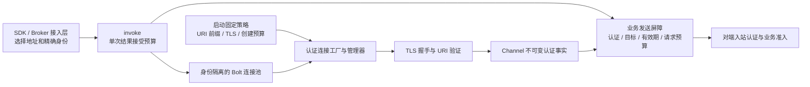

# Bolt 连接层认证与统一 invoke 生产设计

> 状态：草案基线已审，禁止直接实施。用户已确认统一调用、连接层认证、自定义 URI 身份和滚动重启更新证书的方向；独立设计 reviewer `5151be08-386f-491` Accept-as-design-baseline/findings none，仅接受未来讨论基线，不构成实施或生产授权。O1–O4 用户选择及技术退出条件仍未决，解决并重新确认前不能创建实施计划或切换生产。本文不是现状说明，也不扩大既有 A5 的实施授权。

## 摘要

将 Bolt 客户端公开入口统一为 `invoke`。调用方提供不可变的「目标」：连接地址与完整预期对端身份；固定 URI 命名空间、TLS 材料和连接创建预算由启动配置提供。连接工厂在交付连接前完成 TLS 和身份验证，Channel 发送屏障在真正放行业务命令时再次检查认证状态、目标绑定和证书有效期。业务调用器只负责序列化、结果接受预算、RPC 和响应解码，不再逐请求读取证书。

统一范围包括 Broker Peer 全部操作、Broker SDK 的首次发现和后续刷新、Gateway SDK，以及 Gossip 经 `BoltRpcClient` 的 digest/delta。不是把 `invokeAuthenticated` 改名，也不是只迁移 probe/report。所有调用完成迁移后删除旧地址入口和 `invokeAuthenticated`，不保留生产绕过路径。

继续使用项目自定义规则：叶证书在选定命名空间内恰好一个 URI SAN，且与完整预期身份精确相等；其他命名空间 URI 可以存在。不引入 SPIFFE/SPIRE，不因 URI 以 `spiffe://` 开头就声称实现 X.509-SVID。证书与信任材料更新通过到期前滚动重启生效，不做热加载。证书到期后禁止发送新业务请求，已发送请求仍按原 RPC 预算完成。

现有测试原型只证明部分公开 hook 可用，不等于该生产方案已经可交付。首次发现没有预期 ID、Gossip seed 仅有地址、后台重连、完整写入路径审计和证书链截止规则，必须在实施前按本文分别解决决策或验证缺口。

## 背景与当前事实

事实依据是当前工作树中的以下组件，不能把目标契约读成当前实现：

- `im-bolt` 的 `spi/BoltInvoker` 目前同时提供地址版 `invoke` 和八参数 `invokeAuthenticated`。`core/BoltClientInvoker` 的后者在取得连接后读取 TLS 证书，再用同一 Connection 发起请求；前者不执行这项身份校验。
- `ImBoltAutoConfiguration` 创建普通 `RpcClient`，允许应用以同类型 Bean 覆盖；`ImBoltProperties` 目前只有客户端/服务端开关、监听和 TLS keystore 配置，没有本文拟议的目标或连接策略配置。
- `BoltRequestProcessor` 从连接建立入站上下文，保留 `tlsVerified` 和完整 URI 集合；其兼容 `peerIdentity` 可能取首个 URI 或 Subject，不能把该字段直接视为严格唯一身份。
- [连接层认证原型](2026-10-20-bolt-connection-authentication-spike-design.md)及 `BoltConnectionAuthenticationSpikeTest` 是测试源码，不改变生产 Bean。原型六项测试已有 scoped Accept，但只覆盖显式关闭并从 manager 移除后的重新创建，不覆盖后台 Reconnector、轮换、所有 `ctx.write` 路径或完整预算。
- 当前依赖为 SOFA Bolt 1.6.6。公开 `RpcClient.setConnectionManager`、`DefaultConnectionManager.setConnectionFactory` 和 `RpcConnectionFactory.createConnection(Url)` 可扩展；普通 TCP active 和异步 CONNECT 事件均不是认证完成信号。
- 本地依赖字节码中 `ReconnectManager.ReconnectTask` 持有 `Url`，调用 `ConnectionManager.createConnectionAndHealIfNeed(Url)`；`DefaultConnectionManager.HealConnectionCall` 也携带 `Url` 和 pool。它们说明后台路径有可能携带目标，不证明属性、池 key 和认证屏障在实际重连时全部保留。原生 heal 失败会重排任务，需验证停止和重复失败时资源上界。

## 目标与非目标

目标是任何受支持的 Bolt 业务发送都先验证指定对端，且同址异身份不能借连接池交叉复用。认证职责归连接层，身份来源和业务授权仍归各自拥有者。

不新增全局地址到身份注册表、不为每个 peer 创建一个 RpcClient、不另建 RPC 框架，不 fork/反射访问 Bolt 私有实现。不改 JRaft 原生 transport、Dubbo、HTTP 或 WebSocket 外部传输；Broker Peer 的 `fetchQuorumReadIndex` 虽涉及 Raft 数据，仍是本次 Bolt 范围。证书签发服务、自动续期服务、吊销实时分发、热加载、性能容量保证均不是本次交付；现有签发和 secret 部署责任不能因此省略。

## 调用路线与身份来源

下表是本轮生产源码检索得到的实际调用链。后续实施需重新检索增量，不能只按本表类名建立白名单。

| 路线/操作 | 当前连接入口 | 生产目标的来源与迁移要求 |
|---|---|---|
| `BrokerPeerAdapter.probe / fetchHealthReport` | `invokeAuthenticated` | committed 目标 Broker 的 ID、routeEndpoint，配合启动时固定 Broker URI 前缀构造完整预期身份；保留现有观察上下文及失败三态映射 |
| 同 Adapter 的 `lookupRoutes / cleanupRoutes / fetchQuorumReadIndex / prepareLease / installLease / fence` | 普通 `invoke` | 所选 SDK/领域 BrokerNode 的 ID 与端点必须成对传递，不在提取 endpoint 后丢掉 ID；调用超时和业务幂等不变 |
| `BrokerClient` 注册/注销/心跳 Broker、注册/注销/心跳 Gateway、`listBrokers` | `invokeBroker` → 地址版 `invoke` | 未定向控制操作可负载均衡选一个目标，但选中后必须是地址与精确身份的一对；不能以「任意 Broker」作为免验证理由 |
| `BrokerClient.refreshClusterState / currentClusterState / BrokerRefresher` | Nacos bootstrap 地址或刷新后 ACTIVE 地址 → `GET_CLUSTER_STATE` | 当前 `discoverBootstrapAddresses` 只取 host/port；首次身份没有安全来源。待选择引导政策，缺身份直接失败；刷新后保存 committed BrokerNode 而非退化为 `List<String>` |
| `BrokerClient` 注册/注销连接、帧写入、关闭连接 | committed state 选择 RouteBroker → 地址版 `invoke` | 选择器返回完整 BrokerNode，绑定 brokerId 与 routeEndpoint；明确路由拒绝后的单次重试用新 committed 目标，绝不根据不可信 hint 直接连接 |
| `applyGatewayRouteSnapshot / acknowledgeGatewayRouteSnapshot` | 指定 RouteBroker 或遍历 committed Broker 地址 | 每次尝试携带该节点精确身份；ACK 收到 NOT_LEADER 的受控遍历可保留，认证失败不得被 catch-all 吞掉并改找另一节点 |
| `GatewayClient.writeFrame / closeConnections` | GatewayEndpointDTO → 地址版 `invoke` | 使用 DTO 的 host/port 与注册时绑定的 `workloadIdentity`。gatewayId 每次进程随机生成，不等于证书身份，不能拼成 Broker URI 或默认按 gatewayId 签证书 |
| `BrokerGossipScheduler` → `GossipSynchronizer.syncPeer` → `GossipPeerClient.exchangeDigest / pushDeltas` → `BoltRpcClient` | 全链路只有 peerAddress | 通用插件接收同一个不可变目标用于 digest/delta，不引入 Broker 类型；Broker 接入层保留已知 peer 的 ID/地址。Registry 观察 ID 不能直接假定是 Raft 稳定 brokerId；必须与可信身份绑定核对。seed-addresses 只有地址，缺身份时拒绝，政策见开放项 |
| `BoltRpcClient.invoke` | 通用地址包装 | 改为目标输入，不推断业务前缀；当前已知生产消费者为 Gossip，也必须迁移，不保留通用地址逃生口 |

当前 `BrokerClient` 装配点为 WS Gateway 的 `config/GatewayBeans`、Message 的 `infrastructure/config/RemoteAdapterConfig` 和 Account 的 `infrastructure/config/beans/AdapterBeans`；这些进程都要在构建 SDK 客户端前获得出站身份策略，不是只给 Broker Server 加配置。其各自 typed Broker 配置及配置资源也属于后续迁移范围。调用方自己的证书角色与目标 Broker 身份是两回事：Message 调 Broker 时预期对端仍是 Broker，但 Broker 入站必须继续识别 Message 的调用权限。

### 发现、身份和业务数据的信任分工

地址只回答「去哪里连接」，身份回答「允许连接到谁」。Nacos 的服务名、实例 metadata、DNS 和 IP 都不能自动成为证书身份授权源。不能先以普通连接读取响应中的 brokerId，再把响应宣称的 ID 当作本次预期身份；这会形成先信任再验证的循环。

首次 `GET_CLUSTER_STATE` 必须先验证独立提供的精确身份。已验证 Broker 返回的完整 committed state，沿用当前对已认证服务实现的信任：它是业务状态输入，不是客户端独立执行的 Raft quorum 证明。收到 state 后继续执行版本/算法/内容校验，不因 TLS 成功跳过。若需要在客户端防御恶意已认证 Broker 伪造 committed state，应另立设计，不能在本文暗示已经具备。

Gateway 注册绑定由 Broker 入站认证和 Registry 拥有；Gossip 携带的 `workloadIdentity` 只是候选路由描述，不是证书证明。使用前校验允许的 Gateway 命名空间及注册/租约绑定，随后仍以真实握手精确验证。未知、空白、开发网络占位身份不能转换为生产认证目标。Gossip 观察不因本方案成为权威成员或自动故障票。

## 方案概览



| 状态 | 唯一拥有者 | 不变量与提交位置 |
|---|---|---|
| 目标地址、完整预期身份、所属策略 | SDK/接入层在选择时构造，构造后不可变 | 不从响应回填，不修改缓存 Url；同一次请求不能在验证后切换目标 |
| TLS 材料、允许 URI 前缀和创建预算 | `im-bolt` 客户端启动配置 | 进程内固定；业务请求不能传入任意前缀改变策略 |
| 候选连接、共享创建任务、池成员 | 认证工厂/管理器 | 只有认证成功的候选可交付/入可用池；失败候选只能关闭，不能进入普通池 |
| 已验证身份、证书截止时间、状态 | 每个 Channel | 只在该 Channel 握手成功后写一次；新 Channel 不能继承旧 Channel 的认证标记 |
| 单次结果接受期限 | Invoker/单次命令 | 每个 caller 独立，不写入共享 Url，不影响其他 waiter；发送放行和结果接受均检查 |

## 详细设计

### 目标与配置契约

以下 Java 名称和属性路径都是建议名，不是已发布 API；实施前按现有风格收敛，行为不可静默改变：

```java
record BoltTarget(String address, String expectedPeerIdentity) {}
<T, R> R invoke(BoltTarget target, String service, String operation,
                T request, Class<R> responseType, int timeoutMillis);
```

目标不携带 CA、URI 前缀或「跳过认证」开关。`ImBoltProperties.Client` 增加 typed 连接策略，至少包含显式运行模式、允许的 URI 命名空间前缀集合、共享连接创建预算。前缀必须非空、带清晰节点分隔边界且互不重叠；一个完整预期身份必须唯一匹配一条前缀。Broker/Gateway 前缀可在同一个 RpcClient 中共存，无需 client-per-peer。确需一个服务级身份时，也必须配置一个完整服务 URI，不能退化为「任意匹配前缀」；是否允许 Broker bootstrap 使用服务身份尚待决定。

Broker SDK 只消费通用目标类型及部署传入的 Broker 身份配置，不读取 Server Bean、不依赖 Server 包；生产的 typed 属性由消费应用装配层提供。Gateway SDK 同样只消费目标身份规则及 DTO。`im-gossip` 只透传通用目标，不知道 brokerId、Raft 或 Broker Registry；Broker 在进入插件前完成转换。SDK 构造器及默认 Bean、直接 new 的调用者和测试 fixture 均需同步迁移，不能增加无人使用的兼容构造器。

当前 keystore 同时承载本机证书链和受信 CA，首版沿用 Bolt 已支持配置，不凭空声明已有独立 trust-store 或动态 TrustManager 能力。启动校验 TLS 开关、mTLS 服务端要求、材料存在及策略一致性；密码仅从 secret 注入，不进入日志。默认与本地启动方式的最终键值在计划中落实，不能让缺少生产配置静默变明文。

### 创建、认证和池复用

1. Invoker 在序列化前记录单调起点，校验目标与 timeout。每次构造独立内部 Url，把完整目标和身份感知 uniqueKey 成对绑定。uniqueKey 用无歧义编码包含地址和完整身份；模式/固定策略作用域也必须隔离。禁止简单字符串分隔拼接碰撞、修改 Bolt 缓存解析 Url 或用全局 address→identity 可变表。
2. 管理器按该 key 共享创建任务。创建任务拥有自己的固定单调预算，覆盖候选连接建立和认证等待；不会采用第一个 caller 的短预算作为共享任务寿命。候选 Channel 在 connect 前绑定目标并安装发送屏障。
3. 装饰原生 `RpcConnectionFactory.createConnection(Url)`，等待真实 TLS 握手、受信链验证、叶证书 URI 唯一/精确匹配及有效期事实可用后，才返回可交付 Connection。只出现 TCP active/CONNECT 不放行业务。无身份属性的 String、Url、地址重载或后台创建均应明确拒绝，不能转普通工厂。
4. 同一地址预期 B 和 C 的创建与连接池分别隔离。验证为 B 的 Channel 只能服务预期 B，不允许把 Channel 属性覆盖成 C。取出池连接时还要检查其绑定与状态，避免 stale/外部注入 Connection 被当作已认证。
5. 新连接认证失败、创建预算耗尽或初始化失败时，工厂关闭本次候选，失败任务不留作可用池命中；后续受控调用可重新创建，但仍走相同验证，不自动重放原业务请求。

原型用 `ThreadLocal` 在同步创建调用链内暂存目标，再以 `bootstrap.clone().attr(...)` 在 connect 前绑定 Channel。生产可沿公开 hook 验证此实现，但必须在每个实际创建入口从 Url 建立作用域，重入时恢复上层值、finally 清理；不能假设 caller 线程的 ThreadLocal 会传入后台 heal。缺少 Url 身份时拒绝。若公开 hook 无法覆盖实际路径，实施保持 blocked，不复制 initializer、反射或 fork 来掩盖缺口。

### Channel 发送屏障与在途请求

屏障至少区分 `PENDING`、`AUTHENTICATED`、`EXPIRED`、`FAILED/CLOSED`。只有 `AUTHENTICATED` 且身份绑定相等、当前墙钟未到截止、当前命令单调预算仍可用，才允许业务命令进入编码/写出路径。这是「新发送已准入」的线性化点；不是远端已执行或完成证明。

首版建议 pending 写入直接失败而非在 gate 内排队；正常 Invoker 在连接交付后才发送，早期 CONNECT 回调的直接调用必须在编码前拒绝。这样不引入另一套 pending 请求缓存。每个失败 promise 保留具体原因，不能只表现为远端 timeout。

单次目标与预算应附着到内部出站命令上下文，由 gate 在编码前消费，不新增远端 wire 身份字段；具体如何关联 Bolt RpcRequestCommand 与本机请求对象须在公开 hook 验证中固定。不能把某 caller 的 deadline 写成共享 Channel 属性，否则并发请求会互相覆盖。原生直接调用若缺少受控命令上下文，应拒绝其业务发送，而非默认无限预算。

仅把 gate 加在 pipeline 尾部不够。Netty 的 `ctx.write` 从当前 context 向前传播，位于 gate 前方的 handler 可能绕过尾部 gate。生产必须逐条审计原生 Bolt 编码器、heartbeat、CONNECT listener、自定义 handler、直接 Connection 重载和 ctx.write 的实际写入起点，选择能在业务编码前覆盖这些起点的公开安装位置，并以计数器证明。TLS 握手帧、RPC 响应和必要协议控制帧与新业务请求分开处理，不能因认证 gate 死锁握手，或因证书到期阻断已发送请求的响应。若无法完整覆盖则不发布，不以 handler 最终零次替代「业务未提前放行」。

证书在请求序列化或池等待期间到期，则 gate 拒绝该新发送。到期前已放行的请求可按原预算结束，不能为其续时；到期不能主动关闭仍有在途请求的 Channel。管理器将过期连接移出新发送候选，按每个 Channel 实际放行的请求登记在途，保留至底层完成或原 RPC 预算终止后再关闭；caller 提前放弃等待不能提前清空其他请求的在途计数。新调用可创建新连接，但若远端仍使用过期材料仍应失败，不能回退明文或跳过有效期检查。

### 两种预算不能混在一起

- **共享连接创建预算**：管理器/工厂拥有，启动时固定；覆盖连接和认证。创建失败只能结束自己的候选；不能被某个短 caller 的 timeout/cancel 取消。DNS/原生同步调用若无法中断，超过预算后也不得交付迟到连接，需在真实返回后关闭候选。
- **单次 caller 等待与结果接受预算**：从序列化前开始，用单调时钟覆盖准备、共享池等待、RPC、解码。等待共享任务使用剩余预算；超时仅停止自己的等待，不 cancel 共享 future，不关闭别的 caller 正使用的连接。取得连接后、gate 放行前和解码后分别检查，迟到不发新请求、不接受迟到成功。

`DefaultConnectionManager` 的共享 future 和同步 DNS 仍可能使底层线程超时后未结束。必须先验证公开 hook 能否提供有界 waiter；若不能，明确保留当前「结果接受预算而非硬返回期限」契约，不用无限异步线程伪造硬期限。应用现有有界执行器、队列及实际完成闸门继续保留，不因调用方不再等就释放仍运行任务的闸门。计划中需固定创建任务/队列与池的资源上限和清理证据，容量未经实测不报 TPS 或机器规格。

### 失败分类保持来源，不把安全错误变成故障票

继续使用 `BoltInvocationException.Failure` 四类和原始 cause。工厂/manager/gate 的包装异常必须保留分类穿透信息；不能仅凭「发生在 getConnection」就归为不可达。

| 情形 | 分类与行为 |
|---|---|
| URI 缺失/歧义/不符、TLS/证书链验证失败、证书过期 | `AUTHENTICATION`；禁止业务发送，禁止换普通连接、其他身份或明文重试 |
| caller 接受预算耗尽、连接等待迟到、共享创建等待耗尽、队列拒绝、目标/配置无效、中断 | `LOCAL`；中断恢复线程标志；不作为远端不可达证据 |
| 在接受预算内，连接/RPC 阶段明确可归因的 ConnectException、SocketTimeoutException、InvokeTimeoutException、Netty ConnectTimeoutException | `TRANSPORT_UNAVAILABLE`；保留当前受限可归因集合，不把任意 channel 关闭都扩充为不可达 |
| 非 BoltResponse、不成功响应、解码/响应协议不合法 | `PROTOCOL`；不证明目标故障，也不自动重放副作用 |

保持现有优先级：caller 获取连接在预算后才成功或失败，caller 结果为 `LOCAL`，底层认证失败仍保留在 cause/创建审计中；明确 TimeoutException 的本机预算是 `LOCAL`；预算内的 SSL/Certificate cause 是 `AUTHENTICATION`。原生包装后的错误需在真实路径回归。probe/report 仅将 `TRANSPORT_UNAVAILABLE` 变为 UNHEALTHY，其余 UNKNOWN，不扩大可计票集合。普通 SDK 的异常形态变化需要同步测试和说明。

### 后台重连、预热与生命周期

预热只接受与正常调用相同的目标，走同一工厂和 key；不得用裸地址提前建立普通池。自然失效、pool heal、自动重连必须保留原目标 Url、身份属性和 key，每个新 Channel 重新握手验证。旧连接的认证事实、caller 预算和 ThreadLocal 不得成为后台任务的隐式输入。

对 Bolt 1.6.6 的 `ReconnectManager`、`DefaultConnectionManager.createConnectionAndHealIfNeed` 和 `HealConnectionCall` 做真实集成验证，包含错误身份换服、自然关闭、重复失败与 shutdown。原生队列失败重排不能无限积压失效目标或已停止客户端；是否能用公开生命周期钩子停止对应任务需取得测试证据。未通过时首版禁用相应自动预热/重连能力，且只有在证明依赖默认设置和所有入口均已禁用后才能采用按需重建；这不是认证失败后的降级路径。若产品要求必须启用而公开 hook 不能满足，则阻塞发布并回到设计 Review。

Spring 创建的 `RpcClient`、manager、reconnector、专用执行器由同一配置生命周期拥有，初始化中途失败也应反向关闭已分配资源。失败工厂拥有未入池候选，manager 拥有入池及过期排空连接，Invoker 不关闭共享连接。停机先拒绝新调用、停止创建/重连，再在已有 shutdown 边界内收口在途并关闭 Channel，最后关闭执行器。不得双重关闭应用外部拥有的客户端。

`@ConditionalOnMissingBean` 不能把任意外部注入的 RpcClient 自动包装为「安全」。生产 Bean 启动时应验证该客户端确实安装了受支持工厂、管理器、gate 和固定策略；建议由受控装配返回可检验能力而非仅检查 TLS enabled。无法证明能力时启动失败，不静默回普通 invoke，也不假定自定义 BoltInvoker 已遵守契约。具体能力类型名称留实施前 Review，需有外部 Bean 正/负装配测试，不新增泛化能力注册框架。

## 入站安全与明文开发边界

出站验证证明「调用方连到预期接收方」；入站 mTLS 证明「接收方看到哪个调用方」。二者不替代对方，更不替代成员资格、角色、scope/audience、Gateway 租约、epoch、Lease/fence、幂等和协议内容校验。Broker 的 observation 严格准入、Peer/Gossip 成员校验、Gateway route 注册绑定及 Gateway 的 Broker 授权继续保留。

生产必须关闭可信网络身份回退，服务端要求 client auth；严格身份从握手成功证书的命名空间唯一 URI 取得，不能用 `peerIdentity` 的首 URI/Subject 兼容值。入站也需在新业务请求准入检查客户端证书有效期，过期前已准入用例仍按自己的预算完成；响应写回不被误当新调用。具体身份到权限的映射归拥有模块，不塞进通用连接工厂。

保留明文开发模式仅作为**建议的显式受限模式，待用户确认限制集合**：使用独立配置档和回环/隔离测试网络、仅合成数据，生产环境不得启用；没有 TLS 身份能力，不能发放观察票或启用自动故障摘流。普通开发路由能否保留当前可信网络权限，需要明确列出允许操作，不能让 TLS 失败自动选择此模式。目标类型可在两种模式共用，但配置必须选择其一，不能按目标或异常隐式降级。测试替身也不能通过 null 身份或不安全 RpcClient 绕过生产装配检查。

## 证书更新、有效期与运维

用户已批准：无热加载；更新文件不改变已建立 SSL Context 或已认证 Channel。运维在到期前分发新证书/CA 并滚动重启，观察双向新连接成功再继续下一节点。信任 CA 变更需先分发同时信任新旧 CA 的材料并滚动重启，再切换叶证书，再移除旧 CA 并滚动重启；是否允许这段重叠及运维窗口由部署评审确认，不承诺无中断。

**待批准的截止规则建议**：本机证书链和对端经验证证书链均参与有效期约束，取实际验证路径中叶证书及中间 CA 的最早 `notAfter`，到达即不可新发送；信任锚作为配置的信任基础，不纳入这个运行期最小值。握手时同时校验这些证书的 `notBefore`，并在每次新发送/入站准入按墙钟检查有效区间。生产必须证明取得的是验证使用的路径，而不是把远端随意附带的证书集合当成已验证链。若当前 Bolt/JSSE 公开接口无法证明路径，应阻塞该建议的实施并提交替代规则 Review，不自行改成叶证书即可。

该规则尚未获用户批准，尤其是否约束信任锚、是否同时约束本机链，见开放项。证书绝对有效期使用墙钟，请求预算使用单调时钟；墙钟回拨、时间同步失常仍有安全风险，不声称本方案消除时钟风险。不实现在线吊销或撤销已准入业务；紧急私钥泄露需独立停机/撤信任运维处置，不能等待正常到期。

审计区分创建、握手、身份拒绝、过期拒绝、caller 超预算与协议失败，记录策略、阶段、对端及 cause，不记录私钥、密码或请求内容。身份可进入受控日志，不作为无限基数指标标签；指标用固定 mode/phase/failure 标签。证书到期预警、创建失败率、池/候选/在途数量和关闭结果应可观察，告警提前量及资源数值在实施配置评审中固定，不在无证据时虚构生产阈值。

## 运维与交付

这是未来变更，无本轮生产发布。实施授权后按「先安全连接能力与负例 → 全部调用方成组迁移 → 删除旧入口 → 完整集成验收」推进，不创建可对外部署的半迁移版本。内部施工可以分步，但任何发布版本不能同时留下可用的地址版普通调用。`invokeAuthenticated` 只有全部路线和测试 fixture 都迁移后才删除；最终检索必须为零生产旧调用和零地址绕过。

现有业务 wire payload 不因目标类型自动改变，SDK Java API 与配置仍是不兼容变更，消费方必须同步重建；部署先准备证书、绑定、配置和所有消费方。是否存在已上线旧版本、能否成组维护发布尚待确认；不得在未知上线事实下声称支持混合版本。若需要在线迁移，先另行批准明确窗口与服务端安全约束，不能临时保留 legacy bypass。

回滚是停止新流量后整体恢复上一个经验证的版本与匹配材料/配置，不是把认证错误改走普通 invoke。旧版本不满足新身份保证，回滚需明确接受安全能力回退并保持网络隔离。证书链、URI 绑定或 SDK 配置错误时失败关闭；不自动更换预期身份、不从响应学习可信身份、不重放结果未知的副作用。

## 实施前必须确认的选择

以下不是已批准决定。状态保持待 Review，但存在阻塞项时仍按草案门槛处理，不能创建 execution plan。

| ID | 待决定问题 | 建议及可行替代 | 未决定时行为 |
|---|---|---|---|
| O1 | Nacos bootstrap 与 Gossip seed 的精确身份从何取得；Gossip 已知观察 ID 如何对应稳定证书身份 | 建议部署显式提供地址与完整身份配对；Nacos 仅给候选地址，与配对配置交集。替代是将受 ACL/发布权限控制的 Nacos identity metadata 明确纳入安全控制面并校验冲突；或单独批准 bootstrap 专用精确服务身份及其授权范围。不能自行宣称 metadata 已可信，也不能直接接受任意 Broker 前缀 | 无独立预期身份则拒绝 bootstrap/seed；不能取得首份状态。需用户选择信任根及维护责任 |
| O2 | 运行期截止取哪些证书，如何获得经验证路径 | 建议采用上一节的本机/对端叶证书与中间 CA 最小值，不含信任锚；可替代为明确包含锚的保守规则，但会增加锚证书到期停服风险 | 不能仅依据原型的叶证书检查声称完成生产有效期保证；需用户确认政策与技术证据 |
| O3 | 明文开发允许的业务操作，以及是否强制仅回环地址 | 建议仅显式本地/隔离测试、合成数据、无自动故障票；若需跨容器隔离网开发，明确网段和部署防误用检查 | 不允许认证失败回退；生产只支持 mTLS。开发迁移的最终允许表待批准 |
| O4 | 是否已有线上消费方、能否同步发布，以及是否要求首版开启原生自动重连/预热 | 建议无双协议安全绕过、同版成组发布；自动能力仅在实际覆盖后启用，未证明可禁用时不得上线 | 不能承诺混合窗口或不停服；发布计划必须先确认事实与要求 |

接口命名、配置键、正数预算/资源上限可以在设计批准后的计划中按职责补齐，但若改变以上信任或可用性取舍必须重新 Review。

## 验证策略

以下是**未来验证要求，不是本轮已运行证据**。用真实 TLS、可控时钟、latch/future 和有界等待；不用 sleep 证明时序。非法请求同时断言编码前 forwarded 为 0、对端 handler 为 0 和明确失败分类/cause；只看 handler 为 0 不足以证明无泄露。

| 不变量/边界 | 稳定 RED 反证 | GREEN 与验收要求 |
|---|---|---|
| 工厂交付前认证 | 原生无屏障工厂在握手 pending 时提前交付/写业务 | 真实 TLS 正确、错误、无/重复/多匹配 URI、其他命名空间 URI、明文、缺目标；正确可复用，非法编码前零放行 |
| gate 无旁路 | CONNECT 回调 Connection 重载和各实际 ctx.write 起点绕过尾部 gate | 每个已审计起点独立 attempted/forwarded 计数；握手帧/响应正常，不以 mock 代替实际 pipeline |
| 池身份隔离 | 同址 B/C 使用同 key 或覆盖 Url 属性 | B 成功复用、C 身份拒绝且不复用 B；并发创建及不同命名空间均无覆盖，key 编码碰撞负例 |
| 共享创建与 caller 独立 | 短 caller 取消共享 future 导致长 caller 失败 | 两 waiter，一个超时 LOCAL，另一个仍成功；迟到 caller 无新发送，创建超时候选被关闭；序列化/等待/解码逐阶段超预算拒绝 |
| 原始归因 | 将工厂 SSL 包装错误当连接不可达 | 对现有四分类及优先级做表驱动/真实 TLS 回归；probe/report UNKNOWN/UNHEALTHY 语义不扩大 |
| 过期与在途 | 只在握手检查、到期立即关闭 Channel | 可控墙钟跨 notAfter 等号边界，新发送零放行，已发送延迟响应按原预算完成；本机与对端链、较早中间 CA、重启前后材料生效边界 |
| 后台创建 | 去掉 Url 身份或继承旧 Channel 标记 | 自然失效、后台 Reconnector/heal、预热、同址换错误证书均重验；测试不是显式 manager.remove 的重复替代 |
| 发现信任 | 从 bootstrap 响应学 ID 或丢失刷新后 ID | 未知 Nacos/seed 身份失败关闭，冲突绑定拒绝，首份 state 及刷新/路由重试/ACK 各次目标捕获验证 |
| 全路线无旧入口 | Gossip String peerAddress 或某 SDK 留地址 invoke | Peer 八方法、BrokerClient 全表、Gateway 两方法、Gossip digest/delta、BoltRpcClient 全部捕获地址+身份；生产源码与直接 RpcClient 调用架构检查 |
| 装配与清理 | 外部普通 RpcClient 被自动认为安全；初始化中途抛错 | 覆盖 Bean 正/负例；候选 closeFuture 成功且 !open，停机/失败时队列、线程、pool 和临时证书目录收口；不关闭其他 caller 连接 |
| 入站与开发隔离 | 出站成功就跳过 caller/member/Lease，或 TLS 失败走明文 | 错角色、非成员、过期 caller、错误 audience/scope、失效 Gateway 租约、开发模式观察票全部拒绝 |

批准后从窄到宽固定命令：

```bash
mvn -q -pl im-plugin/im-bolt -am test
mvn -q -pl im-plugin/im-gossip -am test
mvn -q -pl im-broker/im-broker-sdk -am test
mvn -q -pl im-gateway/im-ws-gateway/im-ws-gateway-sdk -am test
mvn -q -pl im-broker/im-broker-server -am test
./scripts/verify.sh architecture
./scripts/verify.sh behavior
./scripts/verify.sh e2e
./scripts/verify.sh startup
./scripts/verify.sh quick
./scripts/verify.sh clean
./scripts/verify.sh full
```

精确新测试类/方法由计划在修改前固定，不提前声称命令会覆盖尚未写的用例。Broker reactor 当前私有 JRaft 制品解析限制仍按既有事实处理，不以本方案绕过。需要真实多 Broker 双向 TLS、Gateway 注册/下行、Gossip、Message/Account SDK 消费方启动及滚动重启场景；HA fixture 的替代 Gateway ACK 不是真实 Gateway E2E。机器证据须匹配当前 HEAD/工作树，任何早层失败先归因再推进。最终独立 Review 与机器门禁缺一不可。

## 后续文档与执行

本轮只形成生产决策提案，不改代码、不运行 Maven/网络，不新建或推进实施任务。readiness 已运行并通过；文档静态核对不能算生产 GREEN。

开放项解决、用户确认且独立 Review 无 Blocker/Major 后，由协调者登记唯一实施计划。实施后再更新根及 Broker/Gateway Architecture、im-bolt/im-gossip 与两 SDK README、消费方配置说明、SECURITY/RELIABILITY，以及 Harness 的无地址绕过与认证失败归因规则。规则自动化应优先用最窄架构/契约检查；完整 ctx.write 覆盖仍需实际 pipeline 测试及独立审计，不能靠类名例外放行。

## 附录 A：备选方案与依据

- **保留逐次认证并迁移全部调用方**：可沿用当前同连接保证，改动集中在 Invoker；但每次调用都要传固定策略，后台创建与直接 Connection 写入仍需另设屏障。作为可行保守替代，不满足本次已确认的连接层职责目标。
- **连接工厂认证、Channel gate 与身份隔离池**：本文方向。把一次连接的认证事实归连接所有，但必须承担 pipeline 路径、后台任务、资源生命周期和有效期的验证成本；原型成功不免除这些成本。
- **仅 CONNECT 事件验证**：事件异步，无法独立阻止提前发送，不作为生产安全方案。按 peer 新建 RpcClient 虽可隔离池，却扩大线程与生命周期数量，也不能消除 gate/重连问题，故不采用。

库能力依据为本地 SOFA Bolt 1.6.6 的上述公开类/API 与字节码，以及仓库测试原型；临时 javap 文件不作为可移植规范。X.509 有效期和路径语义参考 RFC 5280（https://www.rfc-editor.org/rfc/rfc5280）；该标准不能替本项目决定长连接到期时的业务准入政策。SPIFFE X.509-SVID 规范（https://spiffe.io/docs/latest/spiffe-specs/x509-svid/）仅用于区分标准与自定义 URI 规则，不宣称本项目合规。本轮未进行网络查询。

## 附录 B：决策记录

| ID | 来源/问题 | 决策及批准范围 | 理由与影响 |
|---|---|---|---|
| D1 | 用户确认身份形式 | 沿用自定义唯一命名空间 URI + 完整身份精确匹配，不引入 SPIFFE/SPIRE | 固定原有签发责任，不能把前缀匹配当完整认证 |
| D2 | 用户确认调用范围 | 全部 Bolt 调用统一 invoke，目标绑定地址与预期身份，固定规则由配置提供 | 包含 SDK 引导、刷新和 Gossip，不仅 probe/report；类型名仍为建议 |
| D3 | 用户确认职责与绕过 | 工厂/连接层认证、身份感知池 key、业务发送前 gate，无认证失败回退 | 接收方认证与业务授权保留，不建注册框架或 client-per-peer |
| D4 | 用户确认证书更新 | 不热加载，滚动重启生效；到期不发新请求，在途按原预算完成 | 截止取链范围尚待 O2 决定，不能据此宣称轮换已验证 |
| D5 | 本文生产提案 | 共享创建预算与单 caller 接受预算隔离、保留失败来源及清理所有权 | 尚待独立 Review；不承诺 Bolt 同步 DNS 硬返回期限 |
| D6 | 调查暴露身份缺口 | 首次发现/seed 不从响应学习身份，缺独立预期身份失败关闭 | O1 需用户决定安全控制面，不能静默发明审批 |

## 附录 C：独立 Review

本文由 reviewer `5151be08-386f-491` 全文独立审查，结论 Accept-as-design-baseline，无必须修改finding；O1–O4和技术可行性仍阻塞实施，不把基线审查当完整生产方案批准。原型设计 reviewer `0461448d-b90c-462` 的 Accept 与实现 reviewer `67e6d4d5-1e52-4a6` 的 scoped Accept 仅适用于原型，不沿用为本文批准。Review 需重点核对 O1/O2、后台 Url 传播、ctx.write 覆盖、两类预算、入站权限及全路线退出条件；尚未证明的库能力以阻塞验证项处理，而非写成已经实现的保证。
