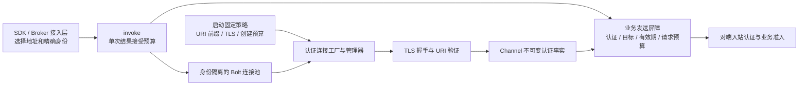

# Bolt 连接层认证与统一 invoke 生产设计

> 状态：D11 已批准（`Approved`）。用户已批准受控发送与同 JVM 可信代码边界，独立设计 reviewer `1fb8baed-2232-4e1` Approved/findings none。对应[实施计划](../exec-plans/completed/2026-10-22-bolt-unified-invoke.md)已获计划 reviewer `1a730f5e-903f-4cb` 全文及精确 diff Review Approved/findings none；T1 唯一 active/WIP=1，仅恢复 test-only，完整技术退出仍 pending。D10/B 及 reviewer `aa137e0a-4814-47d` Approved/findings none 保留；历史设计/计划 Review 不覆盖本次计划修订。raw 预编码业务旁路仍是旧 all-origin 主张的有效反证，不变为运行期拒绝或 GREEN。不授权生产迁移或上线，不恢复已归档 A5。

> 当前增量：D14 原生 TLS 材料加载收敛已获用户明确批准，独立设计 reviewer `c80596b3` 最终 Accept、无 remaining；首轮 Revise 的现行措辞矛盾已关闭，仅授权既有测试有限调整，不实施 D13 或生产材料快照。D13 是未批准候选，已由 D14 取代，不实施，不新增私有 secret 副本。上行 D11/计划批准及 T1 状态为历史记录；当前 T1–T3 passing、T4 active/Block、T5/T6 not_started，Loop#3 expired，不自动续期。

## 摘要

将 Bolt 客户端公开入口统一为 `invoke`。调用方提供不可变的「目标」：连接地址与完整预期对端身份；固定 URI 命名空间、TLS 材料和连接创建预算由启动配置提供。连接工厂在交付连接前完成 TLS 和身份验证，Channel 发送屏障在真正放行业务命令时再次检查认证状态、目标绑定和证书有效期。业务调用器只负责序列化、结果接受预算、RPC 和响应解码，不再逐请求读取证书。

统一范围包括 Broker Peer 全部操作、Broker SDK 的首次发现和后续刷新、Gateway SDK，以及 Gossip 经 `BoltRpcClient` 的 digest/delta。不是把 `invokeAuthenticated` 改名，也不是只迁移 probe/report。所有调用完成迁移后删除旧地址入口和 `invokeAuthenticated`，不保留受支持的业务绕过入口；D11 明确排除的 raw 写入不是受支持 API，也不是 gate 可隔离的恶意同 JVM 行为。

继续使用项目自定义规则：叶证书在选定命名空间内恰好一个 URI SAN，且与完整预期身份精确相等；其他命名空间 URI 可以存在。不引入 SPIFFE/SPIRE，不因 URI 以 `spiffe://` 开头就声称实现 X.509-SVID。证书与信任材料沿 Bolt 原生加载语义，不承诺自动热更新，也不保证同进程所有新 Channel 固定旧材料；完整原子交付与滚动重启是运维建议，不是新连接只在重启后才能使用新材料的门禁（D14）。证书到期后禁止发送新业务请求，已发送请求仍按原 RPC 预算完成。

现有测试原型只证明部分公开 hook 可用，不等于该生产方案已经可交付。首次发现没有预期 ID、Gossip seed 仅有地址、后台重连、完整写入路径审计和 D10 会话证书数组有效期规则，必须在实施前按本文分别解决决策或验证缺口。

## 背景与当前事实

事实依据是当前工作树中的以下组件，不能把目标契约读成当前实现：

- `im-bolt` 的 `spi/BoltInvoker` 目前同时提供地址版 `invoke` 和八参数 `invokeAuthenticated`。`core/BoltClientInvoker` 的后者在取得连接后读取 TLS 证书，再用同一 Connection 发起请求；前者不执行这项身份校验。
- `ImBoltAutoConfiguration` 创建普通 `RpcClient`，允许应用以同类型 Bean 覆盖；`ImBoltProperties` 目前只有客户端/服务端开关、监听和 TLS keystore 配置，没有本文拟议的目标或连接策略配置。
- `BoltRequestProcessor` 从连接建立入站上下文，保留 `tlsVerified` 和完整 URI 集合；其兼容 `peerIdentity` 可能取首个 URI 或 Subject，不能把该字段直接视为严格唯一身份。
- [连接层认证原型](2026-10-20-bolt-connection-authentication-spike-design.md)及 `BoltConnectionAuthenticationSpikeTest` 是测试源码，不改变生产 Bean。原型六项测试已有 scoped Accept，但只覆盖显式关闭并从 manager 移除后的重新创建，不覆盖后台 Reconnector、轮换、所有 `ctx.write` 路径或完整预算。
- 当前依赖为 SOFA Bolt 1.6.6。公开 `RpcClient.setConnectionManager`、`DefaultConnectionManager.setConnectionFactory` 和 `RpcConnectionFactory.createConnection(Url)` 可扩展；普通 TCP active 和异步 CONNECT 事件均不是认证完成信号。
- 本地依赖字节码中 `ReconnectManager.ReconnectTask` 持有 `Url`，调用 `ConnectionManager.createConnectionAndHealIfNeed(Url)`；`DefaultConnectionManager.HealConnectionCall` 也携带 `Url` 和 pool。它们说明后台路径有可能携带目标，不证明属性、池 key 和认证屏障在实际重连时全部保留。原生 heal 失败会重排任务，需验证停止和重复失败时资源上界。

## 目标与非目标

目标是在 D11 的受控装配及同 JVM 可信代码前提下，受控 invoke 和经审计的公开 RpcClient typed-command 路径（包括直接 Connection 重载和 CONNECT 回调）都在业务编码前验证指定对端；缺少本机命令上下文即拒绝，同址异身份不能借连接池交叉复用。认证职责归连接层，身份来源和业务授权仍归各自拥有者。

不新增全局地址到身份注册表、不为每个 peer 创建一个 RpcClient、不另建 RPC 框架，不 fork/反射访问 Bolt 私有实现。不改 JRaft 原生 transport、Dubbo、HTTP 或 WebSocket 外部传输；Broker Peer 的 `fetchQuorumReadIndex` 虽涉及 Raft 数据，仍是本次 Bolt 范围。证书签发服务、自动续期服务、吊销实时分发、热加载、性能容量保证均不是本次交付；现有签发和 secret 部署责任不能因此省略。

## 调用路线与身份来源

下表是本轮生产源码检索得到的实际调用链。后续实施需重新检索增量，不能只按本表类名建立白名单。

| 路线/操作 | 当前连接入口 | 生产目标的来源与迁移要求 |
|---|---|---|
| `BrokerPeerAdapter.probe / fetchHealthReport` | `invokeAuthenticated` | committed 目标 Broker 的 ID、routeEndpoint，配合启动时固定 Broker URI 前缀构造完整预期身份；保留现有观察上下文及失败三态映射 |
| 同 Adapter 的 `lookupRoutes / cleanupRoutes / fetchQuorumReadIndex / prepareLease / installLease / fence` | 普通 `invoke` | 所选 SDK/领域 BrokerNode 的 ID 与端点必须成对传递，不在提取 endpoint 后丢掉 ID；调用超时和业务幂等不变 |
| `BrokerClient` 注册/注销/心跳 Broker、注册/注销/心跳 Gateway | `invokeBroker` → 地址版 `invoke` | 未定向控制操作可负载均衡选一个目标，但选中后必须是地址与精确身份的一对；不能以「任意 Broker」作为免验证理由 |
| `BrokerClient.refreshClusterState / currentClusterState / BrokerRefresher` | Nacos bootstrap 地址或刷新后 ACTIVE 地址 → `GET_CLUSTER_STATE` | 当前 `discoverBootstrapAddresses` 只取 host/port；首次身份没有安全来源。按 O1 使用部署显式配对，缺身份直接失败；刷新后保存 committed BrokerNode 而非退化为 `List<String>` |
| `BrokerClient` 注册/注销连接、帧写入、关闭连接 | committed state 选择 RouteBroker → 地址版 `invoke` | 选择器返回完整 BrokerNode，绑定 brokerId 与 routeEndpoint；明确路由拒绝后的单次重试用新 committed 目标，绝不根据不可信 hint 直接连接 |
| `applyGatewayRouteSnapshot / acknowledgeGatewayRouteSnapshot` | 指定 RouteBroker 或遍历 committed Broker 地址 | 每次尝试携带该节点精确身份；ACK 收到 NOT_LEADER 的受控遍历可保留，认证失败不得被 catch-all 吞掉并改找另一节点 |
| `GatewayClient.writeFrame / closeConnections` | GatewayEndpointDTO → 地址版 `invoke` | 使用 DTO 的 host/port 与注册时绑定的 `workloadIdentity`。gatewayId 每次进程随机生成，不等于证书身份，不能拼成 Broker URI 或默认按 gatewayId 签证书 |
| `BrokerGossipScheduler` → `GossipSynchronizer.syncPeer` → `GossipPeerClient.exchangeDigest / pushDeltas` → `BoltRpcClient` | 全链路只有 peerAddress | 通用插件接收同一个不可变目标用于 digest/delta，不引入 Broker 类型；Broker 接入层保留已知 peer 的 ID/地址。Registry 观察 ID 不能直接假定是 Raft 稳定 brokerId；必须与可信身份绑定核对。seed-addresses 只有地址，缺身份时拒绝，政策见 O1 |
| `BoltRpcClient.invoke` | 通用地址包装 | 改为目标输入，不推断业务前缀；当前已知生产消费者为 Gossip，也必须迁移，不保留通用地址逃生口 |

当前 `BrokerClient` 装配点为 WS Gateway 的 `config/GatewayBeans`、Message 的 `infrastructure/config/RemoteAdapterConfig` 和 Account 的 `infrastructure/config/beans/AdapterBeans`；这些进程都要在构建 SDK 客户端前获得出站身份策略，不是只给 Broker Server 加配置。其各自 typed Broker 配置及配置资源也属于后续迁移范围。调用方自己的证书角色与目标 Broker 身份是两回事：Message 调 Broker 时预期对端仍是 Broker，但 Broker 入站必须继续识别 Message 的调用权限。

### 发现、身份和业务数据的信任分工

地址只回答「去哪里连接」，身份回答「允许连接到谁」。Nacos 的服务名、实例 metadata、DNS 和 IP 都不能自动成为证书身份授权源。不能先以普通连接读取响应中的 brokerId，再把响应宣称的 ID 当作本次预期身份；这会形成先信任再验证的循环。

首次 `GET_CLUSTER_STATE` 必须先验证独立提供的精确身份。已验证 Broker 返回的完整 committed state，沿用当前对已认证服务实现的信任：它是业务状态输入，不是客户端独立执行的 Raft quorum 证明。收到 state 后继续执行版本/算法/内容校验，不因 TLS 成功跳过。若需要在客户端防御恶意已认证 Broker 伪造 committed state，应另立设计，不能在本文暗示已经具备。

Gateway 注册绑定由 Broker 入站认证和 Registry 拥有；Gossip 携带的 `workloadIdentity` 只是候选路由描述，不是证书证明。使用前校验允许的 Gateway 命名空间及注册/租约绑定，随后仍以真实握手精确验证。未知、空白、开发网络占位身份不能转换为生产认证目标。Gossip 观察不因本方案成为权威成员或自动故障票。

## 方案概览



| 状态 | 唯一拥有者 | 不变量与提交位置 |
|---|---|---|
| 目标地址、完整预期身份、所属策略 | SDK/接入层在选择时构造，构造后不可变 | 不从响应回填，不修改缓存 Url；同一次请求不能在验证后切换目标 |
| TLS 材料路径/option 配置、允许 URI 前缀和创建预算 | `im-bolt` 客户端启动配置 | 启动固定的是路径/option 配置值，不是文件中的材料 bytes；材料沿 D14 原生加载语义，已有 Channel 保持其 session，新 Channel 不继承旧认证事实；业务请求不能传入任意前缀改变策略 |
| 候选连接、共享创建任务、池成员 | 认证工厂/管理器 | 只有认证成功的候选可交付/入可用池；失败候选只能关闭，不能进入普通池 |
| 已验证身份、证书截止时间、状态 | 每个 Channel | 只在该 Channel 握手成功后写一次；新 Channel 不能继承旧 Channel 的认证标记 |
| 单次结果接受期限 | Invoker/单次命令 | 每个 caller 独立，不写入共享 Url，不影响其他 waiter；发送放行和结果接受均检查 |

## 详细设计

### 目标与配置契约

以下 Java 名称和属性路径都是建议名，不是已发布 API；实施前按现有风格收敛，行为不可静默改变：

```java
record BoltTarget(String address, String expectedPeerIdentity) {}
<T, R> R invoke(BoltTarget target, String service, String operation,
                T request, Class<R> responseType, int timeoutMillis);
```

目标不携带 CA、URI 前缀或「跳过认证」开关。`ImBoltProperties.Client` 增加 typed 连接策略，至少包含显式运行模式、允许的 URI 命名空间前缀集合、共享连接创建预算。前缀必须非空、带清晰节点分隔边界且互不重叠；一个完整预期身份必须唯一匹配一条前缀。Broker/Gateway 前缀可在同一个 RpcClient 中共存，无需 client-per-peer。确需一个服务级身份时，也必须配置一个完整服务 URI，不能退化为「任意匹配前缀」；本次 bootstrap 采用部署显式提供的节点地址与完整身份配对，不引入 bootstrap 专用服务身份。

Broker SDK 只消费通用目标类型及部署传入的 Broker 身份配置，不读取 Server Bean、不依赖 Server 包；生产的 typed 属性由消费应用装配层提供。Gateway SDK 同样只消费目标身份规则及 DTO。`im-gossip` 只透传通用目标，不知道 brokerId、Raft 或 Broker Registry；Broker 在进入插件前完成转换。SDK 构造器及默认 Bean、直接 new 的调用者和测试 fixture 均需同步迁移，不能增加无人使用的兼容构造器。

当前 keystore 同时承载本机证书链和受信 CA，首版沿用 Bolt 已支持配置，不凭空声明已有独立 trust-store 或动态 TrustManager 能力。启动校验 TLS 开关、mTLS 服务端要求、材料存在及策略一致性；密码仅从 secret 注入，不进入日志。默认与本地启动方式的最终键值在计划中落实，不能让缺少生产配置静默变明文。项目当前没有证书，本次使用自动生成、可清理的测试专用 CA 和合成身份进行真实 mTLS 验证；私钥和密码不得提交仓库，测试材料不得用于生产。生产签发、私钥保管、secret 分发、续期与告警流程另行落实，未完成前不准生产上线。测试覆盖中间 CA 不要求未来生产必须采用中间 CA。

### 创建、认证和池复用

1. Invoker 在序列化前记录单调起点，校验目标与 timeout。每次构造独立内部 Url，把完整目标和身份感知 uniqueKey 成对绑定。uniqueKey 用无歧义编码包含地址和完整身份；模式/固定策略作用域也必须隔离。禁止简单字符串分隔拼接碰撞、修改 Bolt 缓存解析 Url 或用全局 address→identity 可变表。
2. 管理器按该 key 共享创建任务。创建任务拥有自己的固定单调预算，覆盖候选连接建立和认证等待；不会采用第一个 caller 的短预算作为共享任务寿命。候选 Channel 在 connect 前绑定目标并安装发送屏障。
3. 装饰原生 `RpcConnectionFactory.createConnection(Url)`，等待原生 JSSE TLS 握手成功及受信链验证完成，再取得本次会话两端证书数组，完成对端叶证书 URI 唯一/精确匹配和 D10 额外有效期检查后，才返回可交付 Connection。只出现 TCP active/CONNECT 不放行业务。无身份属性的 String、Url、地址重载或后台创建均应明确拒绝，不能转普通工厂。
4. 同一地址预期 B 和 C 的创建与连接池分别隔离。验证为 B 的 Channel 只能服务预期 B，不允许把 Channel 属性覆盖成 C。取出池连接时还要检查其绑定与状态，避免 stale/外部注入 Connection 被当作已认证。
5. 新连接认证失败、创建预算耗尽或初始化失败时，工厂关闭本次候选，失败任务不留作可用池命中；后续受控调用可重新创建，但仍走相同验证，不自动重放原业务请求。

原型用 `ThreadLocal` 在同步创建调用链内暂存目标，再以 `bootstrap.clone().attr(...)` 在 connect 前绑定 Channel。生产可沿公开 hook 验证此实现，但必须在每个实际创建入口从 Url 建立作用域，重入时恢复上层值、finally 清理；不能假设 caller 线程的 ThreadLocal 会传入后台 heal。缺少 Url 身份时拒绝。若公开 hook 无法覆盖实际路径，实施保持 blocked，不复制 initializer、反射或 fork 来掩盖缺口。

### Channel 发送屏障与在途请求

屏障至少区分 `PENDING`、`AUTHENTICATED`、`EXPIRED`、`FAILED/CLOSED`。只有 `AUTHENTICATED` 且身份绑定相等、当前墙钟处于 D10 有效区间、当前命令单调预算仍可用，才允许业务命令进入编码/写出路径。这是「新发送已准入」的线性化点；不是远端已执行或完成证明。

首版建议 pending 写入直接失败而非在 gate 内排队；正常 Invoker 在连接交付后才发送，早期 CONNECT 回调的直接调用必须在编码前拒绝。这样不引入另一套 pending 请求缓存。每个失败 promise 保留具体原因，不能只表现为远端 timeout。

单次目标与预算附着到逐命令本机上下文，由 gate 在编码前消费，不新增远端 wire 身份字段。原生公开 `InvokeContext` hook 已由 typed 局部 witness 使用，不再是未知 hook；它不等于已验证全部原生写路径，也不把本机上下文变成远端字段。生产关联与不可变性仍须独立验证。不能把某 caller 的 deadline 写成共享 Channel 属性，否则并发请求会互相覆盖。原生直接调用若缺少受控命令上下文，应拒绝其业务发送，而非默认无限预算。

仅把 gate 加在 pipeline 尾部不够。Netty 的 `ctx.write` 从当前 context 向前传播，位于 gate 前方的 handler 可能绕过尾部 gate。对 D11 允许的实际装配，必须逐条审计所有可达 `ctx.write`、原生 Bolt 编码器、heartbeat、CONNECT listener、直接 Connection 重载和受支持扩展的写起点；公开安装位置必须覆盖其中所有 typed 新业务请求，非法请求以独立计数证明编码前零放行。TLS 握手帧、RPC 响应和必要协议控制帧是单独信任、单独审计的原生来源，不能冒充新业务请求，也不能因 gate 死锁握手或阻断已发送请求的响应。rawbytes 控制流须独立验证；只看远端 handler 为零不能替代编码前证明。覆盖不足仍阻塞发布，不以 D11 排除任意 raw 业务写入为由跳过原生实际路径审计。

### D11：受控发送边界与可信代码前提

用户批准的保证适用于受控 `invoke` 及经审计的公开 `RpcClient` typed-command 路径，包括 String/Url/Connection 的实际公开发送入口和 CONNECT 回调中的直接 Connection 调用。它们必须经过同一认证、身份绑定、D10 区间、pending 拒绝和逐命令预算检查；缺少受控上下文即拒绝，不默认无限预算。所有 Broker Peer、Broker/Gateway SDK、首次发现/刷新、Gossip digest/delta 和通用 `BoltRpcClient` 的迁移范围不变，probe/report 归因、入站成员/角色/租约等要求不变。

同 JVM 中装配代码、原生 TLS/encoder/response/control 实现及获准扩展被视为可信代码；这些原生来源仍须分别审计，不能仅因「原生」就免于验证。本文不承诺对恶意进程内代码提供 sandbox，也不承诺有权限代码运行期修改 pipeline 后仍被永久隔离。

不支持且禁止的业务机制包括：任意预编码业务 `ctx.write`（包括从真实 encoder context 写入已编码业务字节）、自定义 codec/transport 替换、非受控 pipeline 修改和 unsafe 写入。受控装配必须拥有客户端扩展及 codec/transport 选择；启动拒绝不受支持的外部客户端或扩展配置，架构检查按模块所有权和 API 使用规则禁止业务代码获取/使用这些逃生口，不建立逐类名例外。启动检查只证明当时受控装配符合支持集合，不能证明有权限代码以后永不修改；运行期特权修改仍是可信代码假设，而非启动检查带来的永久 containment。

已存在的 `explicitPreencodedContextWriteBypassesTypedGateWitness` 必须原样保留为正向 **COUNTEREVIDENCE**：原生编码器预编码后，从真实 encoder context 写入，promise 成功、远端 handled=1、typed attempted/forwarded=0、编码输出观察=1、TLS 前明文及 HEAD 密文字节均大于零。其通过表示旧 broad all-origin 主张被反驳，不是新策略下的运行期拒绝，不要求把它改成失败。该 synthetic raw 业务来源不代表原生 handler 自动产生了非法业务，也不证明所有公开 hook 方案不可能。

后续需另建配置/架构负例：不支持的客户端/扩展/codec/transport 配置必须启动失败；越过拥有者使用 raw 业务写入、pipeline 或 unsafe API 的代码必须被架构规则拒绝，并有受控拥有者正例。负例验证的是支持边界约束，不是 raw 字节在运行期被 gate 拦住。受控原生路径的可达写起点清单、typed 编码前零放行及原生 rawbytes/control 的独立证据均未完成；设计及对应计划修订均已获独立 Approved，T1 唯一 active/WIP=1，仅继续 test-only，完整退出仍 pending。

证书在请求序列化或池等待期间到期，则 gate 拒绝该新发送。到期前已放行的请求可按原预算结束，不能为其续时；到期不能主动关闭仍有在途请求的 Channel。管理器将过期连接移出新发送候选，按每个 Channel 实际放行的请求登记在途，保留至底层完成或原 RPC 预算终止后再关闭；caller 提前放弃等待不能提前清空其他请求的在途计数。新调用可创建新连接，但若远端仍使用过期材料仍应失败，不能回退明文或跳过有效期检查。

排空与锁外关闭必须采用同一状态协议：锁内先提交持续有效的禁止准入状态，零在途与最后一次完成都不能在物理关闭前撤销该状态；实际close移至锁外，由closeFuture完成回调清理引用。重复drain只登记一次关闭监听器。此原则同样适用于锁外通知等副作用：副作用未完成前不得恢复可准入状态。最窄生产回归分别扣住零在途关闭与最后一次完成关闭，验证真实待发送请求被拒绝；不把native future已登记等同于业务已获准入。

### 两种预算不能混在一起

- **共享连接创建预算**：管理器/工厂拥有，启动时固定；覆盖连接和认证。创建失败只能结束自己的候选；不能被某个短 caller 的 timeout/cancel 取消。DNS/原生同步调用若无法中断，超过预算后也不得交付迟到连接，需在真实返回后关闭候选。
- **单次 caller 等待与结果接受预算**：从序列化前开始，用单调时钟覆盖准备、共享池等待、RPC、解码。等待共享任务使用剩余预算；超时仅停止自己的等待，不 cancel 共享 future，不关闭别的 caller 正使用的连接。取得连接后、gate 放行前和解码后分别检查，迟到不发新请求、不接受迟到成功。

`DefaultConnectionManager` 的共享 future 和同步 DNS 仍可能使底层线程超时后未结束。必须先验证公开 hook 能否提供有界 waiter；若不能，明确保留当前「结果接受预算而非硬返回期限」契约，不用无限异步线程伪造硬期限。应用现有有界执行器、队列及实际完成闸门继续保留，不因调用方不再等就释放仍运行任务的闸门。计划中需固定创建任务/队列与池的资源上限和清理证据，容量未经实测不报 TPS 或机器规格。

### 失败分类保持来源，不把安全错误变成故障票

继续使用 `BoltInvocationException.Failure` 四类和原始 cause。工厂/manager/gate 的包装异常必须保留分类穿透信息；不能仅凭「发生在 getConnection」就归为不可达。

| 情形 | 分类与行为 |
|---|---|
| URI 缺失/歧义/不符、TLS/证书链验证失败、证书过期 | `AUTHENTICATION`；禁止业务发送，禁止换普通连接、其他身份或明文重试 |
| caller 接受预算耗尽、连接等待迟到、共享创建等待耗尽、队列拒绝、目标/配置无效、中断 | `LOCAL`；中断恢复线程标志；不作为远端不可达证据 |
| 在接受预算内，连接/RPC 阶段明确可归因的 ConnectException、SocketTimeoutException、InvokeTimeoutException、Netty ConnectTimeoutException | `TRANSPORT_UNAVAILABLE`；保留当前受限可归因集合，不把任意 channel 关闭都扩充为不可达 |
| 非 BoltResponse、不成功响应、解码/响应协议不合法 | `PROTOCOL`；不证明目标故障，也不自动重放副作用 |

保持现有优先级：caller 获取连接在预算后才成功或失败，caller 结果为 `LOCAL`，底层认证失败仍保留在 cause/创建审计中；明确 TimeoutException 的本机预算是 `LOCAL`；预算内的 SSL/Certificate cause 是 `AUTHENTICATION`。原生包装后的错误需在真实路径回归。probe/report 仅将 `TRANSPORT_UNAVAILABLE` 变为 UNHEALTHY，其余 UNKNOWN，不扩大可计票集合。普通 SDK 的异常形态变化需要同步测试和说明。

### 后台重连、预热与生命周期

预热只接受与正常调用相同的目标，走同一工厂和 key；不得用裸地址提前建立普通池。自然失效、pool heal、自动重连必须保留原目标 Url、身份属性和 key，每个新 Channel 重新握手验证。旧连接的认证事实、caller 预算和 ThreadLocal 不得成为后台任务的隐式输入。

对 Bolt 1.6.6 的 `ReconnectManager`、`DefaultConnectionManager.createConnectionAndHealIfNeed` 和 `HealConnectionCall` 做真实集成验证，包含错误身份换服、自然关闭、重复失败与 shutdown。原生队列失败重排不能无限积压失效目标或已停止客户端；是否能用公开生命周期钩子停止对应任务需取得测试证据。未通过时首版禁用相应自动预热/重连能力，且只有在证明依赖默认设置和所有入口均已禁用后才能采用按需重建；这不是认证失败后的降级路径。若产品要求必须启用而公开 hook 不能满足，则阻塞发布并回到设计 Review。

Spring 创建的 `RpcClient`、manager、reconnector、专用执行器由同一配置生命周期拥有，初始化中途失败也应反向关闭已分配资源。失败工厂拥有未入池候选，manager 拥有入池及过期排空连接，Invoker 不关闭共享连接。停机先拒绝新调用、停止创建/重连，再在已有 shutdown 边界内收口在途并关闭 Channel，最后关闭执行器。不得双重关闭应用外部拥有的客户端。

`@ConditionalOnMissingBean` 不能把任意外部注入的 RpcClient 自动包装为「安全」。生产 Bean 启动时应验证该客户端确实安装了受支持工厂、管理器、gate 和固定策略，并符合 D11 的扩展、codec/transport 所有权边界；建议由受控装配返回可检验能力而非仅检查 TLS enabled。无法证明能力时启动失败，不静默回普通 invoke，也不假定自定义 BoltInvoker 已遵守契约。具体能力类型名称留实施前 Review，需有外部 Bean 正/负装配测试，不新增泛化能力注册框架。

## 入站安全与明文开发边界

出站验证证明「调用方连到预期接收方」；入站 mTLS 证明「接收方看到哪个调用方」。二者不替代对方，更不替代成员资格、角色、scope/audience、Gateway 租约、epoch、Lease/fence、幂等和协议内容校验。Broker 的 observation 严格准入、Peer/Gossip 成员校验、Gateway route 注册绑定及 Gateway 的 Broker 授权继续保留。

生产必须关闭可信网络身份回退，服务端要求 client auth；严格身份仅从握手成功后对端叶证书的命名空间唯一 URI 取得，不能用 `peerIdentity` 的首 URI/Subject 兼容值。入站也需按 D10 取得本次会话本机/对端数组并在新业务请求准入检查额外有效区间，过期前已准入用例仍按自己的预算完成；响应写回不被误当新调用。具体身份到权限的映射归拥有模块，不塞进通用连接工厂。

保留用户批准的显式受限明文开发模式：必须使用独立开发配置档，仅限本机回环或隔离的容器测试网络及合成数据，生产配置禁止启用。允许服务发现、注册、心跳、路由、消息投递及清理，不发放有效自动故障观察票，也不启用自动故障摘流；安全观察及摘流必须使用真实 mTLS 验证。实现须在配置和业务准入边界验证这些限制，隔离网段及防误用检查在计划中固定，不能把任意私网地址视为隔离证明。TLS 失败不能自动选择此模式。目标类型可在两种模式共用，但配置必须选择其一，不能按目标或异常隐式降级。测试替身也不能通过 null 身份或不安全 RpcClient 绕过生产装配检查。

## 证书更新、有效期与运维

现行材料加载选择见 D14：沿 Bolt 原生 TLS 加载，不再保证更新文件后同进程所有新 Channel 仍固定旧材料。已有 Channel 保持其已建立会话，不因文件替换自动换证；新 Channel 仍须完成标准 TLS 信任验证、严格身份验证和 D10 gate。建议在到期前完整原子交付材料并滚动重启，观察双向新连接成功后再继续下一节点；这不是 runtime only-restart 门禁。CA 顺序仍为旧材料 → 双信任 → 新叶 → 撤旧 CA，保留各阶段实际允许/拒绝与重启验证；重叠窗口由部署评审确认，不承诺无中断或任意同路径原地并发写一致。

**D10：用户批准的 B 策略（替换 D7/O2，增量已批准）**。保持 Bolt 原生 TLS 装配与标准 JSSE 信任验证，不引入自定义 SSL/provider，不替换、绕过或削弱原生信任验证。只有本 Channel 的 TLS 握手成功后，才读取当前 `SSLSession.getLocalCertificates()`（本机实际发送链）及 `SSLSession.getPeerCertificates()`（对端呈现的会话链），作为**额外有效期约束**的输入。二者不是实际验证路径，也不代表所有可能的中间 CA；不得在握手成功前用任意数组建立认证事实。

mTLS 要求两端数组均非空且全部为 X.509 证书；读取失败、事实缺失或类型不符均失败关闭，不回退为仅检查叶证书。两个数组中出现的所有证书都参与计算，包括呈现的根证书/信任锚及未被路径验证使用的证书，不剔除「非路径」成员。取两端数组全部证书的最晚 `notBefore` 和最早 `notAfter`，仅允许 `latestNotBefore <= now < earliestNotAfter`；空有效区间直接拒绝。握手后的认证、每次新发送及入站新业务准入均检查此区间；严格 URI 规则**只适用于对端叶证书**，不对中间 CA 或根证书要求 workload URI。在途请求仍按原预算完成，不因到期立即关闭。

**风险与保证变化**：B 仅对会话数组中呈现的证书采用保守约束，不是普遍比旧 O2 更严格。呈现但未使用的较早到期证书或根证书会提前拒绝；仅配置但未发送的证书不参与此额外约束。对端省略根证书时，不能承诺运行期检查该根证书；原生 JSSE 仍负责握手信任验证，但 B **失去监控隐藏实际验证路径中每张证书有效期的旧 O2 保证**，包括未呈现而由信任材料补全的路径证书。用户已确认批准范围包含这一隐藏路径保证损失；独立 reviewer `aa137e0a-4814-47d` 已核对，Approved/findings none，无需进一步选择。

TLS 会话恢复也不能复制旧 Channel 的认证标记：每个新 Channel 都须握手成功，从当前会话读取并检查非空的两端 X.509 数组，重新完成身份及有效区间验证；缺少事实即拒绝。必须分别验证 TLS 1.2/1.3 的完整握手与恢复握手行为，取得证据前不承诺恢复能力可用。

证书绝对有效期使用墙钟，请求预算使用单调时钟；墙钟回拨、时间同步失常仍有安全风险，不声称本方案消除时钟风险。不实现在线吊销或撤销已准入业务；紧急私钥泄露需独立停机/撤信任运维处置，不能等待正常到期。

审计区分创建、握手、身份拒绝、过期拒绝、caller 超预算与协议失败，记录策略、阶段、对端及 cause，不记录私钥、密码或请求内容。身份可进入受控日志，不作为无限基数指标标签；指标用固定 mode/phase/failure 标签。证书到期预警、创建失败率、池/候选/在途数量和关闭结果应可观察，告警提前量及资源数值在实施配置评审中固定，不在无证据时虚构生产阈值。

## 运维与交付

整体交付范围仍为实现与隔离环境验收，不进行生产发布；D11 设计及对应计划已获独立 Approved，仅恢复 T1 test-only。按「先安全连接能力与负例 → 全部调用方成组迁移 → 删除旧入口 → 完整集成验收」推进，不创建可对外部署的半迁移版本。内部施工可以分步，但任何发布版本不能同时留下可用的地址版普通调用。`invokeAuthenticated` 只有全部路线和测试 fixture 都迁移后才删除；最终检索必须为零生产旧调用和零业务地址绕过，另按 D11 检查 raw/pipeline/unsafe API 所有权；不把该检查称为同 JVM sandbox。

现有业务 wire payload 不因目标类型自动改变，SDK Java API 与配置仍是不兼容变更，消费方必须同步重建；部署先准备证书、绑定、配置和所有消费方。用户已确认项目尚未上线，无旧版消费方兼容要求。仓库内消费方同步迁移并重建，不实现混合版本、双协议或 legacy bypass。首版不要求开启原生自动重连或预热：只有实际覆盖目标传播、认证和资源清理后才允许启用；若不满足但能证明相关入口全部禁用，则采用按需安全重建，否则保持 blocked。

回滚是停止新流量后整体恢复上一个经验证的版本与匹配材料/配置，不是把认证错误改走普通 invoke。旧版本不满足新身份保证，回滚需明确接受安全能力回退并保持网络隔离。证书链、URI 绑定或 SDK 配置错误时失败关闭；不自动更换预期身份、不从响应学习可信身份、不重放结果未知的副作用。

## 实施选择与技术退出条件

旧 O1–O4 已由用户逐项确认并获历史独立 Review；现行有效期决策改为 D10/B，增量已批准；发送支持边界改为 D11，用户已批准、独立设计 reviewer `1fb8baed-2232-4e1` Approved/findings none，对应计划 reviewer `1a730f5e-903f-4cb` 全文及精确 diff Review Approved/findings none。历史计划修订 Approved 不覆盖 D11。下表保留 O2 历史以供追溯，不作为现行规则。技术退出条件须在计划中优先验证，不通过时保持 blocked，不以用户批准替代能力证明。

| ID | 用户确认的决策 | 理由与影响 | 技术退出条件 |
|---|---|---|---|
| O1 | 部署配置显式维护地址与完整预期 URI 身份配对；Nacos 仅提供候选地址并与配对配置取交集。Gossip seed 同样要求配对，缺失或冲突拒绝；不从响应学习首次身份，不信任 Nacos identity metadata 作为授权源 | 部署承担配对维护责任，不新增安全控制面；已认证 Broker 返回 committed state 后仍保留节点 ID/地址绑定 | 已知 Gossip 观察 ID 不直接等同稳定 brokerId；Broker 接入层须用可信配对或已认证 committed 绑定核对，不能匹配时拒绝 |
| O2（历史，已由 D10 替换） | 原批准规则为本机/对端实际验证路径叶证书及中间 CA 的截止，不含信任锚 | 实际路径未证明；历史观察 witness 不等于路径证据 | 原退出条件未通过，不改写为已通过；现行规则及新退出条件见 D10 |
| D10/B | 原生 JSSE 握手成功后，以当前会话本机实际发送数组和对端呈现数组中全部 X.509 证书设定额外有效区间，包含出现的根/锚；对端叶证书单独执行严格 URI 规则 | 用户已批准计入根及提前拒绝；不再保证监控隐藏实际验证路径的全部证书，不能称为普遍更严格 | 非空两端数组、区间两端边界、入站/启动及 TLS 1.2/1.3 恢复均须验证；设计增量已批准；历史 T1 test-only 切片及计划修订曾获独立 Approved；当前 T1 唯一 active/WIP=1，仅 test-only；D11 设计及对应计划 Approved，完整退出前不迁移生产 |
| D11 | 受控 invoke 与经审计公开 RpcClient typed-command（含 Connection/CONNECT）保证编码前检查，缺上下文拒绝；原生 TLS/encoder/response/control 单独信任并审计 | 同 JVM 可信代码前提；禁止任意预编码业务、codec/transport 替换、非受控 pipeline/unsafe 写入，不承诺恶意进程内 sandbox | 受控装配拥有扩展/codec，启动拒绝不支持配置，按所有权/API 架构规则检查；保留 raw COUNTEREVIDENCE，补配置/架构负例及实际原生路径/rawbytes 审计。用户及独立设计 reviewer `1fb8baed-2232-4e1` Approved/findings none；对应计划 Approved，T1 唯一 active/WIP=1，仅 test-only，完整退出仍 pending |
| O3 | 显式独立开发配置允许本机回环或隔离容器测试网络中的合成数据；允许发现、注册、心跳、路由、投递、清理，不发放有效自动故障观察票、不自动摘流；生产禁止明文 | 保留低成本日常开发，安全行为用真实 mTLS 验证；禁止 TLS 失败回退 | 固定隔离网和防误用检查，验证操作允许表及观察/摘流拒绝，不能仅靠文档约定 |
| O4 | 项目尚未上线，无旧版兼容；所有消费方同步迁移、重建，不保留旧入口。本次仅实现和隔离验收，不生产上线；首版不强制启用自动重连/预热 | 不构造无需求的兼容或在线迁移机制；项目当前无证书，测试 CA 与生产材料严格分离 | 后台能力验证完整才启用，否则证明全部禁用并按需安全重建；无法证明则 blocked。生产证书体系与上线单独推进 |

接口命名、配置键、正数预算/资源上限可以在设计批准后的计划中按职责补齐，但若改变以上信任或可用性取舍必须重新 Review。

## 验证策略

以下是**未来验证要求，不是本轮已运行证据**。用真实 TLS、可控时钟、latch/future 和有界等待；不用 sleep 证明时序。非法请求同时断言编码前 forwarded 为 0、对端 handler 为 0 和明确失败分类/cause；只看 handler 为 0 不足以证明无泄露。

| 不变量/边界 | 稳定 RED 反证 | GREEN 与验收要求 |
|---|---|---|
| 工厂交付前认证 | 原生无屏障工厂在握手 pending 时提前交付/写业务 | 真实 TLS 正确、错误、无/重复/多匹配 URI、其他命名空间 URI、明文、缺目标；正确可复用，非法编码前零放行 |
| D11 受控 typed 发送 | CONNECT 回调 Connection 重载和受控装配实际 typed 写起点绕过尾部 gate；缺上下文放行 | 审计每个可达 ctx.write，逐实际起点独立 attempted/forwarded 与编码观察计数；invalid/unbound/pending/expired/超预算在编码前零放行。原生 TLS/encoder/response/control 与 rawbytes 分别审计、正向可用，不以 synthetic 探针或 mock 替代原生路径 |
| D11 支持边界 | 任意 raw 业务字节可从 encoder context 绕过 typed gate 的正向 COUNTEREVIDENCE，持续保留，不作为待修成拒绝的 RED | 另建不支持客户端/扩展/codec/transport 的启动拒绝 fixture，及 raw/pipeline/unsafe API 所有权违规架构负例与受控正例；不以类名例外放行，不声称启动校验保证永久 containment |
| 池身份隔离 | 同址 B/C 使用同 key 或覆盖 Url 属性 | B 成功复用、C 身份拒绝且不复用 B；并发创建及不同命名空间均无覆盖，key 编码碰撞负例 |
| 共享创建与 caller 独立 | 短 caller 取消共享 future 导致长 caller 失败 | 两 waiter，一个超时 LOCAL，另一个仍成功；迟到 caller 无新发送，创建超时候选被关闭；序列化/等待/解码逐阶段超预算拒绝 |
| 原始归因 | 将工厂 SSL 包装错误当连接不可达 | 对现有四分类及优先级做表驱动/真实 TLS 回归；probe/report UNKNOWN/UNHEALTHY 语义不扩大 |
| B 有效区间与在途 | 仅查叶证书、剔除呈现根/锚或把 notAfter 等号放行 | 本机/对端分别覆盖过期、尚未生效及较早中间 CA；notBefore 等号允许、notAfter 等号拒绝，空区间拒绝；新发送零放行，在途按原预算完成，重启前后材料生效边界明确 |
| B 呈现范围 | 把数组称为实际路径，或扫描配置中的未发送证书 | 呈现根到期须拒绝；对端省略根不承诺运行期检查该根；未使用但呈现的较早到期证书须约束，配置但未发送证书不参与。若原生 JSSE 已拒绝，断言握手失败，不伪造握手成功 |
| B 信任与事实来源 | 握手前任意数组、缺一端数组或弱化 TrustManager 使 fixture 成功 | 标准 JSSE 下本机/对端过期及尚未生效证书均失败关闭；区分握手拒绝与握手成功后额外拒绝；空/非 X.509/读取失败无叶证书降级，保持原生 TLS 装配 |
| B 会话恢复 | 新 Channel 复制旧认证事实或假定恢复必有证书 | TLS 1.2、TLS 1.3 分别覆盖完整/恢复握手；当前会话数组重新取得、非空且验证，缺失拒绝；无证据不保证恢复可用 |
| 后台创建 | 去掉 Url 身份或继承旧 Channel 标记 | 自然失效、后台 Reconnector/heal、预热、同址换错误证书均重验；测试不是显式 manager.remove 的重复替代 |
| 发现信任 | 从 bootstrap 响应学 ID 或丢失刷新后 ID | 未知 Nacos/seed 身份失败关闭，冲突绑定拒绝，首份 state 及刷新/路由重试/ACK 各次目标捕获验证 |
| 全路线无旧入口 | Gossip String peerAddress 或某 SDK 留地址 invoke | Peer 八方法、BrokerClient 全表、Gateway 两方法、Gossip digest/delta、BoltRpcClient 全部捕获地址+身份；生产源码与直接 RpcClient 调用架构检查 |
| 装配与清理 | 外部普通 RpcClient 被自动认为安全；初始化中途抛错 | 覆盖 mTLS 启动配置及外部 Bean 正/负例，不以自定义 SSL/provider 绕过原生装配；候选 closeFuture 成功且 !open，停机/失败时队列、线程、pool 和临时证书目录收口；不关闭其他 caller 连接 |
| 入站与开发隔离 | 出站成功就跳过 caller/member/Lease，或 TLS 失败走明文 | 错角色、非成员、D10 两端有效区间拒绝（含过期/尚未生效 caller）、错误 audience/scope、失效 Gateway 租约、开发模式观察票全部拒绝 |

批准后从窄到宽固定命令：

```bash
mvn -q -pl im-plugin/im-bolt -am test
mvn -q -pl im-plugin/im-gossip -am test
mvn -q -pl im-broker/im-broker-sdk -am test
mvn -q -pl im-gateway/im-ws-gateway/im-ws-gateway-sdk -am test
mvn -q -pl im-broker/im-broker-server -am test
./scripts/verify.sh architecture
./scripts/verify.sh behavior
./scripts/verify.sh e2e
./scripts/verify.sh startup
./scripts/verify.sh quick
./scripts/verify.sh clean
./scripts/verify.sh full
```

精确新测试类/方法由计划在修改前固定，不提前声称命令会覆盖尚未写的用例。Broker reactor 当前私有 JRaft 制品解析限制仍按既有事实处理，不以本方案绕过。需要真实多 Broker 双向 TLS、Gateway 注册/下行、Gossip、Message/Account SDK 消费方启动及滚动重启场景；HA fixture 的替代 Gateway ACK 不是真实 Gateway E2E。机器证据须匹配当前 HEAD/工作树，任何早层失败先归因再推进。最终独立 Review 与机器门禁缺一不可。

## 后续文档与执行

用户已确认 B 策略及隐藏路径保证损失，D10 增量独立 reviewer `aa137e0a-4814-47d` Approved/findings none；旧版完整设计的 Approved 保留为历史。readiness 已运行并通过；历史原型或文档静态核对不能算本次实现 GREEN。本次不生产上线，也不以隔离验收替代生产签发和部署准备。

唯一实施计划及 PROGRESS 已同步 D11 范围恢复：计划 reviewer `1a730f5e-903f-4cb` 全文及精确 diff Review Approved/findings none，T1 唯一 active/WIP=1，仅 test-only，完整退出仍 pending；不把历史计划 Review 冒称覆盖 D11。设计增量已由 reviewer `1fb8baed-2232-4e1` Approved/findings none；仅继续 T1 test-only，不授权生产迁移。先验证公开 hook、D10 会话数组与有效区间、D11 受控路径发送屏障、配置/架构边界及后台能力退出条件，再迁移生产源码及全部消费方。实施后再更新根及 Broker/Gateway Architecture、im-bolt/im-gossip 与两 SDK README、消费方配置说明、SECURITY/RELIABILITY，以及 Harness 的无地址绕过与认证失败归因规则。规则自动化应优先用最窄架构/契约检查；受控装配全部可达 ctx.write 与原生 rawbytes/control 覆盖仍需实际 pipeline 测试及独立审计，不能靠类名例外放行。

## 附录 A：备选方案与依据

- **保留逐次认证并迁移全部调用方**：可沿用当前同连接保证，改动集中在 Invoker；但每次调用都要传固定策略，后台创建与直接 Connection 写入仍需另设屏障。作为可行保守替代，不满足本次已确认的连接层职责目标。
- **连接工厂认证、Channel gate 与身份隔离池**：本文方向。把一次连接的认证事实归连接所有，但必须承担 pipeline 路径、后台任务、资源生命周期和有效期的验证成本；原型成功不免除这些成本。
- **仅 CONNECT 事件验证**：事件异步，无法独立阻止提前发送，不作为生产安全方案。按 peer 新建 RpcClient 虽可隔离池，却扩大线程与生命周期数量，也不能消除 gate/重连问题，故不采用。

库能力依据为本地 SOFA Bolt 1.6.6 的上述公开类/API 与字节码，以及仓库测试原型；临时 javap 文件不作为可移植规范。X.509 有效期和路径语义参考 RFC 5280（https://www.rfc-editor.org/rfc/rfc5280）；该标准不能替本项目决定长连接到期时的业务准入政策。SPIFFE X.509-SVID 规范（https://spiffe.io/docs/latest/spiffe-specs/x509-svid/）仅用于区分标准与自定义 URI 规则，不宣称本项目合规。本轮未进行网络查询。

- **字面 all-origin：任意 handler 预编码业务字节也必须被运行期屏障阻止**：已由真实 encoder context 的 raw witness 反驳当前 typed 原型，未证明满足该承诺的公开 hook 方案。用户拒绝将此作为本次保证，选择 D11 受控来源边界；不能声称该备选已实现，也不能把任意 raw 写入重命名为受控路径。

## 附录 B：决策记录

| ID | 来源/问题 | 决策及批准范围 | 理由与影响 |
|---|---|---|---|
| D1 | 用户确认身份形式 | 沿用自定义唯一命名空间 URI + 完整身份精确匹配，不引入 SPIFFE/SPIRE | 固定原有签发责任，不能把前缀匹配当完整认证 |
| D2 | 用户确认调用范围 | 全部 Bolt 调用统一 invoke，目标绑定地址与预期身份，固定规则由配置提供 | 包含 SDK 引导、刷新和 Gossip，不仅 probe/report；类型名仍为建议 |
| D3 | 用户确认职责与绕过 | 工厂/连接层认证、身份感知池 key、业务发送前 gate，无认证失败回退 | 接收方认证与业务授权保留，不建注册框架或 client-per-peer |
| D4（材料固定保证已由 D14 取代） | 历史证书更新选择 | 原为不热加载、滚动重启生效；同进程新 Channel 固定旧材料保证已撤下。到期不发新请求、在途按原预算完成不变 | 有效期范围由 D10 定义；旧轮换 RED 保留，不改为 GREEN；现行材料语义见 D14 |
| D5 | 本文生产提案 | 共享创建预算与单 caller 接受预算隔离、保留失败来源及清理所有权 | 历史提案时完整方案待独立 Review；不承诺 Bolt 同步 DNS 硬返回期限 |
| D6 | 用户确认 O1 | 首次发现/seed 采用部署显式地址与完整身份配对，Nacos 仅给候选地址；缺失或冲突失败关闭，后续 committed state 保留节点绑定 | 不把 Nacos metadata 或响应自报身份升级为信任根；配对维护归部署 |
| D7（历史，已由 D10 替换有效期规则） | 用户确认 O2 及证书现状 | 采用本机/对端实际验证路径叶证书与中间 CA 的严格截止规则，不含信任锚；项目无证书，使用自动生成、可清理的测试 CA 与合成身份验证 | 私钥和密码不入库，测试材料不用于生产；路径能力未证明则阻塞，不用叶证书替代 |
| D8 | 用户确认 O3 | 保留显式受限明文开发模式，仅回环/隔离容器网络和合成数据；允许普通开发链路，不发有效故障观察票、不自动摘流 | 生产禁止，TLS 失败不回退；配置及准入须有防误用测试 |
| D9 | 用户确认 O4 与本次交付范围 | 项目未上线，无兼容要求，全部消费方同步迁移重建；本次实现与隔离验收，生产签发和上线另行推进 | 不留 legacy bypass；后台重连/预热通过安全及清理验证才启用，否则证明禁用并按需重建，不能证明则阻塞 |
| D10 | 用户在获知计入根证书及可能提前拒绝后批准 B | 替换 D7/O2：标准原生 JSSE 握手成功后，仅以当前会话本机实际发送、对端呈现的非空 X.509 数组全部成员定义额外有效区间，含出现的根/锚；对端叶证书单独严格 URI 验证；失败关闭，无叶证书回退 | 不再要求证明实际验证路径，也不保证监控隐藏路径每张证书；呈现范围内保守而非普遍更严格。保证损失已纳入用户批准范围，设计 reviewer `aa137e0a-4814-47d` Approved/findings none；TLS 1.2/1.3 历史局部证据不代表完整退出；当前 T1 唯一 active/WIP=1，仅 test-only；D11 设计及对应计划 Approved，技术退出尚未通过 |
| D11 | 用户在 raw 旁路实证及 reviewer `31433f1e-b3e4-46d` 边界审查后批准 | 保证限于受控 invoke 与经审计公开 RpcClient typed-command（含直接 Connection/CONNECT），缺上下文拒绝；原生 TLS/encoder/response/control 单独信任并审计；受控装配拥有扩展和 codec，启动拒绝不支持客户端/扩展，架构按所有权/API 约束，禁止任意预编码业务、codec/transport 替换、非受控 pipeline/unsafe 写入 | 同 JVM 可信代码假设，不提供恶意进程内 sandbox；运行期特权修改不是启动检查能永久约束的行为。保留 raw witness 为旧主张 COUNTEREVIDENCE，配置/架构负例另行验证；全部调用迁移和原安全要求不缩减。用户及独立设计 reviewer `1fb8baed-2232-4e1` Approved/findings none，对应计划 Approved，T1 唯一 active/WIP=1，仅 test-only，完整退出仍 pending |
| D13（未批准候选，已取代，不实施） | 原生逐 Channel 读文件与旧固定保证冲突 | 私有 keystore 快照从未获得用户批准，现由用户批准的 D14 材料加载收敛取代 | 不新增含私钥副本；POSIX/同 UID/root/崩溃残留与清理风险仍是真实风险，不能称已解决 |
| D14（用户已批准，独立设计 Accept） | 用户明确同意最小收敛 | 沿 Bolt 原生 TLS 材料加载，只取代同进程所有新 Channel 固定旧材料保证；不承诺自动热更新或任意 inplace write 一致 | 保留标准 TLS、严格身份、D10/D11、owner 授权、mode/namespace/资源及 mTLS；Accept 前不实施或调整测试，详见 D14 |

## 附录 C：独立 Review

以下为 D10 之前的历史 Review，不覆盖 B 策略增量。本文由 reviewer `5151be08-386f-491` 全文独立审查，结论 Accept-as-design-baseline，无必须修改finding；原审查时 O1–O4 和技术可行性均未决，不把基线审查当完整方案批准。用户现已确认 O1–O4，本次补全后的独立 reviewer `83f8f2a3-df78-41b` 已完成全文、当前源码及相对 HEAD `6ecd9c9f57f36111e4af112cae261bd2af00d4b1` 的精确增量复核，结论 Approved/findings none。允许建立技术闸门优先计划，不批准提前迁移、运行期可行性或生产上线；技术退出条件仍须实际证明。原型设计 reviewer `0461448d-b90c-462` 的 Accept 与实现 reviewer `67e6d4d5-1e52-4a6` 的 scoped Accept 仅适用于原型，不沿用为本文批准。Review 需重点核对 O1/O2、后台 Url 传播、ctx.write 覆盖、两类预算、入站权限及全路线退出条件；尚未证明的库能力以阻塞验证项处理，而非写成已经实现的保证。

D10/B 增量独立 Review：reviewer `aa137e0a-4814-47d`，Approved/findings none。审查覆盖标准 JSSE 信任边界、握手后数组来源与非空约束、包含根/锚的额外区间、隐藏实际路径保证损失及用户批准范围、TLS 1.2/1.3 恢复、启动与入站矩阵；用户批准数组范围包含隐藏路径限制，无需进一步选择。此结论批准 D10 设计，不批准技术退出或生产迁移；当时计划修订已由 reviewer `7822499f-8cf4-430` 独立 Approved/findings none。历史 witness 与反证不因政策更改而变成路径证明或新策略 GREEN；不改写原执行证据。

D11 边界审查来源：计划记录 reviewer `31433f1e-b3e4-46d` **Block** 将双 typed guard 视作 all-origin 通过，建议受控协议来源及禁用任意预编码扩展，须用户批准并独立设计 Review；该 Block 不删除。spec reviewer `59cfe70f-c7ac-4de`、质量 reviewer `020c8646-f181-453` 均仅 witness scoped Accept、完整 T1 Block。用户现已批准 D11 边界，独立设计 reviewer `1fb8baed-2232-4e1` Approved/findings none；本次登记不改写旧 Block 或技术证据。计划 reviewer `1a730f5e-903f-4cb` 全文及精确 diff Review Approved/findings none；T1 从历史 blocked 恢复为唯一 active/WIP=1，仅 test-only，完整退出仍 pending；不以设计批准或历史 scoped Accept 代替完整技术退出。

### 实施审查补充：模式授权事实不可变

安全模式许可必须从实际受控客户端固定模式导出并由业务Adapter构造期保存；采样间隔、超时等可重绑定options不能另存可写的观察许可。probe/report与自动故障application入口（包括已有FAIL_BROKER恢复）共用同一不可变许可，开发模式在读取集群状态/恢复/提交共识前拒绝。Spring装配同时核对实际running client与Invoker引用关系；仅配置声明mode或启动时写一次Boolean不构成运行期授权事实。最窄回归为 `BrokerDevelopmentObservationPermissionTest`，Review须核对actual transport来源与三个入口同事实，不将mock mode或单纯scheduler禁用当运行期保证。

## D12：DEV Gateway 下行部署描述配对（Approved）

### 决策与事实边界

设计评估 `278937d7` 推荐 C：在 O3 已批准的普通开发投递内，为 Broker 下行增加**显式 endpoint → 合法 Gateway URI 的不可变部署配对**。独立设计 reviewer `b5d08806` Approved/Accept，无 must，授权按本段精确范围实施；不增加用户信任选择，不扩大网络/操作范围。

真实 E2E 已到达上行私聊与 ACK，但首次下行失败：开发注册的 `trusted-network://127.0.0.1` 不是 Gateway SDK 固定 namespace URI。当前注册契约 `GatewayRegisterParams` 只有 gatewayId/host/port；`GatewayRegistration` 仅有一个 principalId，Transformer 将它映射到 DTO.workloadIdentity；租约按该 principalId 与当前 caller 精确相等及 TTL 授权。不能临时把配对 URI 写入这些认证/授权事实。

保留链路：真实 DEV Processor 的 developmentPlaintext marker → owning admission 准入 → trusted-network principal → 原 Registry/Gossip/DTO/租约事实。Broker 下行只有在**固定实际 DEV 模式**下，才严格检查注册 marker 的 URI 结构与目标 endpoint literal host 一致，随后按完整 address 精确查找唯一部署配对，生成 `BoltTarget(address, GatewayURI)`。该 URI 只是 DEV pool/routing descriptor，**不是认证证明**，不写回 principalId、DTO 或 Gossip，不赋予证书角色。目标地址仍须通过既有 literal loopback/受控声明容器网络限制。普通 SDK 不解释 Broker 领域，不引入服务器依赖。

MTLS 分支完全不读取 DEV 配对作目标选择，仍只使用注册的严格叶证书 Gateway namespace URI；marker、错 namespace 或不存在的证书主体拒绝，不按失败切换分支。通用 Bolt prefix、TLS 工厂、gate 及观察/自动摘流拒绝不变，不增加 trusted-network prefix 特例。

### 配置与固定策略

Broker owning typed 配置新增 `im.broker.gateway-push.bolt.development-targets`（每项 address、expected-peer-identity，默认空）。启动策略防御性复制；拒绝重复 address、空/非法身份、非固定 Gateway namespace、非法端口、userinfo/path/query/fragment 或非字面 endpoint；marker 严格无 userinfo/端口/path/query/fragment，host 与 endpoint host 精确匹配，IPv6 使用一致 bracket 格式构造 address，不允许 DNS/映射/scoped 地址绕过。

Gateway SDK 使用轻量不可变 `GatewayIdentityConfiguration`（明确 mode、固定 namespace、DEV 配对快照；不依赖 Spring/Server）。唯一正式构造契约接收该策略，不留无 caller 兼容构造。Broker 工厂从实际 running `BoltControlledClient.configuredMode()` 构造 mode，并核对 `BoltClientInvoker.usesControlledClient` 同源，不仅信任 mutable properties。后续配置 mutation 不改变目标或模式。

### 实际 E2E 启动顺序（不新增生产协调器）

只读核对结论：`ImBoltAutoConfiguration` 已支持匹配的外部 `BoltControlledServer`，独立 validator 核对 fixed mode/bind；默认 server 以 initMethod start 绑定，processor 在 ApplicationRunner 注册。Gateway `RegistrationLifecycle` 在 ApplicationReadyEvent 才注册且从 typed properties 读取 Bolt port；Netty 生命周期在 refresh 阶段启动。因此不假定完整 Gateway 可先于 Broker 启动，也不使用 `port=0` typed property 注册成错误端口。

E2E 改为测试拥有的两个真实 `BoltControlledServer` 先用 loopback/port=0 绑定并保留 socket，读取 native `.port()`；此时不发请求，也不制造注册数据。Broker 的 DynamicPropertySource 用这两个**实际仍绑定端口**构造启动固定配对，再正常启动 Broker。每次 Gateway 正式 Spring context 以外部受控 server Bean 装配，properties.port 为对应实际端口；正式 processor runner 注册后 ApplicationReadyEvent 执行真实 Gateway 注册，Netty/WebSocket 生命周期与 owner handler/authorizer 不替换。第二 Gateway 独立 context/预绑定 endpoint用于重启旅程。测试按 context close → 实际 server stop 逆序关闭；初始化失败独立回滚已分配 server，所有 fixture 生命周期有界。此为既有受控外部 Bean 能力的真实测试使用，不新增生产协调器、可变注册表、late config 或空闲端口 close/rebind 保留假设。

### 最小验证与范围

- SDK 窄回归先 RED/GREEN：DEV 注册 marker + 唯一配对的 write/close 捕获合法完整目标；缺配对、marker/host 不符、错模式在发送前拒绝；构造拒重复/非法 URI/端口；source list mutation 不影响快照。
- MTLS 即使存在 DEV 配对仍只取注册证书 URI；DEV marker 不可覆盖。Broker Spring 工厂模式/Invoker 不同源拒绝，正式 controlled DEV 装配成功。
- 真实 E2E 证明 WebSocket 握手、注册、上行/ACK、真实 Gateway 下行、session close 与 cleanup；marker 来自 Processor，不造 TLS principal。既有租约/成员/epoch/fence 与 DEV observation 拒绝回归保留。
- 新生产准确路径：Gateway SDK `model/GatewayIdentityConfiguration.java`、`GatewayClient.java`；Broker `ClientConfiguration.java`、`properties/BrokerProperties.java`。不改注册 wire、domain、event、Gossip、Transformer 或通用 Bolt policy。实施前由计划固定所有调用方测试路径并独立 Review。

## D13：启动固定材料的私有文件快照（未批准候选，已取代，不实施）

原候选拟为每个受控 MTLS client/server 复制私有 keystore，以固定实例材料。该候选从未取得用户安全批准，也未获独立设计批准；现已由用户明确批准的 D14 材料加载收敛选择取代，不实施，不再请求相同 secret 副本批准。

保留的取舍历史：SOFA Bolt 1.6.6 已核对公开 API 未提供可直接采用的固定 SSLContext/内存材料注入口，私有文件方案会新增含私钥副本、POSIX 限制、同 UID/root 无隔离及异常退出残留/清理责任。权限不等于 immutable 或安全擦除，这些风险没有被实现解决；D14 通过不创建该副本避免引入该组新责任，不消除原部署私钥风险。复制 initializer、反射/fork、自定义 SSL/provider/TrustManager 或改依赖均未获授权。原候选完整文本可从本轮 before 快照追溯，不是现行实施要求。

## D14：沿 Bolt 原生 TLS 材料加载（用户已批准，独立设计 Accept）

### 批准选择与不变量

用户已明确同意最小收敛：取消 D13 私有 keystore 快照，沿 SOFA Bolt 1.6.6 原生材料加载；仅取代 D4 中「同进程所有新 Channel 固定旧材料、必须重启才可使用替换材料」的保证。不新增 watcher、热更新协议、生产明文支持或生产 TLS 实现，不承诺自动热更新、不承诺任意同路径 inplace write 的一致性。

已有 Channel 保持其已建立的 TLS session；文件替换不自动更新该会话。新 Channel 仍必须通过原生标准 TLS/JSSE 信任验证、严格 namespace 唯一叶 URI/完整预期身份、D10 当前两端非空 X.509 数组与额外有效区间及发送/入站 gate。统一 invoke、身份隔离池、owner 业务授权、模式不可变、mTLS、资源/在途/关闭责任与 D11 支持边界均不变。TLS 失败不得回退明文或弱化验证。

建议部署方完整原子交付材料并滚动重启以缩小不确定窗口；这是运维建议，不是 runtime only-restart 门禁，也不意味着任意原地并发写可安全读取。不完整、不可读或无效材料仍须失败关闭；不重读凑成功或自动降级。CA overlap 及撤旧的真实双向原生拒绝义务不因收敛取消：仍验证旧 → 双信任 → 新叶 → 撤旧 CA 各阶段，并验证重启后材料。

### 当前事实与尚未证明范围

`/tmp/bolt-t4-recovery-attempt/` 的运行窗口 `2026-10-23T07:18:33Z–07:27:05Z`，exit1、512.55s（900s 内非超时），实际 3 tests / 2 failures / 0 errors / 0 skipped。测试源码 SHA-256 `491d531bfdd6ce134e8e697a823c700de440dc1daa2ae247d1c9e26590d4e7d1`；XML SHA-256 `7c19bbccd6520e9c307b486087859d7c140acfd0b93a961e1844abe5ef001885`，mtime_ns `1792740425256319027`。独立证据 reviewer `cfe0699d` Accept 仅覆盖归属与客户端真实 RED，不是 D14 设计或 T4 Accept。

`liveStoreReplacementKeepsOldMaterialOnExistingAndNewChannels` line280 客户端新 Channel local encoded 证书预期 old CA、实际 new CA；旧连接与双端新 Channel ID 检查此前已通过。此 RED 是旧固定契约的有效反例，政策取代不使原运行变 GREEN。server 原生 initializer 同样按新 Channel 从路径加载，这是静态代码事实；首个断言已失败，服务端新 Channel 后续完整 local/peer 数组比较未运行，不声称 server runtime reload 已完整证明。`restartedEndpointsPresentReplacementMaterial` 本轮实际通过，但不代表整体轮换通过。

CA 最终撤旧 line335→350 实际 cause 为 `SSLException: Bolt session certificate array missing`，缺少要求的原生 `SSLHandshakeException`，仍是独立取证 API gap。必须定位实际客户端/服务端失败方向与 native handshake cause 来源；不得用 AUTHENTICATION、普通 SSLException、timeout、断连或零 handler 计数替代双向原生拒绝证据。若受支持公开路径无法取得证据则保持 Block 并回 Review，不添加生产 seam 或弱 TrustManager 假绿。

### 后续有限测试变更提案（非本轮执行授权）

获得独立设计 Accept 后，才允许在既有 `im-plugin/im-bolt/src/test/java/com/co/kc/imchat/plugin/bolt/client/BoltAuthenticatedTlsTest.java` 有限修订三个轮换方法及其本文件 helper；必要文档为本设计、设计索引、active plan、PROGRESS，以及既有 T5 内 `im-plugin/im-bolt/README.md`、`docs/SECURITY.md`、`docs/RELIABILITY.md`、`docs/references/HARNESS_GUIDE.md` 的材料语义同步。不新增生产类、测试框架、依赖或脚本；超出此范围先 Review。

- 以现有真实 controlled client/server fixture 验证完整交付后旧 Channel 的双端 local/peer encoded 证书和 session 保持，强制物理新 Channel 并验证双端 ID 改变，分别比较客户端/服务端实际 session local/peer 全数组；把已观察到的 client native 加载与尚待验证的 server 行为分开归属，不只删除 failing assert。
- 保留重启 client/server 后新材料的正向验证；CA 旧 → 双信任 → 新叶 → 撤旧 CA 的实际成功与双向原生 TLS 拒绝验证不删除，先定位 API gap。仍遵守 D10/D11，不把数组称实际验证路径。
- 保留所有 fixture 初始化失败、候选/Channel closeFuture、线程/队列/pool 与测试材料目录收口要求；不以材料策略收敛免除 T4 资源退出、三 startup 和完整退出 Review。精确方法命名与窄命令在实施前同步计划并独立 Review，历史三方法运行原名/报告不改写。

独立设计 reviewer `c80596b3` 首轮 Revise 的状态表/执行 checkbox 两处现行措辞已修正，最终 Accept、无 remaining。仅允许上述既有测试有限调整；不授权 D13、生产材料实现或放宽安全断言。T4 唯一 active/Block，T5/T6 not_started；Loop#3 expired，不自动续期。full/真实 HA 未运行，不生产上线、不提交。
