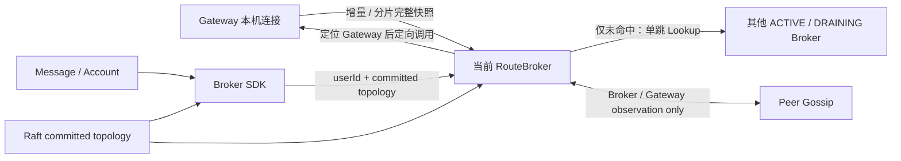

# Broker 用户路由分片与 Gossip 连接观察收敛设计

> 状态：草案。用户要求将讨论中的路由分片目标与推荐方案写入仓库；本次仅形成设计，不代表用户已批准全部细节、独立 Review 通过或实施完成。未创建 execution plan，不改变当前唯一活跃任务 T11/B3。本文尚不取代已批准的路由、故障接管与安全契约。

## 摘要

推荐保留现有 RouteBroker 路由分片、Gateway 分片快照、peer RouteLookup 和 Raft 拓扑治理，取消 Broker 层逐用户连接观察的 Gossip 发布、保存与转发。Gossip 继续同步 Broker/Gateway 运行观察，但不再承担全局 `userId -> gatewayId` 目录。

当前代码已经将远端连接观察与本机业务路由隔离，但仍为连接注册、注销和快照生成 CONNECTION Gossip 条目。这满足「处理职责分片」，不满足「逐用户路由状态也分片」的完整目标。增量同步只能减少重复传输，删除回收只能约束历史残留，二者都不能消除全局活跃连接观察副本。

本方案不新增 Redis 全局路由、不增加用户路由 Raft 日志、不引入新的路由算法，也不以删除 Gossip 条目替代 Gateway 的路由重建。正常调用仍由 SDK 直达当前 RouteBroker；本机未命中时保留有界、单跳的 RouteLookup。代价是 Broker 失效后的路由恢复依赖 Gateway 重报，不能承诺零中断。

## 背景

### 当前事实与历史定位

事实来源为当前代码和仓库文档，而不是面试口述稿或对话中的推测：

- [Broker Architecture](../../im-broker/ARCHITECTURE.md) 的「Gossip 一致性」「本机分片接收与清理」「查询、投递与本机缓存」分别描述观察同步、本机路由和 Lookup。
- [Gateway Architecture](../../im-gateway/ARCHITECTURE.md) 定义 Channel 所有权、分片快照、routeRevision 和整轮 ACK。
- [Broker 权威路由设计](2026-09-19-broker-routing-consensus-design.md) 保留连接观察传播，并定义 committed 拓扑、RouteBroker、Lease/fence 和 RouteLookup。
- `BrokerGossipAppService.observeConnectionRegistration/observeConnectionRemoval/observeConnectionSnapshot` 将连接变化交给 Gossip Adapter。
- `BrokerGossipAdapter.putConnectionState/removeConnectionState/updateConnectionSnapshot` 创建逐用户条目；`merge` 将条目存入 Gossip store，CONNECTION 不投影到本机 `ConnectionRegistry`。
- `BrokerGossipAdapter.removeLocalConnections` 仍有实际本机路由清理职责，不能因取消连接观察而一起删除。
- 提交 `f6ef983` 的 `domain/store/BrokerStateStore` 已记录「Connection 状态只作为集群同步视图保存，业务连接 registry 只保存当前 broker 归属的本地连接」；提交 `477758a` 仍保留。当前 Adapter 是后续归位结果，不能据此宣称全局观察是最近才引入。

这些证据能定位已有行为，但不足以证明当初为何保留全局连接观察，也不能证明其符合更早的用户批准内容。本文将「用户路由分片保存、不传播全量连接信息」记录为本次讨论的目标，不倒推原始批准历史。

### 容量问题

设 N 为活跃用户与 Gateway 的路由关系数，而不是注册用户数；B 为参与承载的 Broker 数，G 为有效 Gateway 数。用户可对应多个 Gateway，因此 N 不一定等于在线用户数。

| 项目 | 当前方式 | 推荐方式 |
|---|---|---|
| 本机业务路由 | 均匀时约 N/B | 均匀时约 N/B |
| 每台连接 Gossip 观察 | 传播收敛后可能接近 N | 0 |
| 集群连接观察副本 | 可能接近 B×N | 0 |
| Broker/Gateway 观察 | 继续传播 | 继续传播 |
| 异常 Lookup | 本机未命中后单轮查询 peer | 保持不变 |

该表是复杂度分析，不是实测内存结论。实际内存还包括实体、索引、序列化载荷、墓碑、缓存、分片暂存及 JVM 开销。迁移期间旧路由会短暂保留，不能把 N/B 写成每台任何时刻的硬上限；热点用户也可能造成分布不均。

## 目标与非目标

- 目标：Broker 常驻逐用户路由只保存当前归属及受控排空所需数据；消除 CONNECTION 全局观察副本和相关同步流量。
- 目标：正常路由不依赖 Gossip 用户目录；保留重连、删除乱序、Gateway 重启和 Broker 切换的既有保护。
- 目标：用确定性测试证明删除传播路径不会破坏实际路由清理、投递、诊断和恢复。
- 非目标：改变消息分表、冷热备份、业务消息保留策略；生产用户规模不能直接作为本仓库容量验收。
- 非目标：更改路由算法、Raft membership、健康报告资格、Lease/fence/quarantine、会话撤销或消息可靠性语义。
- 非目标：本轮实现代码、生产部署、执行真实流量模拟、修改现有活跃计划。

## 已知事实与约束

| 状态 | 唯一职责所有者 | 跨节点方式 |
|---|---|---|
| Channel、connectionId、认证会话 | 所属 Gateway | 不复制 Channel |
| userId 到 Gateway 集合的有效路由 | 当前 RouteBroker；旧节点仅按 drain 契约保留只读/清理状态 | Gateway 增量与分片完整快照；必要时 Lookup |
| Broker/Gateway 运行观察 | Broker 本机 Registry / Gossip store | Gossip digest/delta |
| ACTIVE 集合、算法、epoch、operation | Broker 已提交控制面 | Raft |
| 历史消息与 Receipt | Message | 既有业务协议，不进入 Gossip |

SDK 与 Gateway 必须使用同一份 committed 拓扑和既有算法编码计算归属。Nacos 和 Gossip 不授予 ACTIVE、成员或路由权限。健康探测报告由合格 voter 本机采样、Leader 按既有协议取回，不能笼统描述为 Gossip 多数投票。

## 方案概览

关键不变量：

1. 非归属 Broker 不因 Gossip 收到用户信息而新增业务路由。
2. 推荐方案中，Broker Gossip store、摘要和 delta 不生成、保存或转发 CONNECTION 条目。
3. 路由变更仍通过 epoch、RouteBroker、Lease/fence、Gateway 身份和 routeRevision 校验；删除观察不能代替这些校验。
4. Gateway 删除仍清理该 Broker 实际持有的相关路由，但不再递归发布逐用户 Gossip 删除条目。
5. 移除连接观察不改变消息持久化、Gateway 写入和客户端确认之间的结果边界。

## 详细设计

### 连接建立、注销与周期校准

Gateway 保留本机连接事实。SDK 按 committed ACTIVE 集合和既有算法选出 RouteBroker，注册或注销只发给负责节点，不广播所有 Broker。

同一 Gateway 进程的增量与完整快照继续共享单调 routeRevision。低版本不能覆盖新路由，注销 tombstone 阻止迟到注册复活。用户重连涉及的 sessionVersion、Gateway routeRevision 和集群 epoch 各自维持原语义，不能合并成一个版本号。

周期快照仍按 RouteBroker 分组。收齐分块、校验整体摘要、复验 epoch 和归属后原子应用；缺片、超时或摘要冲突不得安装部分路由。上一轮非空而本轮为空的分片继续发送空快照。全部目标成功后再按既有契约提交整轮 ACK。

取消的是连接事件到 Gossip 的观察投影，不是所有连接事件。实施前需枚举全部 listener 和消费者，保留指标、业务清理及其他仍有调用者的事件职责；不新增无人调用的兼容包装。

### 正常下行与 Lookup

Message 提交消息事务后，通过 SDK 直达接收用户的当前 RouteBroker。Broker 查本机有效路由、复核 Gateway 端点并投递。Leader 不经手全部业务消息。

正确 RouteBroker 本机未命中时，沿用当前一轮查询其他 ACTIVE/DRAINING Broker 的 Lookup：每个 peer 独立超时，并发查询、按 Gateway 合并最高 revision、复核端点后投递。peer 只查本机 Registry，不递归转发，不返回整个分片，不回填全局逐用户观察。单 peer 超时不能丢弃其他成功结果。

Lookup 是异常/恢复窗口的兜底，不是正常每条消息广播。保留现有负缓存的容量、TTL 和端点复核条件，不新增无界正缓存。节点大规模故障导致持续未命中时，O(B) 的查询成本仍需测量；本方案不以扩大 fanout、超时或缓存掩盖路由重建失败。

### Broker 变化与恢复

新增、摘流和故障接管继续使用既有 operation、旧 epoch fence/quarantine、新拓扑提交及新 Lease 安装流程，不因本设计省略安全阶段。

Gateway 观察到 epoch 变化后，立即按新拓扑重分组并重报完整分片。新 RouteBroker 从 Gateway 重建路由，不从 Gossip 用户副本恢复。旧节点只按既有 DRAINING/cleanup 水位保留或清理旧数据；不得因 Lookup 返回旧记录重新获得下行资格。

Gateway 暂时不可达时不能假定路由恢复完成；继续重试并保持未完成状态。Broker 在 epoch 不变时丢失内存路由，依靠既有注册/周期完整快照恢复，期间可能未命中。Gateway 重启必须使用新 gatewayId，旧实例按现有租约和回收规则处理。

### Gossip 缩减边界

Broker 层只发布和接受 BROKER/GATEWAY 类型。过滤须覆盖本地发布、入站合并前、摘要响应、请求差异和 delta 输出，不能仅让 `syncRegistry` 忽略 CONNECTION 而继续保存它。

入站认证和角色检查先执行；经过身份校验的旧 CONNECTION 条目在 Broker 边界丢弃并计数，不持久化、不传播、不修改 Registry。其 key 不得混入摘要或差异请求。条目数、字节限制及预算继续在过滤前执行，不能靠过滤接受无界旧载荷。未知类型维持既有明确拒绝策略，不把所有未知载荷静默忽略。

`im-gossip` 保持通用算法，不增加 Broker 业务依赖。是否删除通用 CONNECTION 枚举值，必须先核对插件其他消费者和序列化合同；推荐首先在 Broker Adapter 收敛类型，不以本需求强行修改通用协议。

### Gateway 删除与诊断

Gateway 注册失效或明确移除仍触发本机路由清理。将实际删除与 Gossip 观察发布解耦，不能连带删掉 `removeGateway` 行为。Gateway 墓碑及过期规则继续保护旧端点观察。

诊断查询仍只支持明确 userId，通过实际路由和必要的单用户查询定位；不增加全量用户列表接口。取消连接 Gossip 后，相关条目数指标、日志、测试和 UI 必须更新，不能把逐用户观察缺失报告成同步故障。Broker/Gateway 摘要与同步健康指标保留。

## 可靠性与安全

- Gossip 最终一致不升级为线性一致查询；Raft 本机投影读取不自动证明实时 quorum。
- SDK 旧拓扑请求按现有明确拒绝/刷新规则处理，不因可达地址降级绕过 RouteBroker 或 Lease。
- 删除全局用户观察降低复制范围，但不是新的访问控制机制。BoltTarget、TLS 身份、角色和 operation 准入保持不变。
- Lookup 继续限定可信 committed peer、单跳、逐请求预算；错误、超时、无目标和部分成功维持可区分结果。
- 路由快照重试复用既有幂等和摘要规则；下行未知结果、Gateway 去重和 Receipt 机制不因路由查询成功而取消。
- 墓碑、分片暂存、清理检查点和缓存仍须有界。Broker/Gateway 级状态也会随节点规模增长，本设计不承诺单机总内存只取决于 N/B。

## 运维与交付

### 发布与混合版本

尚未确认本仓库对应版本是否已在生产部署，不能从元仔用户统计推导当前代码已经上线。正式计划前必须确认部署状态及在途 operation。

推荐先完成应用消费者清单、对照测试和容量基线，再在维护窗口统一重启 Broker；不新增长期双写和兼容开关。Gateway 连接是否可保留取决于实测的 Broker 重启/重注册过程，不承诺维护期间实时投递持续可用。

新进程的 Gossip store 不加载旧用户观察，并阻止旧 peer 再次注入。混合版本阶段不得算验收通过：旧 Broker 仍会互相保存全局连接观察，旧节点何时重启决定集群何时真正消除副本。若发布要求滚动无中断，需要另行补充混合版本实验与退出条件并重新批准，不能临时扩展本草案。

新拓扑是否变化由现有控制面决定；重启、升级不自动授权成员变更。发现成员不一致或未完成切换时先按既有恢复合同处理，不能为了缩减 Gossip 绕过安全闸门。

### 容量与可观测性

分别记录本机业务路由数、按类型的 Gossip 条目/墓碑数、摘要/delta 字节、同步耗时、Lookup 触发/命中/超时、快照重建耗时和堆使用量。使用低基数标签，不以 userId/gatewayId 作为指标标签。

对比固定 N、Gateway 数、Broker 数和连接变更率的相同 workload；覆盖稳定态、连接 churn 和切换窗口。正确性硬门槛为新 Broker CONNECTION Gossip 条目及输出为零、正常稳定命中不触发 Lookup、实际投递行为无回归。内存、带宽和重建时间阈值待基线与目标环境确认，不预填收益百分比或机器规格。

## 风险与回滚

- 风险：未识别的诊断或清理消费者依赖连接观察。实施前用调用清单和差异测试闭合，不能只靠无编译错误判断。
- 风险：Gateway 重报成为路由恢复的关键路径；故障窗口可能出现投递失败，需要如实暴露，不能称为零丢失或零中断。
- 风险：保留 Lookup 全候选查询，节点规模增大或恢复风暴仍有放大成本；本次不引入无限广播重试。
- 回滚：本方案不改变 Raft 日志/快照格式；回滚应统一恢复受审版本并由 Gateway 重报业务路由，不从观察数据恢复权威状态。回滚到旧版本会重新引入全局连接观察成本，应明确记录，不能把其重新膨胀当作新版本泄漏。
- 停止条件：消费者无法说明、必要清理被删除、旧 epoch 可执行副作用、快照无法完成或持续 Lookup 激增，均停止发布并调查。不得以恢复连接 Gossip 副本掩盖控制面故障。
- 延后事项：有限副本路由、全局 Redis 目录、Lookup 候选优化和独立负载均衡改造均不在本次范围。

## 验证策略

| 不变量/风险 | 确定性或运行验证 |
|---|---|
| 连接事件不产生全局副本 | 修复前注册/注销/快照会产生 CONNECTION 的 RED；修复后 store、digest、delta 均为零 |
| 旧条目不能重新注入 | 可信旧 peer 混合 BROKER/GATEWAY/CONNECTION 载荷；前两类正常，连接条目不保存/请求/转发；重复同步仍为零 |
| 删除保留业务作用 | Gateway 移除确实删除本机路由，不生成连接 Gossip 墓碑；Gateway 墓碑仍传播 |
| 用户路由归属 | 固定拓扑 golden vector；注册只落在负责 Broker，非归属节点拒绝写入 |
| 本机未命中兜底 | peer 只查本地、单跳不递归；一个 peer 超时不影响其他成功目标；正常命中零 Lookup |
| 重连及乱序 | 迟到注销/注册、低 revision 快照不覆盖新状态，旧 sessionVersion 不关闭新会话 |
| 完整快照 | 分块重复/缺失/错序/摘要冲突、空分片和 ACK 条件保持原语义 |
| 故障恢复 | Broker 丢失内存、Gateway 重启、epoch 切换、重报重试；无全局观察仍能完成既有恢复旅程 |
| 安全 | 未认证旧条目不能绕过认证，旧 epoch/无 Lease 拒绝，过滤前仍执行字节和条数上限 |
| 容量 | 固定 workload 对比业务路由、观察条目、堆、带宽和恢复时延；不以 mock 结果证明生产容量 |

设计阶段仅运行文档链接/差异检查；不伪造上述 RED/GREEN。实施时先运行拥有模块聚焦测试，再进行 behavior/E2E/HA 验证，最终按仓库合同执行 `./scripts/verify.sh clean` 和 `./scripts/verify.sh full`。具体 focused 命令和场景选择由批准后的执行计划固定，完整同轮 full 报告满足相应风险覆盖时不再重复独立大门禁。

## 后续文档与执行

本次只新增本文和设计索引，不把目标写成当前 Architecture 事实，不修改旧设计的历史批准结论。尚无本设计的实施计划；现有 T11/B3 保持原状态。

批准与独立 Review 后，实施需涉及 Broker Gossip Adapter/AppService/listener、相关测试和监控消费者，并核对 `im-gossip` 类型合同；Gateway/SDK 原则上只做必要回归覆盖，不顺带更换协议或算法。

实施完成后同步根 `ARCHITECTURE.md`、Broker Architecture/README/Server README、Gossip 插件 README 和 `docs/RELIABILITY.md`；Gateway Architecture 仅在恢复或调用合同确实变化时修改。更新旧权威路由设计的后续决定链接，明确只取代连接观察全局传播部分。若形成跨模块可复用规则，再按 owning 规范与 Harness Guide 登记并配窄 checker，不在设计草案阶段添加空泛工程规则。

## 附录 A：备选方案与依据

| 方案 | 收益 | 代价与适用条件 |
|---|---|---|
| 保留全局连接 Gossip 观察 | 便于全局观察；可维持现有实现 | 每节点可能 O(N)，集群 O(BN)；当前投递并不直接使用该副本，需证明独立价值 |
| 分片路由 + Gateway 重报 + 单跳 Lookup（推荐） | 删除重复用户目录，沿用现有负责节点与恢复机制 | 恢复依赖 Gateway，Lookup 异常成本及快照窗口需实测 |
| 分片路由 + 有限副本 | 可在有限冗余下改善恢复 | 新增副本选择、水位、切换和授权语义；需独立设计，不作为本次隐含实施项 |
| Redis 全局连接目录 | 可统一查询与共享存储 | 新增集中依赖、TTL/会话乱序与容量治理；现有路由协议并不需要该依赖 |

本次不选择或变更第三方库，依据为仓库已有 Gossip digest/delta 和 JRaft 接入合同，而非新增外部能力主张。算法、共识库版本和官方能力依据继续沿用已有批准设计；本草案不重新声明 Raft 或 Gossip 提供此前未证明的保证。

## 附录 B：决策记录

| ID | 来源/问题 | 当前决策状态与完整语义 | 理由与影响 |
|---|---|---|---|
| D1 | 用户指出 Broker 可能越来越大 | 讨论目标：用户路由分片保存，不通过 Gossip 保存全局用户连接观察；待全文批准 | 职责分片不能抵消额外全量副本成本 |
| D2 | 正常消息如何定位 | 推荐保留 SDK 按 userId 与 committed 拓扑直达 RouteBroker | 不引入新的全局目录或常态 Broker 二跳 |
| D3 | 去掉副本后怎么恢复 | 推荐保留 Gateway 分片完整快照、epoch 变化重报、既有 drain/ACK 和单跳 Lookup | 不把观察副本当恢复权威，接受可观测恢复窗口 |
| D4 | Gossip 和 Raft 的分工 | 推荐 Gossip 仅发布 Broker/Gateway 观察；Raft 不增加用户路由日志，健康报告仍按独立协议取回 | 不改变已批准控制面安全语义 |
| D5 | 旧版本连接条目 | 推荐 Broker 边界在认证、预算检查后过滤连接类型，覆盖 store/digest/delta 全路径 | 防止只停发布但被旧 peer 重新灌入；不是无限期兼容承诺 |
| D6 | 通用插件类型 | 先保留通用插件合同，删除枚举须有消费者审计和单独范围确认 | 不让业务缩减反向污染通用插件 |
| D7 | 发布方式 | 推荐维护窗口统一 Broker 升级；实际部署状态、窗口和回滚前提待确认 | 不虚构生产上线，不擅自增加滚动兼容平台 |
| D8 | 原始方案是否被改变 | 历史只能确认首次重构已保留全局观察；其批准理由与更早约定未确认 | 不把当前代码或本次对话包装成原批准事实 |

## 附录 C：独立 Review 与开放问题

尚未运行独立上下文 Review，结论为待审，不是 Approved。本次写入授权仅限设计文档。

进入待 Review/批准前需要确认：

1. 用户是否接受 Lookup 保持现有全候选、单跳、仅未命中触发的规则，以及恢复窗口非零中断的边界。
2. 是否存在生产部署和滚动发布要求；维护窗口统一升级是否可接受。
3. 全部连接观察消费者与诊断使用是否完成审计；文中历史定位不等于无消费者证明。
4. 固定环境容量、连接 churn、快照恢复和 Lookup 风暴的验收阈值。阈值确定前不得宣称容量收益已验收。
