# Broker Architecture

集群路由操作的完整生命周期由 `BrokerClusterAppService` 编排：`drain` 发起排空，`advanceDrain` 推进排空，
`recoverRoutes` 推进故障摘流后的路由恢复，`forceDrain` 在显式风险确认后结束失败排空。
定时入口调用对应业务方法，不保留独立排空和故障恢复 AppService；`forceDeactivate` 仍表示发起故障摘流。

## 职责与状态模型

Broker 是实时路由协调层，不是消息存储。它持有 Broker、Gateway 和用户连接位置的运行态注册表，把上行帧交给 Message，把下行帧写到目标 Gateway，并通过 Gossip 让多个 Broker 最终收敛。

```text
Registry 状态
  BrokerRegistry      brokerId -> Broker
  GatewayRegistry     gatewayId -> Gateway
  ConnectionRegistry  userId <-> gatewayId

业务写入 -> 内部事件 -> BrokerStateStore -> Gossip digest/delta -> peer Broker
```

Broker Server 采用“DDD 核心 + 技术子系统”。`domain/cluster/model/BrokerCluster` 是权威控制面唯一聚合，
保存 Server 自有拓扑、revision、epoch、operation、drain 和 fence 不变量；`domain/authority` 保存
Lease、fence、admission 及领域 seam，并在能力包内按 `model`、`service`、`repository` 组织领域对象、
领域服务和资源库；`domain/connection/model` 保存连接路由聚合。
application service 编排具体 Adapter 和领域对象。InMemory Registry、Gossip store、Raft、
Bolt/Gateway client 和文件 marker 按其技术能力归入 `adapter` 或 `infrastructure`。HTTP/Bolt 入口只转换协议
并调用 application 用例，不能自行推导集群状态或执行跨资源编排。
通用判据见 [`docs/references/MODULE_STRUCTURE_GUIDE.md`](../docs/references/MODULE_STRUCTURE_GUIDE.md)。

## DDD 模型与边界

Broker Server 的 `domain` 只表达 Broker 自己拥有的业务规则，不承载 Spring、SOFAJRaft、Bolt、
Gossip、配置类或协议 DTO。外部请求先在 interfaces/transformer 边界转换为应用命令和值对象，再由
application service 调用领域模型；领域层不能反向依赖 application、infrastructure 或 interfaces。

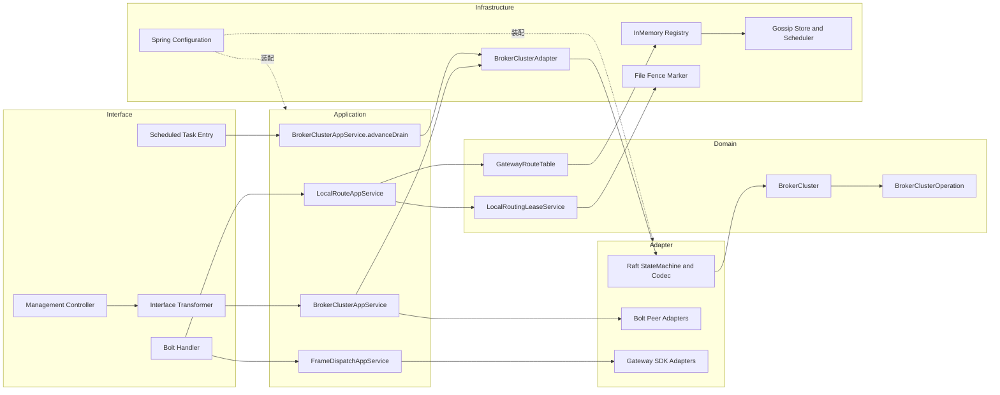

依赖方向以用例为准：Interface 只进入 Application；Application 编排具体 Adapter 和领域对象；Adapter
把技术输入转换成领域行为；Domain 不认识 Controller、SDK、Raft 或 Spring。Raft 状态机属于 Adapter
内部执行路径，它只能调用聚合公开行为，不能直接修改聚合字段。

| 领域能力 | 聚合和核心对象 | 保护的不变量 |
|---|---|---|
| `domain/cluster/model` | `BrokerCluster` 聚合根、`BrokerClusterOperation` 操作实体 | epoch、revision、成员角色、拓扑、drain、fence 和 operation 阶段只能按合法状态转换 |
| `domain/connection/model` | `GatewayRouteTable` 聚合根、`ConnectionRegistration` 实体 | routeRevision 单调、完整快照原子接受、tombstone 阻止迟到注册、过期路由按规则回收 |
| `domain/authority` | `RoutingLease`、`FenceAck` 等授权模型 | Lease 必须绑定 Broker/epoch/term/sequence/nonce；最高 fence 水位之后不得重新准入旧 epoch 副作用 |

领域对象的角色遵循以下约束：

- 聚合根负责跨字段和跨实体的不变量。`BrokerCluster` 负责权威拓扑和 operation；
  `GatewayRouteTable` 负责单个 Gateway 的连接路由、快照和 tombstone。
- `BrokerClusterOperation`、`ConnectionRegistration` 等实体具有业务身份和生命周期，不能由 Handler 或
  Raft 状态机直接修改字段。
- `BrokerNode` 的角色和流量状态由 Commit 内的实体行为修改，Begin 只登记经过校验的事实。
  Proposal 和 operation 不持有节点或目标拓扑；聚合构造、公开查询与持久化快照仍隔离可变节点。
  Commit 使用冻结的端点、最低 voter 数量及 drain 事实，不读取运行时配置重新解释历史请求。
- `BrokerId`、`RoutingEpoch`、`ClusterRevision`、`RouteRevision`、`LeaseSequence`、
  `LeaseNonce`、`MonotonicTimestamp`、`QuorumReadIndex` 等是值对象，用于承载校验和业务语义。
- `LocalRoutingLeaseService` 和 `BrokerFailureObservationService` 是领域服务，分别负责本机
  Lease admission/fence 线性化，以及故障观察是否满足进入权威处置的条件。
- `FenceWatermarkRepository` 是领域资源库抽象，只表达读取和推进本机最高 fence 水位；文件 marker
  等持久化实现属于 `infrastructure`。
- `LocalFenceResult`、`FenceResult`、`BrokerClusterDecision` 是领域结果或决策，不是新的聚合。

application service 负责用例顺序、幂等、权限和外部协作；domain 负责业务不变量；infrastructure
负责 Raft、Gossip、文件 marker、内存索引、Bolt 和监控实现。不能因为对象被多个 Handler 使用，
就把它提升到 `support` 或 SDK，也不能把仅用于转发的内部对象包装成新的 Engine、Coordinator 或 Service。

Broker RPC Handler 只负责业务处理，不持有责任链。配置为每个 operation 按列表顺序组装
身份、成员准入、调用方角色、RouteBroker/Lease 执行保护和最后的业务 Handler，Bolt Processor
只注册这些完整链入口。`BrokerRequestInterceptorChain` 直接实现 `BoltRequestHandler`，不保留
没有新增契约的 support 接口；调用对象与节点执行位于
`infrastructure/chain`。节点不声明 stage，配置列表就是执行顺序；operation 覆盖和请求类型匹配
由装配测试保证，不保留生产启动校验 Bean。Handler 不依赖基础设施，也不感知内部拦截阶段。

Broker 不使用顶层 `support` 承载完整能力；请求责任链归基础设施层，
`support.exception`、`support.security`、`support.util` 保存少量无状态且需要跨层识别的模块内部辅助类型。
异常和工具保持协议无关；`support.security` 可以适配
受信传输上下文，保存 `BrokerCallerPrincipal` 的身份与 `BrokerCallerRole`，但不执行授权策略；
授权策略和业务决策仍由 application 执行。应用用例直接按 cluster、frame、local、gossip、diagnostic 能力分组，
不保留仅承载这些 AppService 的 service 中间目录，也不保留已经没有能力契约的 port 目录。
AppService 负责完整用例编排，独立应用级策略按真实职责组织，不为目录对称性创建空层级。
`frame` 负责帧分发；`local` 放置 LocalLeaseAppService 与 LocalRouteAppService。
LocalRouteAppService 维护本机路由视图，acceptRoutes 接收 Gateway 分片，cleanupRoutes 按已提交水位清理旧路由；
领域 BatchConnectionRegistry 扩展 ConnectionRegistry，基础设施 InMemoryBatchConnectionRegistry
包装实际存储并管理分片暂存。应用层使用接收锁串行资格检查、收集、应用与发布；
包装实现同步保护自身批次集合。
清理幂等缓存也由 InMemoryBatchConnectionRegistry 管理，实现使用独立 cleanupLock，
不与分片集合共享同步锁；应用层另行串行资格核对与本轮清理调用。
LocalLeaseAppService 独立维护 prepare/install 和一次性 nonce 记录。
本机用例输入在访问状态前直接转换为领域值，参数异常交外部统一处理；
准备记录负责单调过期判断。清理资格由操作及其 DrainProgress 匹配目标、代次、毫秒事件期限和完整确认集合，
不在应用层重复展开阶段与整组水位规则。分片暂存和清理缓存均为本机运行状态，不新增领域聚合。
GatewayRouteBatch 是 domain/connection 的接收实体，使用手写 Builder 和领域字段；复合身份
GatewayRouteBatchId 区分 Gateway 的同名批次。实体维护匹配、幂等收集、按序组装和完整摘要验证，
不依赖 Command、SDK 或 Spring。InMemoryBatchConnectionRegistry 管理 receivingBatches 索引、
容量、超时回收和锁；基础设施直接读取 BrokerRoutingProperties，应用服务只接收快照重试所需的批次超时，
不为缓存容量构造领域值对象或跨层配置包装。
GatewayRouteBatchReception 返回分片接收事实及可应用批次，不依赖配置、SDK 或 Spring。
应用层只持有 BatchConnectionRegistry，将接收事实转换为响应，在 Lease 保护下调用 applyBatch 后发布事件。
配置层仅对外注册一个包装 Registry Bean，普通 ConnectionRegistry 与批次契约访问同一底层连接数据；
底层 InMemoryConnectionRegistry 是内部委托对象，不单独注册。applyBatch 不自行决定授权。
RouteCleanupId 表达操作/Gateway 清理身份，RouteCleanupCheckpoint 保存已完成水位和首次删除数量，
重试水位核对由检查点保护；不新增独立 Repository 或批次持久化聚合。
应用层在清理锁内只读取一次操作并核对完整请求，通过后调用 Registry.cleanupRoutes；
实现复用首次结果或按水位删除，控制缓存容量，返回现有 RouteCleanupResult。
应用层经 BrokerDrainTransformer 转为响应，不为单个 Gateway 构造内部 Command 或重复查询。
缓存只保存水位和删除数量，不保留同形单 Gateway Command/Result，也不持久化。
Lease 执行异常从接收方法沿 RPC 处理通道直接传播，不在应用层捕获再包装。
Gateway 整轮快照 ACK 由 cluster 中的 BrokerClusterAppService 登记 Raft 恢复进度，
与路由重建和排空推进共用控制面边界，不与本机分片暂存混在一个服务中。
只有真正表达聚合存储语义的接口才进入 domain repository；单一实现的 Raft、Bolt 或 SDK 调用能力直接作为
具体 Adapter 使用，不再为了依赖倒置统一创建 application port。
跨层用例模型位于顶层 `model`，先按类型职责组织，只有同类模型出现多个稳定业务组且数量足够时才继续按
业务分包；HTTP Request/Response 位于顶层 `model/io`。Registry 诊断查询由 BrokerDiagnosticAppService
直接编排；Tracker、Spring 事件发布和 Micrometer 指标位于 infrastructure。
Registry 已发生事实的事件数据模型统一位于 `model/cqrs/event`。
注册表事件监听入口位于 `interfaces/listener`，统一委托 `RegistryGossipAppService` 更新 Gossip
observation；心跳查询 Registry 当前端点，缺失端点不复活已移除节点。入口保留单次处理异常隔离，
Gossip 状态存储和技术组件启停监听仍位于 infrastructure。应用用例按 cluster、frame、local、gossip、
diagnostic 分组：frame 保留帧分发及其 Lookup，local 处理本机路由维护和 Lease；
不为这些用例阶段增加顶层内部执行类。
BrokerRegistry 位于 domain/cluster/repository，GatewayRegistry、ConnectionRegistry 位于 domain/connection/repository，
表达本机注册和路由索引存取；内存实现仍位于 infrastructure/registry。接口返回 Server 自有的
BrokerRegistration、GatewayRegistration、ConnectionRegistration 和 ConnectionSyncResult，不依赖 SDK DTO。
GatewayRegistry 注册接收 GatewayRegistration，其余查询、心跳、注销和退役判断接收 GatewayId。
协议/Gossip 边界通过现有 RegistryTransformer 构造注册观察，内存实现直接保存输入观察，
身份索引和退役集合使用 GatewayId，不保留 String/host/port 注册重载；身份绑定及退役规则保持。
GatewayRegistration 字段使用 GatewayId、GatewayHost、GatewayPort、GatewayPrincipalId 和 Instant。
principalId 是认证主体，gatewayId 是进程身份；值对象构造入口保护空值和端口范围。
SDK/诊断由 Transformer 展开基础字段，Gossip 显式保存 GatewayEndpointDTO，保持平铺协议，
不直接序列化领域对象。心跳只更新 lastSeenAt，保留主体、端点及首次注册时间。
ConnectionRegistry 注册接收完整 ConnectionRegistration，注销接收 ConnectionRouteId、RouteRevision、Instant；
其他输入使用 UserId、GatewayId、RouteRevision、Instant、Duration 和 List<UserId>，无基础类型或无版本重载。
find(UserId) 返回活跃 ConnectionRegistration，包含版本、更新期限和观察时间；删除 findRouteStates 与 sync。
原 ConnectionRoute 行为合并进已有注册实体，实体保留首次注册时间，已接受更新刷新观察时间。
GatewayRouteTable 是唯一实体来源，存储只维护用户到 Gateway 的身份索引，不复制注册投影；查询不补建记录。
协议入口和应用入口构造领域值，包装实现直接委托，SDK 与诊断字段由 Transformer 展开。
Gossip 连接删除只更新远端观察，不携带 revision 的删除不能改写本机路由；Gateway 整体移除仍清理本机聚合。
SDK 端点仅在跨进程调用和响应边界通过 RegistryTransformer 转换，Gossip observation 的序列化字段保持原契约。
诊断不保留 BrokerDiagnostics/RegistryBrokerDiagnostics，Controller 直接调用 BrokerDiagnosticAppService；
实例身份由配置层从 BrokerProperties 取出并传给应用服务，GossipSyncTracker 是 adapter/diagnostic 的具体
技术查询能力，不通过同形接口转发，也不把监控计数放进业务领域。
RouteLookup 不保留独立 peer Client，FrameDispatchAppService 调用 BrokerClusterAdapter.lookupRoutes，
配置层拥有独立虚拟线程查询执行器；Gateway 投递由 BrokerClusterAdapter.dispatchFrame 调用 SDK，
应用层只定位目标与汇总结果，保留逐 Gateway 的低基数指标，不直接依赖跨模块 SDK 实现。
FrameDispatchAppService.dispatch 按本地活跃目标、未命中 lookup、远端端点复核、并发逐目标投递展开；
BrokerClusterAdapter 将阻塞式 Gateway 写帧提交到配置层拥有的专用虚拟线程执行器，
返回 CompletionStage；应用服务在全部响应结束后汇总，单个目标失败不丢弃其他结果。
RouteBrokerExecutionInterceptor 只在入场时检查请求期限，不中断已经开始的 Handler；
dispatch 不重复判定请求过期，但保留 FrameDispatchCommand 的请求截止时间以计算在途 peer RPC
剩余预算，BrokerClusterAdapter 继续将同一期限传到对端。
GatewayRegistration.isFreshAt 表达注册观察的活跃窗口，不等同于路由执行 Lease。
短负缓存按 UserId 索引，由 JetCache 控制 TTL，从 Gateway 复核完成且无可投递目标时开始计时。
dispatch 内直接从当前已提交拓扑选择所有其他 ACTIVE/DRAINING 节点，不排序、不截断，
使用专用虚拟线程执行器并发查询一轮，
不保留 lookup、directedCandidates、allCandidates、queryCandidates 或 recordCurrentState 私有链。
单个 peer 的同步提交失败、异步失败与超时不丢弃其他结果，完成后按 Gateway 保留最高 revision；
每次 peer IO 使用 Adapter 配置的固定超时，不从外部请求期限分配剩余预算；
已退出当前拓扑的旧节点不再由 Lookup 查询。
FrameDispatchAppService 的未命中负缓存同样使用 JetCache LOCAL 标记，Gateway 复核仍无目标后写入，
TTL 和容量交给框架；配置为零时不写标记。应用不维护 ConcurrentHashMap 或手工裁剪键集合。
重复观察同一 epoch 刷新 TTL；observeClusterState 只写入，不手写扫描、淘汰或历史锁。
候选从 im-cache 提供的有效值快照读取，容量策略由 JetCache/Caffeine 决定，不保证最早 epoch 淘汰；
缓存只辅助查询，丢失历史不改变权威拓扑。网络等待不持有缓存锁，不增加 LocalCache 包装类型。
InMemoryBatchConnectionRegistry 的未完成分片与本机清理检查点也使用 JetCache LOCAL 缓存。
未收齐的新批次只在首次接收时写入 JetCache，后续分片更新同一个本地批次对象，不重新 PUT；
框架写入 TTL 自首次暂存起算，重复分片不延长批次寿命，不再手工计算剩余时间。
暂存字节容量从当前有效批次计算，不手动追踪过期字节。清理检查点保留固定容量与长 TTL，
只提供本机尽力幂等，不作为持久化事实；淘汰不保证最早操作先出。
LocalLeaseAppService 的 pending nonce 也存入 JetCache LOCAL，以 pendingTtl 过期并释放 prepare 容量，
不再遍历缓存检查过期。accept 仅查询目标 nonce 并匹配后先消费；领域服务按单调准备起点与
Lease 自身有效期判断能否安装及执行，不重复检查应用层 pendingTtl。Registry 索引和聚合状态不是缓存。
prepare 不再在应用层执行满额拒绝：JetCache localLimit 达到上限时可淘汰旧 nonce，
旧申请后续安装可能失败，调用方依赖原有重试流程；缓存容量不是租约授权依据。
lookupRoutes 接收包含当前 BrokerNode、UserId 和 RoutingEpoch 的 BrokerRouteLookupParams；
不再创建目标 DTO 或本轮 lookupId。Adapter 构造 peer RouteLookupParams 时设置独立 IO 期限并固定 hopCount=1。
路由更新有效期限统一叫 updateExpiresAt，不表示连接断开时间；排空冻结的旧事件截止水位叫
oldEventDeadline，SDK eventDeadline 字段只在边界转换，不机械合并这两种时间语义。
Broker peer 身份、scope 与 learner join token 校验集中在 `application/policy/cluster`；其跨层可识别的
access-denied 异常位于 `support.exception`。这些类型不进入 domain，也不复用 HTTP 错误模型。

Spring 配置统一位于 `infrastructure/config`，并按 Cluster、Lease、Gateway Route、Lookup、Delivery、Drain
等能力拆分；触发成员恢复、排空、故障恢复、Lease 续签和 Gateway 租约清理的定时入口位于
`interfaces/scheduler`，兼有启动注册、周期心跳和关闭注销的本机注册入口位于 `interfaces/lifecycle`。
配置层装配任务 Bean 和等待时长。任务周期和 Leader/单轮执行条件保持各入口原有约定。
Spring `@ConfigurationProperties` 只承载部署差异、运行预算与容量上限；quarantine 等派生时长在配置装配时计算，
不重复绑定。应用服务不直接依赖 infrastructure 配置：专用的不可变参数快照归所属 application 能力，
调度参数归 interfaces/scheduler；批次缓存容量由基础设施直接读取源配置，应用只接收其需要的超时，
不再保留没有独立契约的顶层 model/properties 包。
不为单字段透传或未消费参数保留额外配置类型；源配置可按绑定命名空间聚合，字段必须注明用途和调节边界。
取得调度运行标志后，同步读取或提交异常必须释放标志；异步操作完成时再释放，避免永久跳过后续恢复轮次。
Gateway 租约清理由 `GatewayCleanupScheduler` 触发 `LocalGatewayCleanupAppService`；显式注销由
`GatewayUnregisterHandler` 委托同一应用服务。两种入口均先在
`BrokerStateStore` 写入 Gateway 和连接的 Gossip 删除观察，再移除本机连接与 Gateway 注册。写入失败时保留
Gateway 注册和连接：超期清理由下一轮扫描重试，显式注销由调用方重试；重复清理不恢复已删除路由。该观察只在本机内存中，进程在写入或传播前
崩溃时没有持久化重放保证，不能将此流程视为可靠事件投递。
Gossip、Registry 的技术同步、清理及进程生命周期仍跟随 infrastructure 对应能力维护，不再使用顶层
`config`、`lifecycle` 技术类型桶。接口层任务不依赖基础设施配置类型。`Authorizer` 后缀只表示调用方访问授权；holder 本机的 Lease prepare/install
关联由 `LocalLeaseAppService` 编排，避免和安全授权混淆。

集群路由写入由 `BrokerClusterAppService` 编排，Raft membership 写入由 `BrokerMembershipAppService` 编排；
两个应用服务分别作为 Controller 的直接用例入口，互不调用。前者拥有路由状态变更、旧 epoch fence、
quarantine 和新 epoch Lease 激活，后者拥有 learner/voter 加入、就绪、晋升、降级和移除。底层共识、
成员操作、fence、Lease 和远端调用由对应 application service 直接调用具体 Adapter。写用例需要同时使用领域聚合和 SDK 投影时，只能读取同一次
committed view；领域聚合恢复和 SDK 投影转换由共识 adapter/state machine 承担，应用服务不得自行把
`BrokerClusterState` restore 成领域聚合。

## RouteBroker 与连接路由

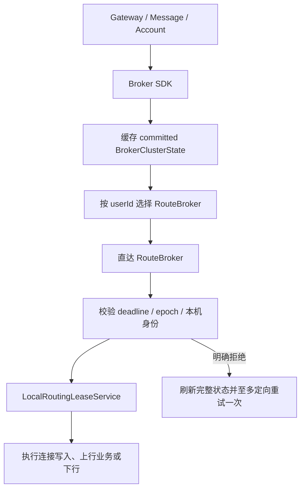

RouteBroker 只由已提交 `BrokerClusterState` 中的 ACTIVE Broker 计算。建群时选择
`RENDEZVOUS_HASH` 或 `MODULO_HASH`，运行中不能切换算法；Nacos/Gossip 不能直接改变选择输入。

`ConnectionRegistry` 同时维护 user 到 gateway 和 gateway 到 user 的索引。前者服务用户投递，后者服务 Gateway 快照同步和失效清理。Broker 不保存 Gateway 本机 connectionId。
Gateway 快照应用后发布的 Gossip 完整用户集合来自连接表实际状态，不直接复用快照输入；
旧快照被忽略或新增量被保留时，观察同步不能回退。cleanup 请求的事件截止时间必须与 operation
中已冻结的 oldEventDeadline 一致，避免改变删除标记的保留期限。Lease 安装先匹配 prepare nonce
和 epoch，再消费准备记录；错配请求不消耗有效申请，匹配请求仍只允许一次安装尝试。

每个用户只有一个 RouteBroker 持有可投递路由。普通连接注册/注销只写 RouteBroker；Gossip
合并的远端 Connection delta 只进入 `BrokerStateStore`，不会投影到本机业务 `ConnectionRegistry`。

单连接注册、注销和完整快照共享同一个 Gateway 进程内单调 `routeRevision`。Gateway 按 committed
`BrokerClusterState` 把活跃用户分片，只把分片发送给对应 RouteBroker；需要清空的上一轮非空分片会发送
一次空快照。Broker 收齐全部 chunk、校验整体 checksum，并再次确认 epoch 和 RouteBroker 归属后才原子
应用。低 revision 不能覆盖新路由，注销 tombstone 会阻止迟到的 register 复活路由。
相同 revision 快照按排序用户集合的 SHA-256 摘要判定：摘要相同为幂等重复，摘要不同为协议冲突；重复快照
不会重写 tombstone 的 deadline、创建时间或快照覆盖水位。

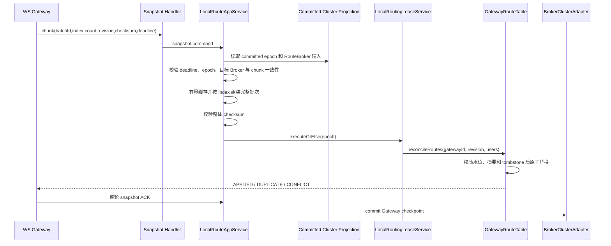

未收齐的 chunk 不能进入 `GatewayRouteTable`；Lease 校验必须包围最终原子应用，而不是只保护前置校验。
ACK 只有写入 Raft operation 后才成为 drain 或故障恢复的 committed evidence。

## 成员变化与路由恢复

### 成员加入、晋升、降级与移除

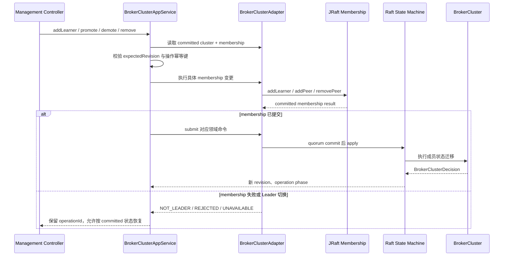

Application 负责调用顺序和恢复，聚合负责判断成员状态能否迁移。membership API 成功但领域命令尚未提交时，
不能靠本地回滚猜测结果；必须使用同一个 `operationId` 对照 committed membership 和 operation phase 恢复。

### 优雅排空

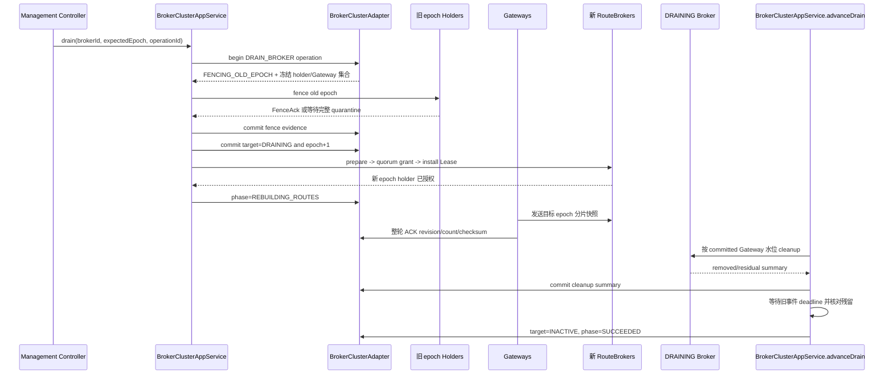

优雅排空的 Gateway 冻结集合、ACK 水位和 cleanup 摘要都属于 Raft operation。旧 Broker 进入
`DRAINING` 后只允许按 committed 水位删除旧路由并写 tombstone，不能创建新路由或承担新下行。

排空清理 RPC 统一由 `BrokerClusterAdapter.cleanupRoutes(operation)` 发起，复用有界 peerExecutor，
不再保留独立清理 Client 或线程池。请求与摘要转换由 BrokerDrainTransformer 负责，
Adapter 返回 `domain/cluster/model/RouteCleanupResult`，删除/残留数量使用 RouteCount，
应用层与 Gateway 重建数量合并为 RouteRecoveryEvidence；RPC 状态与基础类型仅留在 SDK 传输契约中。
超时使用 BrokerRoutingProperties.drainCleanupRpcTimeout；资格、超时重试和摘要持久化由应用用例处理。

### 故障摘流与降级恢复

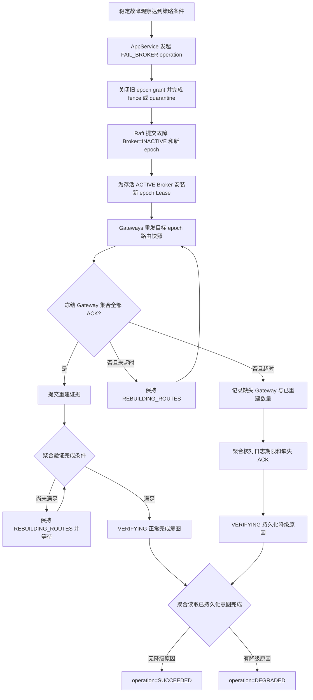

故障节点不可达时不等待该节点 cleanup。`DEGRADED` 是保留证据缺口的明确终态，不等价于成功；Gossip
观察只能触发应用用例，不能直接把 Broker 改为 `INACTIVE`。
`DrainProgress.summarizeRebuild` 汇总已确认数量并复用已保存证据；未确认身份以 GatewayId 返回。
故障重建证据写入时必须匹配聚合当前检查点，过期提交被拒绝并等待下一轮重读；证据形成后检查点
只接受相同的重复确认，避免迟到 ACK 改写已冻结的完成事实。
恢复资格由 operation 根据自身类型、阶段、ACK 和明确期限判断。`verifyRouteRecovery` 与
`completeRouteRecovery` 在 Raft 应用日志时调用聚合：前者登记完成意图，后者按当前持久化原因选择终态。
VerifyRouteRecoveryCommand 固定本轮采用的恢复等待时长和验证时间，领域不读取本机 Properties 或墙上时间。
FAIL_BROKER 不能通过通用阶段命令直接进入 VERIFYING/SUCCEEDED/DEGRADED；正常证据提交已进入验证阶段时
直接提交完成，降级保留先保存证据、再登记原因、最后完成的恢复边界。不增加只转发此流程的领域服务。

## Gossip 一致性

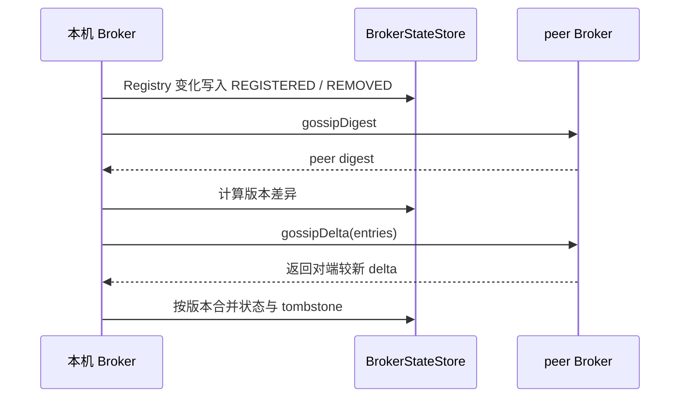

- 本地注册、心跳、注销和快照变化先写入 `BrokerStateStore`，由 store 为实体生成带版本的
  `GossipDeltaEntry`。Broker、Gateway 和 Connection 使用不同的实体类型和 key，不共享业务字段。
- `BrokerGossipScheduler` 默认每 5 秒选择一批 peer；优先使用本机已知 Broker，没有已知 peer 时使用
  静态 seed。每轮只按 `gossipFanout` 选择部分 peer，单个 peer 超时或失败不阻塞其他 peer。
- 同步顺序是 `digest -> keysNewerThan/keysOlderThan -> deltas -> merge`。双方先交换摘要，再只传递
  缺失或版本较新的条目；接收端按版本合并，旧版本不能覆盖新版本。
- `REGISTERED` 条目合并后投影到本地 Broker/Gateway Registry；远端 Connection 只保留在 Gossip 视图，
  不写入当前 Broker 的业务 ConnectionRegistry，避免远端观察状态绕过 RouteBroker 所有权。
- 注销不会立即删除 key，而是写入 `REMOVED` tombstone 并保留配置的 removed TTL。墓碑传播完成前，
  离线节点带回的旧 `REGISTERED` 条目不能复活已删除实体；TTL 到期后才允许清理历史删除证据。
- Gossip 失败只影响最终收敛和诊断记录，不改变 Raft 的 committed cluster state，不推进 epoch，也不能
  单独触发 ACTIVE Broker 摘流、Lease 签发或 drain 成功。
- Gossip 是运行观察同步，不是强一致事务、Raft 日志或业务事件总线。事件模型通过 infrastructure
  publisher/listener 接入 Gossip，但事件不能直接替代领域聚合命令。

## Raft 权威状态流程

Raft 只保存低频、需要全体 Broker 观察一致的权威状态：`BrokerClusterState`、有界
`BrokerClusterOperation`、当前 fence operation 和 voter/learner membership。Broker/Gateway 的
活性观察、连接位置和诊断历史不进入 Raft 日志。

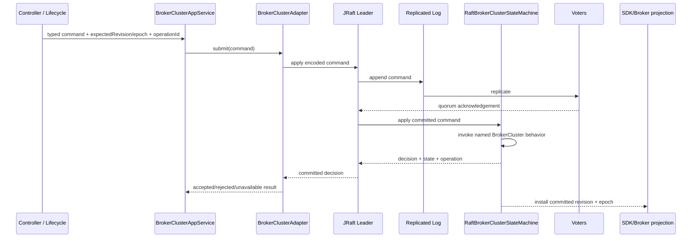

### Raft 写入与状态机

1. Controller 或 lifecycle 只调用 `BrokerClusterAppService`。应用服务校验身份、scope、幂等键、
   `expectedRevision`、目标状态和 operation 前置条件，不直接操作 JRaft。
2. `BrokerClusterAdapter` 只允许 Leader 提交 command。非 Leader 返回 `NOT_LEADER` 和 leader hint；
   quorum 不可用或提交超时返回 `UNAVAILABLE`，不能伪造 accepted。
3. command 经 `BrokerClusterCommandCodec` 编码后写入 Raft。所有 voter 按日志顺序重放同一 command；
   follower 不通过本地 HTTP/Bolt 请求自行改变聚合。
4. `RaftBrokerClusterStateMachine` 只做 command 解码、调用 `BrokerCluster` 的具名行为、转换 SDK
   projection 和管理 snapshot。epoch、revision、operation phase、drain evidence 等不变量留在聚合内。
5. command 只有在 Raft 达到提交条件后才对外报告成功。应用服务收到 decision 后继续执行 fencing、
   Lease 激活、Gateway 快照或 cleanup 等下一阶段；这些阶段完成后再提交下一条 operation command。

### 集群写用例编排

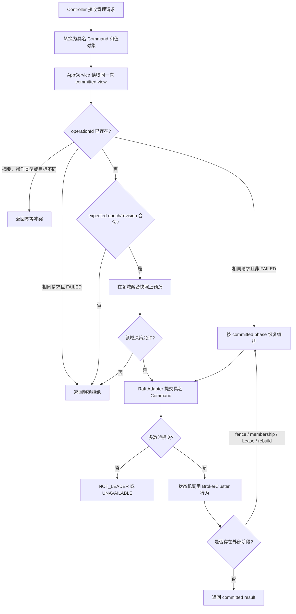

预演只用于尽早返回领域拒绝，最终结果以 committed command 在状态机内执行的聚合决策为准。应用服务不能
把预演后的可变聚合直接保存，也不能把自己计算的完整目标状态当作绕过聚合规则的事实。

改变 ACTIVE 集合的动作具有不可省略的领域阶段。`BrokerCluster.activate(...)` 产生并冻结领域 operation；
Application 完成旧 epoch fence 后，将同一个 operation 交给 Raft 提交。这里不使用 `planActivation`：领域中
不存在独立的 ActivationPlan；也不为 Raft 的 begin/commit 阶段创建两套领域动作。dry-run 与正式请求都调用
同一个 `activate`，区别只在正式请求会继续执行 fence 和共识提交。

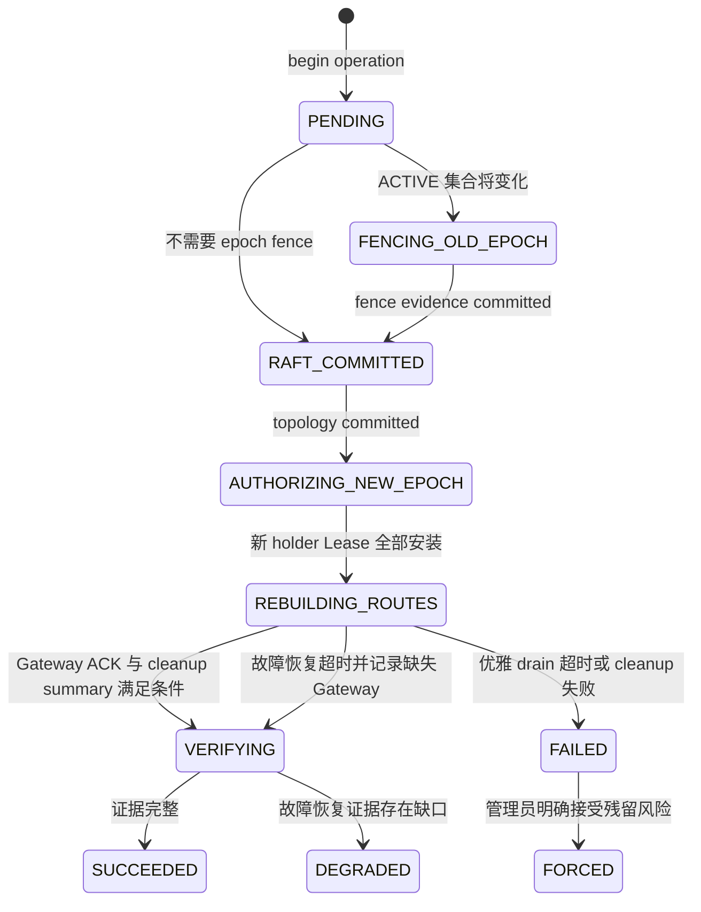

不改变 ACTIVE 集合的操作不需要执行旧 epoch fence，但仍必须按聚合允许的阶段推进到终态；路由恢复类
operation 还必须携带 Gateway 重建与 cleanup 证据。任何恢复逻辑都应根据 committed phase 选择下一步，
不能依赖进程内布尔标记推断。
故障恢复的 VERIFYING 同时保留完成意图：error 为空时依据完整证据提交 SUCCEEDED；
有已持久化的缺失原因时恢复 DEGRADED，不能因重启而覆盖为成功。正常成功的领域入口还会校验
Gateway ACK、摘要和旧事件截止时间，残缺证据或降级意图不能通过阶段合法性检查绕过。

重试判断先于节点当前角色和流量状态检查。相同 operationId 的摘要、操作类型和目标身份必须一致；
已有操作复用冻结意图，不能要求目标仍保持提交前的 READY、DISCOVERED 等状态。路由 epoch 已改变时，
原始请求仍可使用原 expected epoch 重试，身份冲突继续由聚合拒绝；新请求仍严格检查当前 epoch。
成员用例只有在 committed phase 为 `PENDING` 时调用外部 membership，已提交操作直接返回记录结果，
不得因重试旧晋升命令把后来降级的成员再次晋升。单步成员调用的明确拒绝记录 `FAILED`；
晋升/降级包含两步 Raft 配置变更，拒绝可能发生在第一步已提交之后，因此保持 `PENDING` 等待核对。
`UNAVAILABLE` 同样不推断为失败。`FAILED` 不能被当作已提交拓扑，也不能重新执行。

drain/故障恢复从登记到终态都占用拓扑变更窗口，包括 `REBUILDING_ROUTES` 和 `VERIFYING`。
聚合在 Raft 重放时拒绝新的拓扑意图，避免新 epoch 使按当前 epoch 调度的旧恢复操作丢失。
此约束不限制 Gateway ACK、cleanup evidence 等既有 operation 的推进。

### 启动、选主和 snapshot

- Broker 启动时校验 `clusterId/nodeId/endpoint` 与 Raft 数据目录中的稳定 identity marker 一致；
  不一致时拒绝复用数据目录，避免把一个节点的数据误装到另一个身份。
- 本地从 Raft meta、log 和 snapshot 恢复 `BrokerCluster` 聚合；snapshot 恢复后继续接收未包含在
  snapshot 中的日志。snapshot 至少包含当前 SDK state、operation history 和当前 fence operation。
- Leader 选举和任期变化由 JRaft 管理。新 Leader 不继承旧 Leader 的本地内存 Lease，也不能直接
  复用旧 term 的 ACK；它必须基于已提交 operation 重新完成 fence barrier、quorum grant 和 Lease install。
- Leader 失效期间，新的 cluster-state 写入、membership 变更和需要当前 term 的 Lease grant 都保持
  失败或等待；Gossip 和本地只读观察可以继续，但不能把观察结果升级成权威状态。

### membership 与 BrokerRoutingState

membership 是 Raft 的共识成员资格，`BrokerRoutingState` 是业务流量状态，两者正交：

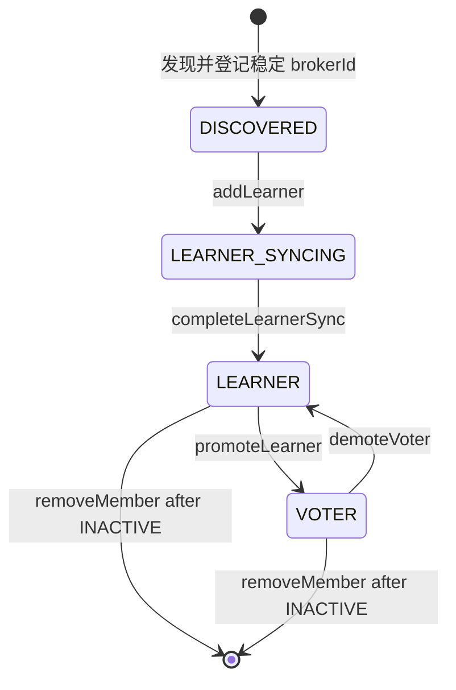

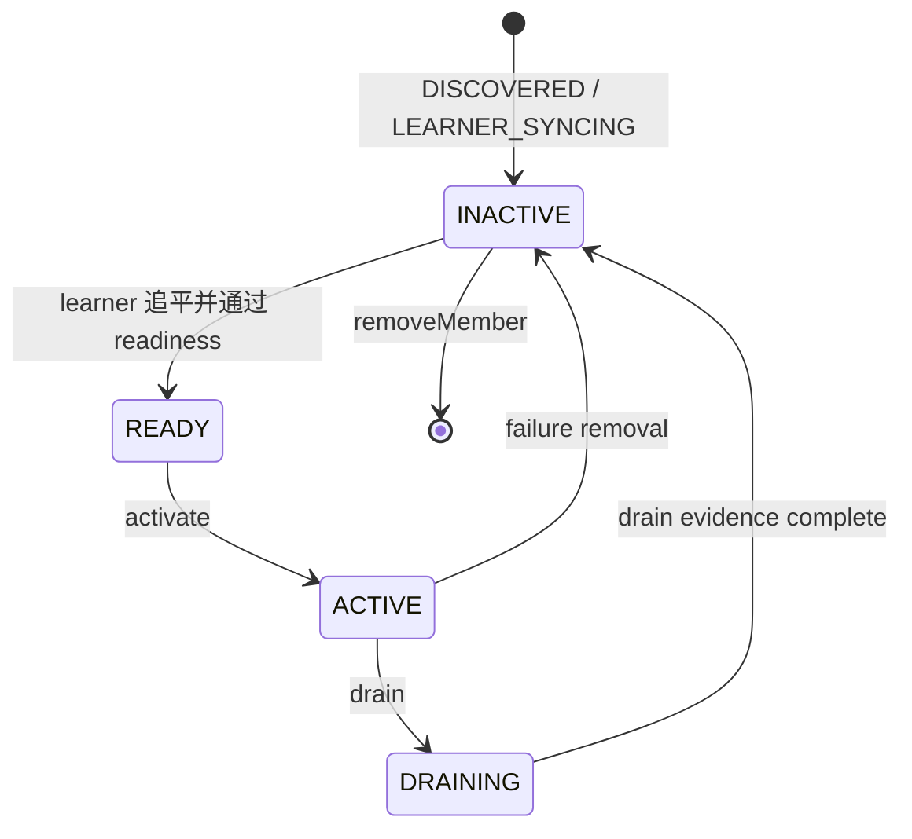

promote/demote/remove 必须先由当前 Leader 调用 JRaft membership API，再把结果提交到
`BrokerClusterState`。成员变更期间遇到 Leader 切换时，从已提交 membership 和 operation phase 恢复，
不能用本地猜测回滚或跳阶段。删除 ACTIVE Broker 前必须先完成旧 epoch fence 和 drain/failure recovery；
不能用 Gossip 的“节点不可达”直接删除权威成员。

### epoch fence 与 Lease 授权

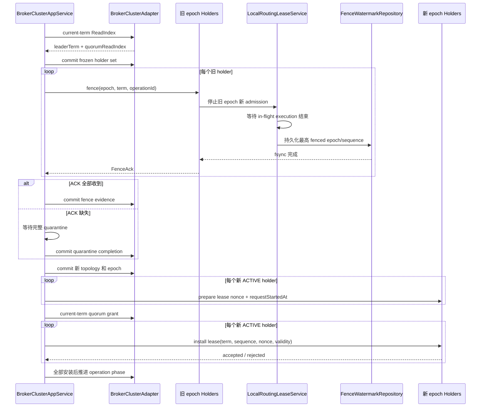

安全边界是“新副作用 admission 不重叠”，不是“所有旧远端调用必须在 epoch 切换前返回”。已经准入的跨节点
调用仍依赖稳定业务标识和接收端幂等。旧 holder 没有 ACK 时必须等待完整 quarantine，不能因为 RPC 超时就
提前给新 holder 授权。

### Raft 与 Gossip 的边界

| 问题 | Raft | Gossip |
|---|---|---|
| 谁可以成为 RouteBroker | 是，提交 ACTIVE 集合和 epoch | 否，只传播观察 |
| Broker/Gateway 是否刚刚存活 | 否，不承载高频心跳 | 是，最终一致 |
| 用户连接在哪个 Gateway | 否，不进入共识日志 | 是，作为运行态观察 |
| ACTIVE 集合和 epoch 是否递增 | 是，聚合原子校验 | 否 |
| 旧 epoch 是否被 fence | 是，提交 operation 并要求本机持久 marker | 否 |
| Gossip 失败时能否继续写权威状态 | 不绕过 Raft；不要求 Gossip 先收敛 | 只能延迟观察收敛 |

## 权威 Broker 控制面

`im-broker-server` 内的 SOFAJRaft 集群持有低频 `BrokerClusterState`、voter/learner membership 和有界
管理 operation。它与 Gossip 分工如下：

```text
Nacos/Gossip/主动探针 -> BrokerHealthObservation（最终一致事实）
                                  |
                                  | 多数 voter + 稳定窗口 + 冷却期
                                  v
Raft Leader -> fencing/成员 operation -> 多数派提交 BrokerClusterState
                                  |
                                  v
SDK/Broker 原子安装同一 revision + epoch
```

- Raft 决定“谁可以成为 RouteBroker”；Gossip 只描述“当前观察到谁可能健康/故障”。
- `adapter/cluster/BrokerClusterAdapter` 是统一集群技术入口，封装 BrokerCluster 状态读取、业务日志
  提交、voter/learner 配置变更、ReadIndex、snapshot 生命周期及目标 Broker 的 Bolt 应用进度查询。
  进度响应须属于请求集群、目标 Broker 且索引非负；不额外抽象唯一实现的 learner 查询接口。
  本机查询由 getLocalBroker 返回 LocalBroker，复用相同 RaftRuntime；它不是领域 BrokerNode，
  不缓存另一份状态或拥有独立生命周期。远端 fetchQuorumReadIndex 的目标是任意 Broker，不判断
  learner 资格；返回已应用的 quorum ReadIndex 而非最新 applied index。控制面 RPC 使用
  fetchQuorumReadIndex 及 appliedReadIndex 字段，无旧协议别名，需要节点版本匹配。
  Peer RPC 传输由 im-raft 的 RaftPeerClient 封装，Broker Adapter 提供协议载荷与响应类型并核对身份。
  JRaft 原生选举、日志复制和快照通信仍由 RaftRuntime/JRaft 负责，不走这个业务读取证明客户端。
  Raft 状态机、Codec 和快照仍留在 adapter/cluster/raft；跨节点 fence 与 Lease 安装由对应
  通信 Adapter 执行；quorum-backed Lease 签发与持久 fence 的用例顺序归应用层，
  不混入日志状态机和编解码包。Adapter 结果只传递处理状态、operation 和 Leader/原因，
  不重复携带集群或成员配置快照；这两种快照通过显式查询入口取得。
BrokerClusterAdapter 不是本地聚合资源库。
  集群操作的 acceptedEpoch 表示接受时的路由 epoch，resultEpoch 表示操作应用后的路由 epoch；
  不改变路由集合时两者相同，resultEpoch 在 Begin 登记时已冻结，不代表已经提交生效。
  操作对象 JSON 使用 resultEpoch，CQRS 响应的 targetEpoch 在 Transformer 边界映射。
  Raft 快照格式为 v6，日志命令格式为 v5；路由恢复证据字段统一为 recoveryEvidence，
  拒绝旧版本快照和日志，不提供字段别名或混合格式兼容。
  Broker Adapter 的操作查询和 epoch 查询分别接收 ClusterOperationId、RoutingEpoch；领导权确认接收
  QuorumReadNonce。它只表达读取请求上下文，可复用 prepare nonce 或操作标识，独立读取使用新标识，
  不将不同来源冒充 LeaseNonce。领域标识到字符串或 Raft 字节载荷的转换在 Adapter 内完成，
  公共 im-raft 不依赖 Broker 领域类型。
  BrokerClusterAppService 编排关闭旧 grant 和 prepare/quorum/grant/install，
  RoutingLeaseScheduler 调用其 activateLease，首次授权与续租共享签发服务。
  BrokerClusterAdapter 只执行单次技术操作，BrokerCluster 根据自身 epoch、节点和 fence 检查签发资格，
  RoutingLeaseGrantService 维护任期/序列并生成 Lease。应用层只在 prepare 前读取聚合检查资格，
  quorum 返回后调用 Adapter 的 grantLease。底层在状态机日志应用及快照恢复共用的同步边界内，
  对实际持有的聚合检查资格并分配签发序列，不基于分离快照完成最终签发判断。
  不保留 Coordinator 或 Lease Adapter 内隐藏整套用例的间接编排，也不引入应用服务互调；
  quarantine 使用配置层拥有的专用 ScheduledExecutorService 非阻塞等待，不使用公共线程池
  或可能饱和的 peer RPC 工作队列，不注入自定义等待函数，
  不能因接口删除而省略安全等待。
  旧 epoch 隔离的 peer 传输统一为 BrokerClusterAdapter.fenceBroker，接收 BrokerId 与
  RoutingEpochFence，返回领域 FenceAck。配置层提供有界线程数和队列的执行器，Adapter
  不拥有该执行器的关闭职责；任务拒绝返回失败阶段，不使用 CallerRunsPolicy。
  ACK 校验、隔离等待与拓扑提交仍由应用服务编排，真实本地 fence 与持久水位语义不变。
  JRaft `Node`、`Status`、日志与 snapshot 类型只存在于 Raft 实现内部。
- 新 Broker 先 `DISCOVERED`，授权加入 learner 并追平后为 `READY`；activate、promote、demote、remove
  均为串行且可恢复的显式 operation。
- 多数派不可用时不能提交新状态或签发 Lease。ACTIVE 集合变化先关闭旧 epoch grant，冻结旧 ACTIVE
  holder 集合并持久化到 Raft；全部 holder ACK 或完整 quarantine 结束后才提交新 epoch。
- holder 返回 ACK 前会线性化关闭本机 `LocalRoutingLeaseService`、等待已准入副作用结束，并以原子文件持久化
  本机最高 fence epoch。重启加载同一 marker，因此迟到的旧 Lease 不能恢复执行权。
- 新 epoch 提交后，Leader 通过 `prepare -> quorum grant -> install` 两步协议让 holder 以自己的单调时钟
  记录申请起点；只有全部新 ACTIVE holder 接受 Lease，operation 才从 `AUTHORIZING_NEW_EPOCH` 进入
  `REBUILDING_ROUTES`。换届恢复会保留冻结 holder 集合，但使用新 term 重新持久化 fence 并重等 barrier。
- Lease 签发在 prepare RPC 前检查资格；quorum 返回后的最终资格判断与序列分配，在本机状态机的
  日志应用同步边界内原子执行。fence 先应用则拒绝签发；签发先执行则属于关闭前的旧 Lease，仍由
  holder 隔离或完整 quarantine 处理。锁内不等待 quorum 或执行 RPC，且不替代跨节点隔离协议。
  operation 进度更新引起的 revision 变化不单独拒绝签发；异步授权失败记录目标及异常并返回
  本轮未完成，由授权恢复或续租轮次重试。
- `RoutingLeaseScheduler` 仅在本机是当前 Leader 时运行，在启动后和每个续租周期对 committed ACTIVE 集合
  重做 `prepare -> quorum grant -> install`。上一轮未完成时不并发启动新一轮；续租失败不会修改权威拓扑，
  holder 的旧 Lease 到期后会自动停止路由副作用，后续轮次再恢复授权。
- 当前连接 Registry 仍是内存数据面。普通连接、关闭控制、Frame Handler 和 Gateway 分片快照均按
  `epoch/RouteBroker -> LocalRoutingLeaseService -> side effect` 顺序接入。Gateway 每次进程启动生成新的
  `gatewayId`，其路由在租约过期并经过 grace period 后连同 revision 水位和 tombstone 一并回收。
- Gateway 完成目标 epoch 的全部分片后提交整轮 ACK。Leader 将 revision/count/checksum 写入 operation，
  并由 `BrokerDrainScheduler` 或 `BrokerFailureRecoveryScheduler` 恢复推进；只有优雅 drain 调用旧节点 cleanup。
- Registry TTL 清理失联 Broker/Gateway/Connection；TTL 与 Gossip tombstone TTL 分别解决活性和删除传播问题。
- `im-gossip` 提供通用 digest/delta 算法，Broker 通过 `BrokerStateStore` 适配业务状态。
- `im-raft` 提供通用 Raft 运行实例；`BrokerClusterAdapter` 组装启动参数，将业务 Command 编码后提交，
  并提供日志应用和快照内容回调。SOFAJRaft Node、Closure、ReadIndex 回调和快照文件机制由插件拥有，
  Broker 的 operation、Lease/fence 和领域不变量仍由 Broker 管理。

## 帧与控制流

上行和下行以客户端为参照。上行是客户端经 Gateway、Broker 到 Message 的业务请求；下行是 Message
经 Broker、Gateway 到客户端的通知。RouteBroker 只拥有用户连接路由，不拥有该用户的全部上行业务。

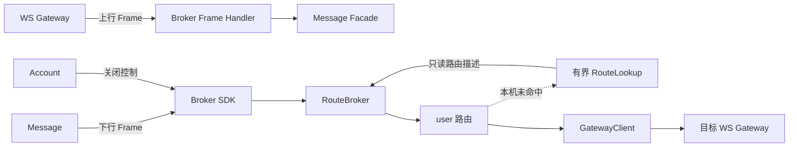

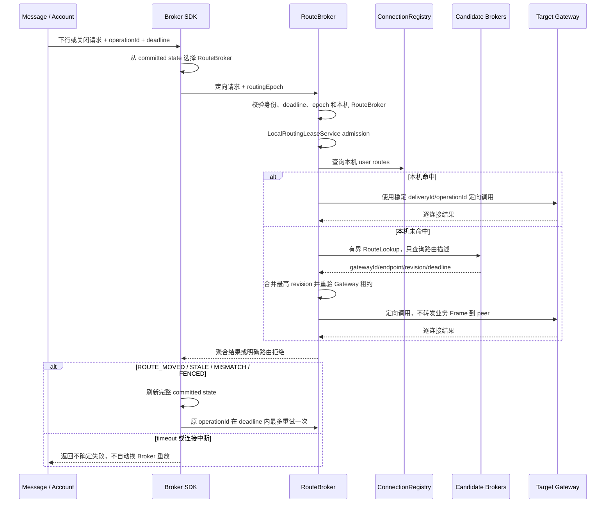

下行允许多 Gateway、多连接和部分失败。RouteLookup 只提供候选描述，当前 RouteBroker 重新校验后仍是唯一
Gateway Frame 调用方。Gateway 用稳定 `deliveryId + connectionId` 去重不确定响应造成的重试；Broker 汇总
逐连接结果，但不持有 ReceiptTask、不决定业务重投，也不把 Gateway 接受写入解释为客户端 ACK。关闭控制
用 `operationId + userId + sessionVersion` 幂等，Session version 只由 Gateway 与本机连接比较。

普通数据面不再由错误 Broker 二次转发。请求 epoch 落后、接收 Broker 状态落后、目标不匹配或本机
已 fence 时，分别返回 `ROUTE_MOVED`、`BROKER_STATE_STALE`、`ROUTE_MISMATCH`、
`ROUTING_FENCED`，且均保证尚未产生路由副作用。SDK 只有收到这些明确拒绝才刷新并定向重试一次；
timeout 不自动换节点重放，也不会广播业务 Frame。

Broker 到目标 Gateway 的每次下行 RPC 使用 `im.broker.gateway.frame.write` 记录结果和 duration。指标不包含 userId、messageId、connectionId 或 gatewayId 等身份标签；它只用于区分 Broker 路由之后的 Gateway RPC 耗时，不能解释为客户端收到消息或完成 ACK。

## 诊断边界

管理 HTTP 与业务 Bolt 使用独立端口。诊断接口只读、限制查询范围，Gossip 历史使用固定容量内存；诊断写入失败不会改变注册或同步结果。Ops 通过 Nacos metadata 发现管理地址，不根据 Bolt 端口猜测。

## 依赖规则

- `im-broker-sdk` 只定义调用契约、Params、DTO 和客户端，不依赖 Server。
- Broker Server 可以依赖 Gateway SDK、Message Facade 与通用 Gossip/Bolt/Dubbo Plugin。
- RPC Handler 只解析协议并委托；集群与路由用例位于 application，权威规则位于 domain，Raft/Bolt/SDK
  调用实现位于 adapter，Spring 装配、Gossip、Registry 和本地技术状态位于 infrastructure。
- Broker 不访问 Message、Account、Social 数据库，也不持有 Gateway Channel。
