# Broker Architecture

`BrokerRaftAdapter` 提供本机集群查询与共识提交能力，供应用服务和调度入口使用。`adapter.cluster.consensus` 定义提交结果及状态，用于区分领域拒绝、重复、冲突及 Raft 技术失败。

集群路由操作的完整生命周期由 `BrokerClusterAppService` 编排：`drain` 发起排空，`advanceDrain` 推进排空，`recoverRoutes` 推进故障摘流后的路由恢复，`forceDrain` 在显式风险确认后结束失败排空。定时入口调用对应业务方法；`forceDeactivate` 表示发起故障摘流。

## Broker 运行概览

[Server README](im-broker-server/README.md#运行概览)提供消息路径、协议分工和启动配置；本节继续解释状态归属、三节点故障推演和并发检查。

先把 Broker 拆成三个问题：消息应该交给哪个 Broker，Broker 当前认为哪些节点可以承担流量，以及某个节点最近是否可达。第一个问题读取已提交的 `BrokerClusterState`，按 `userId` 选择唯一 RouteBroker；第二个问题由 Raft 提交 ACTIVE 集合、`epoch`、fence 和 operation；第三个问题来自 Registry、主动 probe 和报告快照，属于观察，不能单独改变第二个问题的答案。

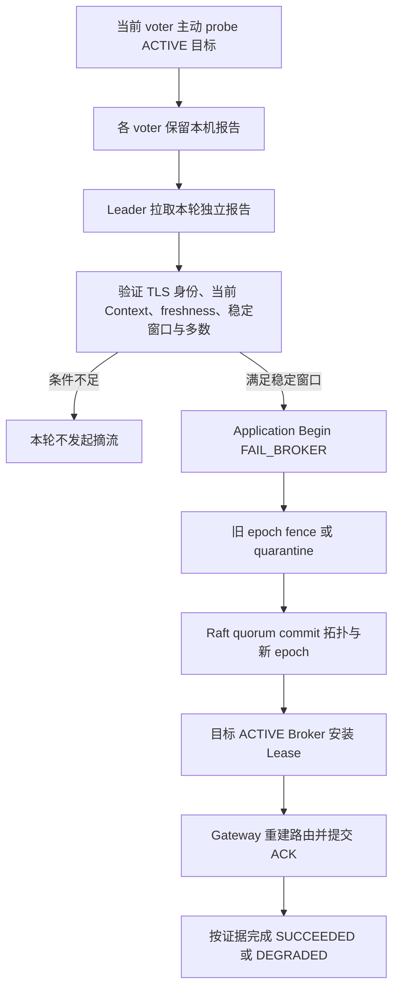

这张图的关键是「观察到决定」中间有一层应用校验。健康报告即使显示目标不可达，也不绕过 `BrokerCluster`；只有 `Begin`、fence、拓扑提交和后续恢复证据进入 Raft 后，其他节点才会看到同一权威结果。`DEGRADED` 保留缺失证据，不能当作成功。

### 三 Broker 的消息与控制信息流

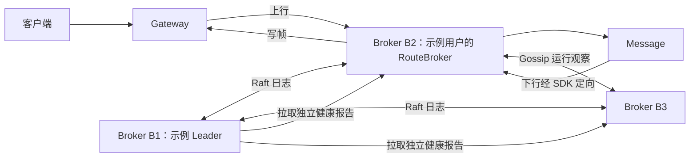

例如 B1、B2、B3 都是 voter，某用户按已提交拓扑被分配给 B2：Gateway 的连接更新交给 B2，Message 的下行也直达 B2，B1 身为 Leader 不必经手每一条消息。Gateway 持有真正的连接和 Channel，Message 持有消息业务事实，B2 保存定位 Gateway 所需的路由。图中只画部分 Gossip 边以便阅读，实际每轮按 fanout 选择 peer；健康报告从 voter 本机采样直接取回，不随这些 Gossip 边传播。

若 B2 无响应，B1 的一次失败只能说明「B1 这次没有成功完成探测」。B1 与 B3 必须各自持续观察，再由 Leader 取回新鲜报告；B2 的自报无效，但多数分母仍是 3，所以需要另外 2 个独立 voter 的合格失败报告。若只有 B1 能报告，不能把分母改成 1 并宣布多数。即使报告满足条件，仍须走旧 epoch fence 或完整 quarantine，才能提交新拓扑和授权，防止仅网络隔离的旧 B2 继续产生副作用。

### 用一次故障摘流理解 DDD

DDD 与协议机制解决的是不同维度。可以从「B2 应不应该停止承担流量」这个问题出发，而不是先记目录名。

**实体追踪同一个对象的变化。** `BrokerNode` 用稳定的 BrokerId 标识同一个 Broker；即使流量状态由 ACTIVE 变成 INACTIVE，它仍是 B2。`BrokerClusterOperation` 同样有稳定 operationId，重试时要继续同一次操作，而不是因阶段变了就另建一项。连接侧的 `ConnectionRegistration` 也有路由身份与生命周期。

**值对象关心值本身及其约束。** `RoutingEpoch`、`ClusterRevision`、`BrokerId` 不是任意数字和字符串。两个值对象的值相同，就表达相同业务含义；不需要追踪「这一个 epoch 对象」的生命周期。把它们区分开，也能避免把内容 revision 误当成路由 epoch。

**聚合负责不能拆开的规则。** 不能让某段代码只把 B2 改成 INACTIVE，却忘了检查 operation 阶段、旧 epoch 隔离或是否仍有 ACTIVE Broker。`BrokerCluster` 是这个一致性边界的聚合根，外部只能调用其公开行为。连接侧的 `GatewayRouteTable` 是另一聚合根，负责完整快照、revision 和 tombstone；它不是集群聚合的附属远端数据库。

**领域服务判断规则，应用服务安排步骤。** `BrokerFailureObservationService.evaluate` 从多个 reporter 的最新报告判断多数、freshness 和稳定窗口，不发 RPC，也不提交 Raft。`BrokerClusterAppService` 则读取当前事实、取报告、调用领域服务，再安排 Begin、fence、Lease 和路由恢复；它负责「先后顺序和如何继续」，不能自行改聚合字段。

**Adapter 处理外部机制。** `BrokerPeerAdapter` 取得对端报告，`BrokerRaftAdapter` 提交具名命令，Gateway Adapter 发送写帧调用。它们负责协议和数据转换，不决定「报告是否足以摘流」。例如一次失败可由 Bolt 分类为可归因的传输失败，但是否连续足够久、是否有独立多数，仍是领域规则。

把这些角色串起来：Scheduler 触发 B1 的应用用例，应用读取 B1 本机观察、经 Peer Adapter 取回 B3 的观察，领域服务判断资格，聚合检查故障摘流意图，Raft Adapter 登记 operation；之后每个已提交命令在状态机中再次调用聚合行为。这样既不会把业务规则塞进网络回调，也不会要求纯领域对象认识 TLS、JRaft 或线程池。

因此，Raft 不会替代 DDD，Gossip 也不会成为领域模型。Raft 的日志提交保证多个 Broker 对同一决定达成一致，但不保证这个决定本身符合业务规则；规则仍由聚合在状态机应用时校验。Gossip 的最终一致传播适合高频观察，但不能授权 Lease、推进 epoch 或把节点改成 `INACTIVE`。同样，`ACTIVE` 只是业务流量状态，不表示节点已经安装有效 Lease；Raft membership 的 voter 资格也不等于 ACTIVE 目标。原始 JRaft 1.4.1 的 Leader-only 成员列表 API 曾阻塞 Follower 完整已应用 membership 读取；当前本地私有候选已通过 Runtime 接入及原三项 Broker TLS HA，解除该范围内的行为阻塞。私有制品发布与可复现性仍属后续轨道；全仓验收与任务状态以 [PROGRESS](../PROGRESS.md)、[计划索引](../docs/exec-plans/active/README.md)及 Harness 当前指纹记录为准。不能把单元测试、结构整理或静态初始配置替代 HA 证明，也不能把 Gateway ACK 替代边界当作真实 Gateway E2E。

### 健康观察值对象的身份与时间

`BrokerHealthObservation` 使用 brokerId 表示被观察的 Broker，observerBrokerId 表示实际探测并产生记录的 Broker；status 必须显式提供，observedAt 是最近采样对应时刻，不是写入或收到报告时刻。unreachableBeginAt 是连续失败窗口起点，仅 UNHEALTHY 时存在且不晚于 observedAt；HEALTHY/UNKNOWN 不保留该窗口。时间点来自本机采样或按报告年龄还原，不直接比较远端墙钟。字段读取使用 Lombok fluent Getter，无 Setter，Builder 与 JSON 构造共享原校验。领域 JSON 使用新字段，无旧名兼容；此对象不是 Raft 持久化载荷，SDK/Query 请求以 callerBrokerId/receiverBrokerId 区分调用者与接收者、brokerIds 表示待查询集合；ReportResult/DTO 的 observerBrokerId 表示实际观察者，Row/ObservationDTO 的 brokerId 表示被观察者，与领域名称一致并经生成 Transformer 转换。该边界JSON字段改名要求同版本成组部署，不保留旧target/reporter alias；probe响应brokerId不变。观察值本身不决定冷却、多数或权威拓扑变化。

### 观察背景与冷却的领域状态

`domain/cluster/model/BrokerObservationState` 是本机观察背景与冷却进度的有状态领域对象；`BrokerClusterAppService` 持有唯一实例，通过 `advance` 更新事实并判断冷却是否满足，通过 `invalidate` 作废计时；冷却资格只由此状态对象判断，不再暴露无生产调用方的耗时查询。首次观察、Leader/任期/拓扑变化、成员不一致及恢复、主动失效或单调时间回退时重新计时；字段为 topology、leaderTerm、cooldownValid、cooldownAt、observedAt 及构造时固定的 cooldown，时间点使用 MonotonicTimestamp。advance 只在本机 Leader 任期可读且 voter 一致性检查通过后接收 topology、leaderTerm、observedAt 三项事实；空 voters 时应用先 invalidate 再返回。非 Leader 时同样直接 invalidate，不为冷却读取 membership 或构造 topology。它不读取时钟、配置或 Adapter，不保存健康样本或判断故障多数，不进入 Raft 快照，重启后重新冷却。应用层继续拥有事实读取、时间采样、轮次互斥与异步重验，领域服务 evaluate 只接收目标、当前 voter、观察集合、评估时刻四项事实，判断多数、freshness及稳定窗口，不再注入或重复判断冷却。eligible 仅表示报告证据合格；应用必须先通过 State.advance，再在汇合后重验任期/角色/Context，最终还需聚合与共识接受。状态对象的同步方法不替代外部事实重验或 quorum proof。

### 异步健康观察的两次 Context 检查

健康探测是异步的，不能在发出请求时假定拓扑仍未变化。每轮开始时构造结构化 Context：`revision` 和 `BrokerClusterTopology`；ACTIVE 目标从拓扑派生。它们按 record 的结构相等比较；不拼接字符串签名，也不依赖 `Topology.toString()` 排序。目标自身的报告不计入有效故障票；多数阈值始终按完整当前 voter 集合计算，不因目标自身或报告不可达而缩小分母。冷却判断只比较拓扑、term、Leader 和一致性状态，不把每个 revision 变化都当成拓扑变化；Tracker 的采样 Context 另含 revision，因此能拒绝旧 revision 的迟到样本。

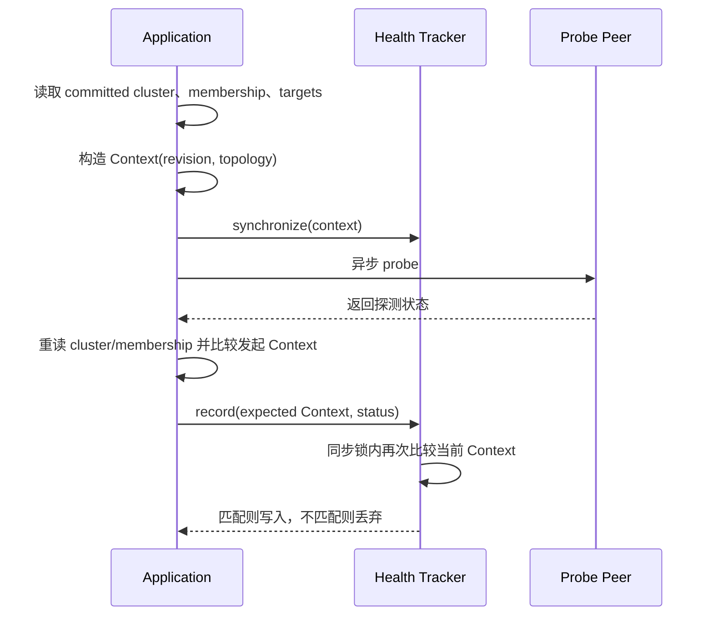

Context 可以理解为记录本的标签，Tracker 是记录本，异步 probe 是发出去后才收回的调查。`synchronize` 不访问网络：标签相同就保留样本，revision 或 topology 改变就清空全部旧样本，目标集合随拓扑更新。它不是每次网络请求的轮次编号，相同背景下的多次采样必须共用上下文，才能累计连续失败。

Tracker 每个目标只保存最近状态、最近单调采样时间和连续失败起点。连续 UNHEALTHY 且间隔未超过 freshness 时沿用起点；HEALTHY、UNKNOWN 或采样断档会打断窗口。`snapshot` 对没有样本、过期或单调时间回退的目标输出 UNKNOWN，不把未知当成故障票。假设 B1 在 t0、t5 都无法访问 B2，窗口可累计5秒；如果中间一次恢复，下一次失败必须重新计时。这里用单调时间算时长，墙钟只用于报告中的绝对时刻，不能靠墙钟回拨延长故障窗口。

第一次检查由 Application 在异步完成后重读最新集群事实，防止把旧 epoch、旧成员或旧目标送入后续资格判断；第二次检查在 Tracker 的同步边界内完成，防止「检查通过」到「写入样本」之间发生 Context 切换。两次检查都不是全局原子快照，也不提供 ABA 或跨 Raft membership 的额外保证；它们只把已知的迟到结果安全地丢弃。例如 B1 发起对 B2 的 probe 后，新的 Context 已移除 B2：即使旧 probe 最后返回失败，应用层也不记录；若应用层刚检查通过、另一线程就切换了 Tracker Context，锁内检查还会挡住旧样本。网络等待期间不持有 Tracker 锁，目标在途闸门仍等底层调用实际结束才释放，不能因 Context 过期就另发一批尚未结束的探测。Leader 开始观察时仅读取本机任期标记用于冷却，汇总后才取得同任期 quorum 证明，并核对 term、Context 及 voter 身份背景，单次 RPC 预算保留，但不再检查整轮耗时上限；最终 Begin 仍由 expectedRevision 和聚合规则保护。

## 三类版本与状态位置

| 标识 | 递增或变化的原因 | 不代表什么 |
|---|---|---|
| `ClusterRevision` | 已提交权威内容改变；例如 Begin 与成功 Commit 各推进一次 | 不表示用户路由一定迁移 |
| `RoutingEpoch` | ACTIVE 集合等 RouteBroker 选择输入改变 | 不是每条管理日志的版本，也不是节点加入次数 |
| `LeaderTerm` | Raft 领导任期变化 | 不表示拓扑变化；本机可读任期不等于 quorum proof |
| Gateway `routeRevision` | 同一 Gateway 进程内的连接增量和完整快照水位 | 不可与集群 revision 比较，进程重启用新 gatewayId |

权威聚合由本机 Raft 状态机应用 committed 日志后投影；本机读取投影不自动提供线性一致性。ConnectionRegistry 是当前 RouteBroker 可用于投递的本机索引，远端 Connection Gossip 只是观察副本。健康 Tracker、冷却状态和安装的 Lease 也只在本机；它们不会因日志复制或 Gossip 自动出现在其他 Broker。

## 职责与状态模型

Broker 是实时路由协调层，不是消息存储。它持有 Broker、Gateway 和用户连接位置的运行态注册表，把上行帧交给 Message，把下行帧写到目标 Gateway，并通过 Gossip 让多个 Broker 最终收敛。

```text
Registry 状态
  BrokerRegistry      brokerId -> Broker
  GatewayRegistry     gatewayId -> Gateway
  ConnectionRegistry  userId <-> gatewayId

业务写入 -> 内部事件 -> BrokerGossipAdapter -> Gossip digest/delta -> peer Broker
```

Broker Server 采用「DDD 核心 + 技术子系统」。`domain/cluster/model/BrokerCluster` 是权威控制面唯一聚合，保存 Server 自有拓扑、revision、epoch、operation、drain 和 fence 不变量。

`domain/authority` 保存 Lease、fence、admission 及领域 seam，并在能力包内按 `model`、`service`、`repository` 组织领域对象、领域服务和资源库。

`domain/connection/model` 保存连接路由聚合。

application service 编排具体 Adapter 和领域对象。InMemory Registry、Gossip store、Raft、Bolt/Gateway client 和文件 marker 按其技术能力归入 `adapter` 或 `infrastructure`。HTTP/Bolt 入口只转换协议并调用 application 用例，不能自行推导集群状态或执行跨资源编排。通用判据见 [`docs/references/MODULE_STRUCTURE_GUIDE.md`](../docs/references/MODULE_STRUCTURE_GUIDE.md)。

## DDD 模型与边界

Broker Server 的 `domain` 只表达 Broker 自己拥有的业务规则，不承载 Spring、SOFAJRaft、Bolt、Gossip、配置类或协议 DTO。外部请求先在 interfaces/transformer 边界转换为应用命令和值对象，再由 application service 调用领域模型；领域层不能反向依赖 application、infrastructure 或 interfaces。

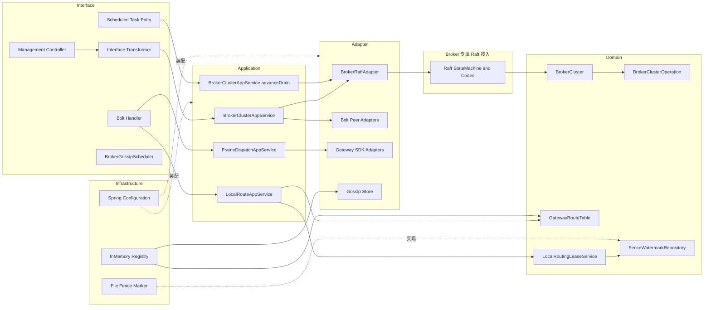

依赖方向以用例为准：Interface 只进入 Application；Application 编排具体 Adapter 和领域对象；Adapter 把技术输入转换成领域行为；Domain 不认识 Controller、SDK、Raft 或 Spring。Raft 状态机属于 Adapter 内部执行路径的 support.raft.statemachine 回调，它只能调用聚合公开行为，不能直接修改聚合字段。

| 领域能力 | 聚合和核心对象 | 保护的不变量 |
|---|---|---|
| `domain/cluster/model` | `BrokerCluster` 聚合根、`BrokerClusterOperation` 操作实体 | epoch、revision、成员角色、拓扑、drain、fence 和 operation 阶段只能按合法状态转换 |
| `domain/connection/model` | `GatewayRouteTable` 聚合根、`ConnectionRegistration` 实体 | routeRevision 单调、完整快照原子接受、tombstone 阻止迟到注册、过期路由按规则回收 |
| `domain/authority` | `RoutingLease`、`FenceAck` 等授权模型 | Lease 必须绑定 Broker/epoch/term/sequence/nonce；最高 fence 水位之后不得重新准入旧 epoch 副作用 |

领域对象的角色遵循以下约束：

- 聚合根负责跨字段和跨实体的不变量。`BrokerCluster` 负责权威拓扑和 operation；`GatewayRouteTable` 负责单个 Gateway 的连接路由、快照和 tombstone。
- `BrokerClusterOperation`、`ConnectionRegistration` 等实体具有业务身份和生命周期，不能由 Handler 或 Raft 状态机直接修改字段。
- `BrokerNode` 的角色和流量状态由 Commit 内的实体行为修改，Begin 只登记经过校验的事实。Proposal 和 operation 不持有节点或目标拓扑；聚合构造、公开查询与持久化快照隔离可变节点。Commit 使用冻结的端点、最低 voter 数量及 drain 事实，不读取运行时配置、当前时间或远端状态重新解释历史请求。
- `BrokerId`、`RoutingEpoch`、`ClusterRevision`、`RouteRevision`、`LeaseSequence`、`LeaseNonce`、`MonotonicTimestamp`、`QuorumReadIndex` 等是值对象，用于承载校验和业务语义。
- `LocalRoutingLeaseService` 和 `BrokerFailureObservationService` 是领域服务，分别负责本机 Lease admission/fence 线性化，以及故障观察是否满足进入权威处置的条件。
- `FenceWatermarkRepository` 是领域资源库抽象，只表达读取和推进本机最高 fence 水位；文件 marker 等持久化实现属于 `infrastructure`。
- `LocalFenceResult`、`FenceResult`、`BrokerClusterDecision` 是领域结果或决策，不是新的聚合。

### 应用用例与入口

| 能力 | 所有者 | 职责 |
|---|---|---|
| 集群路由 | `BrokerClusterAppService` | 状态变更、旧 epoch fence、quarantine、新 epoch Lease 激活、排空与故障恢复 |
| 成员管理 | `BrokerMembershipAppService` | learner/voter 加入、就绪、晋升、降级、移除 |
| 本机路由 | `LocalRouteAppService` | 分片接收、完整路由应用、按 committed 水位清理 |
| 本机 Lease | `LocalLeaseAppService` | prepare/install 和一次性 nonce |
| 帧投递 | `FrameDispatchAppService` | 路由定位、peer Lookup、端点复核、逐 Gateway 投递与汇总 |
| 注册观察 | `BrokerGossipAppService` | Registry 事件到 Gossip observation |
| 诊断 | `BrokerDiagnosticAppService` | 有界只读诊断查询 |

应用服务拥有用例顺序、幂等、权限和外部协作，直接编排具体 Adapter 与领域对象。路由管理和成员管理分别作为 Controller 的直接入口，互不调用。需要领域聚合和 SDK 投影时读取同一次 committed view，聚合恢复与投影转换由共识 Adapter/状态机完成。

HTTP/Bolt 入口只转换协议并委托用例。配置为每个 operation 按列表顺序组装身份、成员准入、调用方角色、RouteBroker/Lease 保护及业务 Handler；Bolt Processor 注册完整链入口。`BrokerRequestInterceptorChain` 实现 `BoltRequestHandler`，调用上下文和节点执行位于 `infrastructure/chain`。Handler 不持有责任链，也不感知内部拦截阶段；operation 覆盖和请求类型匹配由装配测试验证。

管理 Controller 在异步编排前捕获请求上下文；访问拦截器在异步处理开始时清理初始 Servlet 线程，并在同步完成时清理，避免线程复用泄漏请求事实。上下文与入口访问控制归 `support/context`，MVC 注册归 `infrastructure/config`；拦截器可读取管理配置，不调用应用、领域、Adapter 或 Registry 实现。

### Registry 与协议边界

| 存取契约 | 所属领域 | 内存实现位置 |
|---|---|---|
| `BrokerRegistry` | `domain/cluster/repository` | `infrastructure/domain/cluster` |
| `GatewayRegistry`、`ConnectionRegistry`、`BatchConnectionRegistry` | `domain/connection/repository` | `infrastructure/domain/connection` |

Registry 返回 Server 自有的 BrokerRegistration、GatewayRegistration、ConnectionRegistration 和 ConnectionSyncResult。SDK 端点和诊断基础字段由 RegistryTransformer 在边界转换；Gossip 保存平铺的 GatewayEndpointDTO observation，不直接序列化领域对象。

- Gateway 注册接收 GatewayRegistration，查询、心跳、注销和退役判断使用 GatewayId。身份索引及退役集合使用 GatewayId；心跳只更新 lastSeenAt，保留主体、端点与首次注册时间。
- GatewayRegistration 使用 GatewayId、GatewayHost、GatewayPort、GatewayPrincipalId 和 Instant。principalId 表示认证主体，gatewayId 表示进程身份；构造入口校验空值与端口范围。
- Connection 注册接收完整 ConnectionRegistration，注销接收 ConnectionRouteId、RouteRevision、Instant。其他输入使用 UserId、GatewayId、RouteRevision、Instant、Duration 和 List<UserId>。
- find(UserId) 返回活跃注册及版本、更新期限、观察时间。实体保存首次注册时间，已接受更新刷新观察时间。GatewayRouteTable 是唯一实体来源，存储只维护用户到 Gateway 的身份索引，查询不补建记录。
- Gossip 连接删除只更新远端观察；无 revision 的删除不能改写本机路由。Gateway 整体移除按 Gateway 清理本机聚合。

### 本机分片接收与清理

GatewayRouteBatch 是 `domain/connection` 的接收实体，GatewayRouteBatchId 区分 Gateway 的同名批次。实体负责匹配、幂等收集、按序组装和完整摘要验证；GatewayRouteBatchReception 返回接收事实与可应用批次。这些模型不依赖 Command、SDK、配置或 Spring。

InMemoryBatchConnectionRegistry 包装实际存储，管理批次索引、容量、超时回收和同步锁。配置层只注册一个包装 Registry Bean；普通存取和批次应用访问同一份连接数据，底层 Registry 是内部委托对象。应用层只持有 BatchConnectionRegistry，在接收锁内串行检查资格、收集和应用，在 Lease 保护下 applyBatch 并发布事件。

清理资格由 operation 与 DrainProgress 匹配目标、代次、`Instant oldEventExpireAt` 和完整确认集合。应用层在独立清理锁内读取一次 operation、核对完整请求，然后调用 Registry.cleanupRoutes。实现按水位删除或复用首次结果，由 BrokerDrainTransformer 转换响应；Lease 异常沿 RPC 通道传播。

RouteCleanupId 表达操作/Gateway 身份，RouteCleanupCheckpoint 保存已完成水位和首次删除数量。清理缓存与分片集合使用独立锁；缓存仅保存水位和数量，提供本机尽力幂等，不是持久化恢复事实。Gateway 整轮 ACK 由 BrokerClusterAppService 登记 Raft 恢复进度，与本机分片暂存分属控制面和数据面。

### 查询、投递与本机缓存

FrameDispatchAppService.dispatch 依次进行本地活跃目标定位、未命中 Lookup、远端端点复核和并发投递。BrokerPeerAdapter.lookupRoutes 接收 SDK BrokerNode、公共 UserId 和领域 RoutingEpoch；每次 peer RouteLookup 使用独立 IO 超时与 deadline，固定 hopCount=1，不从外部请求期限分配剩余预算。

- Lookup 查询当前拓扑中所有其他 ACTIVE/DRAINING 节点，通过专用虚拟线程并发执行，不排序、不截断。单个 peer 的同步提交失败、异步失败或超时不丢弃其他结果，完成后按 Gateway 合并最高 revision。
- GatewayDispatchAdapter 将阻塞写帧提交到配置层拥有的专用虚拟线程执行器，返回 CompletionStage。应用层等待全部响应后汇总，保留逐 Gateway 的低基数指标；单目标失败不丢弃其他结果。
- RouteBrokerExecutionInterceptor 只在入场时检查请求期限，不中断已开始的 Handler。dispatch 不重复判定入场期限；GatewayRegistration.isFreshAt 是注册观察窗口，不是路由执行 Lease。

| 本机缓存 | TTL 与容量语义 | 安全边界 |
|---|---|---|
| UserId 未命中负缓存 | Gateway 复核后无目标才写入；零 TTL 不写入 | 仅辅助 Lookup，不改变权威拓扑 |
| epoch 观察 | 重复观察刷新 TTL；读取有效值快照 | 网络等待不持有缓存锁，淘汰无 FIFO 保证 |
| 未完成分片 | 首片 PUT，续片更新同一对象，不延长 TTL；字节容量按有效批次计算 | 超时批次不应用部分路由 |
| 清理检查点 | 固定容量与长 TTL，淘汰无 FIFO 保证 | 仅提供有界本机重试记忆 |
| pending nonce | pendingTtl 过期释放容量，localLimit 满额可淘汰旧申请 | 容量不是授权依据；旧申请安装失败由调用方重试 |

上述缓存由 JetCache LOCAL 管理 TTL 与容量，Registry 索引和聚合状态不是缓存。accept 仅查询目标 nonce，匹配后先消费；领域服务按单调准备起点与 Lease 自身有效期判断能否安装及执行。

路由更新的 `Instant updateExpireAt` 与排空冻结的 `Instant oldEventExpireAt` 语义不同；SDK 分片/ACK 的 `updateExpireAtMs` 和 cleanup 的 `oldEventExpireAtMs` 在接口 Transformer 边界转换，不向领域传播数字绝对时刻。

### 事件、诊断与运行装配

定时入口与资源装配分开：`interfaces/scheduler` 触发周期任务，`interfaces/lifecycle` 处理本机注册生命周期，`infrastructure/config` 创建 Bean、执行器和调度资源并负责相应资源装配。Gossip 的 peer 选择与同步顺序见 [Gossip 一致性](#gossip-一致性)。

Registry 已发生事实位于 `model/cqrs/event`，由基础设施中的 Spring publisher 发布。`interfaces/listener` 委托 BrokerGossipAppService 更新 observation；心跳从 Registry 获取当前端点，缺失端点不复活已移除节点。单次处理异常隔离，不阻断后续事件。

诊断 Controller 调用 BrokerDiagnosticAppService；本机身份由配置层传入。

GossipSyncTracker 位于 `support/gossip`，只保留有界、非权威、可选的诊断历史与累计摘要，不参与业务决策，不拥有网络、运行资源或生命周期，不依赖 application、interfaces、infrastructure、配置、Adapter 或具体网络 client；领域不得依赖 support。运行态观察存储与合并仍由 `adapter/gossip/BrokerGossipAdapter` 负责。

Broker 自动健康观察另行批准精确 `support.health`（不允许后代包），当前具体实现为 `BrokerHealthObservationTracker`，允许 Tracker 后缀，不建 Repository、port/实现对或兼容壳。它只维护按当前目标裁剪的有界采样 Context（`revision`、`BrokerClusterTopology`，目标从拓扑派生）、freshness 与快照；观察非权威，但属于安全决策输入，不是可选诊断。成员一致性由聚合 `BrokerCluster.findConsistentVoters` 判定，最新事实、多数与稳定窗口由领域服务 `BrokerFailureObservationService.evaluate` 判定，应用层编排。允许依赖领域 model、common 和 JDK 时间/集合；禁止 application、interfaces、infrastructure、config/configuration、lifecycle、Adapter、领域 service/repository、Spring、client/network、plugin 及运行资源拥有，domain 不得反向依赖 support。装配归配置、入口归 Handler/Application；此例外不放宽 Gossip、Monitoring 或其他 support。精确包和稳定依赖由生产/fixture 共用架构规则保护；有界性、无决策及实际完成回调语义由聚焦测试和 Review 保护，待可靠资源/决策数据流分析后自动化。

跨层 CQRS 模型位于顶层 `model`，HTTP Request/Response 位于 `model/io`。

Transformer 按边界能力分组：`transformer.application` 两类负责应用输出映射，`transformer.interfaces` 三类负责入口映射；`transformer.adapter` 包含 BrokerClusterStateTransformer 及 Raft、Drain、Fence、Lease 转换器，`transformer.registry` 包含 RegistryTransformer。MapStruct 生成映射不承担业务决策。

BrokerMetrics、RoutingAuthorityMetrics 位于精确 `support.monitoring`，保留 Spring `@Component` 和 Micrometer `MeterBinder`，只读查询 Domain、Registry 与 Adapter。此技术观察例外不允许后代包，不依赖 application、interfaces、infrastructure、config、lifecycle，不直接拥有网络 client、RaftRuntime 或执行器，不参与业务决策或写入；Domain 不得反向依赖 support。它不继承纯 support.gossip 的禁止 Adapter/Spring 规则，也不放宽其他 support 包。

| 运行职责 | 所属位置 |
|---|---|
| Bean、预算、容量与调度资源装配 | `infrastructure/config`，按 Cluster、Lease、Lookup、Delivery、Drain 等能力组织 |
| 成员恢复、排空、故障恢复、Lease 续签、Gateway 清理、Gossip 同步 | `interfaces/scheduler`；Gossip 同步入口为 `BrokerGossipScheduler` |
| 本机启动注册、周期心跳、关闭注销 | `interfaces/lifecycle` |
| Gossip store 与 observation 适配 | `adapter/gossip/BrokerGossipAdapter` |
| 有界非权威可选诊断记录与摘要 | 精确 `support/gossip/GossipSyncTracker`，不允许后代包 |
| Spring/Micrometer 只读指标观察 | 精确 `support/monitoring` 的 BrokerMetrics、RoutingAuthorityMetrics，不允许后代包 |
| 请求上下文与入口访问控制 | `support/context` |
| 跨层异常、受信传输身份辅助类型 | `support.exception`、`support.security` |
| peer 身份、scope、learner join token 策略 | `application/policy/cluster` |

应用能力的不可变参数快照归所属 application 包，调度参数归 interfaces/scheduler。应用服务不依赖基础设施配置；批次容量由 Registry 实现读取源配置，应用只接收快照重试所需超时。quarantine 等派生时长在装配时计算。调度运行标志在同步异常或异步完成时释放，避免永久跳过后续轮次。

GatewayCleanupScheduler 与 GatewayUnregisterHandler 委托 LocalGatewayCleanupAppService。两种入口均先写入 Gateway/连接 Gossip 删除观察，再移除本机路由及注册。写入失败保留注册和连接，由扫描或调用方重试；重复清理不恢复已删除路由。

删除观察仅在本机内存中，进程在写入或传播前崩溃时没有持久化重放保证。此流程不能视为可靠事件投递。授权策略属于 application；目标 Broker 的 Lease prepare/install 关联由 LocalLeaseAppService 编排。

## RouteBroker 与连接路由

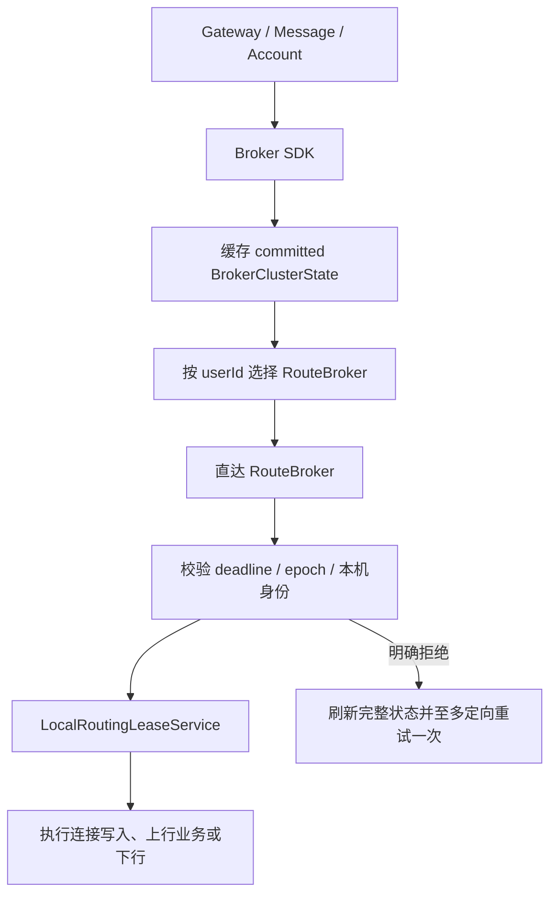

RouteBroker 只由已提交 `BrokerClusterState` 中的 ACTIVE Broker 计算。建群时选择 `RENDEZVOUS_HASH` 或 `MODULO_HASH`，运行中不能切换算法；Nacos/Gossip 不能直接改变选择输入。

`ConnectionRegistry` 同时维护 user 到 gateway 和 gateway 到 user 的索引。前者服务用户投递，后者服务 Gateway 快照同步和失效清理。Broker 不保存 Gateway 本机 connectionId。

Gateway 快照应用后发布的 Gossip 完整用户集合来自连接表实际状态，不直接复用快照输入；旧快照被忽略或新增量被保留时，观察同步不能回退。cleanup 请求的事件截止时间必须与 operation 中已冻结的 `oldEventExpireAt` 一致，避免改变删除标记的保留期限。

Lease 安装先匹配 prepare nonce 和 epoch，再消费准备记录；错配请求不消耗有效申请，匹配请求仍只允许一次安装尝试。

每个用户只有一个 RouteBroker 持有可投递路由。普通连接注册/注销只写 RouteBroker；Gossip 合并的远端 Connection delta 只进入 `BrokerGossipAdapter`，不会投影到本机业务 `ConnectionRegistry`。

单连接注册、注销和完整快照共享同一个 Gateway 进程内单调 `routeRevision`。Gateway 按 committed `BrokerClusterState` 把活跃用户分片，只把分片发送给对应 RouteBroker；需要清空的上一轮非空分片会发送一次空快照。Broker 收齐全部 chunk、校验整体 checksum，并再次确认 epoch 和 RouteBroker 归属后才原子应用。低 revision 不能覆盖新路由，注销 tombstone 会阻止迟到的 register 复活路由。

相同 revision 快照按排序用户集合的 SHA-256 摘要判定：摘要相同为幂等重复，摘要不同为协议冲突；重复快照不会重写 tombstone 的 deadline、创建时间或快照覆盖水位。

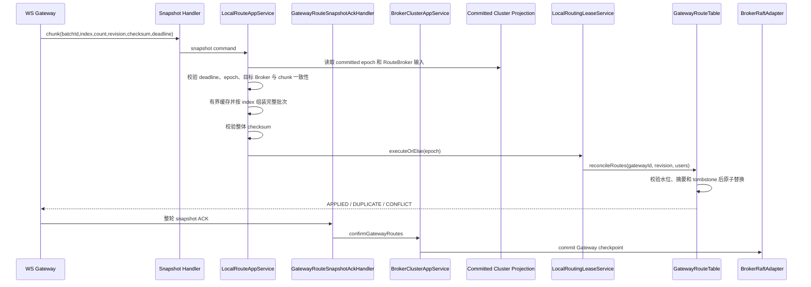

未收齐的 chunk 不能进入 `GatewayRouteTable`；Lease 校验必须包围最终原子应用，而不是只保护前置校验。ACK 只有写入 Raft operation 后才成为 drain 或故障恢复的 committed evidence。

## 成员变化与路由恢复

### 成员加入、晋升、降级与移除

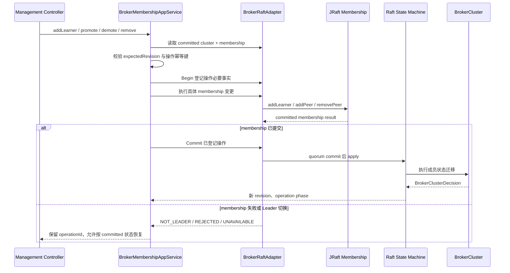

成员操作先通过 Begin 登记必要事实，再执行外部 membership，接受后通过 Commit 改变 Broker 拓扑。learner 就绪确认核对目标身份及其已应用的 quorum ReadIndex，不执行日志同步；已登记请求按领域返回的 duplicate 决定证据分支，不因本地登记后再次查询 exists 而跳过新操作的远端证据。

Application 负责调用顺序和恢复，聚合负责判断成员状态能否迁移。membership API 成功但领域命令尚未提交时，不能靠本地回滚猜测结果；必须使用同一个 `operationId` 对照 committed membership 和 operation phase 恢复。

### 优雅排空

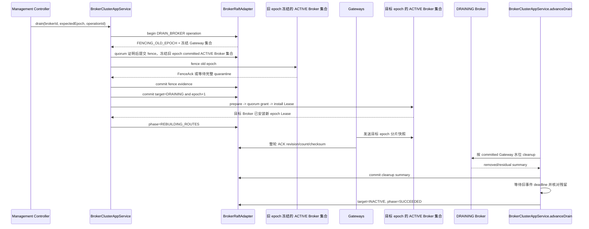

优雅排空的 Gateway 冻结集合、ACK 水位和 cleanup 摘要都属于 Raft operation。旧 Broker 进入 `DRAINING` 后只允许按 committed 水位删除旧路由并写 tombstone，不能创建新路由或承担新下行。

排空清理 RPC 由 `BrokerPeerAdapter.cleanupRoutes(target, operation)` 发起，复用有界 peerExecutor。请求与摘要转换由 BrokerDrainTransformer 负责，Adapter 返回 `domain/cluster/model/RouteCleanupResult`，删除/残留数量使用 RouteCount，应用层与 Gateway 重建数量合并为 RouteRecoveryEvidence；RPC 状态与基础类型仅留在 SDK 传输契约中。

超时使用 BrokerRoutingProperties.drainCleanupRpcTimeout；资格、超时重试和摘要持久化由应用用例处理。

### 故障摘流与降级恢复

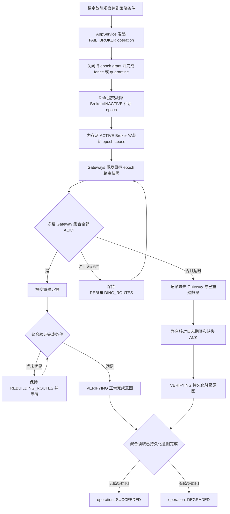

故障节点不可达时不等待该节点 cleanup。`DEGRADED` 是保留证据缺口的明确终态，不等价于成功；自动故障入口使用主动 probe 和 Leader 拉取的健康报告，不从 Gossip 生成故障票。Gossip 不能直接把 Broker 改为 `INACTIVE`。

`DrainProgress.summarizeRebuild` 汇总已确认数量并复用已保存证据；未确认身份以 GatewayId 返回。故障重建证据写入时必须匹配聚合当前检查点，过期提交被拒绝并等待下一轮重读；证据形成后检查点只接受相同的重复确认，避免迟到 ACK 改写已冻结的完成事实。

恢复资格由 operation 根据自身类型、阶段、ACK 和明确期限判断。`verifyRouteRecovery` 与 `completeRouteRecovery` 在 Raft 应用日志时调用聚合：前者登记完成意图，后者按当前持久化原因选择终态。VerifyRouteRecoveryCommand 固定本轮采用的恢复等待时长和验证时间，领域不读取本机 Properties 或墙上时间。

自动故障处置要求多数 voter、独立 reporter、稳定窗口、观察新鲜度与拓扑冷却期满足策略。这些条件只允许应用用例进入 fencing，不直接授权修改拓扑。

`BrokerFailureProbeScheduler` 在每个当前 voter 上触发主动探测 committed ACTIVE 目标；这是点对点的本地 probe，不是 Gossip。`BrokerFailureObservationScheduler` 仅在当前 Leader 拉取 voter 自身的最新报告，包含本机采样；它也不从 Gossip 读取健康结论。`BrokerHealthObservationTracker` 位于精确 support/health，保存按当前目标裁剪的本机技术采样 Context（`revision`、`BrokerClusterTopology`，目标从拓扑派生）和单调窗口，不是领域 Repository，也不写入 Gossip/Raft。HEALTHY/UNKNOWN 清除旧失败窗口；资格服务先选 reporter 最新事实再检查稳定性，相同时刻的冲突事实不计票。

### 自动处置的资格与授权顺序

当前 voter 必须由实际 Raft membership endpoint 与已提交 Broker 角色/绑定一致解析；未终态成员操作或不一致使新故障操作暂停。`BrokerObservationState.advance` 先判断本机冷却，`BrokerFailureObservationService.evaluate` 只判断报告证据，二者都不直接授权拓扑修改。

| 阶段 | 依据与边界 |
|---|---|
| 恢复优先 | Leader 先推进既有未终态故障 operation，不重新要求新报告或起始任期标记 |
| 新观察起点 | 只读 `LocalBroker.getLeaderTerm()` 的 Optional 本机任期，空则 invalidate 并跳过；不执行起始 quorum |
| 收集报告 | 先取本机快照，再并发拉取其他 voter 本轮报告；请求绑定 cluster/revision/epoch/nonce，失败不复用旧票 |
| 最终证明 | 汇合后 `confirmLeadership` 取得同任期 quorum，重新核对角色和完整 Context |
| 证据判断 | 最新事实优先，同刻冲突不计票；报告须新鲜且持续失败达到稳定窗口；每个独立 voter 最多一票，目标自报不计票，多数分母不缩小 |
| 登记与推进 | 聚合预检后提交 Begin；接受后另行取得 fencing quorum，关闭旧 grant，完成 fence 或完整 quarantine，再改变拓扑与授权 |

起始本机任期不是权威证明。最终 proof 到 Begin 仍有并发窗口，提交受 expectedRevision 和聚合规则保护，不宣称原子绑定该任期。三 voter 需要目标以外的两个独立 voter 报告，缺少 reporter 不能降低门槛。

### 健康报告的时间与传输边界

`getHealthReport` 返回本机报告；`BrokerPeerAdapter.fetchHealthReport` 接收目标、clusterId、revision、epoch、brokerIds 五项领域事实，在执行器任务内构造 SDK Params、caller 与 nonce。调用 `invokeAuthenticated` 前采样一次 `requestAt = Instant.now()`，全部行都按该起点减去年龄还原，不把网络耗时加到连续失败时长。实际观察者取已认证目标，客户端校验行数量、重复、目标范围与状态/时长，不比较响应上下文回显；这依赖对端按请求生成报告，不代表 TLS 验证业务内容。

本机快照读取处采样墙钟和单调时间；汇合及最终重验后采样一次 `evaluatedAt = Instant.now()` 供所有目标判断。样本窗口、冷却和单次认证预算用单调时间，报告年龄在本机墙钟上评估。正常墙钟下传输和等待消耗 freshness；当前接受墙钟回拨延长有效性、前跳提前过期和独立采样间年龄高估/低估，不宣称消除轮内墙钟跳变。

probe/report 不传输或校验绝对请求期限，允许晚到只读查询；应用也不设整轮耗时上限，较慢轮次在报告仍合格时可继续。单次认证 RPC 单调预算、年龄保守取整、Context 与领导权重验仍保留。此调整只适用于健康观察，Lease、Gateway 快照、RouteLookup 等协议期限不变；观察 wire 字段删除要求同版本成组部署，operation `fetchBrokerHealthReport` 不变。字段清单见 [SDK 健康观察协议](im-broker-sdk/README.md#broker-独立健康观察协议)。

PROBE_BROKER/FETCH_BROKER_HEALTH_REPORT 使用严格观察准入：必须是真实 TLS 握手成功且证书 namespace 中唯一的 Broker URI SAN；Subject、首URI和可信网络回退不能贡献票。对端调用在同一池内连接核验响应身份，预算覆盖 serialization/acquire/TLS/RPC/decode 的结果接受性，不能承诺同步 DNS/共享连接 future 在固定墙钟期限返回。LOCAL预算耗尽、认证/协议/队列拒绝均为UNKNOWN；只有可归因的传输失败计入不可达。专用有界观察执行器不占 fence/Lease 队列，阻塞时自动观察可安全暂停，不创建额外连接池。未启用可证明的双向 TLS、缺少唯一 Broker URI SAN 或握手身份不明时，结果只能是 `UNKNOWN`，不能贡献故障票；这不代表普通本地开发链路不能启动。

成员集合的相等性不依赖排列；本机观察 Context 直接比较 `revision` 和 `BrokerClusterTopology` 的结构内容，不需要为相等比较构造文本签名或另行排序。Map/Set 按内容比较，BrokerCluster 已排序的节点 List 仍保持原语义；Topology 构造和访问隔离可变 BrokerNode 副本。冷却拓扑比较仍不包含 revision，采样 Context 则包含 revision；真实成员变化仍使旧观察失效。无效交叠配置构造失败，不继续采样或自动摘流。

内部报告使用 enum/Duration；SDK 年龄毫秒向上取整，失败持续时长向下取整，不跨节点比较 nanoTime。启动、换届、拓扑或实际 membership 变化、一致性恢复后重新冷却；冷却只约束新发起。自动用例使用稳定的 cluster/target/epoch 身份，复用 failure Intent/Begin/fence/授权链，不伪造人工 force 原因，不删除 voter，也不自动激活恢复节点。初次人工/自动故障推进与恢复 Scheduler 共用实际完成闸门；早期 fencing 按未终态 operation 查找，不要求当前 epoch 已等于 resultEpoch。


FAIL_BROKER 不能通过通用阶段命令直接进入 VERIFYING/SUCCEEDED/DEGRADED；正常证据提交已进入验证阶段时直接提交完成，降级保留先保存证据、再登记原因、最后完成的恢复边界。

## Gossip 一致性

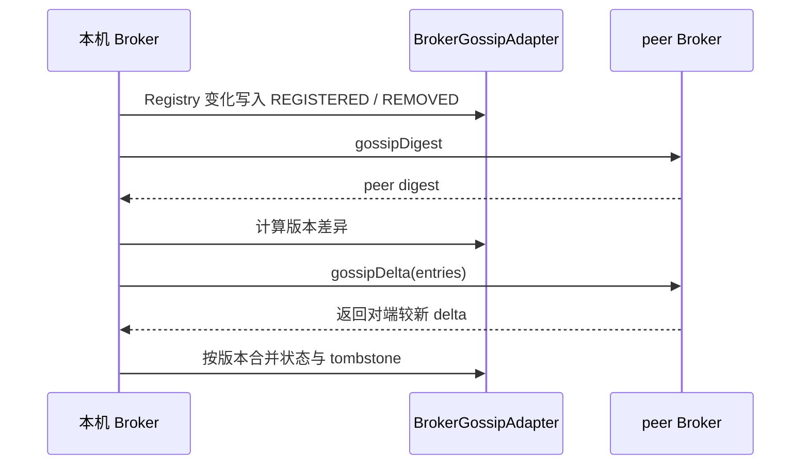

- 本地注册、心跳、注销和快照变化先写入 `BrokerGossipAdapter`，由 Adapter 为实体生成带版本的 `GossipDeltaEntry`。Broker、Gateway 和 Connection 使用不同的实体类型和 key，不共享业务字段。
- `BrokerGossipScheduler` 每轮完成后等待 5 秒再执行；优先使用本机已知 Broker，没有已知 peer 时使用静态 seed。每轮只按 `gossipFanout` 选择部分 peer，通过同步调用 `GossipSynchronizer.syncPeer` 串行同步；单个 peer 超时或失败不终止后续 peer 的同步。
- 同步顺序是 `digest -> keysNewerThan/keysOlderThan -> deltas -> merge`。双方先交换摘要，再只传递缺失或版本较新的条目；接收端按版本合并，旧版本不能覆盖新版本。
- `REGISTERED` 条目合并后投影到本地 Broker/Gateway Registry；远端 Connection 只保留在 Gossip 视图，不写入当前 Broker 的业务 ConnectionRegistry，避免远端观察状态绕过 RouteBroker 所有权。
- 注销不会立即删除 key，而是写入 `REMOVED` tombstone 并保留配置的 removed TTL。墓碑传播完成前，离线节点带回的旧 `REGISTERED` 条目不能复活已删除实体；TTL 到期后才允许清理历史删除证据。
- Gossip 失败只影响最终收敛和诊断记录，不改变 Raft 的 committed cluster state，不推进 epoch，也不能单独触发 ACTIVE Broker 摘流、Lease 签发或 drain 成功。
- Gossip 是运行观察同步，不是强一致事务、Raft 日志或业务事件总线。Registry 事件由基础设施中的 Spring publisher 发布，interfaces/listener 入口委托 BrokerGossipAppService 更新 observation；事件不能直接替代领域聚合命令。

## Raft 权威状态流程

Raft 只保存低频、需要全体 Broker 观察一致的权威状态：`BrokerClusterState`、有界 `BrokerClusterOperation`、当前 fence operation 和 voter/learner membership。Broker/Gateway 的活性观察、连接位置和诊断历史不进入 Raft 日志。

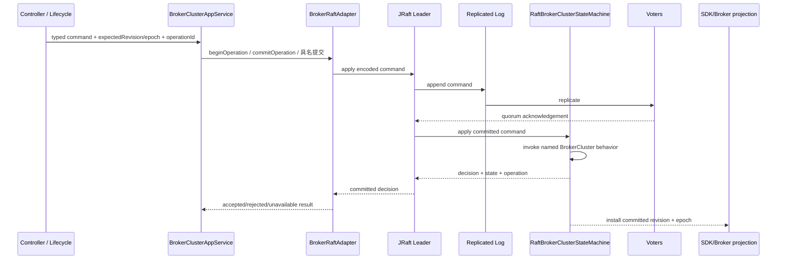

### Raft 写入与状态机

1. 路由管理入口调用 `BrokerClusterAppService`，成员管理入口调用 `BrokerMembershipAppService`。应用服务校验身份、scope、幂等键、`expectedRevision`、目标状态和 operation 前置条件，不直接操作 JRaft。
2. `BrokerRaftAdapter` 只允许 Leader 提交 command。非 Leader 返回 `NOT_LEADER` 和 leader hint；quorum 不可用或提交超时返回 `UNAVAILABLE`，不能伪造 accepted。
3. command 经 `BrokerClusterCommandCodec` 编码后写入 Raft。所有 voter 按日志顺序重放同一 command；follower 不通过本地 HTTP/Bolt 请求自行改变聚合。
4. Runtime 通过 Codec 解码后，`RaftBrokerClusterStateMachine` 只调用 `BrokerCluster` 的具名行为、转换 SDK projection 和管理 snapshot。epoch、revision、operation phase、drain evidence 等不变量留在聚合内。
5. command 只有在 Raft 达到提交条件后才对外报告成功。应用服务收到 decision 后继续执行 fencing、Lease 激活、Gateway 快照或 cleanup 等下一阶段；这些阶段完成后再提交下一条 operation command。

### 集群写用例编排

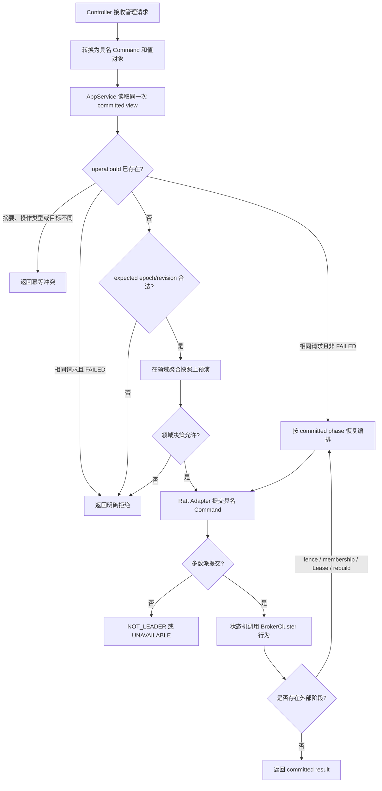

预演只用于尽早返回领域拒绝，最终结果以 committed command 在状态机内执行的聚合决策为准。应用服务不能把预演后的可变聚合直接保存，也不能把自己计算的完整目标状态当作绕过聚合规则的事实。

改变 ACTIVE 集合的动作具有不可省略的领域阶段。`BrokerCluster.activate(...)` 在聚合快照上校验并登记 operation；Application 先通过 Begin 将操作事实写入 Raft，再完成旧 epoch fence，最后通过 Commit 改变拓扑并授权新 epoch。管理写入口不提供 dry-run 模式，快照预检不能替代日志应用时的领域校验。

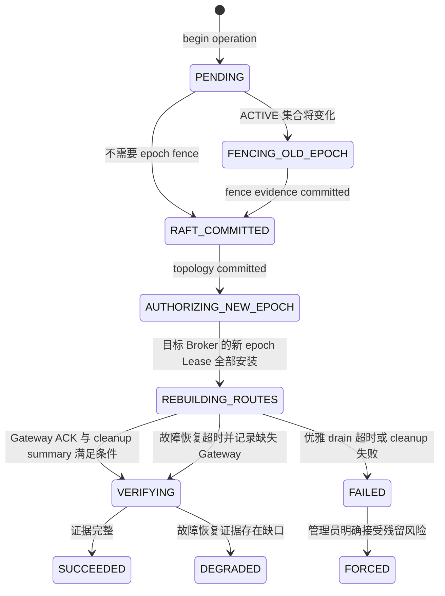

不改变 ACTIVE 集合的操作不需要执行旧 epoch fence，但仍必须按聚合允许的阶段推进到终态；路由恢复类 operation 还必须携带 Gateway 重建与 cleanup 证据。任何恢复逻辑都应根据 committed phase 选择下一步，不能依赖进程内布尔标记推断。

故障恢复的 VERIFYING 同时保留完成意图：error 为空时依据完整证据提交 SUCCEEDED；有已持久化的缺失原因时恢复 DEGRADED，不能因重启而覆盖为成功。正常成功的领域入口还会校验 Gateway ACK、摘要和旧事件截止时间，残缺证据或降级意图不能通过阶段合法性检查绕过。

重试判断先于节点当前角色和流量状态检查。相同 operationId 的摘要、操作类型和目标身份必须一致；已有操作复用冻结意图，不能要求目标仍保持提交前的 READY、DISCOVERED 等状态。路由 epoch 已改变时，原始请求仍可使用原 expected epoch 重试，身份冲突继续由聚合拒绝；新请求仍严格检查当前 epoch。

成员用例只有在 committed phase 为 `PENDING` 时调用外部 membership，已提交操作直接返回记录结果，不得因重试旧晋升命令把后来降级的成员再次晋升。单步成员调用的明确拒绝记录 `FAILED`；晋升/降级包含两步 Raft 配置变更，拒绝可能发生在第一步已提交之后，因此保持 `PENDING` 等待核对。`UNAVAILABLE` 同样不推断为失败。`FAILED` 不能被当作已提交拓扑，也不能重新执行。

drain/故障恢复从登记到终态都占用拓扑变更窗口，包括 `REBUILDING_ROUTES` 和 `VERIFYING`。聚合在 Raft 重放时拒绝新的拓扑意图，避免新 epoch 使按当前 epoch 调度的旧恢复操作丢失。此约束不限制 Gateway ACK、cleanup evidence 等既有 operation 的推进。

内部绝对时刻使用 `Instant xxxAt`，请求期限为 `expireAt`，路由更新期限为 `updateExpireAt`，排空冻结期限为 `oldEventExpireAt`。运行时长使用 `Duration`；Lease 的单调时钟和 `validForNanos` 保持纳秒语义，不转换成 epoch milliseconds。

Raft 时间命令携带 `Instant changedAt`，由具名提交入口采样或复用本轮显式时间，并统一为原有毫秒精度；状态机重放使用命令中的时间，不重新读取本机墙上时间。operation 创建和完成时间在构建及 JSON 重建时统一到毫秒精度，允许同毫秒完成。命令映射使用调用方时间，不以创建时间加一毫秒或取最大值补偿；真实完成时间早于创建时间仍拒绝，不隐藏时钟回拨。

### 启动、选主和 snapshot

- Broker 启动时校验 `clusterId/nodeId/endpoint` 与 Raft 数据目录中的稳定 identity marker 一致；不一致时拒绝复用数据目录，避免把一个节点的数据误装到另一个身份。
- 本地从 Raft meta、log 和 snapshot 恢复 `BrokerCluster` 聚合；snapshot 恢复后继续接收未包含在 snapshot 中的日志。snapshot 至少包含当前 SDK state、operation history 和当前 fence operation。
- Leader 选举和任期变化由 JRaft 管理。新 Leader 不继承旧 Leader 的本地内存 Lease，也不能直接复用旧 term 的 ACK；它必须基于已提交 operation 重新完成 fence barrier、quorum grant 和 Lease install。
- Leader 失效期间，新的 cluster-state 写入、membership 变更和需要当前 term 的 Lease grant 都保持失败或等待；Gossip 和本地只读观察可以继续，但不能把观察结果升级成权威状态。

### membership 与 BrokerRoutingState

当前本地私有候选通过 `RaftRuntime.membership()` 调用 `Node.getAppliedConfiguration(commandTimeoutMillis)`，读取 Leader、Follower 或 learner 本机已应用的 stable voters/learners，而非调用仅限 Leader 的成员列表 API。joint 配置失败关闭，不扁平化 old/new，也不回退初始配置或缓存；超时和中断保留 cause，中断恢复线程标志。该同步访问器禁止在 FSM callback 及其同步 continuation 内调用，需要读取成员的完成链必须明确切换线程边界，不能移除重入守卫。读取不提供 quorum/ReadIndex 证明，也不保证与另一次业务状态读取构成原子快照。

本地候选已通过访问器 16 项、Runtime 22 项、Broker 聚焦 87 项及原三项真实 Broker TLS HA；后者日志为 `/tmp/follower-ha-three-final.log`，Gateway ACK 仍为替代边界，不是真实 Gateway E2E。本地 Follower 行为阻塞已解除，不等于生产采用通过：根 POM 的私有坐标仅在 `/tmp/jraft-artifact-m2` 安装，Registry 尚未发布，双构建与输入锁未完成。来源、复现性及发布边界见[私有制品设计](../docs/design-docs/2026-10-16-jraft-applied-membership-patched-artifact-design.md)，验收与计划状态通过[计划索引](../docs/exec-plans/active/README.md)定位，不以历史局部验证代替当前指纹证据。

membership 是 Raft 的共识成员资格，`BrokerRoutingState` 是业务流量状态，两者正交。Runtime 的 `RaftMembership` 为按端点排序的不可变 String 列表技术快照；`BrokerRaftAdapter.getConsensusMembership` 通过 Transformer 一次转换为 Broker 领域 `ConsensusMembership`，元素为 common 的 `MembershipEndpoint`。领域容器的 voter/learner 为不可变 Set，同角色重复端点在转换时归一化，交叠在构造时拒绝；应用和准入直接把领域容器交给 `BrokerCluster.findConsistentVoters`，由聚合对照自身操作、角色和绑定校验，一致返回 voter BrokerId，不一致返回空集合；不将 RaftMembership/plugin 引入 domain。成员变更的 Broker 结果契约由 Adapter 定义。

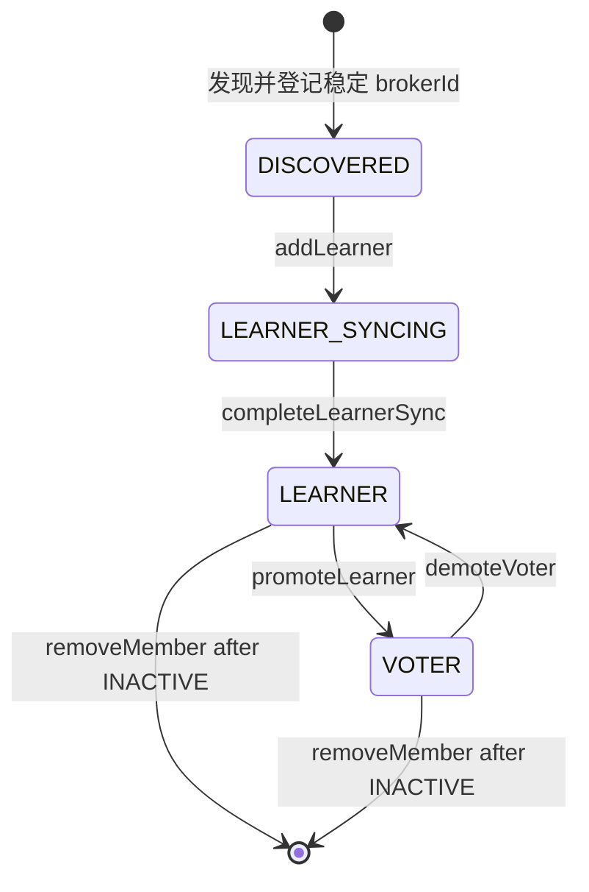

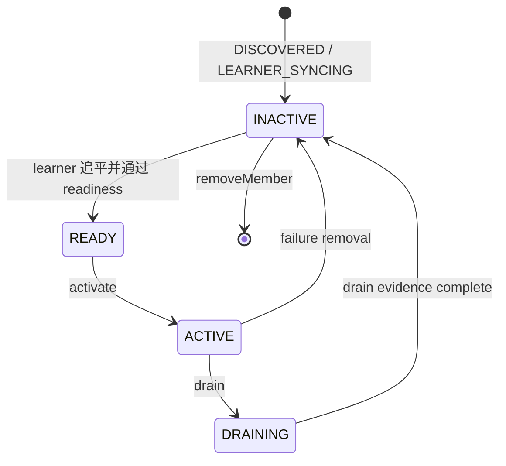

promote/demote/remove 必须先由当前 Leader 调用 JRaft membership API，再把结果提交到 `BrokerClusterState`。成员变更期间遇到 Leader 切换时，从已提交 membership 和 operation phase 恢复，不能用本地猜测回滚或跳阶段。删除 ACTIVE Broker 前必须先完成旧 epoch fence 和 drain/failure recovery；不能用 Gossip 的「节点不可达」直接删除权威成员。

### epoch fence 与 Lease 授权

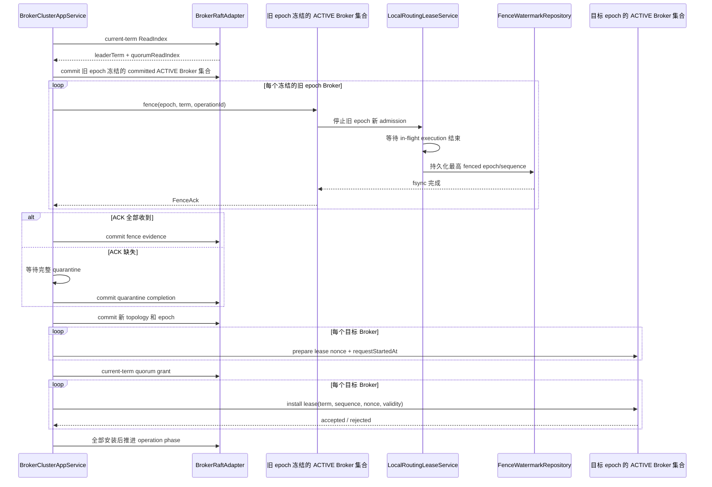

旧 epoch 的隔离范围是冻结的 committed ACTIVE Broker 集合，不是已安装有效 Lease 的节点清单。目标 epoch 的 ACTIVE Broker 是 Lease prepare/install 的目标；ACTIVE 不等于已安装有效 Lease，新 epoch 也不表示节点新加入。

安全边界是「新副作用 admission 不重叠」，不是「所有旧远端调用必须在 epoch 切换前返回」。已经准入的跨节点调用仍依赖稳定业务标识和接收端幂等。冻结的旧 epoch Broker 没有 ACK 时必须等待完整 quarantine，不能因为 RPC 超时就提前给目标 Broker 授权。

### Raft 与 Gossip 的边界

| 问题 | Raft | Gossip |
|---|---|---|
| 谁可以成为 RouteBroker | 是，提交 ACTIVE 集合和 epoch | 否，只传播观察 |
| Broker/Gateway 是否刚刚存活 | 否，不承载高频心跳 | 是，最终一致 |
| 用户连接在哪个 Gateway | 否，不进入共识日志 | 是，作为运行态观察 |
| ACTIVE 集合和 epoch 是否递增 | 是，聚合原子校验 | 否 |
| 旧 epoch 是否被 fence | 是，提交 operation 并要求本机持久 marker | 否 |
| Gossip 失败时能否继续写权威状态 | 不绕过 Raft；不要求 Gossip 先收敛 | 只能延迟观察收敛 |

## 控制面技术接入与安全边界

### 本机共识与对端 RPC

| 组件 | 当前职责 |
|---|---|
| `BrokerRaftAdapter` | 本机聚合快照、具名日志提交、voter/learner 配置变更、ReadIndex、Runtime 生命周期 |
| `BrokerPeerAdapter` | 对端应用进度查询、fence、Lease prepare/install 与 cleanup RPC |
| `im-raft` / JRaft | 通用 Runtime、Node/Closure/ReadIndex 回调、选举、日志复制与快照文件机制 |
| `BrokerGossipAdapter` / `im-gossip` | Broker observation 适配 / 通用 digest-delta 算法 |

本机 getLocalBroker() 返回嵌套 LocalBroker 视图，getId()/isLeader() 查询同一个 RaftRuntime。它不缓存动态角色，也没有独立 Bean 或关闭权。getLeaderEndpoint 查询 Leader 地址；角色标志不能替代 confirmLeadership 的多数派 ReadIndex 证明。

对端 fetchQuorumReadIndex 可查询任意 Broker，不要求 learner 资格。响应 nodeId 必须匹配目标且 quorumReadIndex 非负；协议不携带集群标识。结果是已取得且本机已应用的 quorum ReadIndex，不保证为最新 applied index；节点协议版本必须匹配。

当前普通 Peer RPC 使用 `BoltInvoker.invoke`；probe/report 使用 `invokeAuthenticated`，在同一池内连接验证真实 TLS 与唯一 Broker URI SAN。二者尚未统一为连接层认证入口；[连接层统一 invoke 设计](../docs/design-docs/2026-10-20-bolt-unified-invoke-design.md)是后续方案，不能视为当前实现或已部署能力。

业务 Peer RPC 由 BrokerPeerAdapter 直接使用 BoltInvoker，与 JRaft 原生通信分离。fence 接收目标 BrokerNode 与 RoutingEpochFence，返回领域 FenceAck。配置层拥有有界 peerExecutor 及关闭职责；任务拒绝返回失败阶段，不在调用线程执行 RPC。

### 具名提交与查询

getClusterSnapshot 返回分离的本机已应用聚合快照，不隐式提供线性一致保证。集群和成员配置快照通过显式查询取得；Adapter 结果只承载处理状态、operation、Leader/原因。操作查询、epoch 查询、领导权确认分别接收 ClusterOperationId、RoutingEpoch、QuorumReadNonce。

- beginOperation 提交 Begin，登记意图和 operation 元数据，不修改节点。
- commitOperation 与 Begin 成对，按已登记事实改变节点集合、成员角色或流量状态。Commit 不直接执行 Raft membership，也不表示 operation 成功终态。
- Begin 与成功 Commit 各推进一次 revision；Commit 采用冻结 resultEpoch，重复 Commit 不推进 revision。
- commitRoutingFence 提交 fence 日志，关闭旧 epoch 的新 Lease grant，不会自动撤销远端 Broker 已安装的 Lease，也不表示远端 Broker 已确认隔离。成员拒绝/完成由 failMembershipOperation/completeMembershipOperation 提交，载荷转换归 Raft Transformer。

acceptedEpoch 是接受时路由 epoch；resultEpoch 在 Begin 登记时冻结，表示应用后的 epoch，而非已经生效。路由集合未改变时两者相同。操作 JSON 使用 resultEpoch，CQRS 响应 targetEpoch 在 Transformer 边界映射。QuorumReadNonce 表达读取上下文，可复用 prepare nonce 或操作标识，独立读取使用新标识。

### Lease 签发与恢复

BrokerClusterAppService 编排关闭旧 grant、prepare/quorum/grant/install。BrokerCluster 检查 epoch、节点和 fence 资格，RoutingLeaseGrantService 维护任期/序列并生成 Lease。prepare 前可读取聚合预检；quorum 返回后的最终资格判断与序列分配在状态机共用同步边界内原子执行。

fence 先应用则拒绝签发；签发先执行则属于关闭前的旧 Lease，必须由安装该 Lease 的 Broker 执行本机隔离，或等待完整 quarantine。锁内不等待 quorum 或执行 RPC；operation 进度的 revision 变化不单独拒绝签发。异步授权失败记录目标及异常，返回本轮未完成，由授权恢复或续租重试。

quarantine 使用配置层拥有的专用 ScheduledExecutorService 非阻塞等待，不占用公共线程池或 peer RPC 队列；调度拒绝返回失败，不能继续提交新拓扑。ACK 身份核对、等待与拓扑提交由应用服务编排，本机 fence 水位持久化由领域资源库保护。

RoutingLeaseScheduler 仅在当前 Leader 上启动和周期续签 committed ACTIVE 集合。上一轮未完成时不并发启动新轮次；失败不修改权威拓扑，目标 Broker 的旧 Lease 到期后自动停止副作用，后续轮次成功安装后恢复授权。

### 数据面与活性回收

普通连接、关闭控制、Frame 与 Gateway 分片快照按 `epoch/RouteBroker -> LocalRoutingLeaseService -> side effect` 接入内存数据面。Gateway 每次进程启动生成新的 gatewayId，注册租约过期且经过 grace period 后回收其路由、revision 与 tombstone。

Gateway 注册按 gatewayTtl 与 grace period 清理，连接 tombstone 按自身回收规则处理。Broker 和连接不配置独立活性 TTL；Gateway TTL 解决注册活性，Gossip tombstone TTL 解决删除传播。整轮 ACK 写入 operation，由排空或故障恢复 Scheduler 推进；只有优雅 drain 调用旧节点 cleanup。

## 帧与控制流

上行和下行以客户端为参照。上行是客户端经 Gateway、Broker 到 Message 的业务请求；下行是 Message 经 Broker、Gateway 到客户端的通知。RouteBroker 只拥有用户连接路由，不拥有该用户的全部上行业务。

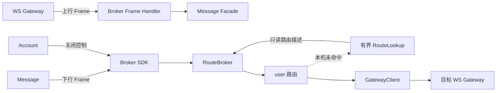

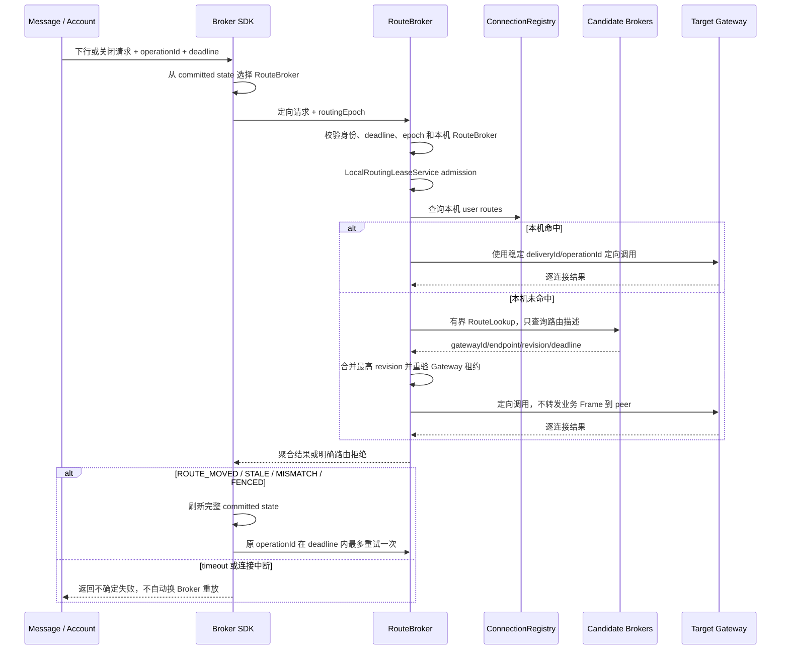

下行允许多 Gateway、多连接和部分失败。RouteLookup 只提供候选描述，当前 RouteBroker 重新校验后仍是唯一 Gateway Frame 调用方。Gateway 用稳定 `deliveryId + connectionId` 去重不确定响应造成的重试；Broker 汇总逐连接结果，但不持有 ReceiptTask、不决定业务重投，也不把 Gateway 接受写入解释为客户端 ACK。

关闭控制用 `operationId + userId + sessionVersion` 幂等，Session version 只由 Gateway 与本机连接比较。

普通数据面由 SDK 直达 RouteBroker，错误 Broker 返回明确拒绝。请求 epoch 落后、接收 Broker 状态落后、目标不匹配或本机已 fence 时，分别返回 `ROUTE_MOVED`、`BROKER_STATE_STALE`、`ROUTE_MISMATCH`、`ROUTING_FENCED`，且均保证尚未产生路由副作用。SDK 只有收到这些明确拒绝才刷新并定向重试一次；timeout 不自动换节点重放，也不会广播业务 Frame。

Broker 到目标 Gateway 的每次下行 RPC 使用 `im.broker.gateway.frame.write` 记录结果和 duration。指标不包含 userId、messageId、connectionId 或 gatewayId 等身份标签，只区分 Gateway RPC 耗时，不能解释为客户端收到消息或完成 ACK。

## 诊断边界

管理 HTTP 与业务 Bolt 使用独立端口。诊断接口只读、限制查询范围，Gossip 历史使用固定容量内存。诊断写入失败不会改变注册或同步结果；Ops 通过 Nacos metadata 发现管理地址，不根据 Bolt 端口猜测。

内部诊断保留 `Instant` 时刻和 `Duration uptime/duration`。管理 HTTP Transformer 将时刻转换为 `Long xxxAtMs`，时长转换为 `Long uptimeMs/durationMs`；`im-web` 将 Long 输出为十进制字符串，可空时间保持 null。Ops 在读取 Broker HTTP 与输出浏览器 HTTP 的各自边界转换，不复用 Broker 内部模型。

## 依赖规则

- `im-broker-sdk` 只定义调用契约、Params、DTO 和客户端，不依赖 Server。
- Broker Server 可以依赖 Gateway SDK、Message Facade 与通用 Gossip/Bolt/Dubbo Plugin。
- RPC Handler 只解析协议并委托；集群与路由用例位于 application，权威规则位于 domain，Raft/Bolt/SDK 调用实现位于 adapter，Gossip observation 适配位于 `adapter/gossip`；Spring 装配、Registry 和本地技术状态位于 infrastructure。
- Broker 不访问 Message、Account、Social 数据库，也不持有 Gateway Channel。

### Raft 回调与持久格式

BrokerRaftAdapter 唯一拥有 RaftRuntime 及生命周期，注入 BrokerClusterCommandCodec.INSTANCE。Runtime 统一编码，并在 Leader、Follower、learner 和重放时解码；Codec 使用稳定 type/Class 白名单进行双向映射。

RaftBrokerClusterStateMachine 实现类型化 RaftStateHandler，接收已解码命令、调用领域并恢复快照。snapshotState 返回完整快照投影，字节 snapshot 在与 Lease 共用的同步边界内编码。decode/apply 异常关闭状态机，拒绝两个 ReadIndex 入口及在途证明，不保证回滚部分内存修改。关闭后从有效快照/日志重建，不能跳过失败日志。

日志命令与快照均使用 v2，只接受版本 2，明确拒绝 v1 及其他不支持的格式版本，不提供字段别名、旧格式兼容或混合格式重放。不兼容的数据目录必须停止节点并保全原目录后，显式换用新目录；程序不自动迁移或删除数据，任何数据删除须另行确认。有业务状态的目录必须保全恢复与审计证据，不能直接删除。

support.raft 是 Broker 专属技术接入边界，仅包含 codec、model、statemachine 三个精确职责包，不包含后代包。它们依赖领域、命令、结果、转换器和 Raft SPI，不依赖应用编排、入口、运行配置/生命周期、Runtime 或网络 client；domain 不反向依赖 support.raft。
