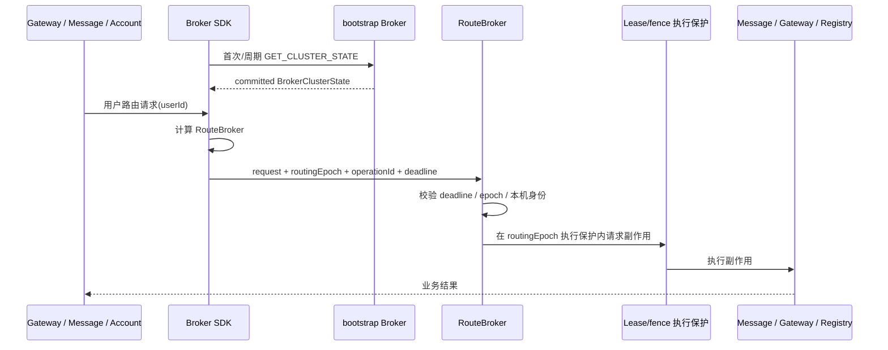

# im-broker

## 模块作用

`im-broker` 是 IM 实时链路的路由协调模块。它接收 WS Gateway、Message、Account 与 Broker 集群内部调用，维护在线投递所需的运行态索引，并把上行 Frame 交给 Message、把下行 Frame 写入目标 Gateway。

Broker 不处理消息领域业务，不保存历史消息，也不持有 Gateway 的 Netty Channel。跨模块拓扑与一致性边界见 [Broker Architecture](ARCHITECTURE.md)，服务端配置和诊断入口见 [Broker Server README](im-broker-server/README.md)，调用契约见 [Broker SDK README](im-broker-sdk/README.md)。

## 阅读路线

首次接触实时链路，先沿下面的三 Broker 示例理解消息去向，再读本页的状态分工与拒绝重试。需要启动或排障时转到 [Server README](im-broker-server/README.md#构建与启动)；接入调用时读 [SDK README](im-broker-sdk/README.md#接入顺序)；修改规则或查找状态所有者时读 [Architecture](ARCHITECTURE.md#ddd-模型与边界)。

设 Broker A、B、C 都是 voter，A 是当前 Leader，某用户由已提交拓扑分配给 B。Gateway 把这个用户的连接路由写入 B；Message 下行也通过 SDK 直达 B，再由 B 找到 Gateway。A 负责协调集群提交，不必经手每条消息。C 参与共识并保存自己的运行观察，不是 B 的业务帧转发站。

B 失联时，A 和 C 各自探测 B，A 拉取报告。三 voter 需要两个独立的合格报告，B 的自报不计票；报告足够也只允许开始故障操作，仍要隔离旧 epoch、提交新拓扑、安装新 Lease，并由 Gateway 重建路由。这样把「看到失败」与「允许其他节点接管」分开，避免网络分区时新旧节点同时执行副作用。

| 阅读中常见的名称 | 含义 |
|---|---|
| committed / quorum | 已按共识规则提交 / 多数派证明；三 voter 的多数为两个 |
| Leader / voter / learner | 日志提交协调者 / 投票成员 / 不投票的同步成员；都不直接等于流量资格 |
| RouteBroker / ACTIVE | 某用户当前路由的所有者 / 参与路由选择的节点状态 |
| epoch / revision / leaderTerm | 路由代次 / 权威内容版本 / Raft 领导任期，三者不能互换 |
| Lease / fence / quarantine | 有限时执行许可 / 阻止旧代次新副作用 / 缺少隔离 ACK 时的完整安全等待 |
| probe / report / Gossip | 单点主动探测 / voter 本机采样报告 / 最终一致的运行观察传播 |

## 模块结构

```text
im-broker/
├── im-broker-sdk/       # 跨进程契约、BrokerClient、集群状态缓存与 RouteBroker 选择
├── im-broker-server/    # Bolt 入口、Raft 控制面、Lease/fence、连接索引与 Gossip
└── pom.xml
```

## 状态分工

Broker 同时存在两类状态，不能互相替代：

| 状态 | 所有者 | 一致性 | 用途 |
|---|---|---|---|
| `BrokerClusterState` | Raft 多数派 | 强一致、低频 | ACTIVE Broker、epoch、算法、成员角色与端点 |
| 业务 Registry / Gossip observation | 各 Broker 本机，部分观察经 Gossip 传播 | 本机写入、跨节点最终一致 | Broker/Gateway 活性和连接位置观察；远端 Connection 观察不写入本机可投递路由 |
| 健康采样 / 冷却 / Lease | 各 Broker 本机 | 不随 Gossip 复制 | 故障证据输入、自动处置资格和本机执行许可，不是 committed 拓扑 |

Nacos 只提供首次 bootstrap 地址。Gossip 或健康探针不能直接增删 ACTIVE Broker，也不能推进 epoch；这类变化必须通过显式 Raft operation 提交。

## RouteBroker

`RouteBroker` 是根据同一份 committed `BrokerClusterState` 和 `userId` 计算出的当前路由 Broker。它负责该用户的连接路由写入、下行投递和关闭控制，不表示拥有该用户的全部业务数据。

建群时选择以下一种算法，运行中不可切换：

- `RENDEZVOUS_HASH`：默认；增删节点只迁移必要用户。
- `MODULO_HASH`：显式可选；节点数量变化会重映射大量用户。

算法只使用 committed ACTIVE Broker 和稳定 `brokerId`。ACTIVE 表示参与 RouteBroker 选择，不等于本机已安装有效 Lease；路由副作用仍须通过 Lease/fence 校验。完整编码与 golden vectors 见 SDK README。

## 正常调用流程



正常路径没有「先选一个 Broker，再由 Broker 转发给真正 Broker」的二跳。连接注册/注销、上行 Frame、下行 Frame 和关闭控制都由 SDK 直接访问 RouteBroker。

### 上行与下行

方向以客户端为参照：

```text
上行：客户端 -> WS Gateway -> RouteBroker -> Message
下行：Message -> RouteBroker -> WS Gateway -> 客户端
路由维护：WS Gateway -> RouteBroker
关闭控制：Account -> RouteBroker -> WS Gateway
```

上行已经从一条认证连接进入系统，不需要查询接收用户位置；它仍按发送者 `userId` 分散到 RouteBroker，再由 Broker 直接调用 Message。下行、连接维护和关闭控制需要本机 `userId -> Set<gatewayId>` 索引。

Broker 不保存 Gateway 本机 connectionId。Gateway 负责把一次用户下行写入该用户的全部本地连接，Broker 汇总逐连接结果；Gateway 接受写入不等于客户端已经 ACK。

## 明确拒绝与重试

Broker 在产生路由副作用前依次校验 deadline、epoch、本机 RouteBroker 身份和 Lease/fence。deadline 过期直接抛出异常，不属于下面四类拒绝状态。

| 结果 | 含义 | `suggestedEndpoint` 提示 |
|---|---|---|
| `ROUTE_MOVED` | 请求 epoch 落后 | 当前 RouteBroker |
| `BROKER_STATE_STALE` | 请求 epoch 超前，本机状态落后 | 当前 Leader |
| `ROUTE_MISMATCH` | epoch 相同但请求到达错误 Broker | 当前 RouteBroker |
| `ROUTING_FENCED` | 比较通过，但本机已失去执行许可 | 当前 Leader |

四类拒绝都保证尚未产生路由副作用。SDK 会刷新完整 committed state，重新计算 RouteBroker，并在原 deadline 内保留同一 `operationId` 最多定向重试一次；`suggestedEndpoint` 仅作提示，不直接作为重试目标。同 epoch 的路由计算漂移会报错，不用连续重定向掩盖问题。

RPC timeout、连接中断等无法判断对端是否执行的异常不会触发自动换 Broker 重放；业务层是否再次尝试由各自幂等协议决定。调用约束见 [SDK 客户端边界](im-broker-sdk/README.md#客户端边界) 和 [SDK 时间字段使用](im-broker-sdk/README.md#时间字段使用)，服务端执行与重试边界见 [帧与控制流](ARCHITECTURE.md#帧与控制流)。

## 连接索引与当前边界

当前 Broker 连接索引为：

```text
userId -> Set<gatewayId>
gatewayId -> Set<userId>
```

Gateway 按 committed state 将连接路由同步到对应 RouteBroker；完整分片通过校验后原子应用，旧更新不能覆盖新路由。Gateway 每次进程启动使用新的随机 `gatewayId`，并与注册身份和租约绑定；租约过期且经过 grace period 后回收该实例的路由，旧 ID 不允许再次注册。

本地路由未命中时，RouteBroker 只向其他 ACTIVE/DRAINING Broker 有界查询只读路由描述，重新校验 Gateway 租约后再定向下行，不广播或转发业务 Frame。下行和关闭控制使用稳定标识支持幂等处理，迟到的旧 session 控制不能关闭新连接。

快照字段与接收结果见 [SDK Gateway 路由快照契约](im-broker-sdk/README.md#gateway-路由快照契约)；批次接收、版本与清理规则见 [本机分片接收与清理](ARCHITECTURE.md#本机分片接收与清理) 和 [RouteBroker 与连接路由](ARCHITECTURE.md#routebroker-与连接路由)，查询与投递边界见 [帧与控制流](ARCHITECTURE.md#帧与控制流)。

## Broker 排空与故障恢复

优雅排空通过专用 `drainBroker` operation 完成，不是普通状态修改。旧 epoch 冻结的 committed ACTIVE Broker 集合必须先完成 fence 或完整 quarantine。fence 提交关闭旧 epoch 的新 Lease grant，不会自动撤销远端 Broker 已安装的 Lease。

目标 epoch 的 ACTIVE Broker 完成 Lease prepare/install 后，由 Gateway 重建路由；新 epoch 不表示节点新加入。DRAINING Broker 只清理已确认的旧路由，不承担新下行；只有重建、清理证据和旧事件期限均满足条件后，才完成排空。

Gateway 确认与恢复证据持久化到 Raft，Leader 切换后可继续。优雅排空确认未齐不执行 cleanup，超时为 `FAILED`；管理员明确接受未确认 Gateway/残留路由风险后才能转为 `FORCED`。突然故障不等待故障 Broker cleanup，目标直接 `INACTIVE`；存活 Gateway 全部确认可 `SUCCEEDED`，确认缺口超时则记录缺失集合并 `DEGRADED`，不等价于成功。

具体流程与恢复所有者见 [优雅排空](ARCHITECTURE.md#优雅排空) 和 [故障摘流与降级恢复](ARCHITECTURE.md#故障摘流与降级恢复)，ACK 与 cleanup 契约见 [SDK Gateway 路由快照契约](im-broker-sdk/README.md#gateway-路由快照契约)。

### 自动故障观察

每个当前 voter 主动探测其他 ACTIVE Broker，Leader 拉取本轮 voter 报告并合并本机采样。默认连续不可达 30 秒、报告仍新鲜且 60 秒冷却结束，才可能发起 `FAIL_BROKER`；目标自报不计票，不可达 reporter 不会缩小多数分母。实际 Raft 成员与 Broker 角色或端点绑定不一致时暂停新发起，恢复节点不自动 ACTIVE，摘流也不删除 Raft 成员。

只有可信身份下可归因于传输的失败计为 UNHEALTHY；本机预算、身份、协议和队列问题是 UNKNOWN。默认明文开发链路可以启动，但不能产生独立故障票。较慢轮次仍须通过报告新鲜度、最终同任期 quorum 和 Context 重验；观察证据不替代 fencing 的独立证明。配置、时间取舍和排障见 [Server 健康观察](im-broker-server/README.md#自动故障观察配置)。

## 时间协议与部署

Broker 内部用 `Instant` 表达绝对时刻、`Duration` 表达运行时长。SDK 的数字时间以 Unix epoch milliseconds 传递：请求期限为 `expireAtMs`，Gateway 分片/整轮 ACK 的更新期限为 `updateExpireAtMs`，排空 cleanup 的旧事件期限为 `oldEventExpireAtMs`；背压响应 `retryAfterMs` 是毫秒时长，不是绝对时刻。已有 SDK `Instant` 观察契约和 Lease 单调纳秒字段保持各自类型。

管理 HTTP 的绝对时间为 `xxxAtMs`，耗时与运行时长为 `durationMs/uptimeMs`。Java Response 使用 Long，JSON 使用十进制字符串，可空时间为 null。Broker、SDK、Gateway 和 Ops 必须按同一契约部署，不支持旧字段别名或混合版本；Raft 日志和快照使用 v2，拒绝 v1，程序不删除数据。配置与数据目录操作见 [Server README](im-broker-server/README.md)，内部转换和重放边界见 [Broker Architecture](ARCHITECTURE.md)。

## RPC 边界

| Service | Operation | 说明 |
|---|---|---|
| `broker.broker` | `getClusterState`、注册、心跳、列表 | committed state bootstrap 与 Broker 运行观察 |
| `broker.routing` | fence、Lease prepare/install | epoch 切换与本机执行许可 |
| `broker.gossip` | `gossipDigest`、`gossipDelta` | 运行观察摘要和增量同步 |
| `broker.gateway` | 注册、注销、心跳 | Gateway 实例管理 |
| `broker.connection` | 注册、注销、分片快照/整轮 ACK、RouteLookup、drain cleanup、关闭 | 用户连接路由与会话控制 |
| `broker.frame` | `writeFrame` | 上行业务与下行投递 |

SDK DTO 是跨进程契约，不作为 Broker 领域模型。服务端先完成身份授权、RouteBroker 比较与执行许可校验，再执行真实副作用。内部入口与责任链职责见 [应用用例与入口](ARCHITECTURE.md#应用用例与入口)。

## Gossip 与生命周期

Registry 变化通过内部事件进入 Gossip 观察，Broker 之间用 digest/delta 和 tombstone 最终收敛。Gossip 不参与 RouteBroker 裁决，也不是业务事件总线。单次事件处理异常不会阻断后续 Spring 事件处理。

Leader 定时恢复已登记的成员变更、推进排空和故障恢复，并为 committed ACTIVE Broker 启动并周期续签 Lease。本机生命周期负责启动注册、周期心跳和关闭注销；Gateway 租约清理先记录删除观察，再移除本机路由和注册。调用方周期刷新完整 committed `BrokerClusterState`。

定时入口位于 `interfaces/scheduler`，其中 `BrokerGossipScheduler` 负责与 peer 交换 digest/delta；本机注册入口位于 `interfaces/lifecycle`。`infrastructure/config` 负责 Bean 与调度资源装配，不承担这些用例入口。具体所有者见 [事件、诊断与运行装配](ARCHITECTURE.md#事件诊断与运行装配)，同步规则见 [Gossip 一致性](ARCHITECTURE.md#gossip-一致性)。

## 验证状态

- 当前能力与验证入口：RouteBroker golden vectors、四类拒绝、Lease/fence、单/三 voter、snapshot/restart、Gateway 分片快照与整轮 ACK、routeRevision/tombstone、DRAINING/故障恢复、RouteLookup 有界查询、下行与关闭幂等、身份绑定和 Spring 启动。入口见 [Server README](im-broker-server/README.md#验证入口)；能力覆盖不等于当前工作树已通过全部门禁。
- 历史证据：[Broker 路由共识收尾计划](../docs/exec-plans/completed/2026-09-20-broker-routing-consensus.md)记录了 3 Broker + 2 Gateway 的 25 类真实故障门禁及同 revision E2E 刷新；[本地容量模拟计划](../docs/exec-plans/completed/2026-10-10-broker-routing-capacity.md)也记录了本地 HA 演练。这些记录不代表当前 WIP 的验收结果。
- 当前验收与任务状态：通过[执行计划索引](../docs/exec-plans/active/README.md)定位 Adapter 职责重划计划；当前门禁结果及其工作树指纹以 `.harness/verifications/` 的独立记录和 `.harness/report.json` 聚合报告为准，Review 结论见 `.harness/quality/quality-snapshot.json`。历史构建、网络或测试失败保留在计划中，不代表当前工作树仍被同一原因阻塞；单次门禁通过也不证明历史偶发问题的根因已修复。
- 环境证据缺口：生产候选 3/5 voter 容量验证与部署环境 Raft 原生端口 mTLS/网络策略验证尚未完成。当前单元测试和本地 Compose 不能替代这些环境证据。

```bash
mvn -q -pl im-broker/im-broker-sdk,im-broker/im-broker-server -am test
```
