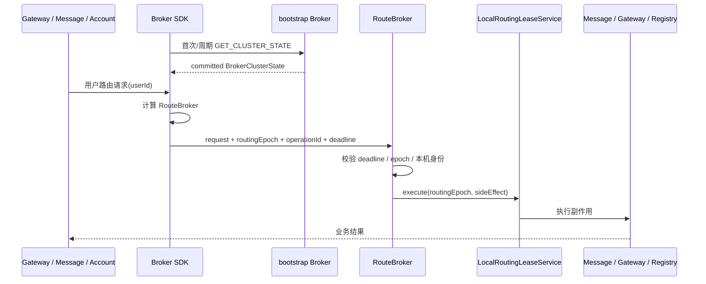

# im-broker

集群路由操作的完整生命周期由 `BrokerClusterAppService` 编排：`drain` 发起排空，`advanceDrain` 推进排空，
`recoverRoutes` 推进故障摘流后的路由恢复，`forceDrain` 在显式风险确认后结束失败排空。
定时入口调用对应业务方法，不保留独立排空和故障恢复 AppService；`forceDeactivate` 仍表示发起故障摘流。

## 模块作用

`im-broker` 是 IM 实时链路的路由协调模块。它接收 WS Gateway、Message、Account 与 Broker 集群内部
调用，维护在线投递所需的运行态索引，并把上行 Frame 交给 Message、把下行 Frame 写入目标 Gateway。

Broker 不处理消息领域业务，不保存历史消息，也不持有 Gateway 的 Netty Channel。跨模块拓扑与一致性
边界见 [Broker Architecture](ARCHITECTURE.md)，服务端配置和诊断入口见
[Broker Server README](im-broker-server/README.md)，调用契约见 [Broker SDK README](im-broker-sdk/README.md)。

## 模块结构

```text
im-broker/
├── im-broker-sdk/       # 跨进程契约、BrokerClient、集群状态缓存与 RouteBroker 选择
├── im-broker-server/    # Bolt 入口、Raft 控制面、Lease/fence、连接索引与 Gossip
└── pom.xml
```

## 状态分工

Broker 同时存在两类状态，不能互相替代：

| 状态 | 所有者 | 一致性 | 用途 |
|---|---|---|---|
| `BrokerClusterState` | Raft 多数派 | 强一致、低频 | ACTIVE Broker、epoch、算法、成员角色与端点 |
| Registry / observation | Broker 本机 + Gossip | 最终一致、高频 | Broker/Gateway 活性观察和用户连接位置 |

Nacos 只提供首次 bootstrap 地址。Gossip 或健康探针不能直接增删 ACTIVE Broker，也不能推进 epoch；
这类变化必须通过显式 Raft operation 提交。

## RouteBroker

`RouteBroker` 是根据同一份 committed `BrokerClusterState` 和 `userId` 计算出的当前路由 Broker。
它负责该用户的连接路由写入、下行投递和关闭控制，不表示拥有该用户的全部业务数据。

建群时选择以下一种算法，运行中不可切换：

- `RENDEZVOUS_HASH`：默认；增删节点只迁移必要用户。
- `MODULO_HASH`：显式可选；节点数量变化会重映射大量用户。

算法只使用 ACTIVE Broker 和稳定 `brokerId`。完整编码与 golden vectors 见 SDK README。

## 正常调用流程



正常路径没有“先选一个 Broker，再由 Broker 转发给真正 Broker”的二跳。连接注册/注销、上行 Frame、
下行 Frame 和关闭控制都由 SDK 直接访问 RouteBroker。

### 上行与下行

方向以客户端为参照：

```text
上行：客户端 -> WS Gateway -> RouteBroker -> Message
下行：Message -> RouteBroker -> WS Gateway -> 客户端
路由维护：WS Gateway -> RouteBroker
关闭控制：Account -> RouteBroker -> WS Gateway
```

上行已经从一条认证连接进入系统，不需要查询接收用户位置；它仍按发送者 `userId` 分散到
RouteBroker，再由 Broker 直接调用 Message。下行、连接维护和关闭控制需要本机
`userId -> Set<gatewayId>` 索引。

Broker 不保存 Gateway 本机 connectionId。Gateway 负责把一次用户下行写入该用户的全部本地连接，
Broker 汇总逐连接结果；Gateway 接受写入不等于客户端已经 ACK。

## 明确拒绝与重试

Broker 在产生路由副作用前依次校验 deadline、epoch、本机 RouteBroker 身份和 Lease/fence：

| 结果 | 含义 | 建议端点 |
|---|---|---|
| `ROUTE_MOVED` | 请求 epoch 落后 | 当前 RouteBroker |
| `BROKER_STATE_STALE` | 请求 epoch 超前，本机状态落后 | 当前 Leader |
| `ROUTE_MISMATCH` | epoch 相同但请求到达错误 Broker | 当前 RouteBroker |
| `ROUTING_FENCED` | 比较通过，但本机已失去执行许可 | 当前 Leader |

四类拒绝都保证尚未产生路由副作用。SDK 收到后刷新完整 committed state，重新计算 RouteBroker，并在
原 deadline 内使用同一 `operationId` 定向重试至多一次。第二次仍被拒绝时直接失败并记录诊断。

RPC timeout、连接中断或其他无法判断对端是否执行的异常不会自动换 Broker 重放。Message 下行使用
Receipt `receiptId` 作为稳定 `deliveryId`；Account 关闭连接使用 `userId + sessionVersion` 形成稳定
`operationId`。业务层是否再次尝试由各自幂等协议决定。

同 epoch 的 `ROUTE_MISMATCH` 若在刷新后仍与 SDK 计算结果不同，表示算法、编码、ACTIVE 集合或端点
映射漂移。SDK 停止重试并报错，不用连续重定向掩盖问题。

## 连接索引与当前边界

当前 Broker 连接索引为：

```text
userId -> Set<gatewayId>
gatewayId -> Set<userId>
```

单连接注册、注销和完整快照共用同一个 Gateway 进程内单调 `routeRevision`。Gateway 根据 committed
`BrokerClusterState` 把活跃用户按 RouteBroker 分组，只向本轮非空或上一轮需要清空的 Broker 发送完整
分片。大分片按块发送并携带整体 checksum；Broker 只有在完整批次收齐、校验和与 RouteBroker 归属均正确
后才原子应用。低 revision 的增量或快照不能覆盖更新路由，注销 tombstone 会阻止迟到 register 复活路由。

Gateway 每次进程启动生成新的随机 `gatewayId`。Broker 将该 ID 与注册时的传输身份和租约绑定；租约过期
并经过 grace period 后，路由、revision 水位和 tombstone 一并回收，旧 `gatewayId` 不允许再次注册。

找不到本地路由时，当前 RouteBroker 用虚拟线程并发查询当前拓扑中所有其他 ACTIVE/DRAINING Broker，
各 peer IO 使用固定超时。Responder 只返回本机只读 `gatewayId/endpoint/revision/epoch` 描述，
不会转发业务 Frame。RouteBroker 合并同一 Gateway 的最高 revision、重新校验 Gateway 注册租约后才定向
下行，因此不存在“找不到就广播业务 Frame”的路径。

下行使用稳定 `deliveryId`，每次 Gateway RPC 使用新的 `deliveryAttemptId`。Gateway 以
`deliveryId + connectionId` 在最低保留窗口内去重；容量不足时明确背压，不提前淘汰仍在窗口内的 key。
关闭控制以 `operationId + userId + sessionVersion` 去重，迟到的旧 session 控制不能关闭新连接。

## Broker 排空与故障恢复

优雅排空通过专用 `drainBroker` operation 完成，而不是普通状态修改：

```text
冻结当前 Gateway 集合和旧事件 deadline
-> fence 旧 epoch
-> 提交目标 Broker=DRAINING 和新 epoch
-> 新 ACTIVE Brokers 取得 Lease
-> Gateways 重发分片并向 Leader 提交整轮 ACK
-> DRAINING Broker 按 committed routeRevision 水位只删除旧路由
-> Raft 持久化重建/清理摘要
-> 旧事件 deadline 已过且摘要一致
-> 原子提交 Broker=INACTIVE、operation=SUCCEEDED
```

Gateway 整轮 ACK 只在全部目标分片都应用后发送，包含目标 epoch、全局 `routeRevision`、连接数和 checksum。
ACK、水位、摘要均随 operation 进入 Raft snapshot，Leader 切换后可继续。ACK 未齐不执行 cleanup；超时为
`FAILED`，管理员明确接受未确认 Gateway/残留路由风险后才能转为 `FORCED`。突然故障不等待故障 Broker
cleanup，目标直接 `INACTIVE`；存活 Gateway 全部确认可 `SUCCEEDED`，确认缺口超时则记录缺失集合并
`DEGRADED`。

## RPC 边界

| Service | Operation | 说明 |
|---|---|---|
| `broker.broker` | `getClusterState`、注册、心跳、列表 | committed state bootstrap 与 Broker 运行观察 |
| `broker.routing` | fence、Lease prepare/install | epoch 切换与本机执行许可 |
| `broker.gossip` | `gossipDigest`、`gossipDelta` | 运行观察摘要和增量同步 |
| `broker.gateway` | 注册、注销、心跳 | Gateway 实例管理 |
| `broker.connection` | 注册、注销、分片快照/整轮 ACK、RouteLookup、drain cleanup、关闭 | 用户连接路由与会话控制 |
| `broker.frame` | `writeFrame` | 上行业务与下行投递 |

SDK DTO 是跨进程契约，不作为 Broker 领域模型。Server Handler 只负责协议解析和用例委托；身份授权、
RouteBroker 比较与执行许可由显式的 `BrokerRequestInterceptorChain` 统一处理。Handler 只依赖
`infrastructure/chain` 的责任链；排序执行与具体准入实现也位于该基础设施包，
由配置层组装。责任链先完成无副作用校验，
再由 `RouteBrokerExecutionInterceptor` 使用 `LocalRoutingLeaseService` 环绕 Handler 的真实副作用；普通 Handler
不能访问原始 `BoltRequestContext`，也不再显式调用 Authorizer 或 Validator。

## Gossip 与生命周期

Registry 变化通过内部事件写入 `BrokerStateStore`，Broker 之间用 digest/delta 和 tombstone 最终收敛。
Gossip 不参与 RouteBroker 裁决，也不是业务事件总线。

成员恢复、排空、故障恢复、Lease 续签与 Gateway 租约清理的定时入口位于 `interfaces/scheduler`；
兼有启动注册、周期心跳和关闭注销的本机注册入口位于 `interfaces/lifecycle`。
基础设施配置负责 Bean 与调度资源装配；注册心跳、Gossip 和技术清理仍由基础设施组件维护。
注册表业务事件通过 `interfaces/listener` 接收，再由 `RegistryGossipAppService` 更新 Gossip 观察。
接口监听器不直接操作 `BrokerStateStore`；单次处理异常不会阻断后续 Spring 事件处理。

| 入口或生命周期 | 说明 |
|---|---|
| `BrokerRegistrationLifecycle` | 注册、心跳和注销本机运行观察 |
| `BrokerGossipLifecycle` | 与 peer 交换 digest/delta |
| `BrokerMembershipScheduler` | 仅由 Leader 定时恢复已登记的成员配置变更 |
| `RoutingLeaseScheduler` | 仅由 Leader 启动并周期续签 committed ACTIVE Broker 的路由 Lease |
| `BrokerDrainScheduler` | 仅由 Leader 恢复并推进优雅排空 ACK、cleanup 与终态 |
| `BrokerFailureRecoveryScheduler` | 仅由 Leader 推进故障摘流后的 Gateway 路由重建 |
| `GatewayCleanupScheduler` | 触发过期 Gateway 清理用例；应用层先记录 Gossip 删除观察，再移除本机路由和注册 |
| `BrokerRefresher` | 调用方周期刷新完整 committed `BrokerClusterState` |

## 验证状态

- 已覆盖：RouteBroker golden vectors、四类拒绝、Lease/fence、单/三 voter、snapshot/restart、Gateway
  分片快照与整轮 ACK、routeRevision/tombstone、DRAINING/故障收口、RouteLookup 有界查询、下行与关闭
  幂等、身份绑定和 Spring 启动。
- 已完成：3 Broker + 2 Gateway 的 25 类真实故障门禁和同 revision E2E 刷新。
- 尚未完成：生产候选 3/5 voter 容量验证与部署环境 Raft 原生端口 mTLS/网络策略验证。当前单元测试和本地 Compose 不能替代这些环境证据。

```bash
mvn -q -pl im-broker/im-broker-sdk,im-broker/im-broker-server -am test
```
