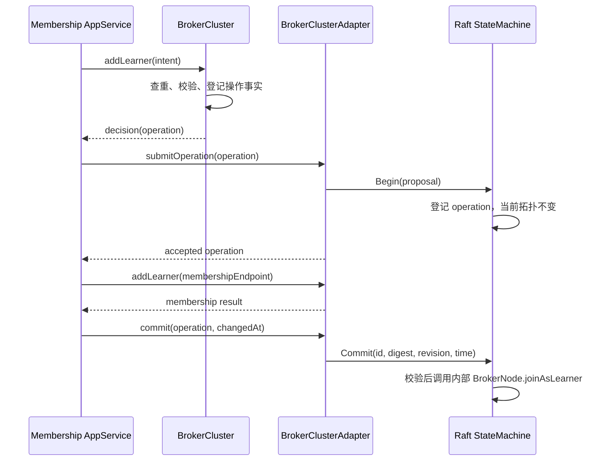
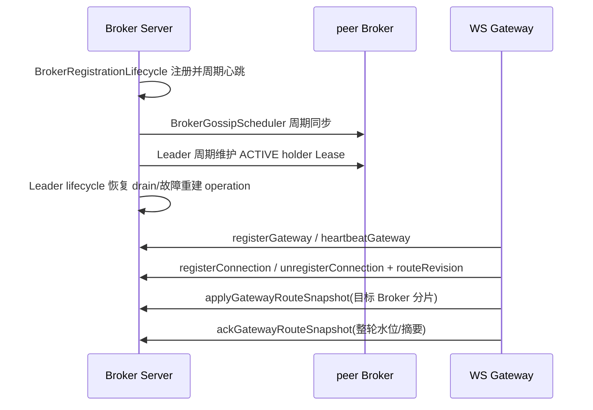
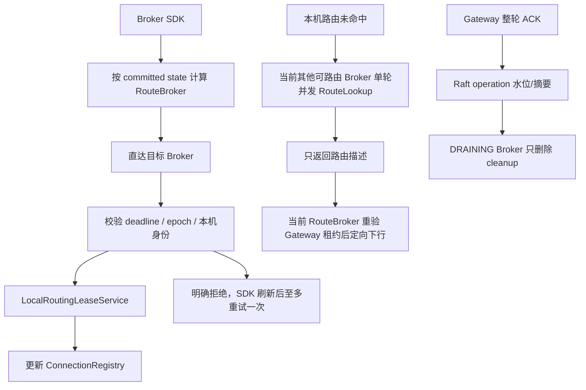
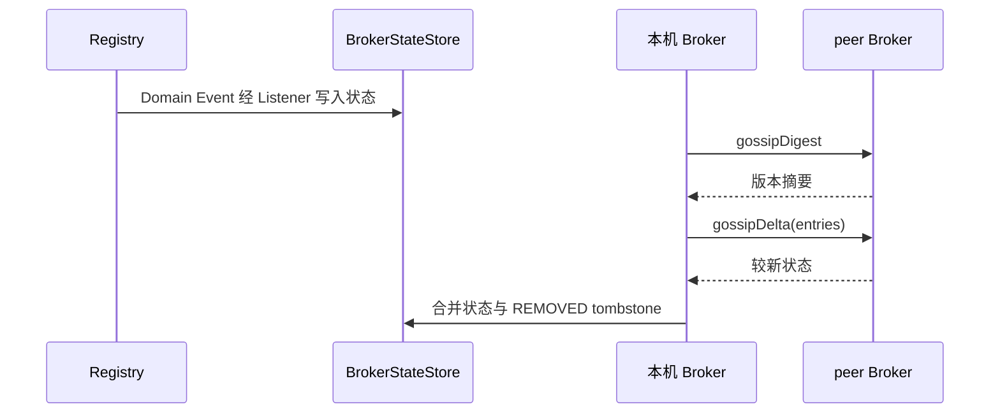
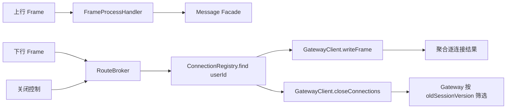

# im-broker-server

Broker 运行服务，提供 Bolt RPC 入口、权威路由控制面、运行态注册表、Broker 间 Gossip observation 同步，以及独立端口上的诊断和受控集群管理接口。

## 代码结构

```text
broker/
  application/
    cluster/                 # 集群变更、恢复确认与共识读取用例
    local/                   # 本机 Lease 安装及连接路由接收/清理
    frame/                   # 帧分发及其连接路由查找
    gossip/                  # 注册事实到 Gossip observation 的应用编排
    diagnostic/              # 运行态诊断查询
    policy/                  # 身份授权、请求准入和提交事实校验等应用策略
  model/cqrs/command/        # 应用命令及可序列化、可重放的 Raft 共识命令
  model/cqrs/dto/            # 应用查询和诊断传输结果
  model/cqrs/event/          # Registry 已发生事实的事件模型
  model/cqrs/result/         # 应用命令协调结果
  model/cqrs/query/          # 只读检查用例的查询条件
  model/enums/               # 跨层边界枚举
  model/io/                  # HTTP Request/Response 边界模型
  domain/cluster/model/      # BrokerCluster 聚合、实体、值对象及领域决策
  domain/cluster/repository/ # BrokerRegistry 存取契约
  domain/cluster/service/    # Broker 故障观察领域服务
  domain/authority/model/    # epoch Lease、fence ACK、quorum evidence 等领域对象
  domain/authority/service/  # 本机 Lease admission 与 fence 线性化领域服务
  domain/authority/repository/ # 本机 fence 水位资源库接口
  domain/connection/model/   # GatewayRouteTable、ConnectionRegistration 与 revision/tombstone
  domain/connection/repository/ # 连接和 Gateway Registry 存取契约
  infrastructure/config/     # 按 Cluster、Lease、Lookup、Delivery、Drain 等能力装配
  infrastructure/gossip/     # Gossip store、Spring publisher/listener 和 Registry adapter
  infrastructure/diagnostic/ # Registry 诊断聚合与有界 Gossip Tracker
  infrastructure/monitoring/ # Micrometer 指标实现
  infrastructure/chain/      # BrokerRequestInterceptorChain、调用上下文及准入节点
  infrastructure/registry/   # InMemory Registry adapter、注册和过期清理任务
  interfaces/handler/        # Broker/Gateway/Connection/Frame RPC Handler
  interfaces/http/management # 诊断、cluster-state 与受控 operation HTTP Controller
  support/context/           # 请求上下文、ThreadLocal holder、入口权限注解及管理拦截器
  support/exception/         # 跨层可识别的 Broker 内部异常
  support/security/          # Broker RPC 入口识别出的调用方身份
  adapter/cluster/            # BrokerClusterAdapter 集群技术入口：共识、成员配置、远端进度
                           # LocalBroker 本机角色、已知 Leader 地址和本机应用进度入口
  adapter/cluster/raft/       # Raft 状态机、Codec 与快照实现
  adapter/cluster/consensus/  # Adapter 的共识提交契约、结果与状态
  adapter/cluster/membership/ # Adapter 的成员配置与变更结果
  infrastructure/authority/  # 本机 fence 水位文件持久化实现
  transformer/application/   # Registry 状态到诊断 DTO
  transformer/domain/        # 领域聚合与 SDK 只读投影转换
  transformer/infrastructure/# Registry 等技术状态转换
  transformer/interfaces/    # 帧/HTTP 等接口边界转换
```

路由管理由 `BrokerClusterAppService` 编排，成员管理由 `BrokerMembershipAppService` 编排。
Lease 和 fence 用例由 BrokerClusterAppService 连续编排，首次授权与续租共用
activateLease 的 prepare、quorum-backed 签发、install 顺序。关闭旧 grant 的共识读取、
fence 恢复和持久化也在该应用服务中执行，不相互调用其他应用服务。
BrokerClusterAdapter 只提供单次 prepare/install/fence RPC、ReadIndex 和共识提交；
RoutingLeaseGrantService 持有任期/序列及签发资格规则，不读取 SDK、执行 RPC 或持久化。
RaftRoutingAuthorityLeaseCoordinator 和 BrokerLeaseAdapter 已删除，原六个 lease port 不恢复。
quarantine 使用配置层拥有的专用 ScheduledExecutorService 非阻塞调度，不使用公共线程池，
不注入自定义等待函数。调度拒绝返回失败，不继续提交新拓扑；测试控制调度完成时机，
等待窗口和协议不变。
集群 Adapter 的提交入口按职责命名：`submitChange` 提交通用共识变更，
`registerOperation` 通过 Begin 登记操作事实，`commitOperation` 通过 Commit 执行已登记操作的
拓扑变更。后两者复用通用提交入口，不等于直接执行 Raft 成员配置或推进操作成功终态。
路由写入口先转换基础类型命令，再读取已提交聚合；新请求 epoch 冲突和领域拒绝通过
Result 的 conflict/failure 工厂返回，不触发 fence 或共识写入。历史重试的返回 epoch
以已登记 operation 为准，结果投影和摘要命令映射由 Application Transformer 完成。
排空与故障恢复每轮读取共识进度；只删除简单时间/结果包装，不把有持久化步骤的恢复方法内联。
成员用例使用 `addLearner` 加入 learner、`confirmLearner` 确认其已应用到 quorum ReadIndex
并提交 READY 状态，再通过 promote 晋升为 voter。`confirmLearner` 不执行日志同步；
现有 `/complete-learner-sync` HTTP 路径、Command/Result 类型和持久化操作类型保持不变。
`LearnerProgressAppService` 编排本机已应用 quorum 索引查询，返回已装配的本机集群/节点身份；
Bolt Handler 不持有责任链，不读取基础设施配置。`BrokerRequestConfiguration` 为每个 operation
按声明顺序组装前置节点，再追加业务 Handler 节点；Bolt Processor 只注册完整链入口。
路由执行节点环绕业务 Handler，Lease 保护真实副作用。管理写权限注解、scope、请求上下文、
ThreadLocal holder 和拦截器统一归 `support/context`；该目录只承载请求上下文与入口访问控制，
拦截器可读取管理配置，但不调用应用服务、领域、Adapter 或 Registry 实现。
MVC 注册配置仍归 `infrastructure/config`。
管理 Controller 在开始异步编排前捕获请求上下文；拦截器在异步处理开始时清理初始 Servlet
线程，并在同步完成时清理，避免线程池复用泄漏请求事实。
管理 Controller 在开始异步编排前读取请求上下文；拦截器在异步处理开始时清理初始 Servlet
线程，并在同步完成时清理，避免线程池复用泄漏上一个请求的上下文。
各用例读取领域聚合，通过 `BrokerClusterAdapter` 提交操作；共识和 membership 契约归属于 Adapter，
成员配置操作直接使用具体 Adapter，不保留无生产调用方的 BrokerConsensusMembershipClient。
共识结果只承载 status、operation、leaderEndpoint、message；成员变更结果只承载 status、
leaderEndpoint、message。结果不附带集群或成员配置快照，查询通过 committedState 和
consensusMembership 独立完成，避免仅为构造结果重复读取本机状态。
目标 learner 的应用索引也由同一 Adapter 通过 Broker Bolt 接口查询，并核对 brokerId
与非负索引。不再保留 LearnerAppliedIndexClient 接口或单独的 LearnerProgressAdapter。
Adapter 使用 im-raft 的 RaftPeerClient 封装该 RPC 传输，不直接持有 BoltRpcClient；
旧 epoch 的本机隔离请求由 BrokerClusterAdapter.fenceBroker 发起，直接复用 BoltInvoker，
不把 Broker fence 业务放入 im-raft。FencePeerClient 和 BoltFencePeerClient 已删除；
BrokerFenceTransformer 完成领域事实与 RPC 载荷转换，应用服务保留 ACK 身份校验和 quarantine。
请求在配置层拥有的有界 peerExecutor 上执行，队列拒绝转为未确认 ACK，不在调用线程执行 RPC。
Broker 操作枚举、SDK 载荷和响应身份校验仍归 Broker，插件不引用业务模型。
通用 Raft 节点生命周期、日志复制、ReadIndex 和单步成员变更由 `im-plugin/im-raft` 承担。
不再增加只有单一调用方的 Engine、Coordinator 或二次 Service 转发。Controller 与
生命周期任务不直接拼装这套提交协议。

重试先匹配 operation 的摘要、类型与目标；新请求才检查当前 epoch 与节点前置状态。
Begin 共识命令登记操作类型及必要事实，不修改 BrokerNode；后续 Commit 命令只携带 operationId、
请求摘要、预期 revision 和提交时间，由聚合读取已登记 operation 并执行内部实体行为。
九类具名聚合行为各自接收领域 Intent，例如 `addLearner(LearnerJoinIntent)`、
`activate(BrokerActivationIntent)` 和 `drain(BrokerDrainIntent)`。Intent 只携带该行为必需的事实，
不包含调用方计算的目标拓扑，也不能填写其他操作的专属参数；操作类型由具体 Intent 固定提供。
应用服务显式构建 Intent 后调用聚合，领域层不接收应用 Command。已有 operation 通过
`checkRepeatedIntent` 核对摘要、类型、目标及失败阶段；只对新意图校验节点前置状态和 revision。
`BrokerChangeIntent` 仅提供重复意图匹配所需的三个属性，操作登记 Proposal 在共识重放时复用该契约。
`BrokerNode` 使用普通类表达聚合内实体，身份和端点固定，成员角色与流量状态由具名行为修改。
聚合不为准备操作复制目标拓扑；`joinAsLearner`、激活、排空或成员角色转换仅在 Commit 内执行。
公开 `findNode` 和 `brokers` 返回分离节点副本，不能用读取结果绕过聚合改变权威状态。
Builder 与持久化/查询快照深拷贝节点；Proposal 和 operation 不保存节点列表，历史记录只有冻结事实。
只有共识成功提交后当前节点状态才改变。`List.copyOf` 仅保护集合结构，不能隔离可变节点。

### 一次 learner 加入的状态归属

当前采用 Begin 登记事实、Commit 执行实体行为的协议，不再提前计算或保存完整目标拓扑。
operation 持久化新增节点端点、learner 成员端点、最低 voter 数量与 drain 证据等该操作必要事实。
Commit 只用这些已提交事实校验和修改节点，不读取当前配置、当前时间或远端状态来决定变更。
节点角色与流量资格由 `BrokerNode.checkOperation` 判断，其具名转换复用同一规则；
聚合继续校验节点存在、端点不可变、至少一个 ACTIVE Broker 和最低 voter 数量。
节点允许转换不代表集群允许该变更；Begin 和 Commit 均组合实体资格与聚合约束。
operation 的创建和完成时间在领域构建及 JSON 重建时统一到毫秒精度，允许同毫秒完成。
命令映射直接使用调用方时间，不用创建时间加一毫秒或 Math.max 修正完成时间；
真实完成时间早于创建时间仍由领域拒绝，系统时钟回拨不会被隐藏。

成员应用用例（包括 `addLearner`）统一返回业务判断结果：新请求 epoch 不匹配为 `CONFLICT`，
资格或端点绑定不满足为 `REJECTED`，不作为参数异常抛出。已登记操作先核对幂等身份，
不因当前 epoch 已变化而拒绝历史重试；业务拒绝不提交 Begin、不调用成员变更。
epoch 与端点前置判断失败直接构造应用结果，不为复用转换器构造共识结果或重复读取已提交投影。
`AddLearnerResult`、`CompleteLearnerSyncResult` 使用 `BrokerClusterConsensusStatus` 枚举，
HTTP Transformer 转为现有响应中的状态名称字符串。固定 epoch 冲突和端点拒绝说明由
结果工厂保存；领域失败通过 failure 工厂保留领域状态、原因和已关联操作的 epoch，
调用方不传空字段，也不把领域失败包装为共识结果。结果工厂直接接收 ClusterOperationId、
RoutingEpoch，在工厂内部转换基础值。共识结果到应用结果的字段映射统一归
BrokerClusterAppTransformer，使用 addLearnerResultFrom 等名称，结果类不承载 from*/*From
或以 outcome 重命名的转换方法，应用层不为映射增加成功/失败分支。
Leader 地址字段、访问器以及 HTTP 响应统一命名为 leaderEndpoint，Ops 客户端与前端类型同步，
不保留 leaderHint 别名；该改名不改变原有地址内容或 Leader 重试规则。
同步请求在聚合接受后，依据领域决定的 duplicate 判断是否需要远端证据，
不在本地域登记后重新查询 exists；历史重试沿用原判断，新操作必须获取同步证据。
应用服务用 completedFuture(decision).thenCompose 衔接该分支，再统一 Commit、完成操作和结果转换。
进度检查的固定非 Leader 原因由 notLeader 工厂维护；rejected 工厂接收具体 message，
区分未加入 learner 集合与日志未追上两种原因，统一维护状态对应的空字段。
本机能力经 getLocalBroker 进入 LocalBroker，使用 isLeader、leaderEndpoint、fetchQuorumReadIndex
查询同一个 Raft 实例，不缓存另一份角色或进度，也不独立管理生命周期。
集群提交、成员变更、领导权确认及远端查询保留在 BrokerClusterAdapter；fetchQuorumReadIndex
接收目标 Broker，不要求目标属于 learner。该值是已取得且应用的 quorum ReadIndex，不保证是
该节点最新应用位置。Bolt 操作为 FETCH_QUORUM_READ_INDEX/fetchQuorumReadIndex，请求响应使用
QuorumReadIndexParams/Result，响应字段为 fetchQuorumReadIndex；无旧协议别名，节点版本须匹配。
该结果可能随换届变化，不能代替 confirmLeadership 获取多数派 ReadIndex 证据。

| 对象/步骤 | 表达什么 | 是否改变权威节点状态 |
|---|---|---|
| LearnerJoinIntent | 目标身份、摘要、预期 revision、端点和时间 | 否 |
| addLearner | 先识别重复操作，再校验资格并登记操作事实 | 否 |
| BrokerClusterOperationProposal | 待登记操作事实，供 Begin 共识重放 | 否 |
| BrokerClusterOperation | Begin 已登记的操作、阶段和恢复事实 | Begin 推进操作元数据，不修改节点 |
| Adapter.addLearner | 执行实际 Raft learner 配置变更 | 改变 Raft 配置，尚不提交 Broker 目标拓扑 |
| commitOperation | 校验并调用内部节点 joinAsLearner | 是，同时推进 revision 和操作阶段 |



图中成员变更失败不会执行 Commit；确定拒绝和未知结果按已有单步/两步恢复规则处理。
相同请求重试先返回现有 operation，应用层根据阶段继续，不重复执行已完成的外部步骤。
本次日志格式为 v2，snapshot 为 v3。项目尚未上线，不实现旧格式混合重放；本地旧 Raft 数据目录
不能与本版本混用，应按既有本地/CI 状态重建流程重新初始化，不能在真实有业务状态的环境直接删数据。
领域决策的可缺省属性按状态约束：APPLIED 必有 operation、reason 为空；DUPLICATE 两者必有；
REJECTED/CONFLICT 可以没有关联 operation，但必须有 reason；UNAVAILABLE 没有 operation。
这些属性不使用 `Optional` 字段；聚合的 `findNode`、`findOperation` 查询结果继续使用 `Optional`。
已提交的成员操作不重复执行外部成员变更，FAILED 不作为成功提交返回。
单步成员变更的确定拒绝记录 FAILED；晋升/降级的两步配置变更发生拒绝时可能部分成功，
继续保留 PENDING 供核对和恢复，不能提前放开下一项拓扑操作。
`BrokerMembershipAppService.handleMembershipResult` 统一处理成员结果：接受后提交 operation，
不确定或可能部分成功时保留 PENDING，可明确失败时提交 FAILED。operation.canFailOnRejection 表达类型策略，
应用层判断成员拒绝是否明确，并负责共识提交；
调用方不再传入含义不直观的 singleStep 布尔参数；失败命令映射由现有应用 Transformer 完成。
drain/故障恢复在 REBUILDING_ROUTES、VERIFYING 等非终态期间继续阻止新拓扑意图，
保证当前 epoch 的恢复调度不会因下一次变更而失去目标。
排空恢复进入 VERIFYING 后，应用主流程直接推进完成提交；已有清理证据可在旧事件过期后复用，
无需重复 cleanup。完成请求的幂等性由 BrokerCluster.completeDrain 保护，重复完成返回 DUPLICATE，
不再次修改拓扑或增加 revision。路由恢复的汇总证据统一命名为 RouteRecoveryEvidence/recoveryEvidence。
排空与故障恢复共用 operation.waitingForGatewayAcks/timedOut 表达 ACK 等待和期限；
operation.needsRouteCleanup 结合操作类型、阶段、ACK 与证据决定是否清理。应用层保留超时后的用例策略：
排空记录 FAILED、故障恢复登记降级意图；RPC、提交顺序及异常隔离不下沉领域层。
故障路由恢复由 DrainProgress 汇总检查点、operation 判断等待与降级资格，聚合在日志应用时登记验证意图
并决定完成终态。应用服务只提交证据、验证与完成请求，不构造降级原因或在两种终态提交之间选择。
验证命令记录策略时长和时间，完成命令不携带目标阶段或错误原因；VERIFYING 重启恢复保留持久化降级意图。
聚合保存故障重建证据时核对当前检查点，拒绝过期汇总；证据形成后禁止迟到 ACK 改写检查点，相同确认仍可幂等重试。
内部命令格式为 v5，拒绝旧日志；快照字段未改，仍为 v6。公共 SDK 请求和结果形状保持不变。

`application` 直接按 cluster、frame、local、gossip、diagnostic 稳定能力分组，AppService 完整拥有用例流程，
不保留 application/service 中间目录和已空的 port 目录。Registry 存取接口归各领域包的 repository，
GatewayRegistry 注册直接接收 GatewayRegistration，查询、心跳、注销、退役判断使用 GatewayId；
入口经现有 Transformer 转换注册观察，实现不再接收四个基础参数后重新构造领域对象。
GatewayRegistration 的 gatewayId/host/port/principalId 分别使用 GatewayId/GatewayHost/GatewayPort/
GatewayPrincipalId。principalId 表示认证主体，区别于进程身份；时间使用 Instant。
SDK 和 Gossip 保留原 workloadIdentity 平铺字段，通过 Transformer 转换，Gossip 不直接序列化领域对象。
内存实现归 infrastructure/registry；诊断直接由 BrokerDiagnosticAppService 查询，RouteLookup 调用
BrokerClusterAdapter，Gateway 写帧也由现有 Adapter 直接使用 GatewayClient，不保留同形 port 和转发实现。
ConnectionRegistry.register 接收升级后的 ConnectionRegistration，unregister 接收身份及版本/期限证据，
不保留无版本和基础类型重载。查询统一为 find(UserId)，返回活跃注册及 revision、期限和观察时间。
原 ConnectionRoute 合并进已有注册实体，删除 findRouteStates、sync 和查询时恢复无版本路由的路径。
存储直接读取 GatewayRouteTable，用户到 Gateway 仅保留身份索引，无第二套注册状态。
协议/应用入口转换领域参数，包装实现直接委托；公共 SDK 的字段由边界展开并保持原契约。
公开用例入口统一使用 `*AppService`；只服务单一入口、没有
独立调用方、生命周期或替换实现的步骤使用 AppService 私有方法表达，不建立 Engine、Coordinator、Executor
或仅供测试替换的内部 interface。某个能力只有在出现多个稳定
应用入口或独立一致性边界后才继续增加子包。诊断与注册事件观察分别位于 diagnostic、gossip 能力包。
Gateway 快照、快照 ACK 和排空清理的入站 SDK Params 由 Handler 经
`BrokerRoutingCommandTransformer` 转为 Server CQRS 命令；嵌套 Gateway 水位使用
`GatewayRouteWatermark`，应用层不直接接收传输请求。快照分块暂存和 Lease pending 是真实的
本机协议状态：分块暂存由 BatchConnectionRegistry 管理，Lease pending 保留在 LocalLeaseAppService，
不为其建立新的聚合或协调器。
`frame` 放置 FrameDispatchAppService；`application/local` 放置 LocalLeaseAppService 和 LocalRouteAppService。
LocalRouteAppService 的 acceptRoutes 接收 Gateway 路由分片并应用完整数据，cleanupRoutes 按已提交排空证据
删除本机旧路由；分片暂存与清理幂等缓存使用独立锁，不新增第二套聚合或协调器。
LocalLeaseAppService 继续独立管理申请与安装。命令/SDK 结果保留原协议语义。
本机 Lease 输入直接在 LocalLeaseAppService 入口构造领域对象，参数/构造异常向外传播；
清理确认字段也在应用入口直接构造领域事实，准备记录以 LeaseNonce 索引，
PreparedLeaseRequest 使用单调时间判断过期。清理请求的完整水位集合及 operation 身份、代次和期限由
BrokerClusterOperation/DrainProgress 核对，应用服务负责读取、同步和删除编排；应用只接收快照批次超时，
本机 Registry 容量由基础设施配置直接提供。
接收流程按批次匹配、增量容量、完整摘要、Lease 保护应用分段，相同分片重试不重复计费。
接收实体 GatewayRouteBatch 负责分片一致性、收集、组装和摘要验证，身份 GatewayRouteBatchId
包含 Gateway 与批次标识。RouteCleanupId/RouteCleanupCheckpoint 表达本机清理身份与完成事实，
BatchConnectionRegistry 位于 domain/connection/repository，是扩展 ConnectionRegistry 的领域契约；
infrastructure/registry/connection/InMemoryBatchConnectionRegistry 包装实际存储并管理容量与回收，
直接读取 BrokerRoutingProperties 中的容量字段。GatewayRouteBatchReception 返回领域接收事实，原 Capacity 已删除。
配置层只对外注册一个连接 Registry Bean，普通存取和分片应用共用同一份路由数据；
LocalRouteAppService 只持有批次 Registry 契约，不额外持有底层存储。
应用服务串行检查资格、接收分片，并在 Lease 保护内调用 applyBatch 后发布实际路由；
Registry 不绕过 Lease 自行写入。清理结果缓存、容量淘汰和幂等删除也由同一实现管理，
使用独立清理锁，不与分片接收争用集合锁。
非法摘要格式在领域化入口抛出异常，合法摘要与内容错配仍返回 INVALID_BATCH。
LocalRouteAppService.cleanupRoutes 转换领域输入、读取一次操作并核对完整请求后调用 Registry。
Registry 返回 RouteCleanupResult，由 BrokerDrainTransformer 转为 RPC 响应，不携带协议类型进入实现。
相同请求复用首次删除数量，缓存仍有容量上界；水位冲突不删除更新路由。
应用异常由 Handler 沿原 RPC 异常通道传播。
GatewayRouteSnapshotAckHandler 调用 BrokerClusterAppService.confirmGatewayRoutes
登记整轮恢复 ACK，不新增独立 ACK 服务，也不在应用服务之间相互调用。
公开应用命令为 ConfirmGatewayRoutesCommand，确认事实通过 BrokerClusterAdapter.confirmGatewayRoutes
提交；Raft 日志载荷由 BrokerClusterRaftTransformer 构造。应用名称不暴露快照传输方式，SDK 契约保持原名。
排空清理阶段资格由 `BrokerClusterOperation.canCleanupRoutes` 表达，已确认 Gateway 快照
由 `DrainProgress.matchesGatewaySnapshot` 核对；应用服务负责完整水位集合、期限与本机目标校验及删除编排。
Frame 投递只依赖一个 `BrokerClusterAdapter` 读取已提交状态和调用对端，避免同时注入同源共识接口。
跨 interfaces/application/infrastructure 复用的输入输出
位于顶层 `model`，先按 CQRS、枚举和 I/O 等类型职责组织；同一类型下出现多个稳定业务组且类数量足够时，
再增加业务子目录。Registry 已发生事实的数据模型统一位于 `model/cqrs/event`；调用方构造明确事件并通过公共
`DomainEventPublisher` 发布，Spring publisher 保留在 infrastructure，注册表业务 Listener 位于
interfaces/listener 并委托 RegistryGossipAppService，不再增加与事件类型一一对应的 Broker 包装接口。routing 在上述三种类型下继续按准入、Lease、快照、Lookup、
投递和排空分包，不再向 application 根包散放类型。Broker peer 授权位于
`application/policy/cluster`；跨层拒绝异常位于受限的 `support.exception`，认证后的请求 Principal 与
受信传输身份解析辅助类型位于 `support.security`，不进入顶层 `model`。

Broker 采用“DDD 核心 + 技术子系统”，不是把所有运行态类型都放进 domain。`BrokerCluster` 是权威控制面
唯一聚合：revision、epoch、拓扑转换、operation、drain 和 fence 恢复规则均由聚合保护；Raft 状态机只负责
将共识命令翻译为具名聚合行为、生成/恢复 snapshot，并由 `BrokerClusterDomainTransformer` 输出 SDK 只读投影。Server
domain 不依赖 Broker SDK、JRaft 或 Spring。`GatewayRouteTable` 是按
`GatewayId` 聚合的连接路由一致性边界；其实体索引以 `UserId` 为键，`RouteRevision` 统一表达连接事件、
快照水位和 tombstone 覆盖修订号。首次完整快照前没有快照绑定，接受后由
`GatewayRouteSnapshotCheckpoint` 原子保存 revision 与 `GatewayRouteSnapshotDigest`，不使用负数哨兵。
聚合集中维护单调 revision、完整快照、tombstone、drain 水位与
回收规则；相同 revision 的完整快照只有内容摘要一致时才幂等接受，不同内容直接拒绝，且重复快照不会重置
tombstone 回收时间。`ConnectionRegistration` 是聚合内实体；`ConnectionRouteChangeSet.accepted` 表示聚合接受并处理
本次命令，`changed()` 仅表示外部连接投影发生增删。`ConnectionRegistry` 是领域注册索引接口，内存实现只负责保存
聚合、维护正反向查询索引并把领域 change set 转换为领域同步结果。注册观察与 SDK 端点模型分离，
传输端点通过 Transformer 转换。RouteLookup 的并发 fan-out、预算、负缓存，
Gateway 快照分块暂存，以及 Gossip observation 都是运行时协调机制，不因服务于 Broker 就自动成为领域对象。

连接路由聚合在每次写入或 tombstone 回收开始时读取一次当前时间，校验更新有效期并记录删除标记时间；
`ConnectionRegistry` 不再逐层传递当前时间参数。Gateway 协议仍携带 `eventDeadline`，由 Registry
adapter 转换为聚合的 `updateExpiresAt`。修订号的新旧比较由 `ConnectionRegistration` 实体统一表达。
注册实体同时保存 connectedAt/refreshedAt，更新版本不重置首次注册时间。Gossip CONNECTION 删除只收敛
远端观察，不能用无版本通知删除本机较新路由；GATEWAY 整体移除仍按 Gateway 清理本机注册。

## 运行模型

- Broker、Gateway 和用户到 Gateway 的映射均保存在各自内存注册表中。
- 用户连接按 committed `BrokerClusterState + userId` 选择 RouteBroker；普通数据面由 SDK 直达。
- Broker/Gateway/Connection 状态通过 `im-gossip` 最终一致同步。
- 上行帧通过 Dubbo 调用 message service；下行帧通过 WS Gateway SDK 精确写入网关。
- 会话关闭控制直达 RouteBroker，再路由到持有该用户连接的 Gateway。
- 本模块不保存聊天历史和 WebSocket `connectionId` 集合。

## Raft 与 Gossip 流程

### Raft：权威控制面

Raft 只保存需要所有 Broker 一致观察的低频状态：

- `BrokerClusterState`：ACTIVE Broker、`routingEpoch`、选择算法、端点和 membership role。
- `BrokerClusterOperation`：成员变更、drain、故障摘流、route recovery 的幂等阶段和证据。
- 当前 fence operation：旧 epoch 的 holder、term、ACK 和 quarantine 进度。
- voter/learner membership：Raft 自身的共识成员，不等同于 Broker 的流量状态。

一次权威写入的固定顺序是：

```text
Controller/Lifecycle
  -> BrokerClusterAppService 校验 command、scope、expectedRevision、幂等键
  -> BrokerClusterConsensus.submit
  -> 当前 Raft Leader append command
  -> voter 复制并达到 quorum
  -> RaftBrokerClusterStateMachine.apply
  -> BrokerCluster 执行具名领域行为
  -> 返回 committed state/operation/result
  -> SDK 与 Broker 安装同一 revision + epoch
```

`RaftBrokerClusterStateMachine` 不承载业务规则，只负责 command 解码、调用 `BrokerCluster`、
输出 SDK projection 以及保存/恢复 snapshot。任何 epoch、revision、operation phase 或 drain evidence
变更都必须由聚合行为产生，不能在状态机或 Controller 中直接改字段。

写入只接受当前 Leader。非 Leader 返回 `NOT_LEADER` 和 leader hint；quorum 不可用、提交超时或
状态机拒绝时不能返回 accepted。Leader 切换后，未提交 command 不得被当作成功；新的 Leader 从
已提交 log/snapshot 和 operation phase 恢复。新 Leader 不能复用旧 term 的 Lease ACK，必须重新完成
fence barrier 和 Lease 安装。

启动恢复顺序为：

```text
校验 clusterId/nodeId/endpoint identity
  -> 加载 Raft meta/log/snapshot
  -> 恢复 BrokerCluster 聚合、operation history、current fence
  -> 参与选举
  -> 只有成为 Leader 后才恢复 Lease 续签和 operation 推进
```

membership 与流量状态分开管理：

```text
DISCOVERED -> LEARNER_SYNCING -> LEARNER -> READY -> ACTIVE
```

加入 learner、追平、promote、demote、remove 必须由 Leader 调用 membership API，并把结果纳入
`BrokerClusterState`。Gossip 发现节点不可达不能直接修改 membership 或摘除 ACTIVE Broker。

### Gossip：运行观察面

Gossip 只同步 Broker、Gateway 和用户连接的运行态观察，不决定 RouteBroker，也不提交 epoch。

```text
本地 Registry/快照变化
  -> BrokerStateStore 写入带版本的 GossipDeltaEntry
  -> BrokerGossipScheduler 每 5 秒选择 gossipFanout 个 peer
  -> 交换 digest
  -> 计算 keysNewerThan/keysOlderThan
  -> 只传输缺失或较新 delta
  -> InMemoryGossipEntryStore 按版本合并
  -> 投影 Broker/Gateway Registry
```

Connection 的远端观察只保存在 Gossip store，不写入当前 Broker 的业务 `ConnectionRegistry`；
业务路由仍由 committed `BrokerClusterState + userId` 计算出的 RouteBroker 负责。

注销使用 `REMOVED` tombstone 而不是立即删除。墓碑在配置 TTL 内继续参与同步，阻止离线节点把旧的
`REGISTERED` 状态重新带回；TTL 到期后才清理删除证据。单个 peer 的同步失败只延迟最终收敛，
不会改变已提交的 Raft 状态，也不能直接触发 Lease 签发、ACTIVE 摘流或 drain 成功。

### 两条链路如何协作

```text
Gossip/探针观察 Broker 可能故障
  -> BrokerFailureObservationService 校验多数、独立 reporter、窗口、新鲜度和冷却期
  -> BrokerClusterAppService 发起故障 operation
  -> Raft 提交 fence/拓扑/operation phase
  -> holder 本地 LocalRoutingLeaseService 停止 admission 并持久化最高 fence epoch
  -> Gateway 按新 epoch 重建路由
  -> Raft 提交 drain evidence 和最终状态
```

因此，Gossip 提供“发生了什么的局部观察”，Raft 决定“集群最终承认什么”。网络分区时：

- 少数派不能提交新的 cluster state、membership 或权威 Lease grant。
- 少数派仍可继续产生本地运行观察，但这些观察不能升级为权威状态。
- Leader 切换后从 Raft committed state 恢复，不从 Gossip 反推 epoch、operation 或成员关系。
- 旧 epoch 的本地 fence marker 跨重启保留，迟到 Lease 即使来自旧 Leader 也不能恢复副作用。

## 权威集群状态策略

Broker 启动时会装配 SOFAJRaft，将 `BrokerClusterState` 和有界管理 operation 持久化到独立数据目录。
Application service 直接编排具体 `BrokerClusterAdapter`，由它提交可重放的共识 command 并执行
voter/learner 变更。Raft 状态机直接持有当前聚合，日志和 snapshot 承担持久化，不增加只有单一实现的
Port 或 Repository 包装。Adapter 不向领域对象暴露 Leader、日志、快照或 JRaft 类型。当前已经完成控制面
状态机、成员变更、quorum-backed Lease、全旧 epoch fencing barrier 和新 epoch ACTIVE holder 授权。
普通连接、Frame 和关闭 Handler 已按 `epoch/RouteBroker` 比较后进入 `LocalRoutingLeaseService`；错误节点
只返回明确拒绝，不再通过 peer client 二次转发。Gateway 分片快照和 `routeRevision` 已接入同一准入
边界；Gateway 整轮 ACK、DRAINING cleanup、故障重建和终态也进入同一可恢复 operation。

- 任意内容变化令 `revision + 1`；只改变 membership 角色时不改变 `epoch`。
- ACTIVE Broker 集合变化令 `revision + 1` 且 `epoch + 1`。
- Broker 输入顺序会先按稳定 `brokerId` 规范化，不产生伪 revision。
- 建群后的选择算法不可修改；同一 `brokerId` 的 `routeEndpoint` 不可修改。
- 端点变更必须以新 `brokerId` 加入，再排空并移除旧身份。
- 新节点只能按 `DISCOVERED -> LEARNER_SYNCING -> LEARNER/READY` 前进；参与流量和 voter
  晋升/降级仍是显式 operation。
- 同一 Broker 同时只提交一个集群变更；跨节点并发由 `expectedRevision` 冲突检测收口。
- `operationId + commandDigest` 提供幂等恢复；Leader 切换后阶段只能前进。容量满时只淘汰最早终态
  operation，不能驱逐进行中的恢复证据。
- SDK 契约拒绝空 ACTIVE 集合、重复身份和未完成 membership 却参与路由等非法状态。

两种算法、固定字节编码和错误输入约束见 [Broker SDK README](../im-broker-sdk/README.md)。启动配置为
`im.broker.routing.algorithm`，默认 `RENDEZVOUS_HASH`；建群后不能在线修改。

### 成员变更与故障观察

- 初始 voter 使用相同的 `cluster-id`、初始 voter 列表和 `bootstrap-brokers` 一次性建群。
- 自动发现只新增 `DISCOVERED/INACTIVE`；经 peer 身份、scope 和一次性 learner join token 校验后，
  Leader 才能加入 learner。
- learner 追平后进入 `READY`；promote/demote/remove 使用 JRaft membership API，结果再提交到
  `BrokerClusterState`。中途换届时根据已提交 membership 继续，不回滚已完成步骤。
- 自动故障摘流的 observation 准入要求当前 voter 多数、独立 reporter、持续窗口、报告新鲜度和拓扑
  冷却期全部满足。该判定只允许后续进入 fencing；Gossip observation 本身不能直接改权威状态。
- SOFAJRaft 原生端口不接受业务 token。跨主机部署必须由 sidecar/service mesh 以 mTLS 和 workload
  identity 保护，只把已认证流量转发到本机 Raft 端口；应用层继续校验 cluster、broker、scope 和 join token。

### Lease 与 epoch barrier

改变 ACTIVE 集合的操作先对旧 epoch 执行 barrier。Leader 通过当前 term ReadIndex 关闭并持久化 grant，冻结
旧 state 中全部 ACTIVE holder；每个 holder 停止新 admission、等待在途 `sideEffect`、原子持久化
`routing-fence.json` 后才能 ACK。缺少任一有效 ACK 时必须等待完整 quarantine。Leader 换届会用新 term
重写同一 operation 的 fence 记录并从新的本机单调起点重等，不能沿用旧 term ACK 或不可恢复的旧计时。

新 epoch 提交后，`BrokerClusterAppService` 对每个新 ACTIVE holder 执行两步安装：holder 先生成一次性 nonce
并记录本机单调申请起点；Leader 完成 quorum-backed grant；holder 再校验 nonce、epoch、term/sequence、
持久 fence 水位和原 deadline 后安装。任一 holder 未确认时 operation 保持
`AUTHORIZING_NEW_EPOCH`，同 operation 重试继续推进但不重复 fence。

集群管理用例只负责 epoch 变更 operation 的首次 Lease 激活和阶段推进。运行期间由
`RoutingLeaseScheduler` 在当前 Leader 上按 `renewal-interval` 维护 committed ACTIVE 集合的 Lease；进程启动
后也通过同一路径取得首个 Lease。续租轮次不可重入，单个 holder 失败不会改变 `BrokerClusterState`，其旧
Lease 到期后本机自动 fenced，下一轮成功安装后恢复路由执行。

## 核心处理流程

### Broker 与 Gateway 生命周期



Gateway 的注册、注销和完整快照共享进程内单调 `routeRevision`。快照按 committed state 分片并直达
RouteBroker；Broker 在全部 chunk 到齐、checksum 和归属校验通过后才原子应用。租约过期且经过 grace
period 后，`GatewayCleanupScheduler` 定时触发应用清理；显式注销也委托同一应用服务。两种入口都先记录 Gateway 与连接的 Gossip 删除观察，
再删除该 `gatewayId` 的本机路由及注册并拒绝旧进程身份再次注册。写入失败时保留注册和连接，超期清理由下轮扫描重试，显式注销由调用方重试；观察仅在
本机内存中，进程崩溃前尚未传播的删除没有持久化重放保证。

### 连接准入与切换恢复



FrameDispatchAppService 的投递步骤直接展开本地定位、必要时 lookup、注册端点复核及逐 Gateway 并发投递。
Gateway 写帧由 BrokerClusterAdapter 提交到配置层拥有的专用虚拟线程执行器，
以 CompletionStage 返回；应用服务等待全部目标完成后汇总连接结果，单个失败不影响其他目标。
活跃观察由 GatewayRegistration.isFreshAt 判断；短负缓存按 UserId 索引。
短负缓存从 Gateway 复核完成且无可投递目标时开始计时；单个 peer 的同步提交失败、异步失败或超时不丢弃其他候选结果。
入口先校验请求期限但不会中断在途调用；dispatch 不重复校验入场期限。
负缓存仍有效时在本地命中失败后提前结束；整体请求期限由 SDK 和入口检查，
每次 peer RouteLookup IO 使用 Adapter 配置的固定超时；
当前拓扑中其他 ACTIVE/DRAINING Broker 全部通过专用虚拟线程并发查询，不排序、不截断；
各 peer 并发执行，超时的结果按空处理，已返回的结果照常合并。已退出当前拓扑的旧节点不在查询范围。
定位步骤直接展开在 dispatch 中，按“选择候选 → 并发查询 → 过滤合并”推进，
不保留单独 lookup/候选/查询私有方法或 RouteLookupCommand。应用层使用
`BrokerRouteLookupParams` 将当前 BrokerNode、UserId 和 RoutingEpoch 一次传给 Adapter；
Adapter 在 RPC 边界生成 peer deadline 并固定 hopCount=1。
未命中负缓存也使用 LOCAL JetCache 的 TTL/容量策略，零期限不写入，移除应用手工 key 裁剪。
观察入口只 put，不手写过期扫描/淘汰；容量淘汰不保证 FIFO。候选读取有效值快照，网络等待不持有历史锁，
只有定位结束并复核 Gateway 后才执行投递，不增加 LocalCache 包装类型。
未完成分片与清理检查点使用同一工厂创建的独立 LOCAL 缓存，前者只在首次暂存时 PUT，
续分片更新缓存中的同一个对象，不刷新 JetCache TTL，也不手工计算剩余期限；
字节上限按有效批次计算；后者仅提供有界本机重试记忆，容量淘汰无 FIFO 保证。
本机 Lease pending nonce 使用 JetCache LOCAL 存储、pendingTtl 过期和容量控制，prepare 不再遍历
全部记录回收。accept 只匹配并消费目标 nonce；JetCache TTL 决定 pending 是否存在，领域服务另按
准备起点及 Lease 自身有效期判断能否安装和执行。聚合路由表和 Registry 业务索引不按缓存策略淘汰。
prepare 不再在容量满时拒绝新申请；缓存可能淘汰旧 nonce，使旧申请安装失败并进入现有重试路径。
ConnectionRegistry 和 GatewayRouteBatch 使用 updateExpiresAt 表达路由更新有效期；清理契约的
oldEventDeadline 表达冻结的旧事件截止水位，不表示连接或 Gateway 的到期时间。SDK 字段仍按原协议转换。

RouteLookup responder 不转发 Frame，旧 DRAINING Broker 也不能执行下行。优雅 drain 只有在冻结 Gateway
全部确认、cleanup 无残留、重建计数/checksum 一致且旧事件 deadline 已过后才 `SUCCEEDED`；超时为
`FAILED`，显式 force 为 `FORCED`。故障摘流不等待旧节点 cleanup，证据缺口为 `DEGRADED`。

### Gossip 同步



### 帧与关闭控制

方向以客户端为参照：客户端到 Message 是上行，Message 到客户端是下行。RouteBroker 只负责下行
需要的 `userId -> gatewayId` 路由；上行 Frame 由入口 Broker 直接交给 Message。



连接、Frame 与关闭请求携带 `routingEpoch + operationId + deadline`。Handler 先比较 committed epoch
并复核本机是否为 RouteBroker，再通过 `LocalRoutingLeaseService` 准入实际副作用。错误节点不会二次转发：

- 旧 epoch 返回 `ROUTE_MOVED`；future epoch 返回 `BROKER_STATE_STALE`。
- 同 epoch 但本机不是 RouteBroker 返回 `ROUTE_MISMATCH`。
- 比较通过后 Lease 已失效或正在切换返回 `ROUTING_FENCED`。

四类结果都保证尚未产生路由副作用。SDK 只有收到明确拒绝才刷新 committed state 并使用同一业务标识、
同一 deadline 定向重试一次；timeout 或连接中断不会自动换节点重放。下行与关闭控制没有全 Broker 广播
兜底。具体结果见 [Broker README](../README.md#路由失败时怎么处理)。

### 多实例验证状态

聚焦测试覆盖 committed state 选择、四类拒绝、一次定向重试、Guard 准入、迁移、Gossip、Gateway
快照和多 Gateway 部分失败。当前 Compose、
realtime E2E 和 load test 均只有一个 Broker，生产多副本部署前必须补充真实多实例验证。详细矩阵见
[Broker README](../README.md#已验证和未验证)。

## 配置

部署身份与网络端点、RPC/Lease 时间窗口、缓存/历史容量和受信身份策略由 Spring typed properties 配置；
建群成员及选择算法虽由配置提供，已有集群不得单节点修改。`leaseGrantDuration`、`quarantineDuration`
等安全时长由基础参数计算，不提供第二套可覆盖键；`hopCount=1`、协议阶段规则和事件去重身份属于代码契约。
应用能力专用的不可变参数快照归所属 application 包，Gossip 定时入口快照归 interfaces/scheduler；
没有独立契约的顶层 model/properties 包已移除；基础设施拥有 typed 源配置，应用服务不依赖 infrastructure 配置类型。配置层仅传入用例实际使用的简单预算或领域值；Registry 容量仍由基础设施直接读取源配置。

- `im.broker.instance`：本机 Broker 地址，ID 自动生成。
- `im.broker.cluster`：种子、fanout、同步超时和删除状态 TTL。
- `im.broker.registry.gateway-ttl`：Gateway 注册观察的活跃窗口；未消费的 Broker/Connection TTL 不再提供。
- `im.broker.routing.lease-pending-capacity`：本机未安装 Lease 申请的缓存容量，默认 `16`；满额时缓存淘汰旧申请，不用于授权判断。
- `im.broker.gateway-push`、`im.broker.peer-call`：网关与 peer 调用超时。
- `im.broker.peer-call.max-concurrent-requests`、`max-pending-requests`：控制面 peer RPC
  工作线程与等待队列上限，默认 8 和 128，均必须为正数，在线程池启动装配时生效。
  队列饱和或线程池关闭会拒绝新任务；fence 流程按未确认节点等待 quarantine。
- `im.bolt.server.port`：Broker Bolt 端口，同时作为非 Web Nacos 服务端口。
- `im.broker.management.host`、`port`：管理 HTTP 与 Actuator 监听地址和端口，默认 `127.0.0.1:19020`。
- 用户连接路由诊断中的注册时间来自路由 `connectedAt`，最后活跃时间来自 `refreshedAt`；管理接口分别输出为 `registeredAt` 和 `lastSeenAt`。
- `im.broker.management.history-capacity`：Gossip 和连接迁移最近记录容量，默认 `100`。
- `im.broker.routing.algorithm`：建群算法，只能为 `RENDEZVOUS_HASH` 或 `MODULO_HASH`，建群后不可修改。
- `im.broker.routing.max-lease-duration`：旧 Leader 最后一次 Lease 的协议上界，默认 `4s`。
- `im.broker.routing.renewal-interval`：续租周期，默认 `1s`，必须短于扣除漂移和 Lease safety margin 后的
  保守 grant 时长。
- `im.broker.routing.max-clock-drift-allowance`、`lease-safety-margin`：从 grant 时长中扣除的漂移与安全余量，
  默认 `100ms`、`200ms`。
- `im.broker.routing.max-scheduling-pause`、`network-safety-margin`：完整 quarantine 的额外暂停和网络余量，
  默认 `2s`、`500ms`。quarantine 为 `maxLease + clockDrift + schedulingPause + networkMargin`。
- `im.broker.routing.max-pending-snapshot-batches`、`max-pending-snapshot-bytes`：未完成 Gateway 快照批次的
  数量和总字节上限，默认 `1024`、`64 MiB`；超过上限返回带退避时间的 `RETRY_AFTER`。
- `im.broker.routing.snapshot-batch-timeout`：不完整快照批次保留时间，默认 `10s`，超时后整批丢弃，不应用
  部分路由。
- `im.broker.routing.route-tombstone-grace-period`：注销 tombstone 在被更新快照覆盖后继续保留的时间，默认
  `2m`，用于阻止迟到 register 复活旧路由。
- `im.broker.routing.max-route-event-ttl`：切换时冻结的旧路由事件最大存活窗口，默认 `10s`。
- `im.broker.routing.drain-operation-timeout`、`drain-reconcile-interval`、`drain-cleanup-rpc-timeout`：排空/故障
  重建总超时、Leader 恢复轮询和旧 Broker cleanup RPC 超时，默认 `2m`、`1s`、`3s`。
- `im.broker.routing.route-lookup-timeout`、`route-lookup-negative-cache`：
  每次 peer RouteLookup IO 超时和短负缓存，默认 `300ms`、`50ms`。
- `im.broker.routing.route-lookup-negative-cache-capacity`：本地未命中负缓存容量，默认 `1024`；
  peer 查询使用专用虚拟线程执行器，不设置固定候选截断或工作线程数。
- `im.broker.routing.broker-workload-identity-prefix` 与
  `allow-trusted-network-broker-identity`：Broker peer 数据面身份前缀与本地明文回退；生产必须关闭回退。
- `im.broker.routing.gateway-workload-identity-prefix`：Gateway mTLS 身份前缀，默认
  `spiffe://im-chat/gateway/`。
- `im.broker.routing.allow-trusted-network-gateway-identity`：仅本地明文环境的显式回退。默认配置由环境变量
  `IM_BROKER_ALLOW_TRUSTED_NETWORK_GATEWAY_IDENTITY` 控制；生产必须设为 `false` 并启用 Bolt mTLS。
- `im.broker.raft.cluster-id`、`node-id`、`endpoint`：稳定集群、节点与 Raft 地址；不能使用临时 Pod IP
  作为生产身份。
- `im.broker.raft.data-directory`：term、vote、log、snapshot、identity 和 `routing-fence.json` 的独立持久目录。生产每个 Broker
  使用独立 PVC/磁盘，不能多个实例共享。
- `im.broker.raft.initial-voters`、`initial-learners`、`bootstrap-brokers`：仅用于首次建群；所有初始
  voter 必须完全一致。建群后的成员关系以已提交 Raft 配置为准。
- `im.broker.raft.election-timeout-millis`、`snapshot-interval-seconds`、`command-timeout-millis`：选举、
  快照与提交等待边界。
- `im.broker.raft.minimum-voter-count`：环境允许的最小 voter 数，只能配置正奇数；本地为 `1`，三节点
  测试和生产通常为 `3`。
- `im.broker.raft.operation-history-capacity`：Raft 内保留的 operation 上限，默认 `1000`。

### 数据目录与灾难恢复

- 正常重启必须复用相同 `cluster-id + node-id + endpoint + data-directory`。identity 不一致时启动失败，
  不能删除 marker 或把其他节点目录挂过来绕过校验。
- 备份优先使用存储卷一致性快照，并先触发/确认 Raft snapshot；不要在线逐文件复制正在写入的 RocksDB、
  log 和 meta。恢复演练必须验证 snapshot 加后续 log 能重建相同 revision、epoch 和 operation。
- 丢失少数节点时，从原节点独立持久卷恢复或按 learner 重新加入；多数派仍是唯一可提交来源。
- 丢失多数派时控制面拒绝新提交，现有上行业务进程不因此退出。不得自动调用 `resetPeers`、删除目录或
  用单个幸存副本覆盖集群。先恢复多数派；只有确认原多数派不可恢复后，才可在保全旧目录与审计证据的
  前提下执行人工灾难重建，使用新的 `cluster-id` 并重新验证业务路由状态。

启动类为 `ImBrokerApplication`。Bolt 默认监听 `18020`，管理 HTTP 与 Actuator 默认监听 `127.0.0.1:19020`，二者不能配置为同一端口。Nacos 实例的主端口仍是 Bolt 端口，管理地址通过 `management-host` 与 `im-nacos` 统一提供的 `management-port` metadata 发布。

管理 HTTP 的 OpenAPI 页面为 `GET /api/doc.html`，API description 为 `GET /v3/api-docs`。

## 管理接口

| 接口 | 内容 |
|---|---|
| `GET /management/broker/overview` | 当前节点、注册表统计、Gossip/迁移累计摘要 |
| `GET /management/brokers` | 当前节点已知 Broker 快照 |
| `GET /management/gateways` | 当前节点已知 Gateway 快照 |
| `GET /management/connections?userId=...` | 单个用户的 Gateway 路由 |
| `GET /management/gossip` | Gossip 累计摘要 |
| `GET /management/gossip/records?limit=...` | 最近 Gossip 记录，`limit` 为 `1..100` |
| `GET /management/cluster-state` | 当前已提交的权威 revision、epoch、算法与 Broker 状态 |
| `GET /management/cluster-state/operations/{operationId}` | 返回 `BrokerClusterOperationResponse`：操作身份、类型、目标、阶段、纪元、时间、失败原因和恢复数量；不暴露领域实体、命令摘要或成员端点 |
| `POST /management/cluster-state/brokers/{brokerId}/activate` | 启用 RouteBroker 分流 |
| `POST /management/cluster-state/brokers/{brokerId}/deactivate` | 停止 RouteBroker 分流 |
| `POST /management/cluster-state/brokers/{brokerId}/drain` | 排空 RouteBroker 流量 |
| `POST /management/cluster-state/brokers/{brokerId}/add-learner` | 加入 Raft learner |
| `POST /management/cluster-state/brokers/{brokerId}/complete-learner-sync` | 确认 learner 同步完成 |
| `POST /management/cluster-state/brokers/{brokerId}/promote` | 将 learner 提升为 voter |
| `POST /management/cluster-state/brokers/{brokerId}/demote` | 将 voter 降为 learner |
| `POST /management/cluster-state/brokers/{brokerId}/remove` | 移除非活跃 Raft 成员 |
| `POST /management/cluster-state/brokers/{brokerId}/force-deactivate` | 接受残留风险后的强制摘流 |

诊断接口不允许空条件获取全量用户路由。每个写 URL 对应一个明确应用用例，不使用动态 action 入口；写请求必须提供 `Idempotency-Key`、`If-Match-Epoch`、正确 audience/scope 和 Ops 服务凭证；管理写请求不提供 dry-run 模式。普通响应和异常由 `im-web` 统一包装为
`HttpResult`。Gossip 记录只保存在固定容量内存中，重启即清空；诊断记录失败不会改变
原业务执行结果。

`/management/**`、Broker Actuator 和 OpenAPI 路径不建立普通用户 `UserContext`，访问控制依赖
管理监听地址、网络策略和调用方基础设施。默认只监听 `127.0.0.1`。仓库 token 只用于本地开发；生产必须覆盖并优先使用 mTLS 或 OAuth2 Client Credentials，不能把浏览器 Header 或网络位置当作管理员身份事实。Broker 只信任 Ops 服务身份，实际管理员授权与审计由 Ops/IAM/Audit 边界负责。

Gossip 生命周期在每次 peer 同步结束后记录合并与推送条目数。旧的 Gossip/modulo 连接迁移 RPC 已删除；RouteBroker 变化只由 committed state 的 epoch 切换、Gateway 分片快照和 drain/failure recovery 闭环完成。

## 关键技术点

- 普通用户连接注册/注销、Frame、关闭控制和周期 Gateway 分片快照均按 `userId` 直达 committed state
  计算出的 RouteBroker，不向全部 Broker 广播路由或业务 Frame。
- 错误 Broker 只返回副作用前的明确拒绝，不通过 `BrokerPeerClient` 转交普通数据面请求。
- `InMemoryConnectionRegistry` 同时维护 user/gateway 双向索引、Gateway revision 水位和注销 tombstone，使
  按用户查询、快照原子替换与租约清理都能直接定位。
- Broker 成员变化后由 Gateway 按新 epoch 重建目标分片；旧 Broker 只按 committed 水位执行 cleanup。
- 注册表变化构造 `model/cqrs/event` 中的明确事件并通过公共 `DomainEventPublisher` 发布，再由
  infrastructure 内部 Spring event 和 Listener 写入 Gossip 状态；调用方不依赖 Spring 发布机制。
- Gossip 提供最终一致性；连接写入仍由 RouteBroker 串联，不能把 Gossip 当作强一致事务日志。
- 删除状态通过 `REMOVED` 增量和 TTL 传播，防止离线节点重新带回旧注册数据。
- 关闭控制携带旧 `sessionVersion`，Broker 不解释该字段，只把它透传给 Gateway 做本地连接筛选。

## 故障处理与排查入口

| 故障 | 当前行为 | 主要证据 |
|---|---|---|
| peer Broker 调用失败 | 当前写入/迁移失败，保留可重试状态并记录诊断 | Gossip/迁移 Tracker、warn 日志 |
| Gateway 下行失败 | 保留逐连接失败结果返回调用方 | Frame write result、`im.message.broker.frame.write`、`im.broker.gateway.frame.write` |
| Message Facade 超时 | 上行帧返回未处理，不在 Broker 落消息 | Frame Handler 日志与结果 |
| Gateway 异常消失 | 心跳/TTL 与后续快照清理路由 | Registry 状态、管理接口 |
| 诊断记录失败 | 只记录失败，不改变核心操作结果 | Tracker 聚焦测试 |

`im.broker.gateway.frame.write` 记录 Broker 调用目标 Gateway 的次数、失败和 duration，不携带 userId、
messageId、connectionId 或 gatewayId。它表示 Gateway RPC 阶段，不代表客户端已经收到或 ACK。

### Bolt mTLS

Gateway 路由写接口不能相信请求体中的 `gatewayId`。Broker 从当前 Bolt TLS session 提取对端证书身份，
优先使用 URI SAN，缺失时才使用证书 Subject，并要求身份前缀、`im-broker` audience、
`broker:route:write` scope、Gateway 租约和注册地址全部匹配。明文连接没有 TLS session，不能自行伪造该身份。

生产环境应同时配置 Gateway 的 `im.bolt.client.tls` 与 Broker 的 `im.bolt.server.tls`，并关闭可信网络回退：

```yaml
im:
  bolt:
    client:
      tls:
        enabled: true
        key-store: /run/secrets/gateway-bolt.p12
        key-store-password: ${GATEWAY_BOLT_KEY_STORE_PASSWORD}
        key-store-type: PKCS12
    server:
      tls:
        enabled: true
        need-client-auth: true
        key-store: /run/secrets/broker-bolt.p12
        key-store-password: ${BROKER_BOLT_KEY_STORE_PASSWORD}
        key-store-type: PKCS12
  broker:
    routing:
      allow-trusted-network-gateway-identity: false
```

当前 SOFA Bolt 配置使用同一个 keystore 提供本机私钥和信任材料，文件必须同时包含服务私钥证书链与用于
验证对端的 CA。Broker 作为 Gateway 下行客户端、Gateway 作为下行服务端时也应启用对应的双向 TLS。

只读管理端点用于判断当前节点看见的 Registry、最近 Gossip 与迁移结果，不是强一致集群真值。跨节点问题需要同时比较多个 Broker，并结合 [Broker Architecture](../ARCHITECTURE.md) 的最终一致性边界判断。

```bash
mvn -q -pl im-broker/im-broker-server -am test
```
