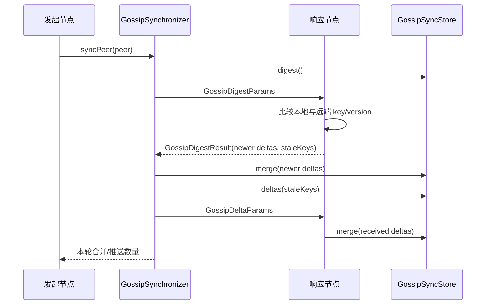

# im-gossip

`im-gossip` 提供基于 digest/delta 的通用 Gossip 状态同步能力。模块负责状态差异计算、增量交换、
版本比较和内存状态存储，不理解具体业务载荷，也不负责集群成员发现、定时调度或状态持久化。

## 模块职责

- 生成并比较本地状态摘要。
- 计算节点之间缺失或版本落后的状态。
- 通过 Bolt RPC 与 peer 交换摘要和增量。
- 使用混合逻辑版本解决跨节点状态顺序冲突。
- 保存增量、更新和删除标记，并按 TTL 清理删除标记。
- 通过 `GossipSyncStore` 将同步结果交给业务模块落地。

以下能力由接入模块负责：

- 节点注册、发现和失效检测。
- Gossip 调度周期、peer 选择和 fanout 策略。
- 业务状态的序列化、反序列化和本地投影。
- 需要持久化时的存储实现。

## 核心组件

| 组件 | 说明 |
|------|------|
| `GossipSynchronizer` | 执行 digest/delta 双向同步算法 |
| `GossipPeerClient` | 基于 `im-bolt` 调用远端 Gossip 接口 |
| `GossipSyncStore` | 业务模块接入 Gossip 的状态存储接口 |
| `InMemoryGossipEntryStore` | 通用内存增量状态表 |
| `GossipVersion` | 包含时间、逻辑计数器和节点 ID 的混合逻辑版本 |
| `GossipDigestEntry` | 仅包含 key 和 version 的状态摘要 |
| `GossipDeltaEntry` | 包含实体类型、变更动作和载荷的完整增量 |

## 同步流程

发起节点主动执行一次同步：

```text
发起节点                                  响应节点
   |                                        |
   |------ GossipDigestParams ------------->|
   |       nodeId + 本地 digest              |
   |                                        | 比较双方版本
   |<----- GossipDigestResult ---------------|
   |       较新 deltas + staleKeys           |
   |                                        |
   | 合并响应节点返回的 deltas                |
   |                                        |
   |------ GossipDeltaParams --------------->|
   |       staleKeys 对应的本地 deltas        |
   |                                        | 合并增量
```

`GossipSynchronizer#syncPeer` 完成发起侧流程：

1. 将本地 digest 发送给 peer。
2. 合并 peer 返回的较新 deltas。
3. 根据 peer 返回的 `staleKeys` 读取本地 deltas。
4. 将这些 deltas 推送给 peer。

方法返回本次合并与推送的 delta 总数，供接入模块记录同步诊断指标；插件本身不保存诊断历史。

## Gossip 协议机制

Gossip 采用周期性反熵（anti-entropy）方式传播状态：每轮由一个节点选择 peer，先交换摘要，再交换摘要中缺失或版本较旧的增量。它不要求固定 Leader，也不通过多数派确认；任意可达节点都可以发起同步，网络恢复后通过多轮交换逐步扩散状态。

协议只对每个 key 的版本负责：摘要包含 `key + version`，完整 Delta 包含 `key + version + entityType + operation + payload`。接收方比较版本后只接受更高版本；相同版本重复到达必须幂等，较旧版本必须丢弃。同步中断时，已经原子合并的 key 保留，未完成的 key 下一轮继续。

一次反熵轮次的语义是局部的：返回的 delta 数量只能说明本次请求处理了多少条增量，不能证明整个集群已经收敛，也不能证明某个 peer 之外的节点已经看到这次更新。

### Digest/Delta 两阶段交换

```text
1. Source 读取本地 digest 并发送给 Peer。
2. Peer 比较双方版本，返回 Peer 较新的 deltas 和 Source 缺少的 staleKeys。
3. Source 原子合并返回的 deltas。
4. Source 根据 staleKeys 读取本地完整 deltas，再发送给 Peer。
5. Peer 原子合并补发的 deltas，返回本轮处理结果。
```

摘要阶段不传业务载荷，Delta 阶段才传完整载荷；业务模块必须在合并前校验 `entityType` 和 payload 格式。

### 版本与删除传播

`GossipVersion(timestamp, counter, nodeId)` 形成稳定的混合逻辑顺序。节点观察远端版本后推进本地逻辑时钟，保证后续本地更新不会回退。删除用 `REMOVED` tombstone 传播，而不是立即物理删除：

```text
删除 -> 写入高版本 REMOVED -> 摘要传播 key/version
     -> peer 接收删除增量 -> tombstone 超过 TTL 后清理
```

TTL 必须覆盖允许离线节点重新加入并完成反熵同步的最长时间。清理过早会让携带旧状态的节点重新传播已删除记录。

### 收敛边界

网络分区期间不同节点可以拥有不同观察视图；恢复连通后，只要 peer 选择和调度持续运行、版本比较规则一致，状态会逐步收敛。Gossip 不提供线性一致读写、事务回滚、全局顺序或全局完成通知，因此不能直接决定 Raft voter、ACTIVE Broker、路由 epoch、Lease 或持久消息事实。

响应侧分别调用：

- `handleDigest(GossipDigestParams)`：比较摘要并返回双方差异。
- `handleDelta(GossipDeltaParams)`：合并 peer 补发的增量。

## 版本模型

每条状态使用 `GossipVersion`：

```text
timestamp + counter + nodeId
```

- `timestamp`：推进状态的物理时间线。
- `counter`：区分同一毫秒内的连续更新。
- `nodeId`：在不同节点产生相同时间和计数器时提供稳定顺序。

节点合并远端状态时会推进本地逻辑时钟，保证后续本地更新高于已经观察到的远端版本。
`InMemoryGossipEntryStore` 使用单 key 原子更新，避免并发写入导致版本回退。

## 状态模型

`GossipDeltaEntry` 包含：

| 字段 | 说明 |
|------|------|
| `key` | 业务实体的 Gossip 唯一键 |
| `version` | 用于冲突比较的混合逻辑版本 |
| `entityType` | 当前支持的 `BROKER`、`GATEWAY` 或 `CONNECTION` 实体类型 |
| `operation` | `ADDED`、`UPDATED` 或 `REMOVED` |
| `payload` | 由业务模块解释的字符串载荷 |

插件不会解析 `payload`。接入模块应保证同一种 `entityType` 使用稳定的载荷格式。

## 接入方式

业务模块需要实现 `GossipSyncStore`：

```java
public interface GossipSyncStore {
    List<GossipDigestEntry> digest();

    List<String> keysNewerThan(List<GossipDigestEntry> remoteDigest);

    List<String> keysOlderThan(List<GossipDigestEntry> remoteDigest);

    List<GossipDeltaEntry> deltas(List<String> keys);

    void merge(List<GossipDeltaEntry> deltas);
}
```

如果使用内存状态表，可以在业务适配层中组合 `InMemoryGossipEntryStore`：

```java
InMemoryGossipEntryStore entries = new InMemoryGossipEntryStore(
        localNodeId,
        removedTtlMillisSupplier);
```

然后创建同步客户端和同步器：

```java
GossipPeerClient peerClient = new GossipPeerClient(boltInvoker);
GossipSynchronizer synchronizer = new GossipSynchronizer(syncStore, peerClient);
```

RPC service、digest operation 和 delta operation 通过 `GossipSyncOperations` 由业务模块传入，插件不写死业务协议名称。

## 删除标记

删除操作不会立即移除状态，而是写入 `REMOVED` 增量，使删除信息能够传播到其他节点。删除标记超过 TTL 后，
`InMemoryGossipEntryStore` 会按本机首次观察到该删除版本的时间进行清理。

删除标记 TTL 应大于节点允许离线后重新加入集群的最长时间。否则，离线节点携带的旧状态可能在删除标记清理后重新传播。

## 使用限制

- `InMemoryGossipEntryStore` 不提供进程重启后的状态恢复。
- Gossip 提供最终一致性，不提供强一致读写或事务语义。
- peer 不可用时的重试、退避和熔断由调用方负责。
- 集群成员发现和失效节点清理由业务模块负责。

## 协议定位与状态所有权

Gossip 是**运行态观察的最终一致反熵协议**。它适合传播 Broker、Gateway、Connection 等高频、可重放、允许暂时分歧的状态观察；不提供多数派提交、线性一致读、事务、租约或业务事实确认。接入方必须明确哪些本地事实可以通过 Gossip 修复，哪些事实只能由数据库、Raft 或其他强一致所有者决定。

| 内容 | 所有者 | Gossip 的作用 |
|---|---|---|
| key/version/delta 的比较与交换 | `im-gossip` | 通用协议能力 |
| Broker/Gateway/Connection 载荷含义 | 接入方模块 | 序列化、反序列化和业务校验 |
| 本地 Registry 和 Gossip View | 接入方 Store/应用服务 | 合并后的最终一致投影 |
| peer 发现、失效检测、fanout、调度 | 接入方生命周期/基础设施 | 决定何时与谁同步 |
| 权威路由拓扑、epoch、消息事实 | 业务领域或持久化所有者 | Gossip 不得直接修改 |

## 一轮同步协议



发起侧先交换轻量摘要，再只传输缺失或版本落后的完整增量。响应侧不会把业务对象直接暴露给插件；`payload` 始终由接入方解释。同步器返回的是本轮处理数量，不是“集群已经收敛”的全局证明。

## 版本、删除和合并规则

每个 key 只有版本更高的增量可以覆盖当前值。`GossipVersion(timestamp, counter, nodeId)` 提供跨节点稳定排序：本地观察远端版本后必须推进本地逻辑时钟，确保后续本地写入不会回退。

删除使用 `REMOVED` tombstone，而不是立即物理删除：

```text
本地删除 -> 写入 REMOVED(version)
         -> digest 携带 key/version
         -> peer 比较并接收删除增量
         -> 超过 removed TTL 后才允许清理 tombstone
```

TTL 必须覆盖允许离线节点重新加入并完成反熵同步的最长时间。过早清理会让旧节点重新传播已删除状态。`InMemoryGossipEntryStore` 的 TTL 清理只处理本地内存状态，不提供重启恢复。

## 接入流程与边界

接入模块需要完成以下流程：

1. 本地 Registry 或 observation 发生变化时，生成稳定 key、实体类型、版本和载荷。
2. `GossipSyncStore` 保存当前值或 tombstone，并保证同 key 原子比较更新。
3. 调度器选择 peer，调用 `GossipSynchronizer.syncPeer`。
4. 成功合并后由应用服务更新本地投影、指标或诊断记录。
5. 网络失败、peer 身份失败或载荷校验失败由接入方记录并按策略重试；不能把失败的 Gossip 结果当作业务操作失败或成功。

Gossip listener 只应把合法增量交给 Store/应用服务。它不能直接改 Raft 的 voter、ACTIVE Broker 集合、路由 epoch、消息持久化状态或本地 Lease。

## 失败语义与收敛限制

- peer 不可达：本轮失败，保留本地状态和 tombstone，等待下一次调度。
- 摘要过期或响应乱序：按版本比较丢弃旧增量，不回退当前值。
- 同步中断：已原子合并的 key 保留，未处理 key 在下一轮继续。
- 载荷无法解析：接入方拒绝该增量并记录诊断；不能静默写入未知业务状态。
- 网络分区：各分区可能暂时拥有不同观察视图；恢复连通后通过反熵逐步收敛，但协议不保证某个时间点已经全局一致。
- 删除 tombstone 被清理后：只有在接入方能证明离线节点不会携带旧状态时才安全；否则应延长 TTL。

## 关键技术点

- Digest 只交换 key/version，Delta 才携带完整载荷，降低常规反熵流量。
- 混合逻辑版本以 timestamp、counter、nodeId 提供跨节点稳定全序比较。
- 单 key 合并只接受更高版本，保证并发同步不会让状态版本回退。
- 删除使用带 TTL 的 `REMOVED` 增量传播，不能直接物理删除状态。
- 插件不负责成员发现和调度，业务接入层决定 peer、fanout 和同步周期。

## 验证命令

```bash
mvn -q -pl im-plugin/im-gossip -am test
```
