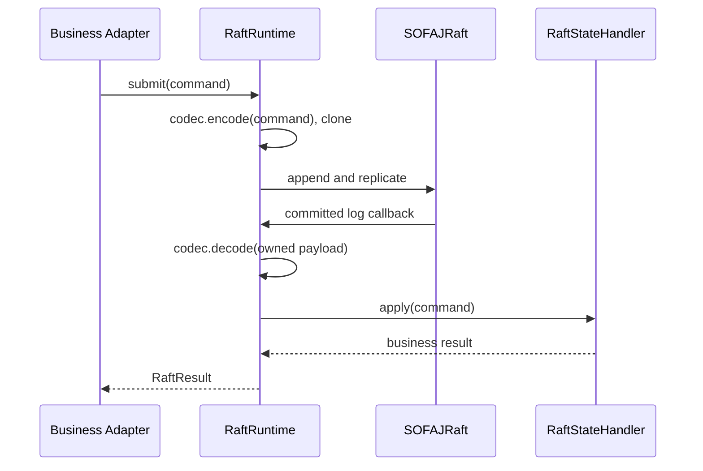
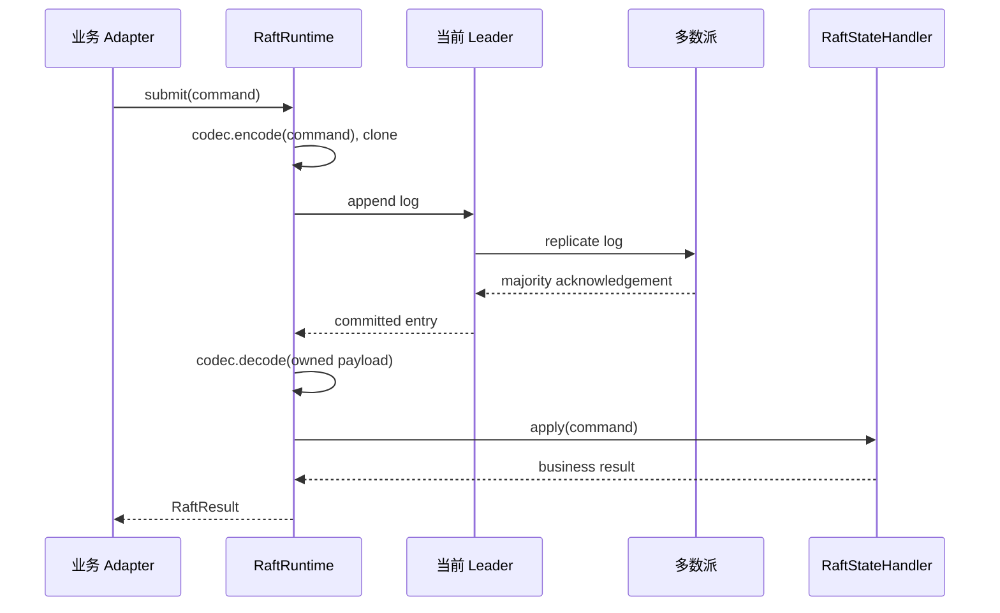

# im-raft

基于 SOFAJRaft 1.4.1 私有补丁候选的通用 Raft 运行能力。插件管理节点启动和关闭、日志提交、当前任期
ReadIndex、voter/learner 配置与 snapshot 文件；使用方拥有业务命令、编码、领域状态和快照内容。

## 本地开发制品

根 POM 唯一管理 `com.co.kc.thirdparty.sofa:jraft-core:1.4.1-imchat.1`，模块不重复声明版本。
当前候选仅安装在隔离 Maven 仓库 `/tmp/jraft-artifact-m2`，未修改默认 `~/.m2`；这只是本地开发接入，
不表示生产发布、可复现构建或完整上游验收通过。生产 Registry 与最终交付门槛仍待完成。
其他机器必须先按[私有制品构建材料](../../third-party/jraft-applied-membership/README.md)准备源码构建并隔离安装，
或在发布完成后配置获准 Registry；当前不能仅凭普通 `mvn` 命令解析这个尚未发布的私有坐标。

`membership()` 调用 `Node.getAppliedConfiguration(commandTimeoutMillis)`，可在 Leader、Follower 和
learner 读取本机已应用成员。仅返回 stable 配置；joint、停止、错误、队列拒绝、超时和中断均失败关闭，
不回退到初始配置、不缓存快照，也不发起 quorum RPC。超时与中断保留原异常 cause，中断恢复线程标志。
该读取不是 quorum/ReadIndex 证明，也不与业务状态读取构成原子快照。禁止在 FSM callback 或其同步
continuation 内调用；调用方必须明确线程边界，不能移除访问器的重入守卫。

本地候选已通过 16 项访问器测试、22 项 Runtime 测试、87 项 Broker 聚焦测试和原三项
`AutomaticFailureTlsHaTest`；Runtime reviewer `a682f997`、HA fixture reviewer `cf4028e1` 均 scoped Accept。
三项 HA 日志为 `/tmp/follower-ha-three-final.log`，Gateway ACK 使用替代边界，不是真实 Gateway E2E。
这仅解除本地候选的 Follower 行为阻塞；双构建、依赖输入锁、私有发布与最终全仓门禁仍未完成，
具体证据和恢复状态通过[计划索引](../../docs/exec-plans/active/README.md)定位；计划归档不改变私有候选的发布边界。

## 核心类型

- `RaftRuntime<C, R>`：一个 group 的本机运行实例，必须在应用关闭时调用 `close()`。
- `RaftNodeSettings`：从使用方的类型化配置组装启动参数，包含稳定身份、端点、目录和超时。
- `RaftCommandCodec<C>`：确定性、线程安全的业务协议 SPI，无默认实现。
- `RaftStateHandler<C, R>`：应用已提交并解码的命令，生成及恢复字节快照。
- `RaftResult<R>`：技术提交结果；`APPLIED` 表示共识完成，业务是否接受由返回值判断。
- `RaftReadIndex`：同一当前 Leader 任期内确认的多数派读取证据。
- `RaftMembership`：本机状态机已应用的稳定 voter 和 learner 的 `List<String>` 技术快照。Runtime 按原始端点字符串排序后生成不可变快照；构造器防御复制列表、保留输入顺序和重复项，允许空列表，不接受 null 列表或元素。

`RaftRuntime.localLeaderTerm()` 返回本机领导权回调记录的 `OptionalLong` 任期；非 Leader、任期未初始化/已停止或状态机错误时为空，不发起 RPC/ReadIndex，也不是多数派读取证明。角色、错误与任期读取不构成原子快照，调用方若要作权威决定仍需 `confirmLeadership`；不得把该值用于替代 fencing/Lease 的 quorum 证据。

`RaftRuntime.leaderEndpoint()` 与 `RaftResult.leaderEndpoint()` 返回当前已知的 Raft Leader
成员通信地址；未知时为空。这不是业务管理 HTTP 地址，地址的业务解释属于使用方 Adapter。

## 调用流程



日志在 Leader 和 follower 上都使用同一字节编码重放。回调必须确定性执行，不读取当前时间、产生
随机值或执行外部 RPC；这些事实由使用方在日志中提供。快照必须与已应用日志一致，恢复必须原子替换
业务状态。回调异常将设置状态机错误并停止当前批次，不能吞掉异常后报告成功。

启动配置使用 `RaftNodeSettings.builder()` 按字段组装，不提供额外默认值。`RaftNodeSettings` 是
只有私有无参构造器的 final class；手写 `RaftNodeSettings.Builder` 持有 final 目标对象，各方法直接填充字段，
不使用 Lombok Builder 或长参数转发构造器。`build()` 统一校验身份、超时、快照文件名及本机 membership，
复制 voter/learner 列表为不可变集合，并将数据目录转为绝对路径后 normalize；只读访问仍使用
`clusterId()` 等 component 风格方法，无公开 setter。

`build()` 校验后返回目标对象；校验失败允许修正输入后重试。

```java
RaftNodeSettings settings = RaftNodeSettings.builder()
        .clusterId("example-cluster")
        .groupId("example-group")
        .nodeId("node-a")
        .endpoint("127.0.0.1:8080")
        .dataDirectory(Path.of("data/raft"))
        .voters(List.of("127.0.0.1:8080"))
        .learners(List.of())
        .electionTimeoutMillis(300)
        .snapshotIntervalSeconds(0)
        .commandTimeoutMillis(5_000)
        .snapshotFileName("state.bin")
        .build();
```

插件没有默认业务状态机，因此由使用方显式创建 `RaftRuntime` 并管理生命周期，不自动启动一个空 group。
多个 group 可以创建多个实例。插件不依赖 Broker、Gateway 或业务模块。

## 可靠性边界

数据目录保留 `identity.json`，复用目录时校验 clusterId、nodeId、endpoint；日志、meta 和 snapshot
分别存放在独立子目录。使用方指定快照文件名，使抽取前后的持久化目录格式保持一致。

提交和成员变更需要 Leader；多数派不可用时不会应用新业务日志。ReadIndex 前后检查同一任期，换届
则拒绝返回证据。超时通过异常返回，可能存在已提交但响应未到达的情况；请求幂等和过程恢复由使用方保证。
成员操作只提供单步 add/remove，晋升、降级、最小 voter 数量等策略由业务 Adapter 编排。

## 协议定位与状态所有权

Raft 在本模块中是一个**强一致提交协议的运行适配**，不是业务领域模型。它负责把一条命令从本机提交到多数派、在所有副本按相同字节顺序回调业务状态处理器，并提供可以证明多数派已经读取到某个位置的 `ReadIndex`。业务模块负责命令语义、命令编码、领域聚合、快照内容和操作重试。

| 内容 | 所有者 | 一致性/语义 |
|---|---|---|
| 任期、Leader、日志复制、提交索引 | `im-raft` / SOFAJRaft | Raft 强一致协议事实 |
| Broker 拓扑、epoch、operation、fence | 接入方领域聚合 | 由已提交日志驱动的业务事实 |
| 命令 JSON/二进制格式与版本 | 接入方 Codec | 业务协议兼容和拒绝策略 |
| 快照字段及恢复校验 | 接入方 Snapshot Codec/Handler | 业务状态原子替换 |
| Lease、RouteBroker、Gossip 等规则 | 接入方业务模块 | 不由通用插件解释 |

Runtime 保留完整 `PeerId.toString()`，包括 index/priority 等原生字符串表示，不解析或规范化为另一套端点身份。`RaftNodeSettings`、add/remove 操作和 Leader 查询仍使用现有 String 边界。使用方 Adapter 负责将技术成员快照转换为所属领域模型；插件不依赖 Broker 的 `ConsensusMembership`，业务领域也不依赖 `RaftMembership`。

插件不把“日志已提交”解释成“业务操作成功”：`APPLIED` 只表示共识层接受并回调了业务状态处理器，业务返回值仍可能是拒绝、重复或冲突。

## Raft 协议机制

本模块运行的是单 Raft group。节点在任期内处于 `Follower`、`Candidate` 或 `Leader`：Follower 接收 Leader 的心跳和日志，超时后发起新任期选举；Candidate 向其他 voter 请求投票，获得多数 voter 投票后成为 Leader；旧任期的消息不能覆盖新任期状态。Leader 是业务日志提交入口，follower 的本地提交请求根据返回的 Leader 地址由调用方重试。

日志复制遵循以下规则：

1. Leader 为命令追加日志条目并向 voter 复制。
2. follower 只接受任期和前置日志匹配的条目；冲突尾部由 Raft 层修正。
3. 条目获得多数 voter 确认后，Leader 推进 committed index。
4. 各节点按 index 顺序应用已提交条目到 `RaftStateHandler`。
5. follower 追赶完成后，以相同顺序应用相同 payload，得到确定性业务状态。

Raft 保证的是日志顺序和多数派提交，不保证业务命令一定被领域接受；业务拒绝、重复或冲突仍由接入方返回。

### ReadIndex、成员变更与快照

ReadIndex 不追加业务日志。Leader 在当前任期内向多数派确认领导权和读取位置，运行时等待本机状态机应用到该位置后返回证据。任期变化、Leader 失效或多数派不可达时，ReadIndex 失败；调用方不得用本地 `isLeader` 或 applied index 替代它。

插件只提供单步成员变更。业务层通常将加入拆为 `add learner -> 等待追平 -> add voter`，移除或降级也可能分成多步。超时或重启后必须重新读取本机已应用的稳定 membership，再依据当前状态继续，不能假设复合操作具备原子性。

快照代表某个已应用位置的完整业务状态。运行时调用 Handler 导出快照并持久化日志位置；恢复时校验 group 身份和版本，原子安装业务状态，再从快照位置继续应用日志。快照不能包含未提交或未应用状态。

## 提交协议流程



同一条已提交日志在 Leader、Follower、learner 和重启重放时统一 decode，再调用 `apply(command)`。`apply` 必须是确定性的：不能读取当前时间、生成随机值、访问网络或依赖本机非日志状态。需要时间、随机数或调用上下文的事实必须在命令创建时写入命令。

## ReadIndex 协议流程

`ReadIndex` 用于在不追加业务日志的情况下证明读取位点属于当前 Leader 任期内的多数派。调用方拿到证据后仍需等待本机业务状态应用到该索引；证据不等于某个业务查询结果，也不等于远端节点已经应用该位置。

```text
调用方 -> RaftRuntime：请求 ReadIndex
RaftRuntime -> 当前 Leader/多数派：确认当前任期与读取位置
RaftRuntime：检查任期未变化，并等待本机状态机应用到该位置
调用方 <- RaftReadIndex：返回任期与索引
```

换届、超时或多数派不可用时不返回有效证据。调用方不能用 `leaderEndpoint()`、本机 `isLeader()` 或本地 applied index 替代 ReadIndex。

## 成员变更协议

插件只提供单步 `addLearner`、`removeLearner`、`addVoter`、`removeVoter`。业务 Adapter 负责把多步流程编排成可恢复操作：新节点通常先加入 learner，等待其应用进度追平，再晋升为 voter；降级或移除同样可能只完成第一步。部分成功必须保留当前 Raft membership，重试读取最新 membership 后继续，不能把一次调用包装成不可分割的业务成功。

## 快照与恢复流程

```text
RaftRuntime.snapshot()
  -> 等待当前已应用位置
  -> 调用 Handler.snapshot()
  -> 持久化业务快照

恢复/追赶
  -> 校验 identity、clusterId 和快照格式（由接入方负责）
  -> Handler.restore(snapshot)
  -> 继续应用后续已提交日志
```

`snapshot()` 必须代表已经应用的业务状态；`restore()` 必须原子替换状态，不能先暴露半恢复聚合。快照格式版本、业务字段和旧格式是否拒绝由接入方决定，插件只负责在 Raft 生命周期中调用回调。

## 失败、重试与资源边界

- 提交超时可能发生“已提交但响应丢失”；插件只返回技术失败，幂等 operation 和状态查询由调用方恢复。
- 多数派不可用时不应用新业务日志；Leader 切换后旧请求不能假设仍可重放。
- encode 异常同步抛出，不追加日志、不调用 Handler、不污染健康节点；非 Leader 在编码前返回 NOT_LEADER。
- decode/apply 异常不能被吞掉或报告 APPLIED；停止本批次并进入状态机错误。confirmLeadership/fetchQuorumReadIndex 的入口及异步完成都检查错误状态，不再提供有效读取证明。部分内存修改不保证回滚，应关闭实例并从有效快照/日志重建，不能跳过损坏日志。
- Codec 和 Handler 在创建节点前校验非空。Codec 可跨 Runtime 共享，encode/decode 可并发，必须线程安全、确定性且不访问网络/时间/随机源。encode 返回非空且归本次调用独占数组；Runtime 仍 clone 以抵御返回后的外部修改，但不保护违反契约的并发共享 scratch buffer。decode 输入是独立日志副本，可修改，返回非空命令；snapshot/restore 保持字节接口。
- 每个 `RaftRuntime` 拥有明确数据目录和稳定身份；创建者负责调用 `close()`，插件不替业务模块管理外部线程池。
- 原生 Raft peer 通信与业务 Bolt 查询是两条不同路径；JRaft 的 AppendEntries、选举和 snapshot 传输由 `RaftRuntime`/JRaft 管理。

## 业务 Peer 查询边界

业务读取证明 RPC 归使用方 Adapter，通过通用 `im-bolt` 调用；`im-raft` 不再依赖 `im-bolt`，
也不保留只有转发职责的 Peer Client。Broker 的 `BrokerPeerAdapter` 选择目标 RPC 地址、服务、
操作和超时，核对目标节点身份及非负索引，并保留同步 IO 与异常转失败阶段的既有契约。
该业务查询不参与 Raft 原生选举、AppendEntries 或 snapshot 传输。

原生 Raft 端点的网络隔离、身份认证和 mTLS 仍由部署环境负责。插件不提供鉴权绕过或强制 bootstrap。

```bash
mvn -q -Dmaven.repo.local=/tmp/jraft-artifact-m2 -pl im-plugin/im-raft -am -Dtest=RaftRuntimeTest -Dsurefire.failIfNoSpecifiedTests=false test
```

测试使用临时数据目录和本机临时端口，覆盖单节点提交、ReadIndex、snapshot/restart、身份冲突、
少数派拒绝写入、三节点复制、Leader 换届、learner、规范化解码、snapshot 尾日志恢复、编码失败后合法提交、解码/应用异常、在途读取证明错误状态检查及缓冲区所有权。生产容量及原生端口安全需要部署环境验证。
