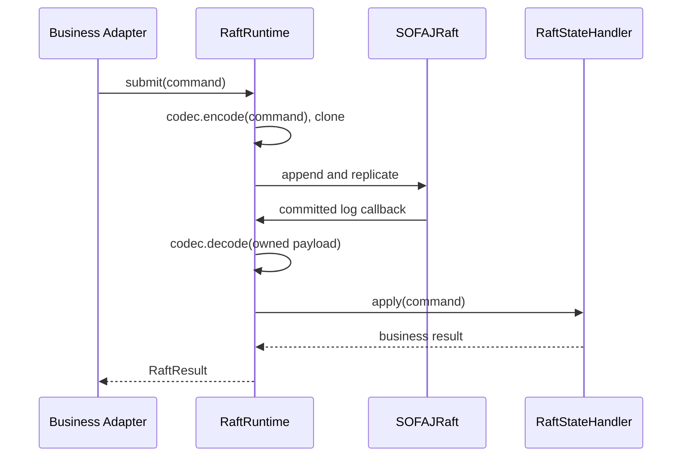
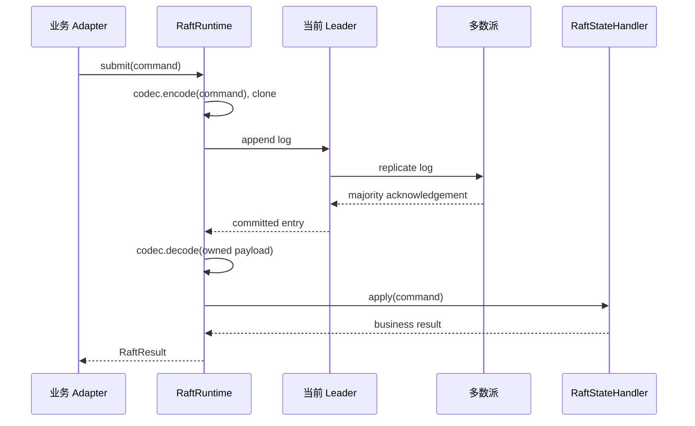

# im-raft

基于官方 SOFAJRaft 1.4.1的通用 Raft 运行能力。插件管理节点启动和关闭、日志提交、当前任期
ReadIndex、voter/learner 配置与 snapshot 文件；使用方拥有业务命令、编码、领域状态和快照内容。

## 官方依赖与配置边界

根 POM 唯一管理 `com.alipay.sofa:jraft-core:1.4.1`，模块不重复声明版本。官方 published sources 的 279 个 Java 文件与固定 commit `cb1a0c7ac16ff146ad8abb04b1bcb035270bb234` 归档逐字节一致；这不证明 binary 可复现或签名验证。原私有配方已退役，保留的来源与法律材料仅为历史记录，不再提供可调用构建入口，也不要求清理本地 Maven 制品或 Raft 数据。

`leaderConfiguration()` 只提供 Leader 的 voters/learners 列表观察。底层两次调用分别获取锁，不构成原子稳定配置，也不证明 FSM applied、quorum 或许可排空；Follower 不提供该查询。业务权威状态仍由 owning FSM 管理，维护通过完整持久化目标和不可转移的本机执行许可推进。旧 `membership()` 与单步增删接口已移除，不提供兼容入口。

## 核心类型

- `RaftRuntime<C, R>`：一个 group 的本机运行实例，必须在应用关闭时调用 `close()`。
- `RaftRoleListener`：构造 Runtime 时必须提供的角色记账 SPI，在原生 group 启动前安装。Runtime 先发布 term/generation，再同步通知 listener；同任期停止后重启仍增加 generation。listener 只能作短记账，不能调用 Node、发布 Future 或执行 continuation。Runtime 与 listener 共享同一 `FaultLatch`；listener 的意外 `RuntimeException` 永久关闭准入并保留首个原因，后续角色事件不能恢复，不承诺 JVM 致命错误恢复。
- `RaftNodeSettings`：从使用方的类型化配置组装启动参数，包含稳定身份、端点、目录和超时。
- `RaftCommandCodec<C>`：确定性、线程安全的业务协议 SPI，无默认实现。
- `RaftStateHandler<C, R>`：应用已提交并解码的命令，生成及恢复字节快照。
- `RaftResult<R>`：技术提交结果；`APPLIED` 表示共识完成，业务是否接受由返回值判断。
- `RaftReadIndex`：同一当前 Leader 任期内确认的多数派读取证据。

`RaftRuntime.localLeaderTerm()` 返回本机领导权回调记录的 `OptionalLong` 任期；非 Leader、任期未初始化/已停止或状态机错误时为空，不发起 RPC/ReadIndex，也不是多数派读取证明。角色、错误与任期读取不构成原子快照，调用方若要作权威决定仍需 `confirmLeadership`；不得把该值用于替代 fencing/Lease 的 quorum 证据。

`confirmMembershipPermitDrain(context)` 是仅供成员许可排空 CAS 使用的专用 ReadIndex 入口。调用者必须在自己的有界 worker 上发起；callback 使用不获取 Node readLock 的 `isLeader(false)` 与同一角色 observation 身份检查，拒绝同任期角色 ABA。专用 `RaftMembershipPermitDrain` 返回 term、generation 和 index，Adapter 必须完整保留；worker 消费和提交 CAS 前均复验同一角色快照，不能仅比较 term。它不替代 Lease、fencing 或 learner 的 `confirmLeadership`，也不代表配置目标已应用；使用方仍需校验本机 applied index、精确许可身份和结果。回调只产生技术读取事实，后续可能进入 Node 的阶段必须显式交回使用方 worker。

`RaftRuntime.leaderEndpoint()` 与 `RaftResult.leaderEndpoint()` 返回当前已知的 Raft Leader
成员通信地址；未知时为空。这不是业务管理 HTTP 地址，地址的业务解释属于使用方 Adapter。

## 调用流程



日志在 Leader 和 follower 上都使用同一字节编码重放。回调必须确定性执行，不读取当前时间、产生
随机值或执行外部 RPC；这些事实由使用方在日志中提供。快照必须与已应用日志一致，恢复必须原子替换
业务状态。回调异常将设置状态机错误并停止当前批次，不能吞掉异常后报告成功。

启动配置使用 `RaftNodeSettings.builder()` 按字段组装，不提供额外默认值。`RaftNodeSettings` 是
只有私有无参构造器的 final class；手写 `RaftNodeSettings.Builder` 持有 final 目标对象，各方法直接填充字段，
不使用 Lombok Builder 或长参数转发构造器。`build()` 统一校验身份、超时、快照文件名及本机 membership，
复制 voter/learner 列表为不可变集合，并将数据目录转为绝对路径后 normalize；只读访问仍使用
`clusterId()` 等 component 风格方法，无公开 setter。

`build()` 校验后返回目标对象；校验失败允许修正输入后重试。

```java
RaftNodeSettings settings = RaftNodeSettings.builder()
        .clusterId("example-cluster")
        .groupId("example-group")
        .nodeId("node-a")
        .endpoint("127.0.0.1:8080")
        .dataDirectory(Path.of("data/raft"))
        .voters(List.of("127.0.0.1:8080"))
        .learners(List.of())
        .electionTimeoutMillis(300)
        .snapshotIntervalSeconds(0)
        .commandTimeoutMillis(5_000)
        .snapshotFileName("state.bin")
        .build();
```

插件没有默认业务状态机，因此由使用方显式创建 `RaftRuntime` 并管理生命周期，不自动启动一个空 group。
多个 group 可以创建多个实例。插件不依赖 Broker、Gateway 或业务模块。

## 可靠性边界

数据目录保留 `identity.json`，复用目录时校验 clusterId、nodeId、endpoint；日志、meta 和 snapshot
分别存放在独立子目录。使用方指定快照文件名，使抽取前后的持久化目录格式保持一致。

提交和成员变更需要 Leader；多数派不可用时不会应用新业务日志。ReadIndex 前后检查同一任期，换届
则拒绝返回证据。超时通过异常返回，可能存在已提交但响应未到达的情况；请求幂等和过程恢复由使用方保证。
成员操作提供完整 voters/learners 目标变更；晋升、降级的分步目标及最小 voter 数量等策略由业务 Adapter 编排。

## 协议定位与状态所有权

Raft 在本模块中是一个**强一致提交协议的运行适配**，不是业务领域模型。它负责把一条命令从本机提交到多数派、在所有副本按相同字节顺序回调业务状态处理器，并提供可以证明多数派已经读取到某个位置的 `ReadIndex`。业务模块负责命令语义、命令编码、领域聚合、快照内容和操作重试。

| 内容 | 所有者 | 一致性/语义 |
|---|---|---|
| 任期、Leader、日志复制、提交索引 | `im-raft` / SOFAJRaft | Raft 强一致协议事实 |
| Broker 拓扑、epoch、operation、fence | 接入方领域聚合 | 由已提交日志驱动的业务事实 |
| 命令 JSON/二进制格式与版本 | 接入方 Codec | 业务协议兼容和拒绝策略 |
| 快照字段及恢复校验 | 接入方 Snapshot Codec/Handler | 业务状态原子替换 |
| Lease、RouteBroker、Gossip 等规则 | 接入方业务模块 | 不由通用插件解释 |

Runtime 保留完整 `PeerId.toString()`，包括 index/priority 等原生字符串表示，不解析或规范化为另一套端点身份。`RaftNodeSettings`、完整目标配置和 Leader 查询使用 String 边界。使用方 Adapter 负责将官方配置观察转换为所属领域模型；插件不依赖 Broker 的 `ConsensusMembership`。

插件不把“日志已提交”解释成“业务操作成功”：`APPLIED` 只表示共识层接受并回调了业务状态处理器，业务返回值仍可能是拒绝、重复或冲突。

## 跟随事件观察与本机身份

`localPeerId()` 只在 Node 完成初始化后返回实际 Node 的完整身份；接入方应先取得该值再首次注册，不以配置 priority 等文本代替实际身份。插件不拥有 Nacos metadata 或管理 origin 配对。

`followingObservation()` 原子无锁读取不可变 `(leaderEndpoint, generation)`，不调用 Node、Supplier 或业务 action。仅 `onStartFollowing` 的正 term、非空 PeerId、当前非 Leader 且未 closing／roleFault／stateMachineFailed 时建立观察；generation 0 合法，`ENEWLEADER` 等非 OK status 不单独使 START 无效。`onStopFollowing`、任何角色发布、`beginClose`、FSM `onError`／apply failure 均清除；roleFault 与 stateMachineFailed 是独立永久拒绝门禁，迟到 START 不能重开。官方首次 Leader 配置提交 closure 在 FSM consumer 上的 Leader-start 回调同样清除观察。

发布与 listener 使用既有 `rolePublication → listener → executor mutex` 锁序；getter 不获取 `rolePublication`，因此允许在 executor mutex 内做纯拒绝判断。角色 generation 不匹配、当前 Leader、close 或任一故障时返回空。观察只证明已消费事件，不保证 Node 实时健康、当前角色或 quorum；Node ERROR 到 FSM 消费之间有不可消除的延迟。接入方不得用它准入新执行、分配预算或绕过 worker／native 门禁。

## Raft 协议机制

本模块运行的是单 Raft group。节点在任期内处于 `Follower`、`Candidate` 或 `Leader`：Follower 接收 Leader 的心跳和日志，超时后发起新任期选举；Candidate 向其他 voter 请求投票，获得多数 voter 投票后成为 Leader；旧任期的消息不能覆盖新任期状态。Leader 是业务日志提交入口，follower 的本地提交请求根据返回的 Leader 地址由调用方重试。

日志复制遵循以下规则：

1. Leader 为命令追加日志条目并向 voter 复制。
2. follower 只接受任期和前置日志匹配的条目；冲突尾部由 Raft 层修正。
3. 条目获得多数 voter 确认后，Leader 推进 committed index。
4. 各节点按 index 顺序应用已提交条目到 `RaftStateHandler`。
5. follower 追赶完成后，以相同顺序应用相同 payload，得到确定性业务状态。

Raft 保证的是日志顺序和多数派提交，不保证业务命令一定被领域接受；业务拒绝、重复或冲突仍由接入方返回。

### ReadIndex、成员变更与快照

ReadIndex 不追加业务日志。Leader 在当前任期内向多数派确认领导权和读取位置，运行时等待本机状态机应用到该位置后返回证据。任期变化、Leader 失效或多数派不可达时，ReadIndex 失败；调用方不得用本地 `isLeader` 或 applied index 替代它。

插件仅提供完整目标配置入口，旧单步成员 API 已退役。跨角色调整必须先通过完整目标移除旧角色，再通过独立完整目标添加新角色。两步复合操作不具备原子性，超时或重启后的恢复由调用方负责。

快照代表某个已应用位置的完整业务状态。运行时调用 Handler 导出快照并持久化日志位置；恢复时校验 group 身份和版本，原子安装业务状态，再从快照位置继续应用日志。快照不能包含未提交或未应用状态。

## 提交协议流程



同一条已提交日志在 Leader、Follower、learner 和重启重放时统一 decode，再调用 `apply(command)`。`apply` 必须是确定性的：不能读取当前时间、生成随机值、访问网络或依赖本机非日志状态。需要时间、随机数或调用上下文的事实必须在命令创建时写入命令。

## ReadIndex 协议流程

`ReadIndex` 用于在不追加业务日志的情况下证明读取位点属于当前 Leader 任期内的多数派。调用方拿到证据后仍需等待本机业务状态应用到该索引；证据不等于某个业务查询结果，也不等于远端节点已经应用该位置。

```text
调用方 -> RaftRuntime：请求 ReadIndex
RaftRuntime -> 当前 Leader/多数派：确认当前任期与读取位置
RaftRuntime：检查任期未变化，并等待本机状态机应用到该位置
调用方 <- RaftReadIndex：返回任期与索引
```

换届、超时或多数派不可用时不返回有效证据。调用方不能用 `leaderEndpoint()`、本机 `isLeader()` 或本地 applied index 替代 ReadIndex。

## 成员变更协议

`RaftConfiguration(voters, learners)` 表示完整目标，不表示已提交事实。模型构造只处理框架无关规则：拒绝 null 和空白字符串，按字面值去重、排序并复制为不可变列表；voters 必须非空，两种角色的字面值不得相交。端点格式与别名由 Runtime/core 使用 JRaft `PeerId` 权威解析：规范化后再次去重、排序并校验跨角色不相交，在创建 Node 或调用 `changePeers` 前拒绝无效端点与跨角色别名。初始配置与变更目标共用同一原生转换规则，避免同目标因 peers 顺序或别名不同而追加配置日志。诊断返回的是原生列表转换后的规范端点。

`changeConfiguration(target)` 仅限 Leader，直接同步进入 `Node.changePeers`，不排队、不自动重试。正常方法返回只证明同步入口已退出；closure 完成是另一项独立事实。返回值为只读 `CompletionStage<RaftConfigurationResult>`，调用方取消、外部完成或超时只能作用于派生 Future，不影响原生完成观察。同步入口异常通过异常完成保留未知结果；即使异常前 closure 已成功，也不发布确定成功，不得据此认定许可排空。

单次结果包含 `APPLIED / BUSY / NOT_LEADER / UNAVAILABLE`、原始 `errorCode`、`leaderEndpoint` 和 `message`。未知原生错误码按原值保留，状态归入 `UNAVAILABLE`。入口错误状态和非 Leader 在原生调用前拒绝；`BUSY` 不证明其他请求已结束。这些结果不表示配置全局稳定，也不是维护许可排空证明。

`leaderConfiguration()` 只允许健康 Leader 调用，否则抛出 `IllegalStateException`。它分别调用 `listPeers`、`listLearners`，两次读取不是原子快照，可能包含过渡或未提交配置，只用于诊断和失败即关闭的前置检查。

晋升采用「移除 learner -> 添加 voter」两个完整目标；降级采用「移除 voter -> 添加 learner」。业务 Adapter 负责追赶证据、授权、迟到请求防护和恢复，不能把部分成功包装为不可分割的业务成功。旧 `membership`、`addLearner`、`removeLearner`、`addVoter`、`removeVoter` 及所有生产调用已移除，不能绕过完整目标与执行许可恢复使用。

每次创建或重建 Node 均强制 `NodeOptions.disableCli=true`，不提供覆盖开关；原生 CLI 的读取和写入均拒绝访问，进程内治理入口不受影响。这不替代原生 peer 端口的网络隔离与认证。

## 快照与恢复流程

```text
RaftRuntime.snapshot()
  -> 等待当前已应用位置
  -> 调用 Handler.snapshot()
  -> 持久化业务快照

恢复/追赶
  -> 校验 identity、clusterId 和快照格式（由接入方负责）
  -> Handler.restore(snapshot)
  -> 继续应用后续已提交日志
```

`snapshot()` 必须代表已经应用的业务状态；`restore()` 必须原子替换状态，不能先暴露半恢复聚合。快照格式版本、业务字段和旧格式是否拒绝由接入方决定，插件只负责在 Raft 生命周期中调用回调。

## 失败、重试与资源边界

- 提交超时可能发生“已提交但响应丢失”；插件只返回技术失败，幂等 operation 和状态查询由调用方恢复。
- 多数派不可用时不应用新业务日志；Leader 切换后旧请求不能假设仍可重放。
- encode 异常同步抛出，不追加日志、不调用 Handler、不污染健康节点；非 Leader 在编码前返回 NOT_LEADER。
- decode/apply 异常不能被吞掉或报告 APPLIED；停止本批次并进入状态机错误。confirmLeadership/fetchQuorumReadIndex 的入口及异步完成都检查错误状态，不再提供有效读取证明。部分内存修改不保证回滚，应关闭实例并从有效快照/日志重建，不能跳过损坏日志。
- Codec 和 Handler 在创建节点前校验非空。Codec 可跨 Runtime 共享，encode/decode 可并发，必须线程安全、确定性且不访问网络/时间/随机源。encode 返回非空且归本次调用独占数组；Runtime 仍 clone 以抵御返回后的外部修改，但不保护违反契约的并发共享 scratch buffer。decode 输入是独立日志副本，可修改，返回非空命令；snapshot/restore 保持字节接口。
- 每个 `RaftRuntime` 拥有明确数据目录和稳定身份；创建者负责调用 `close()`，插件不替业务模块管理外部线程池。
- 原生 Raft peer 通信与业务 Bolt 查询是两条不同路径；JRaft 的 AppendEntries、选举和 snapshot 传输由 `RaftRuntime`/JRaft 管理。

## 业务 Peer 查询边界

业务读取证明 RPC 归使用方 Adapter，通过通用 `im-bolt` 调用；`im-raft` 不再依赖 `im-bolt`，
也不保留只有转发职责的 Peer Client。Broker 的 `BrokerPeerAdapter` 选择目标 RPC 地址、服务、
操作和超时，核对目标节点身份及非负索引，并保留同步 IO 与异常转失败阶段的既有契约。
该业务查询不参与 Raft 原生选举、AppendEntries 或 snapshot 传输。

原生 Raft 端点的网络隔离、身份认证和 mTLS 仍由部署环境负责。插件不提供鉴权绕过或强制 bootstrap。

```bash
mvn -q -Dmaven.repo.local=/tmp/jraft-artifact-m2 -pl im-plugin/im-raft -am -Dtest=RaftRuntimeTest -Dsurefire.failIfNoSpecifiedTests=false test
```

测试使用临时数据目录和本机临时端口，覆盖单节点提交、ReadIndex、snapshot/restart、身份冲突、
少数派拒绝写入、三节点复制、Leader 换届、learner、规范化解码、snapshot 尾日志恢复、编码失败后合法提交、解码/应用异常、在途读取证明错误状态检查及缓冲区所有权。生产容量及原生端口安全需要部署环境验证。

成员配置 closure 只记录原始 status/code/message，不得调用 Node 或读取 Leader。结果中的 leaderEndpoint 是进入 native 前由调用 worker 捕获的诊断 hint，可能 stale 或 null，不代表 callback 时的当前 Leader。closure 先完成而 native 随后抛异常仍是 UNKNOWN，不能用于排空。


## 启动失败与关闭边界

Runtime 显式认领本机 endpoint，先完成 Node.init，再创建默认 RPC server 与原生配置的两个私有请求 executor。完整 Node 初始化后的真实 bind 失败会清理 Node，并仅在已确认默认 Bolt 自清理路径、Node.join 和私有 executor termination 全部完成后释放地址。RPC 工厂异常或无法确认的启动清理状态保留原异常、suppressed 与地址认领，不宣称全部资源已回收。默认 processors、线程池参数、disableCli 与原生 Node 配置不变。

`close()` 在独立角色 publication monitor 内先关闭准入，将观察更新为非 Leader 并递增 generation；迟到角色 callback 不再通知正任期。monitor 不跨 Node.shutdown/join 或 executor 等待持有，fault latch 首因不变。关闭串行执行，已完成动作不重复；RPC shutdown 失败保持可见，不将 native already-closed 当作成功。请求 executor 先全部 shutdown，再等待 termination；没有生产 cleanup timeout，阻塞任务可能阻塞 close。中断保留标志、异常和地址认领，仍执行其余非阻塞清理，后续 close 可继续等待。仅预置 interrupt 且全部资源已终止时不凭空制造新的 cleanup 失败；实际等待中断与 mock join 抛中断分别验证。

Node.init 返回 false／抛异常时不能安全调用上游部分初始化 Node 的 shutdown/join。此时不创建 RPC 或私有请求 executor，但 Node 内部资源可能残留；宿主必须中止服务启动，并由进程所有者替换进程。插件不主动退出进程，也不承诺任意 native 工厂异常都可完整回收。独立源码 Review 和更广验收状态见 active plan，局部测试通过不代表完整 T5 通过。
