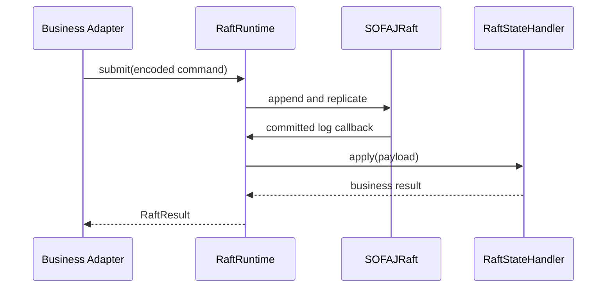

# im-raft

基于 SOFAJRaft 1.4.1 的通用 Raft 运行能力。插件管理节点启动和关闭、日志提交、当前任期
ReadIndex、voter/learner 配置与 snapshot 文件；使用方拥有业务命令、编码、领域状态和快照内容。

## 核心类型

- `RaftRuntime<R>`：一个 group 的本机运行实例，必须在应用关闭时调用 `close()`。
- `RaftNodeSettings`：从使用方的类型化配置组装启动参数，包含稳定身份、端点、目录和超时。
- `RaftStateHandler<R>`：业务回调，应用已提交的字节日志，生成及恢复快照。
- `RaftResult<R>`：技术提交结果；`APPLIED` 表示共识完成，业务是否接受由返回值判断。
- `RaftReadIndex`：同一当前 Leader 任期内确认的多数派读取证据。
- `RaftMembership`：当前 committed voter 和 learner 地址。
- `RaftPeerClient`：通过 Bolt 查询目标 peer 已应用的 quorum ReadIndex 证明；服务名、操作名、
  请求载荷与响应类型由使用方提供，不依赖 Broker SDK。它不替代 JRaft 的原生 peer 通信。

`RaftRuntime.leaderEndpoint()` 与 `RaftResult.leaderEndpoint()` 返回当前已知的 Raft Leader
成员通信地址；未知时为空。这不是业务管理 HTTP 地址，地址的业务解释属于使用方 Adapter。

## 调用流程



日志在 Leader 和 follower 上都使用同一字节编码重放。回调必须确定性执行，不读取当前时间、产生
随机值或执行外部 RPC；这些事实由使用方在日志中提供。快照必须与已应用日志一致，恢复必须原子替换
业务状态。回调异常将设置状态机错误并停止当前批次，不能吞掉异常后报告成功。

插件没有默认业务状态机，因此由使用方显式创建 `RaftRuntime` 并管理生命周期，不自动启动一个空 group。
多个 group 可以创建多个实例。插件不依赖 Broker、Gateway 或业务模块。

## 可靠性边界

数据目录保留 `identity.json`，复用目录时校验 clusterId、nodeId、endpoint；日志、meta 和 snapshot
分别存放在独立子目录。使用方指定快照文件名，使抽取前后的持久化目录格式保持一致。

提交和成员变更需要 Leader；多数派不可用时不会应用新业务日志。ReadIndex 前后检查同一任期，换届
则拒绝返回证据。超时通过异常返回，可能存在已提交但响应未到达的情况；请求幂等和过程恢复由使用方保证。
成员操作只提供单步 add/remove，晋升、降级、最小 voter 数量等策略由业务 Adapter 编排。

## Peer 查询

`RaftPeerClient.fetchQuorumReadIndex` 集中封装 Bolt 读取证明调用。插件依赖 `im-bolt`，
但不定义 Broker 身份或请求响应协议；使用方 Adapter 选择目标 RPC 地址、服务、操作和超时，
并校验响应的集群、节点身份与索引合法性。调用同步返回载荷，传输异常原样抛出；是否转换为
异步失败由使用方保持原契约。它不创建独立节点、线程池或生命周期，不参与 Raft 原生选举、
AppendEntries 或 snapshot 传输。

原生 Raft 端点的网络隔离、身份认证和 mTLS 仍由部署环境负责。插件不提供鉴权绕过或强制 bootstrap。

```bash
mvn -q -pl im-plugin/im-raft -am -Dtest=RaftRuntimeTest -Dsurefire.failIfNoSpecifiedTests=false test
```

测试使用临时数据目录和本机临时端口，覆盖单节点提交、ReadIndex、snapshot/restart、身份冲突、
少数派拒绝写入、三节点复制和 Leader 换届。生产容量及原生端口安全需要部署环境验证。
